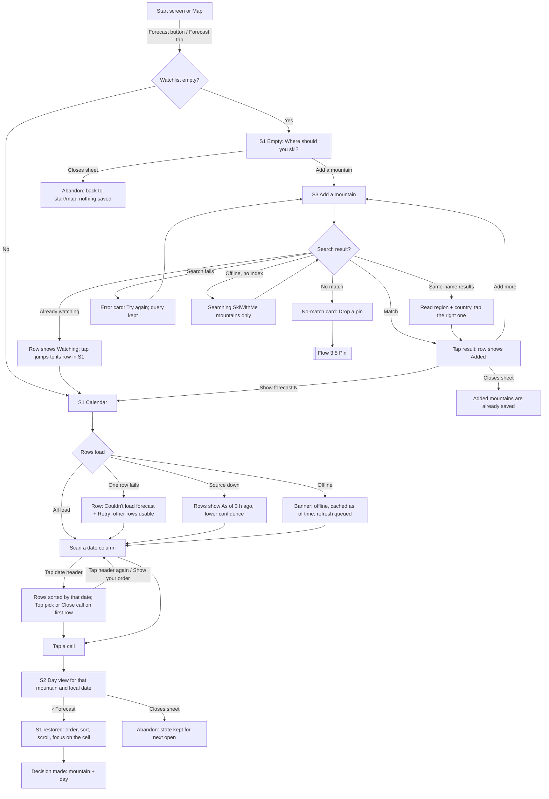
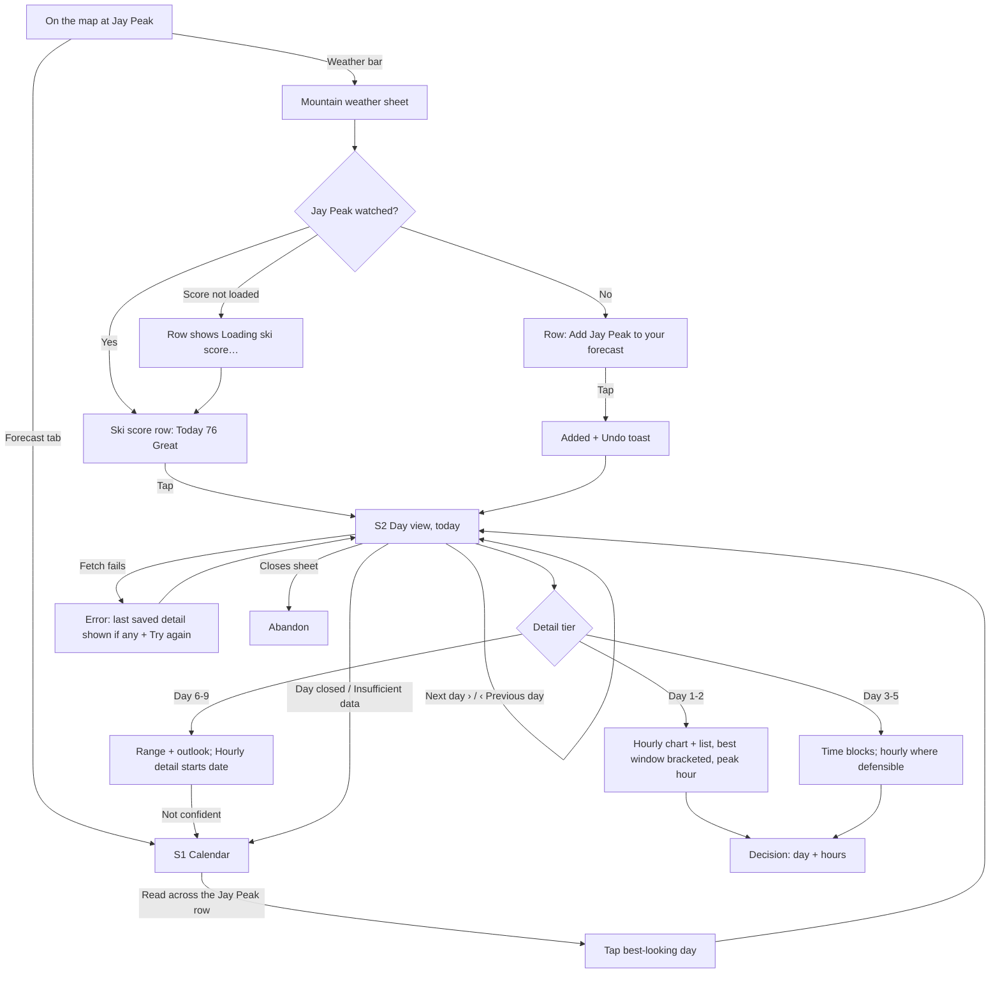
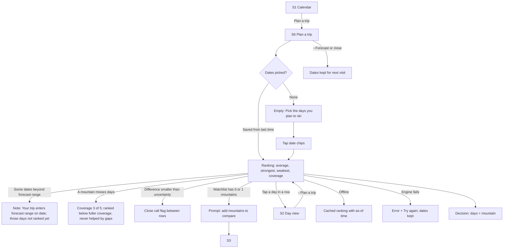
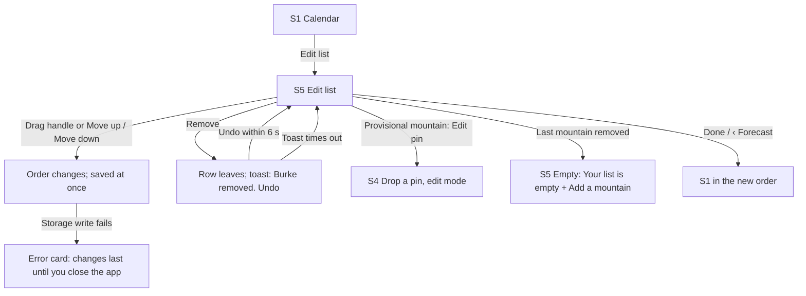
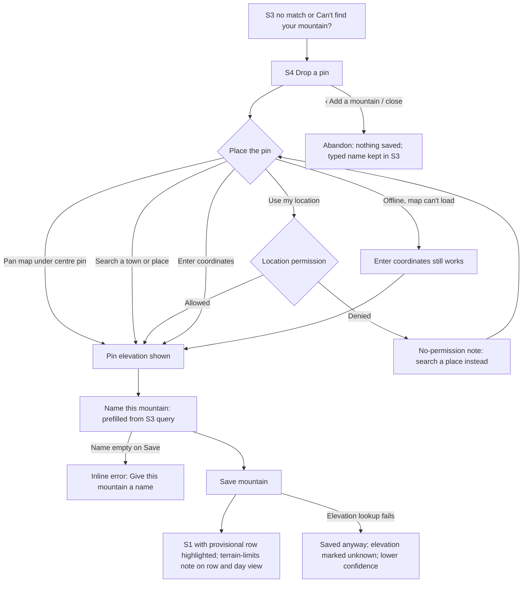

# SkiWithMe Forecast — approved design

Approved by Zach on 2026-11-21 (design round 0). This file is the contract every later step reads. It has three parts:

- **Part 0 — Merge decisions** (this section). Where Part 1 and Part 2 differ, Part 0 decides. Where Part 0 is silent, **Part 2 wins on accessibility matters** and Part 1 wins on everything else.
- **Part 1 — UX design** (the designer's draft, carried whole).
- **Part 2 — Accessibility specification** (the accessibility designer's draft, carried whole).

Requirements: `docs/FORECAST_SPEC.md` (Connor's spec) and `docs/FORECAST_PLAN.md`. Target: `static-html`. No brand pack; the host's "2026-11 look" in `src/styles.css` is the visual system.

---

## Part 0. Merge decisions

### 0.1 Decisions the owner made at approval

| # | Decision | Effect on Parts 1 and 2 |
|---|---|---|
| D1 | **Container: tall sheet.** All seven screens live in the host bottom sheet at near-full height (`#sheet.tall`, Part 1 §1.5, C2). | Part 2 A1/A2 ("full views" and "modal sheets") are mapped, not dropped — see 0.3. |
| D2 | **Calendar columns: 9 now, 15 after phase 7.** A column never shows for a date the engine cannot speak to. | Part 2 assumption 3 (16 fixed columns) and the "Not in range yet" *calendar cell* are not used. "Not yet" remains only in S6 for picked trip days beyond range. PageUp/PageDown still move 7 columns, clamped to the ends. |
| D3 | **Score band = tinted cell.** `--band-1..5` tints (Part 1 §6.2). All text inside a tinted cell is `--ink`. | Part 2's 4 px `--score-*` stripe (G4 last row, §3.4) is not used. The audit must verify `--ink` on every `--band-*` tint in both themes at ≥ 4.5:1; if any fails, lighten that tint, never the text. |
| D4 | **Sixth tab accepted.** Map · Group · Stats · History · Forecast · More. Plus the start-screen button (E2) and the Mountain weather row (E3). | Part 1 Q1 closed. Part 2 A3 gains E3 — see 0.4. |
| D5 | **Word labels on**, bands Epic 85–100 / Great 70–84 / Good 55–69 / Fair 40–54 / Poor 0–39 (tunable). | Both parts agree. |

### 0.2 Screen names (re-key)

Screen IDs S1–S7 are the keys in both parts. Visible titles follow Part 1.

| ID | Title used everywhere | Part 2 calls it |
|---|---|---|
| S1 | Forecast | Forecast calendar (home) |
| S2 | Day view (title shows the mountain name) | Day view |
| S3 | Add a mountain | Add mountain (search) |
| S4 | Drop a pin / Edit pin | Pin on map |
| S5 | Edit list | Edit watchlist (withdrawn term, D15: "your list", "Edit list") |
| S6 | Plan a trip | Trip planner |
| S7 | How scores work | How scores work |

Same seven screens in both parts; none added, split, merged or dropped.

### 0.3 Mapping Part 2's structure onto the tall sheet (D1)

Part 2 states that where the UX picks a different structure "the obligation transfers to the equivalent element and the merge must record the mapping; it never lapses." The mapping:

| Part 2 obligation | In the tall sheet |
|---|---|
| G1 one `<h1>` per full view; `<h2>` per modal sheet | The sheet title `h2#sheet-title` is the single screen heading for every Forecast screen (host heading model: the page `<h1>` stays the app title). Sections are `<h3>`, sub-sections `<h4>`. No level skipped. Focus lands on the sheet title (`tabindex="-1"`, no ring) wherever Part 2 says "focus the `<h1>`/`<h2>`", except S3, which focuses the search input. |
| G1 `<main id="fc">`, background `inert` | The sheet is `role="dialog" aria-labelledby="sheet-title"` for all seven screens, **without `aria-modal`** (D12; the earlier `aria-modal="true"` here is withdrawn because it would hide `#tabs` from some screen readers). While it holds Forecast, everything behind it is `inert` **except `#tabs`** (the way out, and the Forecast tab doubles as "back to calendar"). Over the start screen (E2) there is no tab bar; the ✕ and Escape are the way out. |
| G5 view navigation (S1, S2, S6) | Unchanged in behaviour: store scroll + focus cell before leaving S1; on return restore scroll first, then focus the cell. `history.pushState` entries (Part 2 A4) are pushed by every Forecast screen, S3, S4, S5 and S7 included (D19), so the browser/Android back gesture runs the same restore as the back control; no URL change (Part 1 Q9 stays "no deep links in v1"). |
| G6 dialog contract (S3, S4, S5, S7) | Same dialog element; content is swapped in place (Part 1 §1.5). Escape and the top-left back control return to the screen that opened them (usually S1), with focus per Part 2's per-sheet tables. The ✕ closes Forecast entirely and returns focus to the control that opened Forecast (tab, start button or weather row). Tab cycles inside the sheet plus `#tabs`: last sheet control → `#tabs` → first sheet control (D12; full order per screen in 0.9). |
| Escape | S1: closes Forecast (it is a sheet, so Part 2's "Escape in S1 does nothing" is replaced by the host/dialog convention). S2–S7: back one level, same as the back control. |
| G2 live regions | One pair (`#fc-status` polite, `#fc-alert` assertive) inside the sheet, both `aria-atomic="true"`, kept across screen changes (D27). The weather sheet has its own `#wx-status` for E3 (D7). The host's `aria-live` on `#sheet` is removed while it holds Forecast (C11). |
| C12 close button | The sheet's ✕ is 44 × 44 while it holds Forecast. |

### 0.4 Coverage gap closed here: the Mountain weather row (E3)

Part 2 covers the tab and start-screen entries only. E3 follows the same contract: the row is a `<button>` (`.row-link`), ≥ 44 px tall, accessible name "Ski score today at {mountain}: {n}, {label}. Open the day view." (watched) or "Add {mountain} to your forecast" (not watched); its loading text is "Loading ski score…" with `aria-busy`. Activating it opens S2 with focus on the sheet title; the back control reads "‹ Mountain weather" and returns focus to the row. The implicit add announces "{mountain} added to your forecast." and offers Undo (0.5, row 1). The audits must check this entry.

> **Superseded by D7, D15 and D27; §0.9.9 governs.** "your forecast" is "your list". The watched row's name is "Ski score today: {n}, {label}. Tap to see the best hours. {mountain}." (§0.9.9, E10: it starts with the visible text, and only the trailing "{mountain}." is hidden; corrected in fix round 3, H1). `aria-busy` sits on the skeleton wrapper inside the loading row, not on the button. After the implicit add the row is text plus two separate buttons, "Open day view" and "Undo"; Back from S2 lands on "Open day view".

### 0.5 Where the two parts differ — resolution

| # | Topic | Part 1 | Part 2 | Resolution |
|---|---|---|---|---|
| 1 | Undo after Remove | Toast with Undo, 6 s | Inline Undo row that stays until the sheet closes | **Part 2** (timing is an accessibility matter). In S5 the removed row is replaced in place by "{0} removed. Undo". For the E3 implicit add, the weather row itself becomes "{0} added to your list." with the separate buttons "Open day view" and "Undo" until the weather sheet closes (wording and structure per D7). C13 "Undo toast" is replaced by this inline row; assumption A9 (6 s) is dropped. S5 Undo rows last until Forecast closes, not until S5 closes (D9). |
| 2 | Hourly accessible list | `<table>` Hour · Score · Label · Main factor | `<ol>` of hour items (reflows at 320 px) | **Part 2.** Same four facts per item. C8 becomes a list. |
| 3 | Calendar cell semantics | `<button>` per cell, roving tabindex | `<table role="grid">`, focusable `gridcell`s, one Tab stop | **Part 2.** Enter/Space opens S2. Accessible-name wording per Part 2 G4/G9. |
| 4 | Disabled controls | Refresh disabled offline; steppers and Move buttons disabled at ends | No disabled controls; say why, or don't render | **Part 2 (G11).** Offline, Refresh reads "Refresh when online" and stays enabled; a missing day stepper or Move button is not rendered (D21). |
| 5 | Light-theme text/edge tokens | `--teal-text: var(--teal2)`, `--focus-ring` | `--teal-text #00715c`, `--focus`, `--warn-text #9a5200`, `--control-edge` | **Part 2 values and names.** `--focus-ring` → `--focus`. `--chart-bar-best` uses `--teal-text` in light theme. |
| 6 | Confidence glyph and word | Bars ▮▮▯ + High / Medium / Low | Dots ●●○ + High / Med / Low | **Bars; full word "Medium" in the day view, "Med" allowed in calendar cells** when the cell is 78 px. Screen-reader text "Confidence medium." inside a cell name (D17); "Confidence: medium" as the visible line in S2. |
| 7 | Time format | `Intl` ranges, "9 AM–12 PM" | Examples say "9 AM–noon" | **Part 1** (translatable). Spoken form "9 AM to 12 PM". |
| 8 | Units control | S1 footer | S1 toolbar | **Part 1** (footer). Part 2's obligations for the control and announcement N-S1-14 apply where it sits. |
| 9 | Refresh, Today | Refresh in footer | Refresh in toolbar; "Today" toolbar button | Refresh stays in the footer; **add Part 2's "Today" button**, labelled "Back to today" (D15), as the third button of the "Forecast actions" group, which is a plain group and not a toolbar (D13). |
| 10 | S1 name column | 116 px (96 px below 360 px) | `clamp(96px, 30vw, 140px)`; names wrap to 3 lines, never ellipsis for labels/statuses | **Part 2** sizing and wrapping. The region line may still clip with the full text in the cell's content. |
| 11 | S6 day buttons | A row of the picked days | Auto-fill grid, each ≥ 44 px wide (seven do not fit at 320 px) | **Part 2.** |
| 12 | S2 base and summit | Two columns, time-block switch | Stacked both (recommended) or a switch | Two columns at ≥ 360 px, stacked below; the Morning / Midday / Afternoon switch stays, as a radiogroup named "Time of day" (D21), beside the "Units" radiogroup (D14). |
| 13 | Links ("How scores work", credits) | Text buttons | `--teal-text`, underlined | **Part 2.** |
| 14 | S2 Empty | Cannot occur | Specified (Closed / Insufficient data) | Same content: Closed and Insufficient data are designed variants; treat as specified. |
| 15 | S5 Partial | Specified (entry no longer in catalog) | Cannot occur (local only) | **Part 1** — a stale catalog id is local data and can occur. Row uses the S5 row accessibility rules. |
| 16 | S7 Partial | Designed variant (no days 10–15 text before phase 7) | Cannot occur | Both hold; no state UI needed. |

### 0.6 Conflicts with the host app (carried to the PRD)

Part 2 §8 lists 17 (C1–C14, plus C15 start-panel colours and C16 reorder-button names, added in fix round 1, and C17 focus ring and centre pin on the pin map and info bar, added in fix round 2). Forecast applies each fix inside its own screens. Two change the whole app and need Connor's review as separate issues, not as part of Forecast:

- **C7** remove `maximum-scale=1, user-scalable=no` from the viewport (the prototype allows zoom). AC-46 is blocked on it; shipping without it needs the owner's explicit sign-off on a WCAG 1.4.4 failure (D28).
- **C1/C2/C3/C5** light-theme teal ink, teal text, link colour and control edges fail contrast app-wide; recommended app-wide, scoped to Forecast until agreed.

### 0.7 Open questions still open

Part 1 §10.2 Q2 (pin-map tiles), Q3 (cap on the size of your list), Q4 (ranking rule, design choice stands), Q5 (engine `uncertainty` field; no Close call flags until it exists), Q6 (desktop width), Q9 (deep links), Q11 (closure source), Q12, Q13, Q14 (implicit add from the weather row, with inline Undo), Q16; Part 2 §9 questions 1, 2, 5, 6. Closed by this merge: Part 1 Q1, Q7/Q8/Q10 (recorded as host issues), Q15; Part 2 questions 3 and 4 (trend is phase 7).

### 0.8 Fix round 1 decisions

Added 2026-11-21 after the first audit. D6–D29 are binding. **Precedence:** §0.8 and §0.9 override §0.1–0.7, Part 1 and Part 2 wherever they differ; text they replace carries a "Superseded by D<n>" note where it stands.

| # | Decision | Binding content |
|---|---|---|
| D6 | **S3 Add a mountain keeps the user on the screen.** | Idle state lists "Near you" (only when location is already granted) and "SkiWithMe mountains". Results are capped at 30. A result row is not focusable; its visible text is the name, then region and country. Each row has one trailing control: not on the list, button "Add" (name "Add {name}, {region}, {country}"); added this visit, status text "Added" plus button "Remove" (name "Remove {name}, {region}, {country}"); on the list before this visit, status text "On your list" plus button "Show" (name "Show {name}, {region}, {country} on the calendar"). After Add, focus moves to that row's Remove; after Remove, to that row's Add. Polite announcements: "{name} added to your list." and "{name} removed from your list." The result count is announced 500 ms after typing stops. The sticky bar button reads "Show on calendar ({N})" (N = mountains added this visit); it returns to S1, focuses the row header of the first mountain added, and announces "{N} mountains added to your list." with a proper plural form per language. Opened from S6, the button reads "Back to trip ({N})", returns to S6 and focuses the S6 title. Escape in the search field clears it first; a second Escape goes back. The no-match state hides the trailing "Can't find your mountain?" row. The list-level retry is "Try loading the list again"; the per-row save retry is "Try again: add {name}". A save failure shows persistent inline text under the row, "Couldn't save {name}. This device may be in private browsing or out of space.", plus the Try again button, announced assertive; no toast carries the only copy. When two watched mountains share a name, S1 row headers and cell names add the region. Full rules: §0.9.4. |
| D7 | **E3 Mountain weather row, unwatched mountain.** | A tap adds the mountain to your list and opens S2 for today. S2 shows an inline row at its top: "{name} added to your list." with an "Undo" button. Back on the weather sheet the row is text plus two separate buttons, "Open day view" and "Undo" (no nested controls; names "Open day view: {name}" and "Undo adding {name}", E10); focus on return lands on "Open day view". After Undo in either place the mountain is removed, the row becomes the single button "Add {name} to your list", focus lands on it, and "{name} removed from your list." is announced polite. Weather-sheet announcements go through `#wx-status` (polite, inside that sheet); inside Forecast, through `#fc-status` / `#fc-alert`. Full rules: §0.9.9. |
| D8 | **S5 Remove on a "No longer in the worldwide list" row** | goes through the same inline Undo row as every other removal. Undo restores the row with both choices ("Keep as a pin" and "Remove"). |
| D9 | **When a removal becomes permanent.** | Undo rows last until Forecast closes. The complete list of commit triggers is in §0.9.1 "Commit triggers" (✕ on any screen; Escape on S1; system Back on S1; the Forecast tab on S1; any other tab from any screen; "Open the {mountain} map"; "Undo adding {name}" in S2's E3 inline row, which closes Forecast; the page being closed or reloaded). S5 Done and Back, and the Forecast tab on S2–S7, do not commit. PRD AC-34 must copy all eight triggers and the "do not commit" list from §0.9.1 (H1; through fix round 2 it listed only five, so it did not match). When no live rows remain, "Your list is empty" shows below the Undo rows and the reorder intro line is hidden. |
| D10 | **S6 Plan a trip.** | "Later dates" is a disclosure button revealing labelled native date inputs "From" and "To" plus a "Clear dates" button; focus stays on the disclosure button when it opens. In-range days select their day chips. Out-of-range days appear in the picked-days summary and on every card as "Not yet" and never help or hurt a ranking. To before From: inline error under To, on change, "The end date must be on or after the start date.", linked by `aria-describedby`, announced assertive. Picked days are Part 1's always-visible mini row on each card; each day is a button, named "{weekday date}: ski score {n}, {label}. {mountain}." (or "… Closed. {mountain}.", "… Insufficient data. {mountain}.", "… Not yet. {mountain}."; E6). Scored, range, Closed and Insufficient data buttons open S2; a "Not yet" button explains instead (§0.9.7). A Closed day displays as "Closed", never 0. *Superseded by H3 (§0.8.2):* a Closed day is excluded from both coverage and the average (it is no longer "0" and no longer "covered"; A10 and E21 are withdrawn): "Weakest: Closed Mon", "Coverage 3 of 4 days · 1 closed"; a mountain closed on every picked day is listed last with "Closed on all your days." A card with fewer covered days never ranks above one with more. A failed card has a "Try again" button; on success focus moves to that card's heading, on failure it stays on the button and "Still couldn't load {name}. Try again later." is announced. "Close call" is a paragraph inside the second card's list item, after its heading. Full rules: §0.9.7. |
| D11 | **Focus rule.** | Forward navigation lands on the new screen's title (S3: the search field). Back, Escape, system Back and Done return focus to the control that opened the screen. §0.9.1 re-keys every Part 2 destination to its merged-layout control. |
| D12 | **Dialog semantics.** | `aria-modal` is not used. The sheet keeps `role="dialog"` and `aria-labelledby="sheet-title"`. While Forecast is open, everything outside the sheet except `#tabs` is `inert`. Tab order wraps: last sheet control → `#tabs` → first sheet control (Shift+Tab reverses). In the prototype only, the reviewer scaffolding panel stays reachable through a visible "Leave the phone" link placed after `#tabs` (documented in the prototype README); it is not part of the product. |
| D13 | **S1 controls and Tab order.** | No `role="toolbar"`. The actions are a plain labelled group of separate buttons in this order: Add a mountain, Edit list, Back to today, Plan a trip. Tab order of the screen content: those four → "How scores work" (legend line) → the sort-line button ("Show your order", only when sorted) → the grid (one Tab stop, roving) → footer: Refresh, Units, weather service credits → `#tabs`. "Show your order" moves focus to the previously sorted date header. "Back to today" on a failed row (one spanning cell) focuses that spanning cell. Full order including sheet chrome: §0.9.2. |
| D14 | **Units.** | The units switch (radiogroup, arrow keys) is in S2's Base and summit card and in the S1 footer; both write the same saved setting. |
| D15 | **Terminology: one word per concept in every UI string, PRD line and register entry.** | The saved mountains are "your list" (never "watchlist", "your forecast" or "Watching"). A user-placed mountain carries the tag "Pinned"; its actions are "Edit pin" and "Keep as a pin"; "Provisional" is not UI text (internal term only). Every retry is "Try again" (plus the object where needed). The data provider is "weather service". An unscored day is "Insufficient data" everywhere, S6 included. "Peak hour" everywhere, S7 included. The scroll-to-first-column button is "Back to today". S5 row removal shows the visible text "Remove" (no bare ✕). Legend: "Bars show confidence" and "Tap a score for hourly detail". Storage errors say "This device may be in private browsing or out of space." (no "site storage"). Depth is 4 at most, by the routes S1→S6→S2→S7, S1→S5→S3→S4 and S1→S6→S3→S4. The S7 back label names the mountain ("‹ {mountain}") when S7 was opened from S2. Replaced strings: §0.9.10. |
| D16 | **Engine text.** | The scoring engine returns reason and factor codes plus parameters, never sentences. `en.js` holds one whole-sentence template per code, and the nine other language files hold its translations. The window-timing reason and the insufficient-data reason are their own sentences, never clauses after a dash or colon. The PRD lists the initial code set and carries an open question for issue #2. Accessibility consequence: every reason is a complete sentence in the user's language, so no English fragment is spoken inside a translated sentence. |
| D17 | **Cell names.** | One mechanism: the gridcell's text content (visible text plus visually hidden words) forms the full name; no `aria-label`. One exception (E11): the failed-row spanning cell is named with `aria-labelledby` pointing at its own message span, because it also contains the "Try again" button. Pattern: "{mountain}, {weekday date}: ski score {n}, {label}. Best window {from} to {to}. Confidence {word}." Variants: Closed, Insufficient data, Day over, Offline (never saved: "Offline. No forecast saved."), stale ("Forecast as of 3 hours ago"). The row-head tags "Top pick" and "Close call" are read after the mountain name in that row's cell names; in the row header the tag order is Pinned, New, Top pick or Close call (E12). AC-41 uses this wording. Full variant list: §0.9.2. |
| D18 | **Timed messages.** | Every toast lasts at least 6 s and never carries the only copy of anything. The new-row highlight lasts 4 s and includes a visible "New" text tag (M6). |
| D19 | **Phone Back.** | Every Forecast screen pushes a history entry; the system Back gesture equals the top-left back control, including its focus destination. On S1 it equals ✕. Detail: §0.9.1. |
| D20 | **S4.** | Edit mode (entered from S5 "Edit pin"): title "Edit pin", back control "‹ Edit list", initial focus on the title. Back returns focus to that row's "Edit pin". "Save changes" returns to S5 with focus on that row's "Edit pin" and announces "{name} updated." polite. "Remove this mountain" returns to S5 with the inline Undo row, focus on its Undo button, announcement as for an S5 removal. The pin draft (position and typed name) is kept across S4 exits for the session; the name field is prefilled from the S3 query. Location denied is announced polite. The map's label includes "Arrow keys move the map; plus and minus zoom." Zoom buttons visibly change the map. "Enter coordinates" works offline. Full rules: §0.9.5. |
| D21 | **S2.** | The day stepper "‹ {previous weekday}" / "{next weekday} ›" sits after Back in Tab order. Focus stays on the stepper used; at the first or last day the missing stepper is not rendered and focus falls to the remaining stepper (or the title if neither exists). Each step announces "{date}. Ski score {n}, {label}." polite. Morning / Midday / Afternoon is a named radiogroup with the same key pattern as the units switch. "Open the {mountain} map" closes Forecast and flies to that resort; focus goes to the host header's resort name; the saved S1 scroll and focus state is kept for the next open. The Insufficient-data day view offers the next-day stepper like any other day. Opening a loading cell opens S2 in Loading; opening a failed cell opens S2 in Error with Try again. A mouse click and Enter behave the same. Full rules: §0.9.3. |
| D22 | **Visible feedback.** | Online Refresh shows "Updating…" on the button, then a 6 s toast "Forecasts updated", which is also announced. *Narrowed by H4 (§0.8.2):* the toast shows only when every row loaded; with rows still failing the footer line "Updated. 1 mountain couldn't load." / "Updated. {n} mountains couldn't load." replaces it (N-S1-15). That is the only toast in Forecast (E14). Every action that announces something also changes something visible. |
| D23 | **Repeated failure.** | Every Try again that fails again keeps the message and the enabled control and changes the wording to "Still couldn't load … Try again later." Flows F1, F2b and F5 carry this branch (§0.9.11). |
| D24 | **Sorting affordance.** | Date headers show a sort glyph. The idle sort line reads "Your order · tap a date to sort by it". |
| D25 | **S7.** | Adds a "Tags and statuses" section explaining Pinned, Outlook, Close call, Top pick and Day over. Score bands render as a table with a caption and column headers. |
| D26 | **Contrast and colour.** | Start-panel buttons are theme-independent: dark translucent fill with `--start-ink` text in both themes; the `.sub` line uses a token that reaches 4.5:1 on the dark panel. `.wx-note.warn` text uses `--ink`; its border stays `--warn-text`. `--control-edge` reaches 3:1 against light `--chip` and `--seg-bg`. Part 2 §3.5 holds the computed table (`--ink`, `--focus` and `--teal-text` on each `--band-*` composite in both themes, the Closed and Insufficient data border colours, chart bars against `--chart-bar` / `--chart-bar-best`). The `--score-*` tokens are dropped. |
| D27 | **Remaining accessibility items.** | `aria-busy` goes on the skeleton wrapper only; loading text sits outside it. The E3 loading row announces "Still loading the ski score." when activated. Blocking error states announce their register sentence once through `#fc-alert` when they render. Lists whose count matters (edit list, hours, ranking, results) carry `role="list"`. `#fc-alert` and `#fc-status` carry `aria-atomic="true"`. Spoken forms for ranges and times: "Score between 58 and 74", "9 AM to 12 PM", "Forecast as of 3 hours ago". Accessible names start with the visible label (2.5.3), including "Go here: {name}" and "Keep as a pin: {name}". Row headers are focus targets after add and save (focus goes to the row header, not the first cell). The host stand-in info bar's name includes its visible text; prototype scaffolding status notes are not mounted with text pre-filled. Tags and statuses wrap (no `nowrap` on sentence-length text); tab labels may wrap to two lines. The S5 row at 320 px is recomputed with all controls in G7: the buttons wrap below the name onto as many lines as needed, each at least 44 × 44 px (PRD AC-83 uses this sentence). The drag handle is pointer-only and `aria-hidden`. |
| D28 | **AC-46 (200% zoom)** | is blocked on Q1/C7. Shipping Forecast without the viewport change is an accepted WCAG 1.4.4 failure that needs the owner's explicit sign-off; it is never the default outcome. Recorded in Part 2 §8 C7. |
| D29 | **PRD and prototype agreement.** | After this round the prototype matches the PRD. Any remaining difference is listed in PRD §10 "Known gaps" with a reason. |

#### 0.8.1 Fix round 2 decisions (E1–E24)

Added 2026-11-21 after the round-1 re-audit. **Precedence (R1):** Part 0 §0.8–§0.9 governs accessible names, focus, Tab order and announcements over the PRD and the prototype; the PRD copies these tables verbatim. Where an E row differs from a D row above, the E row governs and the D row is already reworded to match. Rows E18 and E24 concern the prototype and the PRD only and are not restated.

| # | Decision | Binding content | Where it is stated in full |
|---|---|---|---|
| E1 | **Same-name rule everywhere.** | When two mountains on your list share a name, every control name and cell name that carries the name adds ", {region}" directly after it. | §0.9.1 "Same-name rule" |
| E2 | **`aria-busy` placement.** | `aria-busy="true"` only on the skeleton wrapper inside each loading cell or card. Never on `<tbody>`, the table, a list or a stack. Mountain names stay outside it. | §0.9.1 "Busy" |
| E3 | **Sheet Tab order.** | ✕ "Close", then the back control, then screen content, on every screen. Wrap: last `#tabs` tab → ✕ → back control. DOM order is the same; CSS alone sets the visual position. | §0.9.1 "Tab wrap" |
| E4 | **Focus ring on always-dark surfaces.** | The start panel, the S4 pin map and the host info bar are dark in both themes; their focus ring is `--start-edge #3ee6c4` in both themes. The pin-map centre pin is `#ffc266` in both themes. | Part 2 §3.5 H |
| E5 | **Label in name for dates.** | Date header buttons and S6 day chips expose the visible "Sat 6", followed by hidden ", Saturday, December 6, sort by this day" (chips: ", Saturday, December 6, pick this day"). Only the glyph is hidden. An S6 chip name is never a prefix of an S6 card day-button name. | §0.9.2 "Cell names", §0.9.7 |
| E6 | **S6 card day-button names.** | "{weekday date}: ski score {n}, {label}. {mountain}." The Closed, Insufficient data and Not yet forms keep the trailing ". {mountain}." | §0.9.7 "Day buttons on a card" |
| E7 | **S2 and S4 structure names.** | S2 title "{mountain}" plus hidden ", {weekday date}", updated on each day step; steppers in `role="group"` named "Change day"; hidden `h3` "Ski score" and "Key facts". S4 coordinates in a `fieldset` with legend "Coordinates". | §0.9.3, §0.9.5 outlines |
| E8 | **List keys.** | Arrow Down / Up between result-row buttons in S3 and S4; Arrow Up from the first row returns to the field; Home / End go to the first / last row. "Enter coordinates" keeps focus on the disclosure. | §0.9.4, §0.9.5 "Keys" |
| E9 | **Spoken ranges.** | The S6 picked-days summary has a spoken twin with long dates joined by " to ". | §0.9.7 "Picked-days summary" |
| E10 | **E3 names.** | "Open day view: {name}", "Undo adding {name}". The watched-row name starts with its visible text. | §0.9.9 |
| E11 | **Failed S1 row.** | "Try again" is a button inside the spanning gridcell and a separate roving stop. The cell is named with `aria-labelledby` on its own message span, so the button text is not part of the cell's name. This is the one exception to D17. | §0.9.2 "Keys", "Cell names" |
| E12 | **Cell and row-header wording.** | Cell names include "Top pick" / "Close call" where those tags show. Offline cell: "Offline. No forecast saved." Row-header tag order: Pinned, New, Top pick or Close call. | §0.9.2 "Cell names" |
| E13 | **S1 Empty with pending Undo rows.** | While any Undo row is pending, S1 Empty still shows "Add a mountain" and "Edit list". Back from S5 always lands on "Edit list". | §0.9.2 "State deltas" |
| E14 | **Refresh.** | Offline the button's visible label is "Refresh when online" and a persistent footer line reads "You're offline. Forecasts will refresh when you're back online." No toast. In S1 Error, a failed Refresh shows "Still couldn't load forecasts. Try again later." and never "Forecasts updated". The only toast in Forecast is "Forecasts updated". The earlier accessible name "Refresh forecasts" is withdrawn: the name is the visible label. | §0.9.2 "Added controls", §0.9.1 "Toasts" |
| E15 | **E3 error rows.** | (a) "Ski score couldn't load." + button "Open day view: {name}", which opens S2 in Error. (b) Implicit-add save failure: S2 opens with the inline row "Couldn't save {name}. This device may be in private browsing or out of space." + "Try again: add {name}". Retry succeeds → the row becomes "{name} added to your list." + "Undo adding {name}", focus on Undo, N-E3-01. Retry fails → "Still couldn't save {name}. Try again later.", focus stays, N-E3-07 (assertive). The retry button is in the S2 Tab order. | §0.9.9, §0.9.3 |
| E16 | **S2 variants by opening cell.** | Loading cell → skeleton hero. "–" cell in S1 Error → S2 Error with "Try again". Offline with a saved score but no detail → hero plus "Hourly detail needs a connection." (wording per H8) | §0.9.3 "Variants by opening cell" |
| E17 | **Smaller flow rules.** | "Clear dates" also unpicks the days the range added. The Forecast tab on an S2 opened from the weather row returns to S1. S5 shows "Add a mountain" only when the list is empty. S7 has no Done button. Closed and Insufficient data day views show no "See {date}" button. A row reached with "Show" gets the outline only, never "New"; "New" is only for rows added in this visit. | §0.9.2, §0.9.3, §0.9.6, §0.9.7, §0.9.8 |
| E19 | **S7 copy.** | Table caption "Score labels"; section title "Times and weather services". The word "source" is never used for the provider in UI text. | §0.9.8 |
| E20 | **Chart marker and catalog name.** | The chart marker reads "▲ Peak hour". The search catalog is "the worldwide list" in every string ("Still couldn't load the worldwide list. Try again later."; S5 "No longer in the worldwide list"). | §0.9.3, §0.9.4, §0.9.6, §0.9.10 |
| E21 | **S6 coverage.** | *Withdrawn by H3 (§0.8.2).* Was: a closed day counts as covered ("Coverage 4 of 4 days · 1 closed"). Now: a closed day is excluded from coverage and the average ("Coverage 3 of 4 days · 1 closed"). A card with fewer covered days never ranks above one with more (unchanged). | §0.9.7 |
| E22 | **Strings.** | S3 "Show" announces "{name} is already on your list."; the S1 stale footer is "Some forecasts are older than usual. The weather service is delayed."; the S3 save retry's visible label is "Try again: add {name}"; days 6–9 note "Hourly detail starts {date}."; storage sentence "This device may be in private browsing or out of space."; the legend shows the bars alone with "Bars show confidence" (no sample word). | §0.9.10, Part 2 §7 |
| E23 | **Whole templates.** | No sentence is built from fragments. Each variant of a message or name is one whole template with placeholders. | Part 2 §7 rule 9 |

#### 0.8.2 Fix round 3 decisions (H1–H11)

Added 2026-11-21 after the independent review (`review/fix-round-3.md`). **Precedence (R1, unchanged):** Part 0 governs accessible names, focus, Tab order and announcements. Where an H row differs from a D or E row above, the H row governs, and the D or E row carries a "Superseded" or "Withdrawn" note. H2 (day-score edge rules), H10 (prototype i18n) and H12 concern the PRD and the prototype only and are not restated here.

| # | Decision | Binding content | Where it is stated in full |
|---|---|---|---|
| H1 | **PRD reconciliation, spec side.** | D9 and §0.9.1 no longer claim PRD AC-34 matched; AC-34 must copy all eight triggers and the "do not commit" list. The §0.4 note quotes the §0.9.9 watched-row name. The S4 map-error "Try again" is in the S4 Tab order; while tiles have failed it takes the map's place, and the map and its six pan and zoom buttons are not rendered. Back from S4 (new mode) when the "Drop a pin on a map" control that opened it no longer shows → `#s3-q`. Part 2 §7 rule 11: "the PRD cites these ids". | §0.4, D9, §0.9.1, §0.9.4, §0.9.5, Part 2 §7 |
| H3 | **Trip ranking with closed days (owner decision, 2026-11-21).** | A mountain closed on **every** picked day ranks **last**; its card shows "Closed on all your days." in place of Average, Strongest and Weakest. A partly closed mountain ranks on its open days only: Closed days are excluded from both coverage and the average. The coverage line shows the counts, "Coverage 3 of 4 days · 1 closed" (spoken "Coverage 3 of 4 days, 1 closed."). The rule note under "Ranking" reads "Closed days and days without a score don't count. A mountain closed on all your days is listed last." Replaces E21 ("closed counts as covered") and assumption A10 / PRD A5 ("Closed = 0"). | §0.9.7, Part 2 §7 N-S6-01 |
| H4 | **Refresh outcomes.** | Default: Refresh fails → `p#fc-foot-note` "Couldn't refresh. Showing forecasts as of {time}." (N-S1-05, unchanged). Partial: Refresh completes with rows still failing → `p#fc-foot-note` shows one whole string, "Updated. 1 mountain couldn't load." / "Updated. {n} mountains couldn't load.", spoken polite (N-S1-15); no "Forecasts updated" toast and no N-S1-03. S1 Error: a failed Refresh or a failed card "Try again" **replaces** the card's text with "Still couldn't load forecasts. Try again later." (N-S1-04b); nothing goes in the footer, and the sentence never shows twice. Focus stays on the control used in every case. | §0.9.2, Part 2 §7 |
| H5 | **Same-name pins.** | Saving a pin (S4 "Save mountain" or "Save changes", by button or Enter in the name field) whose name matches a mountain already on your list, compared case-insensitively and ignoring the pin's own saved name in edit mode, is refused. `p#s4-name-err` shows "You already have a mountain called {name}. Choose another name."; `aria-invalid="true"` on `#s4-name`, linked by `aria-describedby`; focus moves to (or stays in) the name field; nothing typed is cleared; N-S4-16 assertive. Pins therefore never share a name. Catalog mountains that share both name and region keep the ", {country}" tie-break (§0.9.1 "Same-name rule"). | §0.9.5, Part 2 §7 |
| H6 | **Out-of-season mountains.** | Every calendar cell of a mountain outside its season shows the Closed form (glyph + "Closed", dashed border; name "{mountain}, {weekday date}: closed."). The row header adds the line "Season closed. Opens {month}." S2 shows the Closed variant with the reason sentence "Closed for the season." in place of "Closed on this day". S6 day buttons use the Closed form; ranking follows H3. | §0.9.2, §0.9.3 |
| H7 | **S1 banner order.** | Error-first: the offline banner and the error card sit above the "Forecast actions" group. Tab order: ✕ → banner "Try again" (S1 Error only) → the group → … The stale line stays in `p#fc-foot-note`. | §0.9.2 |
| H8 | **Strings.** | One failure voice: "Couldn't …" and "Still couldn't …" everywhere; "We couldn't" is withdrawn. "hourly detail" is the one term ("Hourly detail needs a connection."). "This day isn't saved on this device. It will load when you're back online." S4 repeat save failure: "Still couldn't save {name}. Try again later. Your pin and name are still here." (N-S4-10b). S7 section heading "Score labels", matching its table caption. E3 unwatched row small line: "Adds it and opens today's day view." S1 failed single cell: "{mountain}, {weekday date}: couldn't load." (unchanged). | §0.9.10 |
| H9 | **Announcement wording.** | N-S1-06 and the grid caption use the long date ("Sorted by Saturday, December 6, best first. …"; caption "Ski scores by mountain and day. Sorted by Saturday, December 6."). Retry success is "{name} forecast loaded." (N-S1-08, N-S6-07). A repeat map failure is polite (N-S4-14). Offline-on-open sentences (N-S2-05, N-S3-06, N-S3-10, N-S4-08, N-S6-04) are spoken once per screen open (Part 2 §7 rule 12). The pan and zoom buttons' border on the pin map is `--start-edge` in both themes (light `--control-edge` measured 2.77 on `--map-tile-a`; computed table in Part 2 §3.5 H). | Part 2 §7, §3.5 H, §0.9.2 |
| H11 | **S6.** | The beyond-range note and the "None of these days are in forecast range yet …" message render directly after the picked-days summary, outside `div#s6-later`, whether the disclosure is open or not. `p#s6-cap` "Later dates show up to 14 days." sits directly under the day chips; a range adds at most 14 days counted from From. In an S3 opened from S6, an "On your list" row shows its status text and no "Show" button. | §0.9.7, §0.9.4 |

### 0.9 Per-screen deltas

This section restates, for the merged tall-sheet layout, each screen's outline, Tab order, focus destinations, added controls and announcements. Where it differs from Part 2 §5–§7 it governs. Anything a screen's block does not restate stays as Part 2 specifies it, read through the re-key table in §0.9.1. Announcement ids refer to Part 2 §7.

#### 0.9.1 Shared rules for every Forecast screen

**Sheet structure (all seven screens).**
```
nav#tabs aria-label="Sections"                 outside the dialog, never inert; Forecast tab aria-current="page"
div#sheet.tall role="dialog" aria-labelledby="sheet-title"       no aria-modal (D12)
  .sheet-head: grab handle (aria-hidden, not focusable)
               h2#sheet-title tabindex="-1" (no focus ring)
               button.x "Close" (44 × 44)
  #sheet-body: the screen content; replaced on every screen change
  div#fc-status role="status" aria-live="polite" aria-atomic="true"   visually hidden
  div#fc-alert  role="alert" aria-atomic="true"                       visually hidden
```
- `#fc-status` and `#fc-alert` are children of `#sheet`, outside `#sheet-body`, created once when Forecast opens and never re-rendered, so a screen change cannot destroy a pending message.
- Everything outside `#sheet` except `#tabs` is `inert` while Forecast is open. Over the start screen (E2) there is no `#tabs`.
- Headings: `h2#sheet-title` is the screen heading; sections are `h3`; sub-sections `h4`. No level is skipped.

**Tab wrap (D12).** First sheet control = ✕ "Close". Order on every screen: ✕ → back control (S2–S7) → screen content in the order its block lists → `#tabs` buttons (Map, Group, Stats, History, Forecast, More; six separate Tab stops) → ✕. Shift+Tab reverses. Over the start screen: last content control → ✕. The prototype's "Leave the phone" link follows `#tabs` and is scaffolding only. **DOM order equals Tab order (E3):** inside `#sheet` the ✕ button comes first, then the back control, then the screen content; `#tabs` follows `#sheet` in the document. CSS alone places ✕ at the top-right and the back control at the top-left. No `tabindex` above 0 is used anywhere. The wrap from the last `#tabs` button lands on ✕, and the next Tab lands on the back control.

**Same-name rule (E1).** When two mountains on your list share a name, every accessible name and visible label that carries the mountain name adds ", {region}" directly after the name, in every place below. If the region is also the same, ", {country}" follows it. The rule is evaluated against your list each time a screen renders.

| Where | Without a twin | With a twin on your list |
|---|---|---|
| S1 row header and every cell name in that row | "{mountain}, …" | "{mountain}, {region}, …" (the row header shows the region line visibly) |
| S1 failed row | "Couldn't load the forecast for {mountain}." ; "Try again: {mountain}" | "Couldn't load the forecast for {mountain}, {region}." ; "Try again: {mountain}, {region}" |
| S2 title | "{mountain}" + hidden ", {weekday date}" | "{mountain}, {region}" + hidden ", {weekday date}" |
| S5 buttons | "Move up: {name}", "Move down: {name}", "Remove {name}", "Edit pin: {name}", "Keep as a pin: {name}", "Undo removing {name}" | each with "{name}, {region}" |
| S5 removed row text | "{name} removed." | "{name}, {region} removed." |
| S6 card heading, day buttons (all five forms, "Not yet" included), failed card | "{rank}. {mountain}" ; "… {mountain}." ; "Try again: {mountain}" | "{rank}. {mountain}, {region}" ; "… {mountain}, {region}." ; "Try again: {mountain}, {region}" |
| E3 row and S2 inline row | "Open day view: {name}", "Undo adding {name}", "Try again: add {name}", "Add {name} to your list" | each with "{name}, {region}" |
| S3 trailing controls | already carry ", {region}, {country}" in every case | unchanged |
| Announcements that name a mountain (Part 2 §7) | "{0}" = name | "{0}" = "{name}, {region}" |

**Busy (E2).** `aria-busy="true"` goes only on the skeleton wrapper inside each loading cell or card (the element that holds the grey bars). It is never set on `<tbody>`, the table, a list (`ol`, `ul`), a card stack or a results container. Mountain names, card headings and the visible loading text are siblings of the wrapper, outside it, so they are read while loading. The wrapper is removed, not just un-flagged, when the content arrives.

**Commit triggers (D9).** A pending removal becomes permanent, and its Undo row is gone at the next open, on exactly these events: (1) ✕ on any screen; (2) Escape on S1; (3) system Back on S1; (4) the Forecast tab while S1 shows; (5) any other tab, from any screen; (6) "Open the {mountain} map" in S2; (7) "Undo adding {name}" in S2's E3 inline row (it closes Forecast); (8) the page being closed, reloaded or discarded (`pagehide`). These do **not** commit: "Done", the back control, Escape or system Back on S2–S7, the Forecast tab on S2–S7, "Show on calendar", "Show", "Save mountain", "Save changes". PRD AC-34 must copy these eight triggers and this "do not commit" list (H1). Nothing is announced at commit.

**Escape and back.** Escape on S1 closes Forecast. Escape on S2–S7 equals the back control, except in the S3 search field holding text (first press clears it). ✕ closes Forecast from any screen and returns focus to the control that opened Forecast: the Forecast tab, the start-screen "Forecast" button, or the E3 row control named in §0.9.9. Closing Forecast commits pending removals (D9); nothing is announced at commit.

**History (D19).**
- Opening Forecast pushes `{fc:'calendar'}`. Each screen change forward pushes one entry: `'day'`, `'add'`, `'pin'`, `'edit'`, `'trip'`, `'how'`, each with its arguments.
- The top-left back control calls `history.back()`, so the control, Escape and the system Back gesture run one code path with one focus destination (the opener, D11).
- System Back on S1 closes Forecast exactly as ✕ does.
- A day step in S2 uses `history.replaceState` (no new entry), so Back from S2 always returns to the screen that opened it.
- Closing Forecast by ✕, by a tab or by "Open the {mountain} map" removes the remaining Forecast entries (`history.go(-n)`), so a later system Back never reopens a closed sheet.
- **Exits that are not Back.** Each sets a pending target (screen and focus destination) first, then moves through history; the `popstate` handler renders the pending target and its focus instead of running the opener rule, then clears it.

| Exit | History handling | Lands on | Focus |
|---|---|---|---|
| S3 "Show on calendar ({N})" | `history.go(-n)` to the `'calendar'` entry, whatever the chain (S1→S3, S1→S5→S3) | S1 | row header of the first mountain added this visit |
| S3 "Show" (On your list row) | same rewind to `'calendar'`, including when S3 was opened from S5. Not rendered in an S3 opened from S6 (H11) | S1 | that mountain's row header |
| S4 "Save mountain" | same rewind to `'calendar'`, whatever the chain (S1→S3→S4, S1→S5→S3→S4, S1→S6→S3→S4) | S1 | the new mountain's row header |
| S3 "Back to trip ({N})" | `history.back()` once (S3 → S6) | S6 | `h2#sheet-title` |
| S4 "Save changes", "Remove this mountain" (edit mode) | `history.back()` once (S4 → S5) | S5 | that row's "Edit pin" ; that row's "Undo" |
| Forecast tab on S2–S7 | `history.go(-n)` to `'calendar'` | S1 | per the tab-bar table below |
| "Undo adding {name}" in S2's E3 inline row; ✕; another tab; "Open the {mountain} map" | every Forecast entry removed (`history.go(-n)` past `'calendar'`) | Forecast closed | per §0.9.9, §0.9.3 and the tab-bar table |

After any rewind to `'calendar'`, system Back on S1 closes Forecast; no entry for S3, S4, S5 or S6 remains, so Back never reopens a screen the user left by one of these exits. Mountains added, the S4 draft and pending Undo rows are unaffected by the rewind.
- No URL changes (Part 1 Q9 stays open).

**Tab bar while Forecast is open.**
| Action | Result and focus |
|---|---|
| Forecast tab on S1 | Closes Forecast. Focus stays on the Forecast tab button; `aria-current` moves to the tab the host shows. |
| Forecast tab on S2–S7 | Returns to S1. Focus → the S1 control that opened the first screen of the chain (a "Forecast actions" button, the legend's "How scores work", or the grid cell); if that control no longer exists, `h2#sheet-title`. The stored grid scroll and roving cell are restored. Pending Undo rows are kept (not a close). The S4 draft is kept. The history stack is rewound to the `'calendar'` entry. When the chain started outside S1 (E3 row → S2), the Forecast tab still returns to S1 (E17): a `'calendar'` entry replaces the `'day'` entry, focus → `h2#sheet-title`, and ✕ or Back on that S1 returns to the weather-sheet control §0.9.9 names. |
| Any other tab | Closes Forecast (commits removals); host behaviour follows; focus stays on the activated tab button. |

**Focus re-key table (D11).** Every destination named in Part 2 maps to one merged-layout control.

| Part 2 names | Merged-layout control |
|---|---|
| `#fc-h1`, any view `<h1>`, any sheet `<h2>` (`#s4-h2`, `#s5-h2`, `#s7-h2`) | `h2#sheet-title` of the current screen |
| `<main id="fc">` | `#sheet` (dialog) |
| "Back to calendar" | back control "‹ Forecast" (first control in `#sheet-body`) |
| "Back to search" (S4) | back control "‹ Add a mountain" |
| Sheet "Close" button as "close this sheet" (S3, S4, S5, S7) | back control of that screen. The ✕ now closes Forecast entirely. |
| "Add a mountain" below the grid | "Add a mountain", first button of the "Forecast actions" group (S1 Empty: the empty-state button) |
| "Edit watchlist" toolbar item | "Edit list", second button of the "Forecast actions" group |
| "Today" toolbar item | "Back to today", third button of the group |
| "Plan a trip" toolbar item | "Plan a trip", fourth button of the group |
| "How scores work" toolbar item | "How scores work" button in the S1 legend line; from S2, the "How scores work" button in the S2 footer |
| Units radio group in the toolbar | "Units" radiogroup in the S1 footer; on S2, the one in the Base and summit card |
| "Refresh" in the toolbar | "Refresh" button in the S1 footer; on S2, the one in the S2 footer |
| "Retry {resort}" (row, card) | "Try again" button in that row or card (name "Try again: {name}") |
| "Mountain picked in S3 → sheet closes → new row header" | Replaced by D6: Add keeps the user in S3 with focus on that row's "Remove"; the row header is reached through "Show on calendar ({N})" or "Show" |
| "See days for {Resort}" disclosure and its day links (S6) | the day buttons in that card's always-visible mini row |
| "See {next scored date}" (S2 Empty) | the next-day stepper |
| "Done" (S7) | back control (S7 has no Done button) |
| "Close / Escape / Done" (S5) | "Done" button, back control "‹ Forecast", Escape, system Back: all return to "Edit list" |
| `#fc-sheet-status`, `#fc-sheet-alert` | `#fc-status`, `#fc-alert` |
| "Escape in S1 does nothing" | Escape on S1 closes Forecast; focus → the control that opened Forecast |

**Toasts (D18, D22).** A toast is visible text only: no `role`, no live attribute, no buttons. Its sentence is spoken through `#fc-status` (the register entry with the same text). It stays at least 6 s and repeats information that is also in persistent UI or in the register. **Forecast has exactly one toast: "Forecasts updated" (N-S1-03)** (E14), shown only when a Refresh ends with every row loaded (H4). Offline Refresh, failed Refresh, a Refresh that leaves rows failing (N-S1-15), save failures, Undo and every error use persistent inline text, never a toast.

**Lists (D27).** Every `ol` / `ul` whose count or position matters carries `role="list"`: S3 results and idle lists, S5 list, S2 hour list and time-block list, S6 ranking and each card's day row.

#### 0.9.2 S1 Forecast (calendar)

**Outline.**
```
h2#sheet-title "Forecast" ; ✕
#sheet-body
  banner slot (offline banner; error card + "Try again")          (first, above the group: error-first, H7)
  div role="group" aria-label="Forecast actions":
      button "Add a mountain", button "Edit list", button "Back to today", button "Plan a trip" (phase 6 only)
  p legend: "82 Great" example · confidence bars (aria-hidden) "Bars show confidence" · "Tap a score for hourly detail" · button (link style) "How scores work"
  p#fc-sortline: "Your order · tap a date to sort by it"  |  "Sorted by {date}" + button "Show your order"
  h3 "Your mountains" (visually hidden while the grid shows)
  div.fc-scroll > table role="grid" aria-labelledby="fc-grid-cap" aria-rowcount aria-colcount
      caption#fc-grid-cap, two whole templates (E23, H9): "Ski scores by mountain and day. In your order." |
                          "Ski scores by mountain and day. Sorted by {long date}." (e.g. "… Sorted by Saturday, December 6.")
      thead: th corner "Mountain"; th per date holding the sort button (glyph ↕ idle, ▼ sorted, both aria-hidden)
      tbody: tr > th scope="row" (roving focus target) ; td role="gridcell" per date
  footer: "Updated {time}" · "All times are each mountain's local time." · button "Refresh" | "Updating…" | "Refresh when online"
          p#fc-foot-note (persistent line; empty unless one of: stale, refresh failed, refresh left rows failing, offline refresh asked; never used in S1 Error; see "Added controls")
          div role="radiogroup" aria-label="Units": radio "°F · in", radio "°C · cm"
          weather service credit links
```
The Refresh button has no `aria-label`: its accessible name is its visible label in each of the three states. The earlier name "Refresh forecasts" (Part 2 S1.4) is withdrawn (E14).
Outline changes from Part 2 S1.1: no `<main>`, no `<h1>`, no `role="toolbar"`; "Add a mountain" moved from below the grid into the group; "How scores work" moved to the legend; Refresh and Units moved to the footer; the sort line is new; the banner slot (offline banner, error card) comes first, above the group (H7); the stale line is `p#fc-foot-note`, not a banner.

**Full Tab order.** ✕ → banner "Try again" (only in S1 Error) → Add a mountain → Edit list → Back to today → Plan a trip → How scores work → Show your order (only when sorted) → grid (one stop; roving cell) → Refresh → Units radiogroup (one stop) → each weather service credit link → `#tabs` (six stops) → ✕. S1 has no back control, so ✕ is followed directly by the banner's "Try again" in S1 Error, otherwise by the group (H7). The offline banner has no control.

**Keys.**
- Group buttons, legend button, sort-line button, Refresh, links: Enter / Space.
- Grid: as Part 2 S1.2 item 2 (arrows, Home / End, Ctrl+Home / Ctrl+End, PageUp / PageDown by seven columns clamped, Enter / Space). Row headers are part of the roving set (D27). Tab leaves the grid to Refresh. Escape closes Forecast.
- Failed row (E11). Structure: `td role="gridcell" colspan="{date columns}" aria-labelledby="fc-fail-{id}"` containing `span#fc-fail-{id}` (the message) and `button` "Try again" (visible "Try again"; name "Try again: {mountain}" from a hidden suffix). The button is **inside** the cell. The roving set for that row is: row header → spanning cell → "Try again" button. Each carries `tabindex="0"` when current and `-1` otherwise. Right Arrow from the cell reaches the button; Left Arrow returns to the cell, then to the row header; End lands on the button; Home on the row header. Up / Down from the cell or the button go to the row above / below, to the column the user came from, or its first date cell. Enter / Space on the spanning cell, or a tap on it outside the button, opens S2 in Error (D21). Enter / Space or a tap on "Try again" retries the row and does not open S2 (the button stops the event).
- Units radiogroup: one Tab stop; Left / Right / Up / Down move and select; Space selects.
- A mouse click and Enter do the same thing on every cell, including loading and failed cells (D21).

**Focus table.**
| Event | Focus destination |
|---|---|
| Forecast opened (tab, start button) | `h2#sheet-title` |
| Forecast reopened later | `h2#sheet-title`; grid scroll and roving cell restored |
| Back from S2 | the cell that opened S2 (scroll restored first, G5) |
| Back from S3 | "Add a mountain" in the group; in S1 Empty, the empty-state "Add a mountain" button; if that button no longer exists because mountains were added, the group's "Add a mountain" |
| "Show on calendar ({N})" in S3 | row header of the first mountain added this visit |
| "Show" on an "On your list" row in S3 | that mountain's row header, scrolled into view; it gets the 2 px outline for 4 s and no "New" tag (E17) |
| Back / Done from S5 | "Edit list", always: in S1 Empty the group still renders "Add a mountain" and "Edit list" while any Undo row is pending (E13) |
| Back from S6 | "Plan a trip" |
| Back from S7 | "How scores work" in the legend line |
| "Save mountain" in S4 | the new mountain's row header |
| Date header activated (sort) | stays on that date header |
| "Show your order" activated | the date header that was sorted (the button is removed; the roving cell becomes that header) |
| "Back to today" activated | today's cell in the row of the current roving cell (first row if none); on a failed row, that row's spanning cell; grid scrolled to the first date column |
| Units changed | stays on the selected radio |
| Refresh activated, completes or fails | stays on Refresh |
| Row "Try again" activated | stays on "Try again"; on success → that row's first date cell (the button is gone); on repeat failure stays on "Try again" |
| Spanning cell opened → S2 Error → Back | that spanning cell |
| S1 Error "Try again" | stays on the button; on success → `h2#sheet-title` (the button is gone); on repeat failure stays |
| Background update while focus is in the grid | stays on the same (row, date) cell; text nodes updated in place |
| The roving cell's mountain was removed in S5 | same column in the row now at that index; if none, the last row; if no rows, `h2#sheet-title` |
| List becomes empty while S1 is showing | `h2#sheet-title` |

**Added controls and their rules.**
- *"Show your order"*: rendered only while a date sort is active. Activation restores your order, removes the button, sets the sort line to "Your order · tap a date to sort by it", and announces N-S1-06 ("Back to your order.").
- *Sort glyph* (D24): `aria-hidden`; the state is carried by `aria-sort="descending"` on the sorted header cell and by the button's hidden words ", sort by this day" / ", sorted, highest score first".
- *"Back to today"*: no announcement; focus lands on a cell that names today. When the grid is already at the first column the focus move is the visible feedback.
- *Loading cell opened*: opens S2 in Loading. *Failed cell opened* (S1 Error, cells showing "–"): opens S2 in Error with "Try again".
- *Refresh online* (D22, H4): button text becomes "Updating…" and it stays enabled and focused. Three outcomes, each with one visible result and one announcement:
  - every row loads: the text returns to "Refresh", the footer time updates, `p#fc-foot-note` clears, a 6 s toast "Forecasts updated" shows and N-S1-03 is spoken;
  - the refresh completes but some rows still fail (S1 Partial): the text returns to "Refresh", the footer time updates, `p#fc-foot-note` shows one whole string, "Updated. 1 mountain couldn't load." / "Updated. {n} mountains couldn't load." (one string per plural form), and N-S1-15 speaks the same sentence polite. No toast, no N-S1-03. The failed rows keep their own messages and "Try again" buttons;
  - the refresh fails (Default, Partial, Stale): `p#fc-foot-note` shows "Couldn't refresh. Showing forecasts as of {time}." and N-S1-05 speaks it polite; the rows keep their earlier forecasts.
- *Refresh offline* (E14): the button's visible label and name are "Refresh when online" for as long as the device is offline, and it stays enabled (G11). Activation puts the sentence "You're offline. Forecasts will refresh when you're back online." in `p#fc-foot-note`, where it stays until the device is back online (persistent, not a toast), keeps focus on the button, and speaks N-S1-11 (the same sentence). No toast shows.
- *Refresh in S1 Error* (E14): Refresh does what the error card's "Try again" does. If it fails, the card's text is **replaced** by "Still couldn't load forecasts. Try again later." (never appended to the first sentence), N-S1-04b is spoken, focus stays on Refresh, and "Forecasts updated" is neither shown nor spoken. Nothing goes in `p#fc-foot-note` in S1 Error, so the sentence shows once only, whether the failure came from Refresh or from the card's "Try again" (H4). If it succeeds, the calendar renders, focus stays on Refresh, and the toast and N-S1-03 follow as for any successful Refresh.
- *Stale footer line* (E22): while any row is stale, `p#fc-foot-note` reads "Some forecasts are older than usual. The weather service is delayed." (two sentences). It is not announced on its own; N-S1-02 carries the stale count. A refresh-failure, "Updated. … couldn't load." or offline sentence replaces it while that applies.
- *New row tag* (D18, E17): only a row added in this visit (S3 "Add", or S4 "Save mountain") gets the visible text tag "New" plus the 2 px `--focus` inset edge, for 4 s; the tag is part of the row header's text while shown. A row reached with S3 "Show" was already on your list: it gets the 2 px edge for 4 s and **no** "New" tag and no added text.

**Cell names (D17).** The gridcell's text content is the whole name; no `aria-label`, no `aria-describedby`. Visually hidden words are `.sr-only` spans; visual strings that have a spoken twin are `aria-hidden`. One exception (E11): the failed-row spanning cell carries `aria-labelledby` pointing at its own message span, so the "Try again" button inside it is not counted in the cell's name. Each row below is one whole template (E23), never assembled from parts. The PRD copies this table verbatim (R1).

| Cell | Text content, in order (spoken) | Visible part |
|---|---|---|
| Scored, days 1–2 | "{mountain}, {weekday date}: ski score {n}, {label}. Best window {from} to {to}. Confidence {word}." | `82` `Great` `9 AM–12 PM` bars + `Med` |
| Scored, days 3–5 | "{mountain}, {weekday date}: ski score {n}, {label}. Best window {morning \| midday \| afternoon}. Confidence {word}." | `74` `Great` `Morning` bars + word |
| Range, days 6–9 | "{mountain}, {weekday date}: ski score between {lo} and {hi}. Outlook. Confidence {word}." With one band: "… between {lo} and {hi}, {label}. Outlook. …" | `58–74` `Outlook` bars + word |
| Trend (phase 7) | "{mountain}, {weekday date}: trend {better \| similar \| worse}." | arrow + word |
| Closed | "{mountain}, {weekday date}: closed." | ⦸ `Closed`, dashed border |
| Insufficient data | "{mountain}, {weekday date}: insufficient data." | `–` `Insufficient data`, dotted border |
| Day over | "{mountain}, {weekday date}: ski score {n}, {label}. Day over. Confidence {word}." | `76` `Great` `Day over` bars + word |
| Offline, never saved | "{mountain}, {weekday date}: Offline. No forecast saved." | `–` `Offline` |
| Loading | "{mountain}, {weekday date}: loading." | skeleton bars (`aria-hidden`) |
| Failed, single cell (S1 Error) | "{mountain}, {weekday date}: couldn't load." | `–` |
| Failed row, spanning cell (named by `aria-labelledby` on its message span, E11) | "Couldn't load the forecast for {mountain}." Repeat failure: "Still couldn't load {mountain}. Try again later." The button text is not part of the cell's name. | message + button "Try again" |
| Failed row, "Try again" button (inside the spanning cell; its own roving stop) | "Try again: {mountain}" | `Try again` |
| Stale row | any pattern above with the sentence "Forecast as of {n} hours ago." appended | row head shows 🕒 `As of 3 h ago` |
| Sorted column, first row | "{mountain}, Top pick, {weekday date}: …" | row head tag `Top pick` |
| Sorted column, first two rows when within uncertainty | "{mountain}, Close call, {weekday date}: …" | row head tag `Close call` |
| Two watched mountains share a name | "{mountain}, {region}, {weekday date}: …" | row head shows the region line |

- `{weekday date}` is the long form from `Intl` ("Saturday, December 6"). `{word}` is high, medium or low.
- Header cells keep `scope` so table navigation works. A screen reader in table mode may read the header before the cell name; that repetition is accepted (D17).
- Row header reading order (E12): name; then the tags that apply, in this order: Pinned, New, Top pick or Close call; then "region, country"; then the stale sentence, the zone line ("Times in {zone} local time") and "One estimate for the whole mountain"; last, for a mountain outside its season, the line "Season closed. Opens {month}." (H6; `{month}` is the full month name from `Intl`, e.g. "June"). The tags are text inside the `th`, so they are read with the row, after the name.
- Out of season (H6): every date cell of that row uses the Closed pattern ("{mountain}, {weekday date}: closed.", visible ⦸ `Closed`, dashed border). No separate cell template exists.
- In cell names only "Top pick" or "Close call" is repeated (after the mountain name, as in the two rows above); "Pinned" and "New" are read in the row header and not in cells.
- Date header button (E5, label in name): the visible "Sat 6" is exposed as text (not `aria-hidden`), followed by hidden words. Idle: "Sat 6, Saturday, December 6, sort by this day". Sorted: "Sat 6, Saturday, December 6, sorted, highest score first". The first column's visible text is "Today": "Today, Saturday, December 6, sort by this day". Only the sort glyph is `aria-hidden`.
- Same-name rule (E1): §0.9.1.

**Announcements.** N-S1-01 to N-S1-15, with the D15, D23, H4 and H9 wording in Part 2 §7. Not announced: "Back to today", opening a cell, background refresh success.

**State deltas.**
- *Empty.* Heading and text per Part 1 ("Where should you ski?"). The group, legend and footer are hidden, with one exception: while pending Undo rows exist (D9), the group renders with "Add a mountain" and "Edit list" only, so the Undo rows stay reachable; Back from S5 then lands on "Edit list" (E13). S1 Empty can only be reached from S5 with at least one Undo row pending, because Undo rows last until Forecast closes, so "Edit list" always exists as the destination. N-S1-13 uses "Your list is empty. Add a mountain to see forecasts."
- *Error.* The error card sits first in the sheet body, above the group (H7), and is announced once through `#fc-alert` when it renders (N-S1-04): "Couldn't load any forecasts. Your mountains are saved. Check your connection and try again." Repeat failure, from the card's "Try again" or from Refresh: the card's text is replaced by "Still couldn't load forecasts. Try again later.", the button stays enabled, N-S1-04b; `p#fc-foot-note` stays empty (H4).
- *Partial.* Row message "Couldn't load the forecast for {name}." + "Try again"; repeat failure per D23 (N-S1-09). Refresh that leaves rows failing: "Updated. 1 mountain couldn't load." / "Updated. {n} mountains couldn't load." in `p#fc-foot-note`, N-S1-15, no toast (H4).
- *Offline.* The offline banner sits first in the sheet body, above the group (H7). Refresh is enabled and labelled "Refresh when online" (§0.5 row 4); activation shows the persistent footer line "You're offline. Forecasts will refresh when you're back online." (E14). A cell never saved reads "Offline. No forecast saved." (E12). Back online: the label returns to "Refresh", the footer line clears, N-S1-12, then the 6 s toast "Forecasts updated" with N-S1-03.
- Default, Loading and No permission: unchanged from Part 2 S1.8 except `aria-busy` placement (E2: on the skeleton wrapper inside each loading cell, never on `<tbody>` or the table; the row header with the mountain name is outside it).

#### 0.9.3 S2 Day view

**Outline.**
```
h2#sheet-title "{mountain}" (translate="no") + visually hidden ", {weekday date}" ; ✕
#sheet-body
  button.back "‹ Forecast" | "‹ Plan a trip" | "‹ Mountain weather"
  [E3 inline row, only after an implicit add (D7, E15); one of:
       p "{name} added to your list." + button "Undo" (name "Undo adding {name}")
       p "Couldn't save {name}. This device may be in private browsing or out of space." + button "Try again: add {name}"
       p "Still couldn't save {name}. Try again later." + button "Try again: add {name}"]
  p "{weekday date} · Times are in {mountain} time ({zone})" ; tag "Pinned" when a pin
  div role="group" aria-label="Change day": button "‹ {prev weekday}" , button "{next weekday} ›"
  banner slot (offline, stale, ended, refresh failure, error card)
  h3 "Ski score" (visually hidden): hero number + label, "Ski score out of 100", confidence bars + "Confidence: {word}",
       reason sentence, explanation sentence
  h3 "Key facts" (visually hidden): dl Best window / Peak hour / Ski hours ; window-timing confidence sentence (D16)
  h3 "Hourly scores" | "Scores by time of day"       (days 6–9: no hours; p "Hourly detail starts {date}.")
       figure: svg role="img" named by its visible figcaption ; chart labels "Best window" and "▲ Peak hour" (glyph aria-hidden)
       h4 "Hour by hour" ; ol.hours role="list"            (days 3–5: ol of the three time blocks, role="list")
  h3 "What moved the score": four boxes, each a dt/dd pair with caption
  h3 "Base and summit"
       div role="radiogroup" aria-label="Time of day": radio "Morning", "Midday", "Afternoon"
       div role="radiogroup" aria-label="Units": radio "°F · in", "°C · cm"
       h4 "Base · {elev}" + dl ; h4 "Summit · {elev}" + dl      (two columns at ≥ 360 px, stacked below; one h4 "Mountain (one estimate)" when unresolved)
  footer: "Updated {time} · Weather: {weather service}" ; button "Refresh" ; button "How scores work" ;
          button "Open the {mountain} map" (built mountains only) ; credit links
```

**Full Tab order.** ✕ → Back → the E3 inline row's one button, when the row is present ("Undo adding {name}", visible "Undo"; or "Try again: add {name}" after a failed save; E15) → previous-day stepper → next-day stepper → banner "Try again" (when present) → Time of day radiogroup (one stop) → Units radiogroup (one stop) → Refresh → How scores work → Open the {mountain} map → credit links → `#tabs` → ✕. The chart and the hour list items are not focusable.

**Keys.** Steppers, buttons: Enter / Space. Both radiogroups: Left / Right / Up / Down move and select, Space selects, one Tab stop each. Escape and system Back: back.

**Stepper (D21).**
- Text content: glyph `aria-hidden`; visible weekday; hidden words. Names: "Fri, previous day, Friday, December 5" and "Sun, next day, Sunday, December 7" (the name starts with the visible label).
- A step swaps the day in place: the title's hidden date, the date line and every section update; the stepper button nodes are kept, not re-created.
- Focus stays on the stepper used. At the first or last available day the missing stepper is not rendered (G11); if the stepper just used is thereby removed, focus → the remaining stepper; if neither exists (one-day calendar), `h2#sheet-title`.
- Announce N-S2-06 after the swap. If the new day needs a fetch, N-S2-06 speaks the date and whatever the cell already knows, then G12 applies.
- Available days are the calendar's columns. Closed and Insufficient data days are steps like any other.

**Focus table.**
| Event | Focus destination |
|---|---|
| S2 opened from an S1 cell, an S6 day button or the E3 row | `h2#sheet-title` (reads the mountain and the date) |
| Back / Escape / system Back | the opener: the S1 cell, the S6 day button, or on the weather sheet the control §0.9.9 names. The opener is the one stored at open, even after day steps. |
| Day step | per the stepper rules above |
| Time of day or Units radio changed | stays on the selected radio |
| Refresh activated, completes or fails | stays on Refresh |
| "How scores work" → S7 → Back | "How scores work" in the S2 footer |
| "Open the {mountain} map" | Forecast closes (removals commit); the host flies to the resort; focus → the host header's resort name (`tabindex="-1"`, no ring). The stored S1 scroll and roving cell are kept for the next open. No announcement: focus reads the resort name. |
| Error "Try again" activated | stays on the button; on success → `h2#sheet-title`; on repeat failure stays |
| Undo in the E3 inline row | The mountain is removed, S2 and Forecast close, the weather sheet shows again; focus → the weather row's "Add {name} to your list" button (§0.9.9) |
| "Try again: add {name}" in the E3 inline row succeeds (E15) | the row becomes "{name} added to your list." + "Undo"; focus → that "Undo" button (the retry button is gone); N-E3-01 |
| "Try again: add {name}" fails again (E15) | stays on the button; the row text becomes "Still couldn't save {name}. Try again later."; N-E3-07 assertive |
| Forecast tab while S2 was opened from the weather row (E17) | S1; focus → `h2#sheet-title` (§0.9.1 tab-bar table) |
| Load completes | unchanged |

**Variants by opening cell (E16).** What S2 shows is fixed by the state of the cell, day button or row that opened it.

| Opened from | S2 shows | Focus | Announcement |
|---|---|---|---|
| Scored cell, days 1–2 | Default, full hourly detail | `h2#sheet-title` | none |
| Scored cell, days 3–5 | Default with "Scores by time of day" | title | none |
| Range cell, days 6–9 | Range hero ("Score between {lo} and {hi}"), outlook sentence, no hours, "Hourly detail starts {date}." | title | none |
| Closed or Insufficient data cell | Empty: status as the hero, reason sentence, steppers; no "See {date}" button (E17) | title | none |
| Closed cell of an out-of-season mountain (H6) | Empty, Closed variant: hero "Closed", reason sentence "Closed for the season." in place of "Closed on this day", score sections hidden, steppers kept | title | none |
| Day over cell | Default with the "Day over" banner | title | none |
| Stale cell | Default with the stale banner ("Forecast as of {n} hours ago") | title | none |
| Loading cell | Loading: **skeleton hero** and skeleton sections; title and date line are real text; `aria-busy` on each skeleton wrapper only | title | N-S2-01 after 1 s, then N-S2-02 |
| "–" cell in S1 Error; a failed row's spanning cell; a failed S6 card's day; the E3 "Ski score couldn't load." row | Error with "Try again" (nothing saved: card; saved detail: banner over the saved day) | title | N-S2-03 assertive, or N-S2-07 polite when a saved day shows |
| Offline cell with a saved score and saved detail | Default with the offline banner | title | N-S2-05 first form |
| Offline cell with a saved score but no saved detail | The hero (score, label, confidence) plus the line "Hourly detail needs a connection." in place of the hourly, factor and base/summit sections (H8) | title | N-S2-05 second form |
| Offline cell never saved ("Offline. No forecast saved.") | No score; "This day isn't saved on this device. It will load when you're back online." (H8) | title | N-S2-05 third form |

**Narration.**
- Hero: number and label as text; a range is "Score between 58 and 74" (hidden) with the visible "58–74" `aria-hidden`.
- Key facts values: "9 AM to 12 PM" (hidden) with the visible "9 AM–12 PM" `aria-hidden`; "10 AM, score 91"; ski hours "8:30 AM to 4 PM", or "Assumed 9 AM to 4 PM. No published hours."
- Stale banner speaks "Forecast as of 3 hours ago".
- Hour list item, visible and spoken alike: "9 AM · 84 Great · Best window" then the main-factor sentence (an engine code rendered from its template, D16). Tags "Best window" and "Peak hour" are text. Missing hour: "11 AM · No data". On the chart the peak marker reads "▲ Peak hour" (E20): the triangle is `aria-hidden` and "Peak hour" is text in the figure; the figcaption names the hour and its score.
- Time of day: no announcement; the two `dl`s directly after the control update in place. Units: N-S1-14.

**Announcements.** N-S2-01 to N-S2-08; N-S1-03, N-S1-05, N-S1-11 and N-S1-14 for Refresh and Units; N-E3-01, N-E3-02, N-E3-06 and N-E3-07 for the inline row.

**State deltas.**
- *Loading.* Reached from a loading cell too (D21). `aria-busy="true"` only on each skeleton wrapper; the visible loading text is outside it.
- *Empty (Closed / Insufficient data).* The single action is the next-day stepper. An out-of-season mountain's days use the Closed variant with the reason "Closed for the season." (H6). No "See {date}" button is rendered on a Closed or Insufficient data day view (E17). A day beyond forecast range has no S2 state: an S6 "Not yet" day button does not open S2 (§0.9.7).
- *Error.* Reached from a failed cell too. Nothing cached: card + "Try again", N-S2-03 through `#fc-alert` once on render. Cached detail exists: the cached day shows with the banner "Couldn't refresh this day. Showing the forecast as of {time}." + "Try again", N-S2-07 **polite** through `#fc-status` (not assertive: the saved day is readable, so the task is not blocked). Repeat failure: banner or card text "Still couldn't load this day. Try again later.", control enabled, N-S2-04.
- *Offline.* Refresh is enabled and reads "Refresh when online"; activation shows the persistent line "You're offline. Forecasts will refresh when you're back online." under it and speaks N-S1-11 (E14). A day whose score is saved but whose detail was never opened shows the hero plus "Hourly detail needs a connection." (E16, H8; N-S2-05, second form). A day never saved at all shows no score and "This day isn't saved on this device. It will load when you're back online." (H8; N-S2-05, third form). N-S2-05 is spoken once when S2 opens offline and once after each day step, never on a re-render of the same day (H9, Part 2 §7 rule 12).
- Default, Partial and No permission: unchanged from Part 2 S2.8, with the D15 wording ("weather service", "Pinned").

#### 0.9.4 S3 Add a mountain (D6)

**Outline.**
```
h2#sheet-title "Add a mountain" ; ✕
#sheet-body
  button.back "‹ Forecast" | "‹ Edit list" | "‹ Plan a trip"      (names the screen that opened S3)
  label for="s3-q" "Search mountains"
  input#s3-q type="search" autocomplete="off" aria-controls="s3-results" aria-describedby="s3-status"
  p#s3-status   index line when there is one (loading with percent, partial, offline); otherwise empty
  idle (no query):  h3 "Near you" + ul role="list"  (only when location is already granted)
                    h3 "SkiWithMe mountains" + ul role="list"
  query:            h3 "Results" (visually hidden) + ul#s3-results role="list"
     li: name (translate="no"), "region, country", optional match-reason line, optional "Limited terrain data" line
         trailing: button "Add"  |  span "Added" + button "Remove"  |  span "On your list" + button "Show"
                   (opened from S6: span "On your list" only, no "Show" button; H11)
         save failure: p "Couldn't save {name}. This device may be in private browsing or out of space." + button "Try again: add {name}" (visible label, E22; replaces "Add")
  p "Showing the top 30. Type more to narrow it down."            (only when capped)
  no match:   h3 "No mountain called “{query}” found." + p + button "Drop a pin on a map"
  otherwise:  button.row-link "Can't find your mountain? Drop a pin on a map"   (hidden in the no-match state)
  index error: p + button "Try loading the list again"
  sticky bar (rendered when N ≥ 1): button "Show on calendar ({N})" | "Back to trip ({N})"
```
- No minimum query length and no "Type at least 2 letters" hint: results update from the first character (Part 1's model).
- Trailing-control names (text content, visible label first): "Add {name}, {region}, {country}"; "Remove {name}, {region}, {country}"; "Show {name}, {region}, {country} on the calendar"; "Try again: add {name}, {region}, {country}" (visible label "Try again: add {name}"; ", {region}, {country}" hidden). Region and country are in every name so two same-name results never share a name. A sector result uses "{mountain}, {sector} sector" as its name.
- "Added" and "On your list" are status text, not controls.
- The sheet body sets `scroll-padding-block-end` to the sticky bar's height so the bar never covers a focused control.

**Full Tab order.** ✕ → Back → search field → for each row in list order, its trailing button (Add, or Remove, or Show, or Try again; an "On your list" row in an S3 opened from S6 has no button and is skipped by Tab and by Arrow Down / Up, H11) → "Drop a pin on a map" (card button or row link, whichever shows) → "Try loading the list again" (index error only) → sticky bar button (when rendered) → `#tabs` → ✕.

**Keys.**
- Search field: typing filters (debounce 150 ms for display; the count is announced 500 ms after typing stops). Enter does not submit and moves nothing. Arrow Down moves focus to the first row's trailing button.
- Trailing buttons: Enter / Space. Arrow Down / Up move to the next / previous row's trailing button; Arrow Up from the first row returns to the search field. Home / End: first / last row's button. Tab order is unaffected.
- Escape in the search field with text: clears the field, focus stays, the idle lists return, nothing is announced. Escape in an empty field, or anywhere else: back (same as the back control).

**Focus table.**
| Event | Focus destination |
|---|---|
| S3 opens | `#s3-q` |
| Results update while typing | stays in `#s3-q` |
| "Add" succeeds | that row's "Remove" button |
| "Remove" | that row's "Add" button |
| "Add" fails to save | that row's "Try again" button (it replaces "Add") |
| "Try again" (row) succeeds | that row's "Remove" button |
| "Try again" (row) fails again | stays on "Try again" |
| "Show" (On your list row) | S1: that mountain's row header, scrolled into view, with the 2 px outline for 4 s and no "New" tag (E17); then N-S3-11 "{name} is already on your list." (E22) |
| "Show on calendar ({N})" | S1: row header of the first mountain added this visit |
| "Back to trip ({N})" | S6: `h2#sheet-title` |
| Back control / Escape / system Back | the opener: S1 "Add a mountain" (group or empty state; if the empty-state button no longer exists, the group's button); S5 or S6 "Add a mountain" if still rendered, otherwise that screen's `h2#sheet-title`. Mountains added stay added. |
| "Drop a pin on a map" | S4: `h2#sheet-title` |
| Back from S4 | the "Drop a pin on a map" control that opened S4; query and results kept. If that control no longer shows (for example the query changed so the no-match card and the row link swapped), `#s3-q` (H1) |
| "Try loading the list again" succeeds | `#s3-q` (the button is gone); the query re-runs |
| "Try loading the list again" fails again | stays on the button |

**Announcements.** N-S3-01 to N-S3-11. Each Add and Remove also changes the row's visible status and the sticky bar count (D22).

**State deltas.**
- *Default.* Idle lists, or up to 30 results. Capped count: N-S3-02 third form.
- *Loading.* Index download: `p#s3-status` shows "Loading the worldwide list… Searching SkiWithMe mountains for now. ({n}%)" beside a `<progress aria-label="Loading the worldwide list">`; the percent text is not live. N-S3-01 after 1 s; completion is announced by the next N-S3-02. Query skeleton rows: `aria-busy` on the skeleton wrapper only, never on `ul#s3-results` (E2). The `<progress>` colours are in Part 2 §3.5 I.
- *Empty.* No match only (the idle state is Default). The card's "Drop a pin on a map" is the single action; the trailing row link is hidden. Focus stays in the field. N-S3-02 no-match form.
- *Error.* (a) Index failed: "Couldn't load the worldwide list. You can still search SkiWithMe mountains." (H8) + "Try loading the list again"; N-S3-03 once through `#fc-alert` when it renders (D27); repeat failure text "Still couldn't load the worldwide list. Try again later." (E20), N-S3-03b. (b) Save failed: the persistent inline text and "Try again: add {name}" under the row; N-S3-07 through `#fc-alert`; repeat failure text "Still couldn't save {name}. Try again later.", N-S3-07b. No toast is used. The query is never cleared.
- *Partial.* `p#s3-status`: "Some mountains may be missing while the list finishes loading." Rows with limited terrain carry their text line and stay addable.
- *Offline.* Index cached: `p#s3-status` "You're offline. You can add mountains now; their forecasts load when you're back online." (N-S3-10 once on open); Add speaks the offline form of N-S3-04. Index not cached: "You're offline. Only SkiWithMe mountains can be searched until you reconnect." (N-S3-06). N-S3-06 and N-S3-10 are spoken once per S3 open, after focus lands in `#s3-q`, and not again when results re-render (H9). "Drop a pin on a map" stays available.
- *No permission.* N/A, as Part 2: S3 never asks for location; without it the "Near you" heading is simply absent.

#### 0.9.5 S4 Drop a pin / Edit pin (D20)

**Outline.**
```
h2#sheet-title "Drop a pin" | "Edit pin" ; ✕
#sheet-body
  button.back "‹ Add a mountain" | "‹ Edit list"
  p "Move the map so the pin marks the skiing, not the town or the summit."
  div role="search": label for="s4-place" "Find the area" ; input#s4-place type="search"      (no Find button; filters as you type)
  ul role="list" of place results: li = place name + button "Go here" (name "Go here: {place}")
  div#s4-map role="group" aria-roledescription="map" tabindex="0"
      aria-label="Map. Move the map to put the pin on the ski area. Arrow keys move the map; plus and minus zoom."
      (centre pin aria-hidden)
  buttons "Move map north", "Move map west", "Move map east", "Move map south", "Zoom in", "Zoom out" (44 × 44 each)
  tiles failed (S4 Error), in place of #s4-map and the six buttons, which are not rendered (H1):
      div.map-error: p "The map couldn't load. Enter the coordinates instead, or try again." + button "Try again"
  p#s4-coords "Pin at {lat}, {lon} · {elev}"
  button "Use my location" ; p location note (when denied)
  button aria-expanded aria-controls="s4-coord-fields" "Enter coordinates"
      fieldset legend "Coordinates": label "Latitude" + input ; label "Longitude" + input ; hint "e.g. 44.936"
  label for="s4-name" "Name this mountain" ; input#s4-name aria-describedby="s4-name-err" (no aria-required)
      p#s4-name-err (empty unless invalid: "Give this mountain a name" or the duplicate-name error, H5)
  h3 "What we can forecast here" + text (terrain limits)
  p#s4-save-err (storage failure, persistent)
  new:  button "Save mountain"
  edit: button "Save changes" ; button "Remove this mountain"
```

**Full Tab order.** ✕ → Back → place field → each "Go here" button → map → Move map north → west → east → south → Zoom in → Zoom out (map and buttons only while tiles are available; when tiles failed, the map-error "Try again" takes the map's place here and the map and six buttons are not rendered, H1) → Use my location → Enter coordinates → Latitude → Longitude (both only when expanded) → name field → Save mountain (edit: Save changes → Remove this mountain) → `#tabs` → ✕.

**Keys.** Map focused: arrows pan by 1/8 of the view, Shift+arrow by half, `+` / `=` zoom in, `-` zoom out; Tab leaves. Pan and zoom buttons: Enter / Space, and each visibly moves or rescales the map. Place field: results filter as you type (the search runs 500 ms after typing stops); Enter runs it at once; there is no Find button, matching S3. Focus stays in the field and the result count is announced once results settle (N-S4-12). Arrow Down from the field moves to the first "Go here" when results exist. "Go here" buttons (E8): Arrow Down / Up move to the next / previous row's button; Arrow Up from the first row returns to the place field; Home / End go to the first / last row's button; Tab order is unaffected. "Enter coordinates": Enter / Space toggles it and focus stays on the disclosure. Focus ring on the map and on the pan and zoom buttons drawn over it: `--start-edge`, inset, in both themes; the pan and zoom buttons' 1 px border is also `--start-edge` in both themes (H9; `--control-edge` fails on the tiles, Part 2 §3.5 H); centre pin `#ffc266` in both themes (E4; Part 2 §3.5 H). Enter in the name field equals the primary Save button. Escape and system Back: back; the draft is kept.

**Focus table.**
| Event | Focus destination |
|---|---|
| S4 opens from S3 ("Drop a pin") | `h2#sheet-title` "Drop a pin". The name field is prefilled from the S3 query; a kept draft (pin position, typed name) is restored. |
| S4 opens from S5 "Edit pin" | `h2#sheet-title` "Edit pin". Map at the saved point, name filled. |
| "Go here: {place}" | `#s4-map` (recentred) |
| Pan or zoom button | stays on that button |
| "Use my location" succeeds | `#s4-map` |
| "Use my location" denied | `#s4-place`; the note shows under the button |
| "Enter coordinates" toggled | stays on the disclosure (works offline) |
| Valid coordinates entered (blur of the second field) | unchanged; map recentres; readout updates |
| Save with invalid fields | first invalid field in the order Latitude, Longitude, Name |
| "Save mountain" succeeds | S1: the new mountain's row header (tag "New" and "Pinned") |
| "Save mountain" or "Save changes" fails to save | stays on the Save button; `p#s4-save-err` shows |
| Back / Escape / system Back, new mode | S3: the "Drop a pin on a map" control that opened S4. If that control no longer shows, S3's search field `#s3-q` (H1 fallback). Nothing is saved; the draft is kept for the session. |
| Save with a name already on your list (H5) | the name field `#s4-name` (focus moves there from the Save button, or stays there after Enter in the field); `p#s4-name-err` shows the duplicate-name error; N-S4-16 |
| Back / Escape / system Back, edit mode | S5: that row's "Edit pin" button. Unsaved edits are dropped; the saved pin is unchanged. |
| "Save changes" succeeds | S5: that row's "Edit pin" button |
| "Remove this mountain" | S5: the "Undo" button of the inline removed row that replaces that mountain's row |
| Map "Try again" (tiles failed) | stays on the button; on success → `#s4-map` (the map and its six buttons render again, the error card is removed); on repeat failure stays, N-S4-14 polite |

**Errors.** As Part 2 S4.6, with these strings: name empty "Give this mountain a name"; latitude and longitude messages unchanged.
- *Duplicate name (H5).* On Save (button, or Enter in the name field), the name is compared, case-insensitively and with surrounding spaces trimmed, with every mountain on your list; in edit mode the pin's own saved name is excluded. A match refuses the save: `p#s4-name-err` shows "You already have a mountain called {name}. Choose another name." (`{name}` as the list shows it), `aria-invalid="true"` on `#s4-name` (linked by its `aria-describedby`), focus → `#s4-name`, nothing typed is cleared, N-S4-16 through `#fc-alert`. When the name is the only invalid field, N-S4-16 is spoken instead of N-S4-05; with other invalid fields too, N-S4-05 counts it and focus goes to the first invalid field in the order Latitude, Longitude, Name. After the error, the field re-validates on change; the error clears when the name no longer matches.
- *Storage failure.* `p#s4-save-err` "Couldn't save this mountain. Your pin and name are still here. This device may be in private browsing or out of space."; N-S4-10; the Save button stays enabled. A repeat failure **replaces** the text with "Still couldn't save {name}. Try again later. Your pin and name are still here." and speaks N-S4-10b (H8).

**Announcements.** N-S4-01 to N-S4-16 and N-S4-10b (N-S4-01 also fires for the pan and zoom buttons); N-S5-02 for "Remove this mountain".

**State deltas.**
- *Default.* Two modes as above.
- *Loading.* `aria-busy` on the tile placeholder wrapper only; "Loading map…" text sits outside it. Readout "Finding elevation…" is not announced.
- *Empty.* Place search with no result: "No place called “{0}” found. Try a nearby town, or move the map yourself." (N-S4-12 second form). The screen itself is never empty.
- *Error.* Tiles failed: card "The map couldn't load. Enter the coordinates instead, or try again." + "Try again" in the map's place (the map and its pan and zoom buttons are not rendered, H1), the coordinate fields expanded, N-S4-15 **polite** through `#fc-status` (not assertive: the coordinate fields are a working alternative, so the task is not blocked); repeat failure "Still couldn't load the map. Try again later." (N-S4-14), button enabled, coordinate fields still usable. Save failure as above.
- *Partial.* Elevation unknown: N-S4-07; Save still works.
- *Offline.* "You're offline. The map needs a connection, but you can enter coordinates now." (N-S4-08, spoken once per S4 open after focus lands on the title, H9); the coordinate fields are expanded and work; Save works; the offline form of N-S4-06.
- *No permission.* Location denied: note under the button, focus → `#s4-place`, N-S4-04 polite.

#### 0.9.6 S5 Edit list

**Outline.**
```
h2#sheet-title "Edit list" ; ✕
#sheet-body
  button.back "‹ Forecast"
  storage-error card (when a write failed)
  p intro "Drag to reorder, or use the arrows. The calendar shows mountains in this order."   (hidden when no live rows)
  ol#s5-list role="list" aria-labelledby="sheet-title"
     li (live row):  drag handle (aria-hidden, not focusable, pointer only)
                     name (translate="no"), "region, country", tag "Pinned" when a pin
                     button "Move up", button "Move down", button "Remove", then "Edit pin" (pinned rows)
     li (no longer in the worldwide list): name, status text "No longer in the worldwide list"
                     button "Move up", button "Move down", button "Remove", button "Keep as a pin" (when it has coordinates)
     li (removed):   p "{name} removed." + button "Undo"
  when no live rows:  h3 "Your list is empty" + p "Add a mountain to start comparing ski days." + button "Add a mountain"
                      ("Add a mountain" is rendered in S5 only in this case, E17; with live rows, adding is done from S1)
  button "Done"
```
Button names (visible label first, as one unbroken phrase, 2.5.3): "Move up: {name}", "Move down: {name}", "Remove {name}", "Edit pin: {name}", "Keep as a pin: {name}", "Undo removing {name}". When two mountains share a name, each name adds ", {region}". "Move up" is not rendered on the first live row nor "Move down" on the last (G11; a spacer holds the place).

**Full Tab order.** ✕ → Back → for each row in order: Move up → Move down → Remove → Edit pin or Keep as a pin (a removed row: Undo only) → Add a mountain (only when no live rows) → Done → `#tabs` → ✕.

**Focus table.**
| Event | Focus destination |
|---|---|
| S5 opens | `h2#sheet-title` |
| "Move up" | the same mountain's "Move up" in its new place; if it is now first → its "Move down" |
| "Move down" | the same mountain's "Move down"; if now last → its "Move up" |
| "Remove" (any row, including "No longer in the worldwide list") | the "Undo" button of the removed row that replaces it |
| "Undo" | the restored row's "Remove" button. A "No longer in the worldwide list" row returns with both choices (D8). |
| "Keep as a pin" | that row's "Edit pin" button (the row is now a pinned row with the tag "Pinned") |
| "Edit pin" | S4 edit mode: `h2#sheet-title` |
| Back from S4 edit, or "Save changes" | that row's "Edit pin" |
| "Remove this mountain" in S4 edit | that mountain's "Undo" button in S5 |
| "Add a mountain" (no live rows) | S3: `#s3-q` |
| Back from S3 | "Add a mountain" if still rendered, otherwise `h2#sheet-title` |
| Done / Back / Escape / system Back | S1: "Edit list" in the group. Undo rows are kept (D9). |

**Announcements.** N-S5-01 to N-S5-06 (N-S5-05 for Undo on a "No longer in the worldwide list" row, N-S5-06 "{name} kept as a pin."), N-S4-13 after "Save changes".

**State deltas.**
- *Default.* The removed row stays in place until Forecast closes (D9), including across Done and re-entry.
- *Empty.* "Your list is empty" below any Undo rows; intro hidden; N-S5-02 last form.
- *Error.* Card text "Couldn't save your changes. They'll last until you close the app. This device may be in private browsing or out of space."; N-S5-04 through `#fc-alert` once per session.
- *Partial.* Occurs (§0.5 row 15): the "No longer in the worldwide list" row above. No announcement on arrival; its status is row text.
- Loading (cannot occur), Offline and No permission: unchanged from Part 2 S5.8.

**Row at 320 px.** The buttons wrap below the name onto as many lines as needed, each at least 44 × 44 px. Widths and line breaks: Part 2 G7.

#### 0.9.7 S6 Plan a trip (D10)

**Outline.**
```
h2#sheet-title "Plan a trip" ; ✕
#sheet-body
  button.back "‹ Forecast"
  h3#s6-days "Which days will you ski?"
  div role="group" aria-labelledby="s6-days": button aria-pressed per calendar column (auto-fill grid, each ≥ 44 px wide)
  p#s6-cap "Later dates show up to 14 days."      (static, always shown, directly under the chips; not announced; H11)
  button aria-expanded aria-controls="s6-later" "Later dates"
  div#s6-later:  label for="s6-from" "From" + input#s6-from type="date"
                 label for="s6-to" "To" + input#s6-to type="date" aria-describedby="s6-to-err s6-cap"
                 p#s6-to-err (empty unless invalid)
                 button "Clear dates"
  p#s6-sum summary: visible text (aria-hidden) + visually hidden spoken twin (see "Picked-days summary")
  beyond-range note or Empty (c) message, directly after p#s6-sum and outside div#s6-later,
       shown whether or not the disclosure is open (H11)
  banner slot (offline, error card)
  h3 "Ranking"
  p "Closed days and days without a score don't count. A mountain closed on all your days is listed last."   (H3)
  ol#s6-rank role="list" > li per mountain:
     h4 tabindex="-1" "{rank}. {mountain}" (+ tag "Pinned")
     second card of a close pair: p "Close call: {0} and {1} are closer than the forecast can tell apart."   (directly after its h4)
     dl: Average / Strongest / Weakest / Coverage
     closed on every picked day (H3): p "Closed on all your days." in place of Average, Strongest and Weakest; dl: Coverage only
     ul role="list" (picked days, date order): li > button per day
     failed card: p "Couldn't load {name}'s forecast." + button "Try again" (name "Try again: {name}")
  fewer than two mountains: p + button "Add a mountain"
```

**Full Tab order.** ✕ → Back → each day chip (one stop each) → Later dates → From → To → Clear dates (these three only when expanded) → banner "Try again" (S6 Error only) → for each card in rank order: its day buttons in date order, then its "Try again" (failed card) → Add a mountain (when shown) → `#tabs` → ✕.

**Later dates.**
- Disclosure: Enter / Space toggles `aria-expanded`; focus stays on the button; the next Tab is From.
- From and To are native date inputs with visible persistent labels; `min` is today. From alone adds that one day. To is used only once From is set.
- A valid range adds every day from From to To, up to 14 days counted from From (H11); days after the 14th are not picked and not listed. `p#s6-cap` states the cap at all times, so nothing is cut off silently. Days inside the calendar set their chips to `aria-pressed="true"`; days beyond it are added as "Not yet" days.
- Validation runs on `change` of either field. To before From: `aria-invalid="true"` on To, `p#s6-to-err` shows "The end date must be on or after the start date.", N-S6-05 through `#fc-alert`; focus stays where it is; the range is not applied and the earlier picks stand. The error clears on the next valid change.
- "Clear dates" empties From and To and unpicks every day the range added (E17): each chip the range pressed returns to `aria-pressed="false"`, and every "Not yet" day the range added leaves the summary and the cards. Chips the user pressed themselves stay pressed, including a day that was both pressed by hand and inside the range. Focus stays on "Clear dates"; N-S6-06, then N-S6-01 after its 600 ms.

**Day chips (E5, label in name).** Each chip is a `button aria-pressed`. Its visible text "Sat 6" is exposed (not `aria-hidden`), followed by hidden words: "Sat 6, Saturday, December 6, pick this day". The first chip's visible text is "Today": "Today, Saturday, December 6, pick this day". The pressed state is carried by `aria-pressed`, a check glyph (`aria-hidden`) and the 2 px border (G13); the name does not change when pressed. A chip name is never a prefix of a card day-button name: after the shared "Sat 6" the chip continues with a comma and the card button with a colon.

**Picked-days summary (E9, E23).** The visible line is `aria-hidden`; a visually hidden twin in the same `p` carries long dates joined by " to ". Each row is one whole template.

| Case | Visible | Spoken twin |
|---|---|---|
| No days | "No days picked" | "No days picked." (not hidden; one text) |
| One day | "1 day picked: Sat 6" | "1 day picked: Saturday, December 6." |
| Consecutive days | "{n} days picked: Sat 6 – Mon 8" | "{n} days picked: Saturday, December 6 to Monday, December 8." |
| Separate days | "{n} days picked: Sat 6, Mon 8" | "{n} days picked: Saturday, December 6, Monday, December 8." |
| With days beyond range | "{n} days picked: Sat 6 – Mon 8. {m} not yet in forecast range: Dec 16 – Dec 18" | "{n} days picked: Saturday, December 6 to Monday, December 8. {m} not yet in forecast range: Wednesday, December 16 to Friday, December 18." |
| Only days beyond range | "{n} days picked. {m} not yet in forecast range: Dec 16 – Dec 18" | "{n} days picked. {m} not yet in forecast range: Wednesday, December 16 to Friday, December 18." |

The summary is not a live region; N-S6-01 announces the ranking after a change.

**Day buttons on a card (D10, E6).** Visible: the date ("Sat 6"; a day beyond the calendar shows "Dec 16"), then the value. Names are the button's text content, one whole template each (E23). Here `{weekday date}` is the button's **visible** date text, exposed as text so the name starts with the visible label (E5); the words after the colon and the mountain are visually hidden where they differ from the visible value. Every name ends with ". {mountain}." so no two day buttons on the screen share a name.

| Day | Name | Example | Visible value |
|---|---|---|---|
| Scored | "{weekday date}: ski score {n}, {label}. {mountain}." | "Sat 6: ski score 86, Epic. Jay Peak." | `86 Epic` |
| Range | "{weekday date}: ski score between {lo} and {hi}. {mountain}." | "Thu 11: ski score between 58 and 74. Jay Peak." | `58–74` (`aria-hidden`) |
| Closed | "{weekday date}: Closed. {mountain}." | "Mon 8: Closed. Jay Peak." | `Closed` |
| Insufficient data | "{weekday date}: Insufficient data. {mountain}." | "Tue 9: Insufficient data. Jay Peak." | `Insufficient data` |
| Beyond range | "{weekday date}: Not yet. {mountain}." | "Dec 16: Not yet. Jay Peak." | `Not yet` |

With a same-name twin on your list, "{mountain}" is "{mountain}, {region}" in all five forms (E1).

Scored, Range, Closed and Insufficient data buttons open S2 for that mountain and date. A "Not yet" button stays enabled (G11) and does not open S2: activation shows the line "{long date} enters forecast range on {long date}." under that card's day row (it stays until the picked days change), keeps focus on the button, and speaks N-S6-09.

**Coverage and closed days (H3, owner decision 2026-11-21; replaces E21).** A Closed day is shown as "Closed", never as the number 0, and is **excluded** from both coverage and the average: a partly closed mountain ranks on its open days only. Days with Insufficient data and "Not yet" days are not covered either. Covered days = picked days in range with a score. Cards sort by covered days first: a card with fewer covered days never ranks above one with more; ties sort by average. The card still reads "Weakest: Closed Mon" when a picked day is closed.
- Coverage line, whole templates with plural forms (E23): "Coverage {n} of {m} days" when no picked day is closed; "Coverage {n} of {m} days · {k} closed" otherwise (e.g. "Coverage 3 of 4 days · 1 closed"). Spoken twins: "Coverage {n} of {m} days." / "Coverage {n} of {m} days, {k} closed."
- **Closed on every picked day.** The card is listed **last**, after every scored card and after any failed card; two or more such cards keep your list order. It shows "Closed on all your days." in place of Average, Strongest and Weakest, and the coverage line "Coverage 0 of {m} days · {m} closed". Its day buttons use the Closed form. Reading order: `h4` "{rank}. {mountain}" → "Closed on all your days." → coverage → day buttons.
- Rule note under "Ranking": "Closed days and days without a score don't count. A mountain closed on all your days is listed last."

**Focus table.**
| Event | Focus destination |
|---|---|
| S6 opens | `h2#sheet-title` |
| Day chip toggled | stays on the chip; ranking recomputes in place |
| "Later dates" toggled | stays on the disclosure button |
| From or To changed (valid or invalid) | stays in that field |
| "Clear dates" | stays on "Clear dates" |
| Day button → S2 → Back | that day button (scroll restored first) |
| "Not yet" day button activated | stays on that button |
| Card "Try again" succeeds | that card's `h4` (the card may have moved in rank) |
| Card "Try again" fails again | stays on the button; card text "Still couldn't load {name}. Try again later." |
| S6 Error "Try again" succeeds | `h2#sheet-title` |
| S6 Error "Try again" fails again | stays on the button |
| "Add a mountain" → S3 → "Back to trip ({N})" | `h2#sheet-title` of S6 |
| "Add a mountain" → S3 → back control | "Add a mountain" if still rendered, otherwise `h2#sheet-title` |
| Back / Escape / system Back | S1: "Plan a trip" |
| Ranking reorders while focus is on a day button | focus stays on the same button node; the card moves with it |

**Announcements.** N-S6-01 to N-S6-09; N-S3-08 on return from S3.

**State deltas.**
- *Default.* As above. Beyond-range note, directly under the picked-days summary and outside the Later dates disclosure (H11): "Your trip enters forecast range on {date}. Those days aren't ranked yet."
- *Loading.* `aria-busy` only on the skeleton wrapper inside each card, never on the `ol` or a card stack (E2); each card's `h4` with the mountain name and the visible loading text are outside it.
- *Empty.* (a) No days: "Pick the days you plan to ski" (the chips are the action). (b) Fewer than two mountains: "Add at least two mountains to compare them for your trip." + "Add a mountain". (c) All picked days beyond range: "None of these days are in forecast range yet. Your trip enters range on {date}." (directly under the picked-days summary, outside the disclosure; H11)
- *Error.* "Couldn't load scores for your trip. Your dates are saved. Check your connection and try again." + "Try again"; N-S6-03 once on render; repeat failure "Still couldn't load scores for your trip. Try again later.", N-S6-03b.
- *Partial.* Failed card ranked after every scored card, with "Try again" (only a card closed on all your days follows it, H3); a missing day shows "Insufficient data" (never "No score").
- *Offline.* As Part 2 S6.8; N-S6-04 is spoken once per S6 open, after focus lands on the title (H9).
- No permission: unchanged from Part 2 S6.8.

#### 0.9.8 S7 How scores work (D25)

**Outline.**
```
h2#sheet-title "How scores work" ; ✕
#sheet-body
  button.back "‹ Forecast" | "‹ {mountain}"          (D15: names the mountain when opened from S2)
  one card per section, each with an h3 and, after its first paragraph, a fold button (aria-expanded, aria-controls):
    What the score means · What goes into it · How a day is scored ·
    Score labels (h3, H8): table, caption "Score labels", th scope="col" "Label" and "Score", five rows
    Confidence · Detail by distance ·
    Tags and statuses: dl with dt Pinned, Outlook, Close call, Top pick, Day over and one sentence each
    Closed and insufficient data · Base and summit · Times and weather services
```
There is no "Done" button (E17); the back control, Escape and system Back are the ways out. The last section's title is "Times and weather services" (E19); the word "source" is never used for the provider in any Forecast string ("weather service" is the term, D15). The section heading and the table's caption are both "Score labels" (E19, H8; "Word labels" is withdrawn as UI text). The Score labels table speaks each range as "85 to 100" (hidden) with the visible "85–100" `aria-hidden`. "Peak hour" is the only term for the single best hour.

**Full Tab order.** ✕ → Back → each fold button in document order → `#tabs` → ✕.

**Focus table.**
| Event | Focus destination |
|---|---|
| S7 opens | `h2#sheet-title` |
| Fold toggled | stays on the fold button |
| Back / Escape / system Back | the opener: "How scores work" in the S1 legend line, or "How scores work" in the S2 footer |

**Announcements.** None; nothing asynchronous happens. **States.** Unchanged from Part 2 S7.8.

#### 0.9.9 E2 start-screen button and E3 Mountain weather row (D7)

**E2.** `button` "Forecast" beside "Join Group" in `#start-panel`; each ≥ 44 px tall, 8 px apart, stacking when a label would wrap. Colours per Part 2 §3.5 F, the same in both themes: `--start-btn-bg` fill, `--start-ink` text, `--start-edge` border, and a 2 px `--start-edge` focus ring with 2 px offset (the theme `--focus` colour fails on this panel in the light theme). The `.sub` line uses `--start-muted`. Activation opens S1 over the start screen, focus → `h2#sheet-title`. There is no tab bar: Tab wraps from the last sheet control to ✕. ✕, Escape on S1 and system Back on S1 close Forecast and return focus to the start-screen "Forecast" button. Everything outside the sheet is `inert`.

**Always-dark surfaces (E4).** Three surfaces are dark in both themes: the start panel, the S4 pin map, and the host info bar that opens the Mountain weather sheet. On all three the focus ring is 2 px `--start-edge #3ee6c4` in both themes, never the theme `--focus` (light `#00715c` falls to 2.41 there). On the start panel the ring is offset 2 px and sits on the panel. On the pin map and its pan and zoom buttons, and on the info bar, the ring is **inset** (`outline-offset: -4px`), so it is always drawn on the dark surface itself and never on the light sheet or the live map beside it. The pin-map centre pin is `#ffc266` in both themes. Ratios: Part 2 §3.5 H.

**E3 row structure.** The row lives in the host weather sheet. That sheet gains `div#wx-status role="status" aria-live="polite" aria-atomic="true"` (visually hidden, a sibling of the sheet content, present whenever the weather sheet shows). The E3 card carries `aria-live="off"` so the host's container-wide `aria-live` on `#sheet` does not read the card's re-renders; only `#wx-status` speaks.

| Row state | Structure | Names |
|---|---|---|
| Watched | one `button.row-link`, ≥ 44 px tall | text content "Ski score today: {n}, {label}. Tap to see the best hours. {mountain}." The visible text comes first and in visible order ("Ski score today", "76 Great", "Tap to see the best hours"); only the trailing "{mountain}." is hidden (E10) |
| Unwatched | one `button.row-link` | "Add {name} to your list" + small line "Adds it and opens today's day view." (H8; the small line is part of the button's text, after the label) |
| Just added (after the implicit add, on return) | `p` "{name} added to your list." + `button` "Open day view" + `button` "Undo" (separate siblings, 8 px apart, each ≥ 44 px) | "Open day view: {name}" ; "Undo adding {name}" |
| Loading | one `button.row-link`; text "Loading ski score…"; `aria-busy` only on the skeleton wrapper inside it | "Loading ski score…" |
| Score couldn't load (E15a) | `p` "Ski score couldn't load." + one `button` "Open day view" (≥ 44 px), a sibling of the text | "Open day view: {name}"; it opens S2 in Error with "Try again" (N-S2-03) |

The visible labels are "Open day view" and "Undo"; ": {name}" and " adding {name}" are hidden suffixes, so each name starts with its visible label (E10). The S2 inline row's "Undo" has the same name, "Undo adding {name}".

**Tab order on the weather sheet.** The E3 controls sit directly under the Summit/Base and Today/7 days switches, in DOM order: (text) → "Open day view" → "Undo". In the "Score couldn't load" state: (text) → "Open day view".

**Focus and announcements.**
| Event | Focus destination | Announcement |
|---|---|---|
| Watched row activated | S2 `h2#sheet-title`; back control "‹ Mountain weather" | none |
| Unwatched row activated | The mountain is added; S2 opens for today with the inline row "{name} added to your list." + "Undo" at its top; focus → S2 `h2#sheet-title` | N-E3-01 through `#fc-status`, set after focus lands |
| Back from S2 to the weather sheet, mountain still on the list | "Open day view" (after an implicit add) or the watched row button | none |
| "Undo" in S2's inline row | The mountain is removed; S2 and Forecast close (their history entries are removed); the weather sheet shows with the row as the single button "Add {name} to your list"; focus on that button | N-E3-02 through `#wx-status`, set after focus lands (Forecast's regions are gone by then) |
| "Undo" on the weather sheet | the row becomes the single button "Add {name} to your list"; focus on it | N-E3-03 through `#wx-status` |
| "Open day view" | S2 `h2#sheet-title` | none |
| Loading row activated | stays on the row; its small line shows "Still loading the ski score." | N-E3-05 through `#wx-status` |
| Score finishes loading or fails | unchanged; row text updates in place | none (background change, readable in place), unless N-E3-05 was spoken for this row: then N-E3-04 through `#wx-status` |
| Implicit add fails to save | S2 still opens; its inline row reads "Couldn't save {name}. This device may be in private browsing or out of space." + button "Try again: add {name}" (visible label and name); focus → S2 `h2#sheet-title`; on the weather sheet the row stays "Add {name} to your list" | N-E3-06 through `#fc-alert` |
| "Try again: add {name}" succeeds (E15b) | the inline row becomes "{name} added to your list." + "Undo" (name "Undo adding {name}"); focus → that "Undo" button, because the retry button is destroyed; the weather-sheet row becomes the "Just added" form | N-E3-01 through `#fc-status`, set after focus lands |
| "Try again: add {name}" fails again (E15b) | stays on the button, which stays enabled; the row text becomes "Still couldn't save {name}. Try again later." | N-E3-07 through `#fc-alert` (assertive) |
| Back from S2 while the save is still failed | the weather row's "Add {name} to your list" button (the mountain is not on your list) | none |
| "Open day view" on the "Score couldn't load" row (E15a) | S2 `h2#sheet-title`; S2 is in Error with "Try again"; back control "‹ Mountain weather" | N-S2-03 through `#fc-alert` once S2 renders |
| Forecast tab while that S2 is open (E17) | S1 `h2#sheet-title` | none |
| ✕ on a Forecast opened from E3 | the weather sheet control the row now shows: "Open day view", the watched row button, or "Add {name} to your list" | none |

The weather-sheet Undo row stays until the weather sheet closes (§0.5 row 1). It is never timed.

#### 0.9.10 Strings replaced (D15, D6, D7, D10, E rows, H rows)

Every string on the left is withdrawn wherever it appears in Part 1 §7, Part 2 or the register.

| Withdrawn | Use |
|---|---|
| watchlist, Edit watchlist, "in your watchlist", "Your watchlist is empty." | your list, Edit list, "on your list", "Your list is empty." |
| "Add {0} to your forecast", "{0} added to your forecast." | "Add {0} to your list", "{0} added to your list." |
| Watching, "Already watching" | "On your list" (status) + "Show" (button) |
| "Added ✓" as a button that removes | "Added" (status) + "Remove" (button) |
| "Show forecast ({0})" | "Show on calendar ({0})"; from S6 "Back to trip ({0})" |
| Provisional, "Provisional pin", "Provisional mountain", "saved as a pinned mountain" | tag "Pinned"; "{0} added to your list as a pin." |
| "Up" / "Down" / "Move {0} up" / "Move {0} down" (S5) | visible "Move up" / "Move down"; names "Move up: {0}" / "Move down: {0}" |
| "We couldn't save this mountain on your device. …", "We couldn't save your changes on this device. …" | "Couldn't save this mountain. Your pin and name are still here. This device may be in private browsing or out of space." ; "Couldn't save your changes. They'll last until you close the app. This device may be in private browsing or out of space." (wording after H8) |
| Retry, "Retry {0}" | "Try again" (name "Try again: {0}") |
| "weather source" | "weather service" |
| "No score" (S6) | "Insufficient data" |
| "the single best hour" (S7) | "the peak hour" |
| Today (button) | "Back to today" (the first date header stays "Today") |
| ✕ as the S5 row remove control | "Remove" |
| "Tap a day for hours", "Med Confidence" (legend) | "Tap a score for hourly detail", "Bars show confidence" |
| "Check that the browser allows site storage." / "Check that your browser allows site storage." | "This device may be in private browsing or out of space." |
| "Your order" (idle sort line) | "Your order · tap a date to sort by it" |
| "Refreshing…" | "Updating…" |
| "{0} restored." | "{0} is back on your list." |
| "Back to calendar", "Back to search" | "‹ Forecast", "‹ Add a mountain" |
| "‹ Day view" (S7 back label) | "‹ {mountain}" |
| "Enter a name for this mountain." | "Give this mountain a name" |
| "Window timing: {level} — {reason}", "Insufficient data · Not enough weather data to score this day: {reason}" | separate whole sentences from engine codes (D16) |
| "9 AM–noon", "9 AM to noon" | "9 AM–12 PM", spoken "9 AM to 12 PM" |
| "Type at least 2 letters." | not used |
| "Maximum depth is 3" | depth is 4 at most (D15 routes) |
| "Your phone may be in private browsing or out of space." | "This device may be in private browsing or out of space." (E22) |
| "No longer in the mountain list", "We couldn't load the worldwide mountain list. …", "Still couldn't load the mountain list. …", "Loading the mountain list…", "catalog" in any UI string | "No longer in the worldwide list", "Couldn't load the worldwide list. You can still search SkiWithMe mountains." (H8), "Still couldn't load the worldwide list. Try again later.", "Loading the worldwide list…" (E20) |
| "offline, no saved forecast" (cell name) | "Offline. No forecast saved." (E12) |
| "We'll refresh when you're back online." (footer line after an offline Refresh), "Refresh forecasts" (accessible name) | "You're offline. Forecasts will refresh when you're back online." ; the name is the visible label "Refresh" / "Updating…" / "Refresh when online" (E14) |
| "Some forecasts are older than usual. Weather service delayed." | "Some forecasts are older than usual. The weather service is delayed." (E22) |
| "Hourly detail from {date}." | "Hourly detail starts {date}." (E22) |
| "Hour-by-hour detail needs a connection. It will load when you're back online." | "Hourly detail needs a connection." (E16, H8) |
| "Try again" as the visible label of the save retry in S3 and in S2's E3 row | "Try again: add {name}" (E22) |
| "▲ Peak", "Peak 10 AM" (chart marker) | "▲ Peak hour" (E20) |
| "Times and sources" (S7), "source" for the provider | "Times and weather services" ; "weather service" (E19) |
| "Coverage 3 of 4 days · 1 closed" (closed day not counted) | "Coverage 4 of 4 days · 1 closed" (E21). **Reversed by H3:** see the fix-round-3 rows below; "Coverage 3 of 4 days · 1 closed" is the current string |
| S6 day-button names without the mountain | "{weekday date}: ski score {n}, {label}. {mountain}." and the four other forms in §0.9.7 (E6) |
| "… Tap to see the best hours." with "at {mountain}:" in the middle (E3 watched row) | "Ski score today: {n}, {label}. Tap to see the best hours. {mountain}." (E10) |
| Row-header tag order "Top pick / Close call, New, Pinned" | Pinned, New, Top pick or Close call (E12) |
| *Fix round 3 (H1–H11):* | |
| "Ski score today at {mountain}: {n}, {label}. Tap to see the best hours." (§0.4 note) | "Ski score today: {n}, {label}. Tap to see the best hours. {mountain}." (H1) |
| "PRD AC-34 lists the same triggers" / "… the same eight triggers" (D9, §0.9.1) | "PRD AC-34 must copy these eight triggers and this "do not commit" list" (H1) |
| "The PRD copies this table verbatim (R1)" (Part 2 §7 rule 11) | "The PRD cites these ids (R1)." (H1) |
| "Coverage 4 of 4 days · 1 closed" (closed day counted as covered); a Closed day ranked as 0 (E21, A10) | "Coverage 3 of 4 days · 1 closed" (closed days excluded from coverage and average); spoken "Coverage 3 of 4 days, 1 closed." (H3) |
| "Mountains with missing days rank below those scored on every day, so gaps never help a mountain." (S6 rule note) | "Closed days and days without a score don't count. A mountain closed on all your days is listed last." (H3) |
| (none: a mountain closed on every picked day showed Average 0) | card text "Closed on all your days." (H3) |
| "Forecasts updated" toast after a Refresh that left rows failing | footer line "Updated. 1 mountain couldn't load." / "Updated. {n} mountains couldn't load." (N-S1-15, H4) |
| "{first sentence} Still couldn't load forecasts. Try again later." (appended in the S1 error card) and the same sentence repeated in the footer | the card text replaced by "Still couldn't load forecasts. Try again later."; footer empty (H4) |
| "We couldn't load any forecasts. …" | "Couldn't load any forecasts. Your mountains are saved. Check your connection and try again." (H8) |
| "We couldn't load this day. …" | "Couldn't load this day. Check your connection and try again." (H8) |
| "We couldn't refresh this day. Showing the forecast as of {0}." | "Couldn't refresh this day. Showing the forecast as of {0}." (H8) |
| "We couldn't load the hour-by-hour detail. Check your connection and try again." | "Couldn't load the hourly detail. Check your connection and try again." (H8) |
| "We couldn't load the worldwide list. You can still search SkiWithMe mountains." | "Couldn't load the worldwide list. You can still search SkiWithMe mountains." (H8) |
| "We couldn't save this mountain. Your pin and name are still here. This device may be in private browsing or out of space." | "Couldn't save this mountain. Your pin and name are still here. This device may be in private browsing or out of space." (H8) |
| A repeat S4 save failure that repeats the first sentence; "Still couldn't save this mountain. Try again later." | "Still couldn't save {name}. Try again later. Your pin and name are still here." (N-S4-10b, H8) |
| "We couldn't search places right now. Move the map or enter coordinates instead." | "Couldn't search places right now. Move the map or enter coordinates instead." (H8) |
| "We couldn't save your changes. They'll last until you close the app. …" | "Couldn't save your changes. They'll last until you close the app. This device may be in private browsing or out of space." (H8) |
| "We couldn't load scores for your trip. …" | "Couldn't load scores for your trip. Your dates are saved. Check your connection and try again." (H8) |
| "We couldn't …" as the opening of any failure message | "Couldn't …"; repeat failures "Still couldn't …" (H8) |
| "Hour-by-hour detail needs a connection.", "hour-by-hour detail" as a term | "Hourly detail needs a connection."; "hourly detail" (H8) |
| "This day isn't saved on your phone. It will load when you're back online.", "saved on your phone" | "This day isn't saved on this device. It will load when you're back online."; "on this device" (H8) |
| "Word labels" (S7 section heading) | "Score labels", matching its table caption (H8) |
| "See ski scores for every day" (E3 unwatched row small line) | "Adds it and opens today's day view." (H8) |
| "Ski scores by mountain and day. {Sorted by {date} \| In your order}." (assembled caption, short date) | "Ski scores by mountain and day. In your order." / "Ski scores by mountain and day. Sorted by {long date}." (H9) |
| "Sorted by {short date}, best first. …" (N-S1-06 with a short date) | "Sorted by {long date}, best first. {1} is first." (H9) |
| "{0} loaded." (row or card retry success) | "{0} forecast loaded." (N-S1-08, N-S6-07, H9) |
| S6 notes inside the "Later dates" disclosure | the same strings under the picked-days summary, outside the disclosure (H11) |

#### 0.9.11 Flows restated (D6, D7, D10, D23)

These replace the step lists in Part 2 §6 where they differ.

**F1 First run.** (1) Forecast tab → S1 Empty; focus `h2#sheet-title`. (2) "Add a mountain" → S3; focus `#s3-q`. (3) Index slow: N-S3-01 after 1 s. (4) Type "jay"; 500 ms later N-S3-02. (5) Tab to "Add Jay Peak, Vermont, USA"; Enter → the row shows "Added" + "Remove", focus on "Remove", N-S3-04, the sticky bar shows "Show on calendar (1)". (6) Repeat for more mountains. (7) Tab to "Show on calendar (2)"; Enter → S1 (history rewound to the calendar entry, §0.9.1); focus on the first added mountain's row header; N-S3-08; both rows carry "New" for 4 s. A mountain already on your list is reached with "Show" instead: focus on its row header, outline only, no "New", N-S3-11. (8) Rows load: G12. *Failure branch (D23, E11):* a row fails → spanning cell named "Couldn't load the forecast for {name}." with the button "Try again: {name}" inside it as the next roving stop (N-S1-07). Try again fails → the text becomes "Still couldn't load {name}. Try again later.", the control stays enabled and focused, N-S1-09. Try again succeeds → focus on that row's first date cell, N-S1-08. *Save-failure branch:* Add fails → inline text + "Try again" under the row, focus on it, N-S3-07; a second failure keeps both and speaks N-S3-07b.

**F2 Compare → day view → back.** As Part 2 F2 with the D17 cell wording, the title "{mountain}" plus its hidden date, and N-S1-06 as "Sorted by Saturday, December 6, best first. Burke Mountain is first." Day steps inside S2 keep focus on the stepper and speak N-S2-06; Back returns to the cell that opened S2.

**F2b Local regular from the weather sheet.** (1) Weather sheet → E3 row. (2a) Watched: Enter → S2, focus title. (2b) Unwatched: Enter → added, S2 opens with the inline "added to your list" row, N-E3-01. (3) Read the day; step days. (4) Back → the weather sheet; focus "Open day view" (2b) or the row button (2a). (5) Optional Undo: in S2 it closes Forecast and returns to the weather sheet (N-E3-02); on the weather sheet it stays there (N-E3-03); either way focus lands on "Add {name} to your list". *Failure branch (D23):* the day detail fails → S2 Error, N-S2-03 (nothing cached) or N-S2-07 (cached day shown). Try again fails → "Still couldn't load this day. Try again later.", control enabled and focused, N-S2-04. Try again succeeds → N-S2-02; focus `h2#sheet-title` when the button is gone. *Score-couldn't-load branch (E15a):* the weather row reads "Ski score couldn't load." + "Open day view: {name}"; Enter → S2 in Error, focus title, N-S2-03; then as the failure branch. *Save-failure branch (E15b):* the implicit add cannot be saved → S2 opens with "Couldn't save {name}. This device may be in private browsing or out of space." + "Try again: add {name}", focus title, N-E3-06. Tab to the retry button; Enter. It succeeds → the row becomes "{name} added to your list." + "Undo", focus on "Undo", N-E3-01. It fails again → "Still couldn't save {name}. Try again later.", focus stays on the button, N-E3-07; Back returns to the weather row's "Add {name} to your list". *Forecast tab from this S2 (E17):* S1, focus title.

**F3 Manage your list.** (1) "Edit list" → S5; focus title. (2) "Move up: Cannon Mountain" → focus stays on that mountain's "Move up"; N-S5-01. (3) "Remove Burke Mountain" → the row becomes "Burke Mountain removed." + "Undo"; focus "Undo"; N-S5-02. (4) "Undo" → focus "Remove Burke Mountain"; N-S5-03. (5) Done → S1; focus "Edit list". Undo rows from this visit stay until Forecast closes.

**F4 Pin a missing mountain.** (1) S3 no match → N-S3-02 no-match form; "Drop a pin on a map" → S4; focus title; the name field holds the S3 query. (2) Place search → "Go here: Lyndonville" → focus map; N-S4-02. (3) Arrows or pan buttons → N-S4-01. (4) "Save mountain" → S1; focus the new row header ("New", "Pinned"); N-S4-06. *Duplicate-name branch (H5):* the name matches a mountain on your list → the save is refused, focus `#s4-name`, inline "You already have a mountain called {name}. Choose another name.", N-S4-16; change the name and save again. *Save-failure branch (H8):* N-S4-10, focus stays on Save; a second failure → "Still couldn't save {name}. Try again later. Your pin and name are still here.", N-S4-10b. *Edit:* S5 "Edit pin: {name}" → S4 "Edit pin" → "Save changes" → S5, focus "Edit pin", N-S4-13.

**F5 Trip planner.** (1) "Plan a trip" → S6; focus title. (2) Press "Sat 6" and "Sun 7"; 600 ms later N-S6-01. (3) Optional "Later dates" → From, To; out-of-range days show as "Not yet"; an end before the start gives the inline error and N-S6-05. (4) Tab to a card's day button "Sat 6: ski score 86, Epic. Jay Peak."; Enter → S2; Back → that day button. "Clear dates" unpicks the days the range added and keeps the chips pressed by hand (N-S6-06). (5) Back → S1; focus "Plan a trip". *Failure branch (D23):* a card fails → "Couldn't load {name}'s forecast." + "Try again". Try again fails → "Still couldn't load {name}. Try again later.", focus stays, N-S6-08. Try again succeeds → focus that card's heading, N-S6-07 then N-S6-01. *Fewer than two mountains:* "Add a mountain" → S3 → "Back to trip (N)" → S6 title, N-S3-08.

---

# Part 1. UX design

# Forecast section — UX design (draft)

SkiWithMe · Forecast section · design mode · target `static-html` · 2026-11-21

Inputs: `inputs/discovery-brief.md` (authoritative), `inputs/spec.md` (Connor's spec), `inputs/source.md` (build plan), `inputs/codebase-context.md`, plus a read of `src/styles.css`, `index.html` and `src/main.js` (`openSheet`, `renderSheet`, tab handler, `sheetWeather`, `sheetPrivacy`). Where they differ: brief > spec > plan.

Design stance: Forecast is designed **into** the "2026-11 look". It reuses the bottom sheet, `.card`, `.btn`, `.seg`, `.srow`, `.boxes`, `.wx-*`, `.empty`, `.learn`, `#toast` and the low-poly sheet title. Map, Group, Stats, History and tracking are untouched except for the entry points listed in §1.4.

---

## Contents

1. Information architecture
2. Scoring display rules (shared by every screen)
3. User flows (Mermaid)
4. Screen inventory with the seven-state matrix (S1–S7)
5. Component spec
6. Token spec
7. Microcopy (complete string table)
8. Interaction and motion
9. Accessibility obligations carried into the build
10. Open questions and assumptions

---

## 1. Information architecture

### 1.1 Content model

| Object | Fields the UI shows | Source | Notes |
|---|---|---|---|
| **Mountain** (watched resort) | display name (`translate="no"`), region, country, local time zone, base elevation, summit elevation, kind (`catalog` or `pin`), terrain status | resort catalog or user pin | A `pin` mountain has one point and one elevation; its terrain status is "Provisional". |
| **Watchlist** | ordered list of Mountains | device (`prefs`) | Order is the user's order. Sorting by a date never changes it. |
| **Mountain-day** | date (resort-local), status (`scored`, `range`, `trend`, `closed`, `insufficient`, `failed`, `ended`), day score or range, word label, best window (exact, broad or none), peak hour, day confidence + reason, window-timing confidence + reason, explanation, source age | scoring engine output | One per Mountain per calendar date. |
| **Hour** | resort-local hour, hour score, base and summit components, base and summit conditions | scoring engine output | Only for days 1–2, and for days 3–5 where the engine marks hourly as defensible. |
| **Time block** | Morning / Midday / Afternoon score | scoring engine output | Days 3–5 when hourly is not defensible. |
| **Trip** | chosen ski dates, ranking rows (average, strongest day, weakest day, coverage, close-call flag) | device + engine | Phase 6. |
| **Units** | imperial (°F, in, mph, ft) or metric (°C, cm, km/h, m) | existing `units` pref | One setting for the whole app (see §10, A6). |

### 1.2 Grouping and depth

> **Superseded by D15:** depth is 4 at most, not 3, by the routes S1→S6→S2→S7, S1→S5→S3→S4 and S1→S6→S3→S4.

```
Forecast (S1 calendar, home)                       depth 1
├── Day view (S2)              ← any cell          depth 2
│   └── How scores work (S7)   ← "How scores work" depth 3
├── Add a mountain (S3)        ← toolbar / empty   depth 2
│   └── Drop a pin (S4)        ← no match / link   depth 3
├── Edit list (S5)             ← toolbar           depth 2
│   └── Drop a pin (S4, edit)  ← "Edit pin"        depth 3
├── Plan a trip (S6)           ← toolbar (phase 6) depth 2
│   └── Day view (S2)          ← a ranked day      depth 3
└── How scores work (S7)       ← legend line       depth 2
```

Maximum depth is 3. Every screen at depth 2–3 has a top-left back control that names its destination ("‹ Forecast", "‹ Add a mountain", "‹ Edit list", "‹ Plan a trip", "‹ Day view") and the sheet's ✕ closes Forecast entirely.

### 1.3 Route / state model

The host has no URL router; screens are values of `S.sheet`. Forecast follows the same model and adds no URL routes in v1 (deep links are open question Q9).

| Screen | `S.sheet` value | Argument (`S.sheetArg`) | Tab highlighted |
|---|---|---|---|
| S1 Forecast calendar | `forecast` | — | `forecast` |
| S2 Day view | `fc-day` | `{ id, date, from: 'calendar' \| 'trip' \| 'weather' }` | `forecast` |
| S3 Add a mountain | `fc-add` | `{ query? }` | `forecast` |
| S4 Drop a pin | `fc-pin` | `{ mode: 'new' \| 'edit', id?, name? }` | `forecast` |
| S5 Edit list | `fc-edit` | — | `forecast` |
| S6 Plan a trip | `fc-trip` | — | `forecast` |
| S7 How scores work | `fc-how` | `{ back: <sheet name> }` | `forecast` |

Persisted state:

| Key | Store | Lifetime | Content |
|---|---|---|---|
| `fcList` | `prefs` (localStorage) | until cleared | ordered watchlist, each entry carrying enough to draw its row offline: id, kind, name, region, country, tz, base/summit points and elevations, `addedAt` |
| `fcCache:<id>` | `prefs` | replaced on each successful fetch | last good engine output for that Mountain + `asOf` |
| `fcView` | `prefs` | until cleared | `{ sortDate: null \| 'YYYY-MM-DD', tripDates: [] }` |
| `S.fc.scroll` | memory (+ `sessionStorage` mirror) | the browser session | `{ x, y, focusCell: 'id\|date' }` restored on every return to S1 |
| `fcIndex` | IndexedDB `kv` | until cleared | downloaded worldwide search index (S3), so search works offline |
| `units` | `prefs` (existing) | until cleared | shared with the rest of the app |

### 1.4 Entry points (decision and justification)

> **Superseded by D7 for E3:** the unwatched row adds the mountain and opens S2; "your forecast" is "your list"; the Undo is an inline row, never a toast. Part 0 §0.9.9.

Forecast compares many mountains and is not tied to the resort that is open, so it must be reachable both before and after a mountain is picked.

| # | Entry | Where | What it opens | Why |
|---|---|---|---|---|
| E1 | **Forecast tab** | New 6th button in `#tabs`, between History and More: Map · Group · Stats · History · **Forecast** · More | S1 in the tall sheet over the map | The tab bar is the host's section switcher and the only always-visible navigation inside a mountain. More stays last by convention; existing tabs keep their order and behaviour. Six columns at a 360 px phone give 60 px per tab, above the 44 px target (label rule in §5, C1). |
| E2 | **Forecast button on the start screen** | `#start-panel` bottom row: `Forecast` and `Join Group` side by side (each half width; they stack when either label would wrap) | S1 as a sheet over the start screen (the existing `#sheet.over-start` pattern used by the pass sheet) | "Where should I ski Saturday?" is asked before a mountain is chosen; the start screen has no tab bar. Same visual weight as Join Group, so the start screen's hierarchy (find your mountain first) is kept. |
| E3 | **Ski score row in Mountain weather** | `sheetWeather`, a `.row-link` card directly under the Summit/Base and Today/7 days switches | S2 for the open resort and today (if watched), otherwise adds it (with Undo) and opens S2 | The local regular (job 2) is already looking at this mountain's weather. |

Rejected: Forecast inside More (two taps deep, hides the home screen of a whole section); replacing an existing tab (breaks muscle memory and the brief); a floating button on the map (the right-hand FAB column is map tools only).

Tab behaviour follows the existing handler exactly: tapping Forecast while S1 is open closes the sheet; tapping it from S2–S7 returns to S1 (because `S.sheet !== 'forecast'`), which doubles as "back to calendar".

### 1.5 Navigation behaviour

- Forecast screens use a **tall** sheet (`#sheet.tall`, §5 C2): the calendar needs the height. All seven screens use it so the sheet does not change size between them.
- Moving between Forecast screens swaps sheet content in place (no slide), exactly like More → Route preferences today.
- Back controls are at the **top** (the `#resort-card .back` pattern), not the bottom, because S1–S6 scroll long. Destructive or confirming actions stay at the bottom.
- Returning to S1 from anywhere restores: watchlist order, `sortDate`, trip dates, horizontal and vertical scroll position, and keyboard focus on the cell that was opened (`S.fc.scroll.focusCell`).

---

## 2. Scoring display rules (shared by every screen)

These rules are the single source for how a score is written. Every screen references them; none restates them differently.

### 2.1 Word labels (brief §5, confirmed)

| Band | Range | Label |
|---|---|---|
| 5 | 85–100 | Epic |
| 4 | 70–84 | Great |
| 3 | 55–69 | Good |
| 2 | 40–54 | Fair |
| 1 | 0–39 | Poor |

Bands are an assumption to tune with scoring (A1). A score always shows as **number + label**, e.g. `82 Great`. A range (days 6–9) shows its label only when both ends are in the same band (`72–81 Great`); otherwise the range alone (`58–74`).

### 2.2 Confidence

Shown as **glyph + word**, never colour: three ascending bars, filled count = level.

| Level | Glyph | Word |
|---|---|---|
| High | ▮▮▮ (3 filled) | High |
| Medium | ▮▮▯ (2 filled, 1 outlined) | Medium |
| Low | ▮▯▯ (1 filled, 2 outlined) | Low |

The day view adds the main reason as a sentence. Window-timing confidence is shown separately (S2 only).

### 2.3 Detail by distance (spec §6, brief §3)

Day 1 = the resort's local today.

| Days ahead | Cell shows | Day view shows |
|---|---|---|
| 1–2 | score + label, exact best window (e.g. `9 AM–12 PM`), confidence | full hourly chart + list, peak hour, base/summit by hour |
| 3–5 | score + label, broad window (`Morning` / `Midday` / `Afternoon`), confidence | time-block scores; hourly chart only where the engine marks it defensible, otherwise the reason |
| 6–9 | range (+ label if one band), `Outlook`, confidence | range, outlook sentence, confidence + reason, no hours, "Hourly detail starts {date}." |
| 10–15 | trend word + arrow: `↗ Better`, `→ Similar`, `↘ Worse` (phase 7 only, where guidance exists) | trend sentence, "Scores from <date>" |

Calendar columns: day 1–9 until phase 7; day 1–15 once trends exist. A column is never shown for a date the engine cannot say anything about.

### 2.4 Special statuses (always distinct from a low score)

> **Superseded by D15:** every "Retry" is "Try again". **By D17:** the spoken forms of Closed, Insufficient data, Day over and Offline are in Part 0 §0.9.2.

| Status | Cell | Day view |
|---|---|---|
| Closed (confirmed) | ⦸ glyph + `Closed`, no tint, dashed border | "Closed on this day" + source of the closure |
| Insufficient data | `–` + `Insufficient data` (wraps), no tint, dotted border | why, and what would fix it |
| Ended (resort-local ski hours are over, e.g. a resort ahead of the phone's time zone) | score + label kept, window line reads `Day over` | banner: the day has ended; forecast shown as it stood |
| Stale source | value kept; row head shows 🕒 `As of 3 h ago`; confidence already lowered by engine | same banner text in the day view |
| Failed (this Mountain) | the whole row: message + `Retry` | — (cells not rendered) |

### 2.5 Times and units

- Every time is the **resort's local time**, formatted with `Intl.DateTimeFormat(locale, { timeZone: resortTz })` and `formatRange` for windows. No "noon" special case (English-only); `9 AM–12 PM` in en-US, `09–12` in 24 h locales.
- When the resort's zone differs from the phone's, the row head and the day view say so with the short zone name (`MST`, `GMT+1`).
- Units follow the existing `units` pref; default from the phone locale when never set (A6).

---

## 3. User flows

### 3.1 Job 1 — Weekend skier: pick the best mountain for a day (F1 first run + F2 compare)



### 3.2 Job 2 — Local regular: pick the best day and hours at one mountain



### 3.3 Job 3 — Trip planner: pick which days of a trip, and where (F5, phase 6)



### 3.4 Manage watchlist (F3)

> **Superseded by D15** ("your list", "Edit list"), **D8 and D9** (inline Undo rows that last until Forecast closes; no 6 s toast). Part 0 §0.9.6 and §0.9.11 F3.



### 3.5 Pin a missing mountain (F4, phase 5)



---

## 4. Screen inventory and state matrix

Shared notes for every screen:

- **No permission** applies only to S4 (location). For S1–S3 and S5–S7 it is **N/A: Forecast is free, needs no account and no SkiWithMe Pass (`passBadge`/`upsell` are never used here), and these screens request no device permission.** Stated per screen below as required.
- Sheet chrome: title in `h2#sheet-title` (low-poly peaks), ✕ closes Forecast, top-left back control on S2–S7.
- All screens use the tall sheet (§5 C2), comfortable density except S1, which is **compact** density throughout (declared; not mixed).

---

### S1 — Forecast calendar (home)

> **Superseded in part.** D13: the actions are a plain group, in the order Add a mountain, Edit list, Back to today, Plan a trip; no toolbar role. D24: date headers show a sort glyph; the idle sort line reads "Your order · tap a date to sort by it". D15: legend "Bars show confidence" and "Tap a score for hourly detail"; "Retry" is "Try again"; "Watching" is "On your list". §0.5 row 4 and D22: offline Refresh is enabled and reads "Refresh when online"; there is no 4-second toast (D18: the only toast is "Forecasts updated", 6 s). D18: the new-row highlight lasts 4 s with a "New" tag. Part 0 §0.9.2.

**Purpose:** answer "Where should I ski Saturday?" (read down a column) and "Which day should I ski here?" (read across a row) in one view.
**Entry points:** Forecast tab (E1); start-screen Forecast button (E2); back from S2, S3, S5, S6, S7; Save in S4.
**Exits:** cell → S2; Add a mountain → S3; Edit list → S5; Plan a trip → S6 (phase 6); How scores work → S7; ✕ → map or start screen; Forecast tab while open → close.
**Density:** compact.

**Layout (top to bottom, inside `#sheet-body`):**

1. **Toolbar** — `Add a mountain` (`.btn.sm`, teal), `Edit list` (`.btn.sm.alt`), `Plan a trip` (`.btn.sm.alt`, phase 6 only). Flex-wrap; buttons keep 44 px min height.
2. **Legend line** (`.note`): `82 Great` example chip · confidence glyph `High` · "Tap a day for hours" · `How scores work` (text button).
3. **Sort status line**: "Your order" or "Sorted by Sat, Dec 6" + `Show your order` (text button). Live region announces changes.
4. **Calendar grid** (C3): a `<table>`; corner cell "Mountain"; sticky first column (mountain heads, C4); sticky header row (date buttons, C5); cells (C6). Horizontal scroll inside the grid wrapper; vertical scroll is the sheet body.
   - Column width 78 px; name column 116 px (96 px below 360 px viewport). At 430 px the user sees the name column + 3.5 dates; the partial column signals horizontal scroll.
   - Date header: weekday + day number (`Sat 6`), month shown on the first column and at each month change (`Dec`). Weekend headers bold. Today's header reads `Today`.
   - Row head: name (2-line clamp, `translate="no"`), `region, country` (1-line, ellipsis; full text in the accessible name), plus at most one status line: zone (`EST`) if it differs from the phone, `Provisional` tag for pins, or 🕒 `As of 3 h ago`.
5. **Footer** (`.wx-foot` composition): "Updated 6:40 AM" · "All times are each mountain's local time." · source credits (MET Norway CC BY 4.0 link, US National Weather Service link — only those in use) · `Refresh` button. Below: units `.seg` (`°F · in` | `°C · cm`).

**Sort behaviour:** tapping a date header sorts rows by that date, highest first. Order key: scored value (range midpoint for ranges), then confidence (High first), then watchlist order. Closed, Insufficient data, Failed and Ended rows go last in watchlist order. The first row gets a `Top pick` tag in its row head, or `Close call` when the engine says the first two are within uncertainty. Tapping the sorted header again, or `Show your order`, restores watchlist order. Sorting never changes the saved watchlist.

**Jump-to-row:** arriving from S3 "Watching" or after adding/saving, the grid scrolls the row into view and outlines it (motion §8).

| State | Decision |
|---|---|
| **Default** | Toolbar, legend, sort line, grid with one row per watched Mountain and 9 date columns (15 in phase 7), footer. Each cell per §2. Scroll position, sort and focus restored from `S.fc.scroll` / `fcView`. |
| **Loading** | Rows and row heads render immediately from `fcList` (names, regions — no wait). Cells show a skeleton: three grey bars at the positions of score, label and confidence (C6 skeleton). If `fcCache:<id>` exists, cached values show at once with a small "Updating…" line in the footer instead of skeletons. Each row resolves independently. Never a full-sheet spinner. |
| **Empty** | `.empty` composition: peaks illustration (existing `.empty svg` style), heading "Where should you ski?", text "Add the mountains you're thinking about. We'll score each day so you can compare them at a glance.", primary button `Add a mountain`. Toolbar, legend and footer are hidden. Same state after device storage is cleared (cannot be told apart; no false "your list was lost" message). |
| **Error** | Every row failed and nothing is cached. Row heads still show (the watchlist is safe). Above the grid a `.card` with `.wx-note.bad` styling: "We couldn't load any forecasts. Your mountains are saved. Check your connection and try again." + `Try again` (`.btn.alt`). Cells show `–`. Toolbar stays usable (Edit list works offline; Add a mountain goes to S3 which handles its own state). |
| **Partial / degraded** | (a) One Mountain fails: that row's cells collapse into one spanning message "Couldn't load the forecast for Burke." + `Retry` (`.btn.sm.alt`); other rows normal. (b) Weather service delayed (stale): values kept, row head shows 🕒 "As of 3 h ago", confidence lowered by the engine; footer shows "Some forecasts are older than usual. The weather service is delayed." (c) Some cells Closed / Insufficient data per §2.4. (d) Base/summit unresolved: cells unchanged (it lowers confidence; detail in S2). |
| **Offline** | Banner card above the grid (`.wx-note.warn`): "You're offline. Showing forecasts as of 6:40 AM. We'll refresh when you're back online." Cached cells show; cells never cached show `–` with "Offline". Refresh button disabled with label "Refresh when online". Queued refresh runs on the `online` event, then the banner is replaced by a 4-second toast "Forecasts updated". Edit list, sorting, opening cached day views all work. Add a mountain opens S3 in its offline state. |
| **No permission** | N/A — Forecast is free, needs no account or Pass, and S1 requests no device permission. |

---

### S2 — Day view

> **Superseded in part.** D21: a missing stepper at the first or last day is not rendered (never disabled); focus rules in Part 0 §0.9.3. D16: "Window timing: Low — …" is two whole sentences from engine codes. D15: "Provisional" is "Pinned"; "weather source" is "weather service". D14: the Units radiogroup is also in the Base and summit card.

**Purpose:** explain one Mountain on one local date: how good, when, how sure, and why.
**Entry points:** any S1 cell; a day in S6; the Ski score row in Mountain weather (E3); Next/Previous day inside S2.
**Exits:** `‹ Forecast` (or `‹ Plan a trip` / `‹ Mountain weather` per `from`) — restores the origin; `How scores work` → S7; `Open the Jay Peak map` (only for mountains with a built SkiWithMe map) → leaves Forecast and flies to that resort; ✕.
**Density:** comfortable.

**Layout (top to bottom):**

1. Back control (`‹ Forecast`).
2. **Header**: mountain name (`h3`, `translate="no"`), "Saturday, December 6 · times in Jay Peak time (EST)". Day stepper: `‹ Fri` and `Sun ›` buttons (44 px), disabled at the first and last available day.
3. **Score hero** (`.wx-hero` composition): big number `76` + label `Great`; line "Ski score out of 100"; confidence glyph + "Confidence: Medium"; reason sentence: "Models disagree on how much snow falls before 9 AM."
4. **Plain-language explanation** (one sentence, engine-written): "Fresh snow overnight on a firm base, and the wind drops after 10 AM."
5. **Key facts** (`.boxes.b3`): `Best window 9 AM–12 PM` · `Peak hour 10 AM` · `Ski hours 8:30 AM–4 PM` (or "Assumed 9 AM–4 PM" with caption "No published hours"). Below: "Window timing: Low — snow arrival time is uncertain." (separate confidence, glyph + word).
6. **Hourly scores** card (C7): bar chart of hour scores across ski hours, best window bracketed and labelled "Best window", peak hour marked "▲ Peak hour" (E20). Directly below, always visible, the accessible list (C8): a table Hour · Score · Label · Main factor; best-window rows marked "Best window" in text; peak hour row marked "Peak hour".
7. **What moved the score** (`.boxes.b4` composition): Snow surface 88 (45%) · Visibility 70 (25%) · Wind 60 (20%) · Comfort 75 (10%), each with a one-line caption from the engine (e.g. "Fresh snow on firm base").
8. **Base and summit** card (C9): two columns, `Base · 1,950 ft` and `Summit · 3,860 ft`, rows: Temperature (feels like), Wind and gusts, Precipitation, Visibility, Snow surface. Values for the best-window midpoint by default with a `.seg` to pick Morning / Midday / Afternoon (days 1–2: any hour via the list).
9. **Footer** (`.wx-foot`): "Updated 6:40 AM · Weather: US National Weather Service" + `Refresh`; `How scores work` text button; `Open the Jay Peak map` (`.btn.alt`) when built.

| State | Decision |
|---|---|
| **Default** | Full layout per detail tier (§2.3). Day 1–2: all sections. Day 3–5: section 6 shows time blocks (three `.box`es: Morning / Midday / Afternoon with score + label) and either the hourly chart (if defensible) or the line "Hour-by-hour detail isn't reliable this far out. These blocks are the best guide." Day 6–9: hero shows the range (`62–78`), section 5 shows "Best window: not yet — timing isn't predictable this far ahead", section 6 replaced by "Hourly detail starts Wednesday, December 3."; sections 7–8 show broad outlook values only where the engine supplies them, otherwise omitted with that sentence. Closed: hero shows ⦸ "Closed on this day" + "Source: Jay Peak operations report" ; sections 5–8 hidden; stepper works. Insufficient data: hero "Insufficient data" + reason "Not enough weather data to score this day: the summit forecast is missing after noon." Ended: banner "Skiing has ended for this day at Niseko (local time 6:10 PM). This is the forecast as it stood." Unresolved base/summit: section 8 is one column "Mountain (one estimate)" with note "The weather service can't tell the base and summit apart here, so this is one estimate for the whole mountain. Confidence is lowered." No summit wind or visibility is ever shown in that case. Provisional (pin) Mountain: note card "Provisional mountain: we only know one point at 2,340 ft. There's no separate base and summit, and ski hours are assumed." |
| **Loading** | Header (name, date) renders at once from the cell's data. Hero shows the cell's score/label/confidence immediately (already known from S1) with skeleton lines for reason and explanation; chart area is a skeleton of grey bars; list, boxes and base/summit card are skeleton rows. No spinner. |
| **Empty** | Cannot occur as "nothing to show": every reachable day has at least a status from §2.4 (the calendar only shows columns the engine can speak to, and Insufficient data covers no-coverage days). The no-hourly case for days 6–9 is a designed Default variant, not an empty screen. |
| **Error** | Detail fetch failed. If cached detail exists: show it with banner "We couldn't refresh this day. Showing the forecast as of 6:40 AM." + `Try again`. If not: hero keeps the cell's score/label/confidence; below, card "We couldn't load the hour-by-hour detail. Check your connection and try again." + `Try again`. Back and stepper still work; S1 position is unaffected. |
| **Partial / degraded** | (a) Source stale: banner "Weather service delayed: forecast as of 3 h ago. Confidence is lowered." (b) Some hours missing: chart shows gaps (no bar, dashed baseline) and list rows read "No data"; note "2 ski hours have no forecast; the day score uses the hours that do." (c) Summit unresolved: single-column section 8 (see Default). (d) One element (e.g. visibility) missing at one elevation: cell shows `–` with caption "Not in forecast". |
| **Offline** | Cached detail shown with banner "You're offline. Showing the forecast as of 6:40 AM." Refresh disabled ("Refresh when online"). A day never opened before shows the hero from the S1 cache and "Hour-by-hour detail needs a connection. It will load when you're back online." `Open the Jay Peak map` follows the host's own offline behaviour. |
| **No permission** | N/A — free, no account or Pass, no device permission. |

---

### S3 — Add a mountain (search)

> **Superseded in part by D6;** Part 0 §0.9.4 holds the full rules. Row control: "Add"; then status "Added" + button "Remove"; or status "On your list" + button "Show". Sticky bar "Show on calendar ({N})", or "Back to trip ({N})" from S6. Save failure is persistent inline text with "Try again: add {name}", never a toast, and says "This device may be in private browsing or out of space." (D15, D18). The no-match state hides the "Can't find your mountain?" row.

**Purpose:** find any downhill resort worldwide by name, alternate name, local spelling or nearby town, and add it.
**Entry points:** S1 toolbar; S1 Empty; S5 Empty; S6 "add mountains to compare".
**Exits:** `Show forecast (3)` → S1 with new rows (last added highlighted); `‹ Forecast`; `Drop a pin on a map` → S4; tap a Watching row → S1 jump-to-row; ✕.
**Density:** comfortable.

**Layout:** back control; search field (`.search` composition, label "Search mountains" visible above it — placeholders are not labels; placeholder "Name, nearby town or region"); results list (`.srow` composition, C10); sticky bottom bar with `Show forecast (N)` once N ≥ 1; at the end of any result list a `.row-link` "Can't find your mountain? Drop a pin on a map".

**Result row (C10):** name (`translate="no"`), `region, country`; when the match came from an alias or town, a third line "Matches “Jay” (nearby town)"; right side: `Add` (44 px button) → `Added ✓` (tap again removes, accessible name "Remove Jay Peak") or `Watching` tag (tap jumps to its row). Small hills and multi-sector resorts look the same; a sector shows as "Jay Peak · Stateside sector".

| State | Decision |
|---|---|
| **Default** | Idle (no query): heading "SkiWithMe mountains" listing the built resorts (existing `.mrow`-style data, with Add buttons); if location is already allowed for the site, heading "Near you" first, sorted by distance (never asks by itself — host rule). Typing (debounced 150 ms, no submit needed): results ranked by name match, then alias/town; up to 30 shown, then "Showing the top 30. Type more to narrow it down." Adding: row flips to `Added ✓`, polite announcement "Jay Peak added. 3 mountains added.", sticky bar appears. Already watched: `Watching` tag; adding the same mountain twice is impossible. |
| **Loading** | First open on a device: the worldwide index downloads. Field is usable at once; results come from SkiWithMe's built-in mountains with the line "Loading the worldwide list… Searching SkiWithMe mountains for now." and a determinate progress bar (`.status-chip`-style) with percent text. During a query: skeleton rows (3) for ≤ 300 ms before results; never a spinner. |
| **Empty** | No match: card "No mountain called “Mount Snowbuddy” found." / "Check the spelling, try a nearby town, or add it yourself by dropping a pin." + `Drop a pin on a map` (`.btn.alt`). The query stays in the field. |
| **Error** | Index download failed and nothing cached: "We couldn't load the worldwide list. You can still search SkiWithMe mountains." + `Try again`. Adding a result fails to save (storage error): row shows "Couldn't save" + inline `Try again`; toast "We couldn't save to this phone. Check that the browser allows site storage." The query is never cleared. |
| **Partial / degraded** | Index partly downloaded or stale: results from what is available with the line "Some mountains may be missing while the list finishes loading." A result with incomplete terrain data (no summit point) carries the line "Limited terrain data: forecasts will be less detailed" — still addable (spec: save even when coverage is incomplete). |
| **Offline** | If the index is cached: search works fully; adding works; banner "You're offline. You can add mountains now; their forecasts load when you're back online." If not cached: SkiWithMe mountains only, with "You're offline. Only SkiWithMe mountains can be searched until you reconnect." `Drop a pin on a map` stays available (S4 handles offline). |
| **No permission** | N/A — free, no account or Pass. "Near you" only appears when location is already granted; S3 never requests it, so a denied permission simply omits that heading (no message). |

---

### S4 — Drop a pin (provisional mountain)

> **Superseded in part by D20 and D15;** Part 0 §0.9.5. "Provisional" is not UI text (tag "Pinned"). Edit mode has its own title, back label and focus destinations. The draft pin and name are kept across exits. Location denied is announced polite.

**Purpose:** add a mountain the catalog lacks by placing a point, naming it, and seeing what the forecast can and cannot know there. Also used to edit an existing provisional mountain.
**Entry points:** S3 no-match card; S3 "Can't find your mountain?" row; S5 "Edit pin" (edit mode).
**Exits:** `Save mountain` → S1 (row highlighted); `‹ Add a mountain` or `‹ Edit list`; ✕ (nothing saved).
**Density:** comfortable.

**Layout:**
1. Back control.
2. Label "Find the area" + place search field (placeholder "Town, lake or peak"); results as `.srow`s that move the map.
3. **Pin map** (C11): 2D map, ~45% of sheet height, fixed teal pin at the centre; the map pans under it (drag, or the four arrow buttons / keyboard arrows); zoom `+` / `−` buttons. Readout under the map: "Pin at 44.936° N, 72.504° W · 2,340 ft" (elevation from open terrain data).
4. `Use my location` (`.btn.sm.alt`) and `Enter coordinates` (text button → two fields, Latitude and Longitude, with format hint "e.g. 44.936").
5. "Name this mountain" field (label visible; prefilled with the S3 query; required).
6. **Terrain-limits card** (`.wx-note.warn` composition): "What we can forecast here" / "One point only: we don't know where the lifts, base and summit are, so you'll see one estimate for the whole mountain with lower confidence. Ski hours are assumed to be 9 AM–4 PM. You can move the pin later."
7. `Save mountain` (teal `.btn`), in edit mode `Save changes` + `Remove this mountain` (`.btn.alt`, routed through S5's undo).

| State | Decision |
|---|---|
| **Default** | Map centred on the S3 query's best geocode, else the phone's last known region if location is already granted, else a world view at the user's locale country. Pin readout updates after each pan (debounced 300 ms). Save enabled when a name is present; on Save with an empty name: inline error under the field "Give this mountain a name" and focus moves there. Edit mode: map at the saved point, name filled. |
| **Loading** | Map tiles: neutral `--card` placeholder squares with the pin and readout already usable; elevation readout shows "Finding elevation…" until it returns. Place search: skeleton rows. Save: button shows "Saving…" and is disabled ≤ 1 s (local write). |
| **Empty** | Place search with no result: "No place called “Snowbuddy Hollow” found. Try a nearby town, or move the map yourself." Not the whole screen: the map is always present, so the screen itself has no empty state. |
| **Error** | Map tiles fail: map area becomes a card "The map couldn't load. Enter the coordinates instead, or try again." + `Try again` + the coordinate fields expanded. Elevation lookup fails: readout "Elevation unknown"; Save still allowed; the mountain is saved with the note "Elevation unknown: forecast uses the weather model's height and confidence is lower." Save fails (storage): inline "We couldn't save to this phone. Your pin and name are still here — try again." Nothing typed is cleared. |
| **Partial / degraded** | Tiles partly load: missing tiles stay as placeholders; pin and coordinates keep working. Place search works but elevation is unavailable: as Error's elevation line, without blocking. |
| **Offline** | Map and place search unavailable: card "You're offline. The map needs a connection, but you can enter coordinates now." Coordinate fields shown; elevation "Unknown until you're back online". Save works; the new row shows in S1 with "Forecast loads when you're back online." |
| **No permission** | Location denied (only after the user taps `Use my location`): inline note under the button, `.wx-note.warn`: "Location is off for SkiWithMe, so we can't centre the map on you. Search for a nearby town instead. To allow location, change it in your browser's settings for this site." Focus moves to the place search field. Everything else works. |

---

### S5 — Edit list

> **Superseded in part.** D15: the remove control shows the text "Remove". D8, D9: every removal, including on a "No longer in the worldwide list" row, becomes an inline Undo row that lasts until Forecast closes; no 6 s toast. D15: storage errors say "This device may be in private browsing or out of space." D27: button names start with the visible label; the row wraps at 320 px (Part 2 G7). Part 0 §0.9.6.

**Purpose:** reorder and remove watched mountains; fix provisional pins.
**Entry points:** S1 toolbar `Edit list`.
**Exits:** `Done` (bottom, teal) or `‹ Forecast` → S1 in the new order; `Edit pin` → S4 edit; `Add a mountain` (empty state) → S3; ✕.
**Density:** comfortable.

**Row (C12):** drag handle (≡, 44×44, accessible name "Reorder Jay Peak"), name (`translate="no"`), `region, country`, `Provisional` tag when a pin; `Move up` ↑ and `Move down` ↓ buttons (44×44, disabled at the ends); `Remove` button (44×44, ✕ with accessible name "Remove Jay Peak"); provisional rows add `Edit pin`. Changes save immediately; no Save button needed ("Done" only closes).

| State | Decision |
|---|---|
| **Default** | Intro line "Drag to reorder, or use the arrows. The calendar shows mountains in this order." List of rows. Reorder by drag (pointer) or arrows (touch/keyboard); after a move, polite announcement "Jay Peak moved to position 2 of 5." Remove: row collapses; toast (C13) "Burke Mountain removed." + `Undo` for 6 s; Undo restores the row at its old position with its cached forecast. |
| **Loading** | Cannot occur: the watchlist is read synchronously from `prefs` on open; there is nothing to wait for. |
| **Empty** | "Your list is empty" / "Add a mountain to start comparing ski days." + `Add a mountain`. Reached after removing the last row (the Undo toast still shows and works). |
| **Error** | Storage write fails (private mode, quota): card at top "We couldn't save your changes on this phone. They'll last until you close the app. Check that your browser allows site storage." Edits stay applied in memory; the card stays until a write succeeds. |
| **Partial / degraded** | A saved entry whose id is no longer in the catalog: row shows "No longer in the worldwide list" with `Remove` and, if it had coordinates, `Keep as a pin` (converts to provisional). Other rows normal. |
| **Offline** | Fully works (local only). No banner needed; S1 shows its own offline banner on return. |
| **No permission** | N/A — free, no account or Pass, no device permission. |

---

### S6 — Plan a trip (phase 6)

> **Superseded in part by D10;** Part 0 §0.9.7. "Later dates" is a disclosure with labelled From and To date inputs and "Clear dates". Days beyond range show as "Not yet" and never change a ranking. Closed ranks as 0 but is displayed as "Closed". "No score" is "Insufficient data"; "Retry" is "Try again" (D15).

**Purpose:** for the dates the user actually intends to ski, rank watched mountains by average score, strongest day, weakest day and coverage, and flag close calls.
**Entry points:** S1 toolbar `Plan a trip` (shown from phase 6).
**Exits:** a day in a row → S2 (`from: 'trip'`); `‹ Forecast`; `Add a mountain` → S3; ✕. Dates persist in `fcView.tripDates`.
**Density:** comfortable.

**Layout:**
1. Back control.
2. "Which days will you ski?" label; date chips (C14) for every calendar column (multi-select toggle buttons, `aria-pressed`); `Later dates` button → native date inputs "From" and "To" for trips beyond the calendar.
3. Summary line: "4 days picked: Fri, Dec 5 – Mon, Dec 8".
4. **Ranking** (C15): one card per mountain, in rank order: rank number, name, `Average 74 Great`, `Strongest Sat 82`, `Weakest Mon 61`, `Coverage 4 of 4 days`, then a mini row of the picked days (score + label each, tappable to S2). Between two cards whose difference is within uncertainty: a `Close call` divider "Close call: Burke and Cannon are closer than the forecast can tell apart."
5. Rule note (`.note`): "Mountains with missing days rank below those scored on every day, so gaps never help a mountain."

**Ranking rule (design decision, see Q4):** sort by coverage (days scored ÷ days picked, descending), then by average over scored days, then by weakest day, then watchlist order. Ranges count at their midpoint for the average and their low end for "weakest". Closed days count as scored with score 0 for ranking and display `Closed` in the day row; Insufficient data counts as missing.

| State | Decision |
|---|---|
| **Default** | Chips, summary, ranking with close-call dividers. Dates beyond the calendar: note "Your trip enters forecast range on Wednesday, December 3. Those days aren't ranked yet." and those days show in day rows as "Not yet". |
| **Loading** | Ranking cards render as skeletons in watchlist order with names filled; they settle into rank order once all scores arrive (motion §8). |
| **Empty** | (a) No dates picked: "Pick the days you plan to ski" / "We'll rank your mountains for just those days." Chips visible. (b) Fewer than two watched mountains: "Add at least two mountains to compare them for your trip." + `Add a mountain`. (c) All picked days beyond forecast range: "None of these days are in forecast range yet. Your trip enters range on Wednesday, December 3." |
| **Error** | Scores could not be fetched and nothing cached: "We couldn't load scores for your trip. Your dates are saved. Check your connection and try again." + `Try again`. |
| **Partial / degraded** | One mountain failed: its card reads "Couldn't load Burke Mountain's forecast" + `Retry`, ranked last, excluded from close-call checks. Stale source: card shows 🕒 "As of 3 h ago". Coverage gaps per the ranking rule, with "Coverage 3 of 4 days" and the missing day shown as `–` "No score". |
| **Offline** | Cached ranking with banner "You're offline. Ranking uses forecasts as of 6:40 AM." Date chips still editable; ranking recomputes from cache; days with no cache count as missing. |
| **No permission** | N/A — free, no account or Pass, no device permission. |

---

### S7 — How scores work

> **Superseded in part by D25 and D15:** adds a "Tags and statuses" section; score labels are a table with a caption and column headers; the back label is "‹ {mountain}" when opened from S2; "the single best hour" is "the peak hour".

**Purpose:** explain the score, the word labels, confidence, detail by distance and the special statuses, in plain language.
**Entry points:** S1 legend line; S2 footer.
**Exits:** back control to the origin (`‹ Forecast` or `‹ Day view`); ✕.
**Density:** comfortable; reading width capped at the sheet's column (≤ 75 characters at 15 px in a 430 px column).

**Content:** sections as `.card`s with `h3` captions (full text in §7.8): What the score means · What goes into it (four `.box`es with weights 45/25/20/10) · How a day is scored (formula in words + worked example 70 and 85 → 76) · Word labels (band table) · Confidence · Detail by distance · Closed and Insufficient data · Base and summit · Times and weather services. Each long section uses `.learn` folds after the first paragraph.

| State | Decision |
|---|---|
| **Default** | All sections; the first card open, others folded with `.learn`. Content is static text in `en.js` with translations. |
| **Loading** | Cannot occur: content is bundled static strings; nothing is fetched. |
| **Empty** | Cannot occur: content is fixed and always present. |
| **Error** | Cannot occur: no network or storage access on this screen. |
| **Partial / degraded** | Cannot occur in content terms. One designed variant: before phase 7, the "Detail by distance" section omits days 10–15 rather than describing a feature that is not live. |
| **Offline** | Works fully (bundled). No banner. |
| **No permission** | N/A — free, no account or Pass, no device permission. |

---

### State-matrix summary

| Screen | Default | Loading | Empty | Error | Partial | Offline | No permission |
|---|---|---|---|---|---|---|---|
| S1 Calendar | ✓ | ✓ | ✓ | ✓ | ✓ | ✓ | N/A (free, no account, no device permission) |
| S2 Day view | ✓ | ✓ | Cannot occur (reason given) | ✓ | ✓ | ✓ | N/A |
| S3 Add a mountain | ✓ | ✓ | ✓ | ✓ | ✓ | ✓ | N/A (location only used if already granted) |
| S4 Drop a pin | ✓ | ✓ | ✓ (place search) | ✓ | ✓ | ✓ | ✓ location denied |
| S5 Edit list | ✓ | Cannot occur (sync local read) | ✓ | ✓ | ✓ | ✓ | N/A |
| S6 Plan a trip | ✓ | ✓ | ✓ | ✓ | ✓ | ✓ | N/A |
| S7 How scores work | ✓ | Cannot occur | Cannot occur | Cannot occur | Designed variant | ✓ | N/A |

49 cells, all with a documented decision.

---

## 5. Component spec

Design system: none named; the host's CSS classes in `src/styles.css` ("2026-11 look") are the system. Composition first, extension second, net-new last.

### 5.1 Reused as-is (composition)

| Host component | Used for |
|---|---|
| `#sheet`, `.sheet-head` (`.grab`, peaks, `h2#sheet-title`, `.x`), `#sheet-body` | All seven screens |
| `#sheet.over-start` | Forecast opened from the start screen (E2) |
| `.card`, `.card h3`, `.card h4`, `.sub`, `.note`, `.foot` | All cards, captions, helper text |
| `.btn`, `.btn.alt`, `.btn.outline`, `.btn.sm` | All buttons |
| `.seg`, `.seg.solid` | Units toggle; base/summit time block picker |
| `.search`, `.field`, `label.lbl` | S3 and S4 inputs |
| `.srow` | S3 results; S4 place results |
| `.row-link` | E3 Ski score row; "Can't find your mountain?" row |
| `.wx-hero` | S2 score hero (number in place of temperature) |
| `.boxes.b3`, `.boxes.b4`, `.box.cap` | S2 key facts, score parts, time blocks |
| `.wx-note.good/.warn/.bad` | Banners: offline, stale, error, terrain limits, permission note |
| `.wx-foot` | S1/S2 footer with update time, credits, Refresh |
| `.empty` | S1, S5, S6 empty states |
| `.learn`, `.learn-text` | S7 folds |
| `.tag` | `Provisional`, `Top pick`, `Close call`, `Watching` |
| `#resort-card .back` style | Top-left back control (restyled only by being placed in `#sheet-body`) |
| `#toast` | Confirmations ("Forecasts updated") |

### 5.2 Extensions (existing component + a variant)

| ID | Component | Extends | Change | Why composition was not enough |
|---|---|---|---|---|
| C1 | Six-tab bar | `#tabs` | Grid `repeat(6, 1fr)`; new Forecast button (calendar glyph, inline SVG, `currentColor`); label rule: 12 px, max two lines, `overflow-wrap: anywhere` as a last resort | A new section needs a tab; the bar is hard-coded to five columns. Behaviour unchanged. |
| C2 | Tall sheet | `#sheet` | `.tall` variant: height `calc(var(--app-h) - var(--sat) - 12px)` minus the tab bar when present | The default 72% sheet leaves ~4 calendar rows visible on a small phone; the existing `.small` variant shows the sheet already has size variants. |
| C13 | Undo toast | `#toast` | Adds one action button (`Undo`) and a 6 s lifetime; focusable; announced via `role="status"` | `#toast` is text-only; the standards require undo over confirmation for reversible removals. |
| C14 | Date chip toggle | `.start-filters button` (pill with `.on` teal ring) | Multi-select with `aria-pressed`; 44 px min height; wraps in rows | The existing pills are single-purpose filters; trip planning needs several on at once. |
| C12 | Reorderable list row | `.mrow` / `.list-item` | Drag handle + Move up / Move down + Remove buttons | No reorder pattern exists in the host. Move buttons are mandatory for keyboard and switch users. |
| — | Start-panel button pair | `#start-panel .join-btn` | Two half-width `.btn.outline` (`Forecast`, `Join Group`) in a wrapping flex row | Adds E2 without a new component. |

### 5.3 Net-new components (with justification)

> **Superseded in part.** C13 "Undo toast": replaced by the inline Undo row (§0.5 row 1, D8, D9). `.tag` values: "Provisional" and "Watching" are withdrawn (D15: "Pinned", "On your list"); "New" is added (D18).

| ID | Component | What was missing | Why composition failed |
|---|---|---|---|
| C3 | **Calendar grid** (sticky-column, sticky-header scroll table) | The host has no table, no grid, no sticky column (codebase §3: "No data table / sticky-column grid exists"). | `.wx-day` rows are one-dimensional; `.boxes` is a fixed small grid. Comparing N mountains × 9–15 dates with names fixed while dates scroll is a two-axis layout the host cannot express. Built as a semantic `<table>` so it also gives screen readers row/column headers for free. |
| C4 | **Mountain row head** | — | Lives in the sticky column; needs name + region + one status line in 116 px. `.mrow` is 400 px wide with a thumbnail; shrinking it loses the region line that disambiguates same-name resorts. |
| C5 | **Date header button** | — | A column header that sorts and shows sort state (`aria-sort`); nothing similar exists. |
| C6 | **Score cell** | No numeric score UI exists (codebase §3). | Must stack score, label, window and confidence in 78 × ~92 px, carry band tint and every special status (§2.4), and be one button with a full accessible name. `.box` is the closest but is not interactive, has no status variants and is too tall. Includes a skeleton variant. |
| C6a | **Confidence glyph** | — | Three bars, filled count = level, `currentColor`, always paired with the word. No icon in the host conveys a 3-level quantity by shape. |
| C7 | **Hourly score chart** | No chart component exists. | `.wx-hours` is a list of temperature tiles, not a magnitude chart; the spec asks for a chart with the best stretch highlighted. Inline SVG, `role="img"` with a text summary; bars, bracket, peak marker. |
| C8 | **Hourly score table** (accessible list) | — | Spec requires an accessible list beside the chart. A plain `<table>` styled like `.wx-head` / `.wx-day`; new only in being a real table with header cells. |
| C9 | **Base / summit comparison** | — | `.wx-more .cols` shows three values for one site; this compares two sites across five conditions, with a one-column fallback. A two-column `<table>` with row headers. |
| C10 | **Search result with add toggle** | — | `.srow` composition plus a trailing `Add`/`Added ✓`/`Watching` control and a match-reason line. Listed as net-new only because of the stateful trailing control. |
| C11 | **Pin map** | The host's maps are a resort-scale 3D/2D map and a globe that zooms to ~220 km, neither able to place a point at slope scale anywhere on Earth. | A world 2D map with fixed centre pin, arrow-button panning and coordinate entry. Tile source is open question Q2. |
| C15 | Start-panel buttons and `.sub` line take theme tokens while the panel is dark in both themes (light theme: white text on a white fill, 1.00:1; `.sub` 2.64:1; a `--focus` border or ring of 2.41:1) | 1.4.3, 1.4.11, 2.4.7 | AA wins. Every colour on the start panel is theme-independent (D26): fill `--start-btn-bg` rgba(8,22,36,.5), text `--start-ink #ffffff` (16.31 to 18.09), `.sub` line `--start-muted #b9c8d6` (8.43 to 10.48), button border and focus ring `--start-edge #3ee6c4` (9.13 to 11.36). §3.5 F. | Three new tokens and three scoped rules; no change to the panel itself. Touches the host's "Join Group" button too, which had the same failure. |

Counts: 15 extensions/net-new IDs; **net-new = 11** (C3, C4, C5, C6, C6a, C7, C8, C9, C10, C11, C15); extensions = 6 (C1, C2, C12, C13, C14, start-panel pair).

---

## 6. Token spec

The host defines colour tokens but writes spacing, radius, type size, elevation and motion as literals. Forecast uses host colour tokens by name and introduces named tokens for everything else, each **set to the host's existing literal** so nothing changes visually. All new tokens are `provenance: inferred` (from `src/styles.css` literals) and listed in §10.

### 6.1 Host colour tokens used (existing)

`--ink`, `--muted`, `--cap`, `--head`, `--card`, `--card2`, `--bg`, `--panel`, `--edge`, `--edge2`, `--teal`, `--teal2`, `--teal-ink`, `--teal-soft`, `--seg-on`, `--line2`, `--warn-bg`, `--warn-ink`, `--bad-bg`, `--bad-ink`, `--good-bg`, `--good-ink`, `--danger-ink`, `--chip`, `--font-body`, `--font-head`, `--tabs`, `--sat`, `--sab`, `--app-h`.

### 6.2 New tokens (inferred)

> **Superseded in part by D26:** light `--control-edge` is `#6b7d90`; `--start-btn-bg`, `--start-edge #3ee6c4` and `--start-muted #b9c8d6` are added; `--focus-ring` is `--focus`; no `--score-*` token exists. Values and ratios: Part 2 §3.5.

| Token | Dark (default) | Light (`[data-theme="light"]`) | Source / reason |
|---|---|---|---|
| `--band-5` (Epic tint) | `rgba(62,230,196,.34)` | `rgba(22,179,147,.34)` | new; teal at band strength |
| `--band-4` (Great) | `rgba(62,230,196,.24)` | `rgba(22,179,147,.24)` | new |
| `--band-3` (Good) | `rgba(62,230,196,.14)` | `rgba(22,179,147,.14)` | new |
| `--band-2` (Fair) | `rgba(62,230,196,.06)` | `rgba(22,179,147,.06)` | new |
| `--band-1` (Poor) | `transparent` | `transparent` | new |
| `--teal-text` | `var(--teal)` | `var(--teal2)` | new; light `--teal` (#16b393) on white is ≈2.7:1, below 4.5:1 for text; `--teal2` is ≈3.5:1 and is used only for large/bold text and non-text; small teal text in light theme uses `--ink` |
| `--focus-ring` | `var(--teal)` | `var(--teal2)` | new; host has no focus style; ≥3:1 on both panels |
| `--chart-bar` | `var(--muted)` | `var(--muted)` | new alias; ≥3:1 against panel in both themes (`--line2` fails at ≈2:1) |
| `--chart-bar-best` | `var(--teal)` | `var(--teal2)` | new alias |
| `--space-1` … `--space-7` | 4, 8, 10, 12, 14, 16, 22 px | same | host literals (grid gaps 8, card padding 14/16, sheet body 22) |
| `--radius-cell` | 10px | same | new; between `.thumb` 9 and `.seg button` 11 |
| `--radius-box` | 14px | same | `.box`, `.field`, `.seg` |
| `--radius-card` | 18px | same | `.card` |
| `--radius-btn` | 16px (`.sm` 12px as `--radius-btn-sm`) | same | `.btn` |
| `--radius-pill` | 999px | same | `.pill`, `.tag` |
| `--fs-cap` | 11.5px | same | `.box.cap span` |
| `--fs-small` | 12.5px | same | `.note` |
| `--fs-sub` | 13.5px | same | `.sub` |
| `--fs-body` | 15px | same | base |
| `--fs-btn` | 17px | same | `.btn` |
| `--fs-h4` | 19px | same | `.card h4` |
| `--fs-cell` | 22px | same | new; score number in a cell |
| `--fs-title` | 28px | same | sheet title |
| `--fs-hero` | 48px | same | `.wx-hero .t` |
| `--cell-w` | 78px | same | new |
| `--head-w` | 116px (96px below 360px) | same | new |
| `--tap-min` | 44px | same | standard |
| `--shadow-sheet` | `0 -8px 30px rgba(0,0,0,.45)` | same | host literal |
| `--dur-micro` | 150ms | same | new (≤200 ms rule) |
| `--dur-move` | 200ms | same | new |
| `--dur-sheet` | 300ms | same | host sheet transition |
| `--ease-out` | `cubic-bezier(.2,.8,.2,1)` | same | host sheet easing |

Contrast decisions already taken (to be verified by `accessibility-designer`): all text inside a tinted score cell uses `--ink`, never `--muted` (dark `--muted` on `--band-5` ≈2.9:1 fails); `--ink` on `--band-5` ≈5.6:1 (dark) and ≈11:1 (light).

---

## 7. Microcopy

> **Superseded by fix round 3 (H3, H4, H5, H6, H8, H9, H11; Part 0 §0.8.2 and §0.9.10 govern).** Every failure message opens "Couldn't …" (repeat: "Still couldn't …"); "We couldn't" is withdrawn in 7.2 Error, 7.3 Error with cache / Error no cache, 7.4 Index error, 7.5 Save error, 7.6 Storage error and 7.7 Error. "hourly detail" replaces "hour-by-hour detail" (7.3 "Hourly detail needs a connection.", "Hourly detail isn't reliable this far out. These blocks are the best guide."). Saved-on-device wording: "This day isn't saved on this device. It will load when you're back online." 7.1 weather row, not watched, small line: "Adds it and opens today's day view." 7.2: Refresh leaving rows failing → footer "Updated. 1 mountain couldn't load." / "Updated. {n} mountains couldn't load." (no toast); out of season → row line "Season closed. Opens {month}."; the error card and offline banner sit above the actions group. 7.3 Closed, out of season → "Closed for the season." 7.5: duplicate name → "You already have a mountain called {0}. Choose another name."; repeat save failure → "Still couldn't save {0}. Try again later. Your pin and name are still here." 7.7: rule note → "Closed days and days without a score don't count. A mountain closed on all your days is listed last."; coverage → "Coverage 3 of 4 days · 1 closed" (closed days excluded); a mountain closed on every picked day → "Closed on all your days."; cap line "Later dates show up to 14 days." 7.8: section heading "Score labels" (was "Word labels").

Voice: calm outdoor utility, numbers first, sentence case, second person. Resort and place names are data (`translate="no"`). `{0}`-style placeholders follow `en.js` convention; every string below is a whole sentence or label, never concatenated. Every string needs an `en.js` id and nine translations (`tests/i18n.test.js`).

### 7.1 Entry points

> **Superseded by D7 and D15:** "Add {0} to your forecast" → "Add {0} to your list"; "{0} added to your forecast. (action: Undo)" as a toast → the inline row "{0} added to your list." with the buttons "Open day view" and "Undo". Loading row, when tapped: "Still loading the ski score." (D27).

| Where | String |
|---|---|
| Tab label (E1) | Forecast |
| Start panel button (E2) | Forecast |
| Weather sheet row, watched (E3) | Ski score today · Small line: `{0} {1}` → rendered "76 Great" + "Tap to see the best hours" |
| Weather sheet row, loading | Loading ski score… |
| Weather sheet row, not watched | Add {0} to your forecast · Small: "See ski scores for every day" |
| Weather sheet toast after add | {0} added to your forecast. (action: Undo) |

### 7.2 S1 Forecast calendar

> **Superseded by D13, D15, D17, D24:** Toolbar → group "Add a mountain · Edit list · Back to today · Plan a trip". Legend → "Bars show confidence · Tap a score for hourly detail · How scores work". Sort status → "Your order · tap a date to sort by it". Sort announcement → "Sorted by {0}, best first. {1} is first." Row head tags → "Pinned · Top pick · Close call · New". Cell accessible names → the D17 table in Part 0 §0.9.2 (insufficient: "{mountain}, {date}: insufficient data."). Row failed → button "Try again"; repeat: "Still couldn't load {0}. Try again later." Footer stale → "Some forecasts are older than usual. The weather service is delayed." Jump-to-row announcement → withdrawn (S3 "Show" moves focus to the row header instead).

| Element | String |
|---|---|
| Sheet title | Forecast |
| Toolbar | Add a mountain · Edit list · Plan a trip |
| Legend | Score out of 100 · Confidence · Tap a day for hours · How scores work |
| Sort status | Your order |
| Sort status, sorted | Sorted by {0} (e.g. "Sorted by Sat, Dec 6") · button: Show your order |
| Sort live announcement | Sorted by {0}. {1} is first with {2}. / Back to your order. |
| Corner cell | Mountain |
| Date header today | Today |
| Date header accessible name | {0}. Sort by this day. / {0}. Sorted, highest score first. Tap for your order. |
| Row head tags | Provisional · Top pick · Close call |
| Row head stale | As of {0} ago (e.g. "As of 3 h ago") |
| Row head zone | {0} time (e.g. "EST time"); accessible: "Times in {0} local time" |
| Cell window, broad | Morning · Midday · Afternoon |
| Cell window, range days | Outlook |
| Cell window, ended | Day over |
| Cell trend | Better · Similar · Worse |
| Cell statuses | Closed · Insufficient data · Offline |
| Cell accessible name (scored) | {mountain}, {date}: ski score {n}, {label}. Best window {window}. Confidence {level}. |
| Cell accessible name (range) | {mountain}, {date}: ski score between {lo} and {hi}. Confidence {level}. |
| Cell accessible name (closed) | {mountain}, {date}: closed. |
| Cell accessible name (insufficient) | {mountain}, {date}: insufficient data to score this day. |
| Row failed | Couldn't load the forecast for {0}. · button: Retry |
| Footer | Updated {0} · All times are each mountain's local time. · Weather data from MET Norway · Weather: US National Weather Service · Refresh |
| Footer loading | Updating… |
| Footer stale | Some forecasts are older than usual. The weather service is delayed. |
| Units seg | °F · in / °C · cm ; accessible group name: Units |
| Empty heading | Where should you ski? |
| Empty text | Add the mountains you're thinking about. We'll score each day so you can compare them at a glance. |
| Empty button | Add a mountain |
| Error | We couldn't load any forecasts. Your mountains are saved. Check your connection and try again. · Try again |
| Offline banner | You're offline. Showing forecasts as of {0}. We'll refresh when you're back online. |
| Offline refresh button | Refresh when online |
| Back-online toast | Forecasts updated |
| Jump-to-row announcement | {0} is already on your list. |

### 7.3 S2 Day view

> **Superseded by D15, D16, D21, D27:** Stepper names → "{weekday}, previous day, {date}" / "{weekday}, next day, {date}" (visible label first). Window timing and Insufficient → whole sentences from engine codes, no dash or colon joins. "weather source" → "weather service". Provisional note → "Pinned mountain: we only know one point at {elev}. There's no separate base and summit, and ski hours are assumed." Table headers → not used (the hourly detail is a list, §0.5 row 2). Error with nothing saved → "We couldn't load this day. Check your connection and try again."; repeat → "Still couldn't load this day. Try again later." Never-saved day offline → "This day isn't saved on your phone. It will load when you're back online."

| Element | String |
|---|---|
| Back | ‹ Forecast / ‹ Plan a trip / ‹ Mountain weather |
| Date line | {date} · times in {mountain} time ({zone}) |
| Stepper | ‹ {weekday} / {weekday} › ; accessible: Previous day, {date} / Next day, {date} |
| Hero caption | Ski score out of 100 |
| Hero range caption | Likely ski score range |
| Confidence | Confidence: {level} |
| Example reasons (engine) | Models disagree on whether precipitation falls as rain or snow at the base. / Forecast is 3 hours old because the weather service is delayed. / The weather service can't separate the base and summit here. |
| Box captions | Best window · Peak hour · Ski hours |
| Assumed hours | Assumed {0} · caption: No published hours |
| Window timing | Window timing: {level} — {reason} |
| No window (days 6–9) | Best window: not yet — timing isn't predictable this far ahead. |
| Hourly card title | Hourly scores |
| Chart labels | Best window · Peak |
| Chart summary (accessible) | Hourly ski scores from {start} to {end}. Highest {n} at {peak}. Best window {window}, averaging {avg}. |
| Table headers | Hour · Score · Label · Main factor |
| Table row markers | Best window · Peak hour · No data |
| Time blocks title | Scores by time of day |
| Time blocks | Morning · Midday · Afternoon |
| Days 3–5 note | Hour-by-hour detail isn't reliable this far out. These blocks are the best guide. |
| Days 6–9 note | Hourly detail starts {date}. |
| Days 10–15 note | Scores from {date}. This is a broad trend only. |
| Parts title | What moved the score |
| Parts | Snow surface · Visibility · Wind · Comfort ; weight caption: {n}% of the score |
| Base/summit title | Base and summit |
| Column heads | Base · {elev} / Summit · {elev} / Mountain (one estimate) |
| Row heads | Temperature · Wind and gusts · Precipitation · Visibility · Snow surface |
| Values examples | 18°F, feels like 6°F · 12 mph, gusts 25 mph · Light snow · 2 mi · Fresh snow on firm base · Not in forecast |
| Unresolved note | The weather service can't tell the base and summit apart here, so this is one estimate for the whole mountain. Confidence is lowered. |
| Provisional note | Provisional mountain: we only know one point at {elev}. There's no separate base and summit, and ski hours are assumed. |
| Closed | Closed on this day · Source: {source} |
| Insufficient | Insufficient data · Not enough weather data to score this day: {reason} |
| Ended banner | Skiing has ended for this day at {mountain} (local time {time}). This is the forecast as it stood. |
| Stale banner | Weather service delayed: forecast as of {0} ago. Confidence is lowered. |
| Missing hours note | {n} ski hours have no forecast; the day score uses the hours that do. |
| Error with cache | We couldn't refresh this day. Showing the forecast as of {0}. · Try again |
| Error no cache | We couldn't load the hour-by-hour detail. Check your connection and try again. · Try again |
| Offline banner | You're offline. Showing the forecast as of {0}. |
| Offline no cache | Hour-by-hour detail needs a connection. It will load when you're back online. |
| Footer | Updated {0} · How scores work · Open the {0} map |

### 7.4 S3 Add a mountain

> **Superseded by D6, D15, D18:** Row control → "Add" / status "Added" + "Remove" / status "On your list" + "Show", with the names in Part 0 §0.9.4. Add announcement → "{0} added to your list."; remove → "{0} removed from your list." Sticky bar → "Show on calendar ({0})" / "Back to trip ({0})". Index error button → "Try loading the list again". Save error → inline "Couldn't save {0}. This device may be in private browsing or out of space." + "Try again: add {0}"; no toast.

| Element | String |
|---|---|
| Sheet title | Add a mountain |
| Back | ‹ Forecast |
| Field label | Search mountains |
| Placeholder | Name, nearby town or region |
| Idle headings | Near you · SkiWithMe mountains |
| Match reason | Matches “{0}” (nearby town) / Matches “{0}” (other name) |
| Sector line | {mountain} · {sector} sector |
| Limited terrain | Limited terrain data: forecasts will be less detailed |
| Row control | Add · Added ✓ · Watching ; accessible: Add {0} / Remove {0} / {0} is on your list. Show it. |
| Add announcement | {0} added. {1} mountains added. |
| Sticky bar | Show forecast ({0}) |
| Result cap | Showing the top 30. Type more to narrow it down. |
| Index loading | Loading the worldwide list… Searching SkiWithMe mountains for now. ({0}%) |
| No match | No mountain called “{0}” found. / Check the spelling, try a nearby town, or add it yourself by dropping a pin. · Drop a pin on a map |
| Pin row | Can't find your mountain? Drop a pin on a map |
| Index error | We couldn't load the worldwide list. You can still search SkiWithMe mountains. · Try again |
| Save error | Couldn't save · Try again ; toast: We couldn't save to this phone. Check that the browser allows site storage. |
| Partial | Some mountains may be missing while the list finishes loading. |
| Offline, index cached | You're offline. You can add mountains now; their forecasts load when you're back online. |
| Offline, no index | You're offline. Only SkiWithMe mountains can be searched until you reconnect. |

### 7.5 S4 Drop a pin

> **Superseded by D15, D20:** Map accessible name → "Map. Move the map to put the pin on the ski area. Arrow keys move the map; plus and minus zoom." Save error → "We couldn't save this mountain. Your pin and name are still here. This device may be in private browsing or out of space." Saved toast → not a toast; announcement "{0} added to your list as a pin." Edit save → "{0} updated." Place search → filters as you type; Enter also runs it; no Find button.

| Element | String |
|---|---|
| Sheet title | Drop a pin / Edit pin |
| Back | ‹ Add a mountain / ‹ Edit list |
| Place search label / placeholder | Find the area / Town, lake or peak |
| Map accessible name | Map. Move the map to put the pin on the ski area. |
| Pan buttons | Move map north · Move map south · Move map east · Move map west · Zoom in · Zoom out |
| Readout | Pin at {lat}, {lon} · {elev} |
| Readout loading | Finding elevation… |
| Readout unknown | Elevation unknown |
| Buttons | Use my location · Enter coordinates |
| Coordinate labels | Latitude · Longitude ; hint: e.g. 44.936 ; errors: Enter a latitude between -90 and 90. / Enter a longitude between -180 and 180. |
| Name label | Name this mountain |
| Name error | Give this mountain a name |
| Terrain card title | What we can forecast here |
| Terrain card text | One point only: we don't know where the lifts, base and summit are, so you'll see one estimate for the whole mountain with lower confidence. Ski hours are assumed to be 9 AM–4 PM. You can move the pin later. |
| Save | Save mountain / Save changes / Saving… |
| Edit remove | Remove this mountain |
| No place | No place called “{0}” found. Try a nearby town, or move the map yourself. |
| Map error | The map couldn't load. Enter the coordinates instead, or try again. · Try again |
| Elevation error saved note | Elevation unknown: forecast uses the weather model's height and confidence is lower. |
| Save error | We couldn't save to this phone. Your pin and name are still here — try again. |
| Offline | You're offline. The map needs a connection, but you can enter coordinates now. / Unknown until you're back online |
| Saved row note (S1) | Forecast loads when you're back online. |
| No permission | Location is off for SkiWithMe, so we can't centre the map on you. Search for a nearby town instead. To allow location, change it in your browser's settings for this site. |
| Saved toast | {0} added as a provisional mountain. |

### 7.6 S5 Edit list

> **Superseded by D8, D9, D15, D27:** Row controls → "Move up" / "Move down" / "Remove" / "Edit pin" / "Keep as a pin", names "Move up: {0}", "Move down: {0}", "Remove {0}", "Edit pin: {0}", "Keep as a pin: {0}"; no "Reorder {0}" name (the drag handle is `aria-hidden`). Remove toast → inline row "{0} removed." + "Undo" (name "Undo removing {0}"). Storage error → "We couldn't save your changes. They'll last until you close the app. This device may be in private browsing or out of space." Keep as a pin → "{0} kept as a pin."

| Element | String |
|---|---|
| Sheet title | Edit list |
| Back | ‹ Forecast |
| Intro | Drag to reorder, or use the arrows. The calendar shows mountains in this order. |
| Row controls (accessible) | Reorder {0} · Move {0} up · Move {0} down · Remove {0} · Edit pin |
| Move announcement | {0} moved to position {1} of {2}. |
| Remove toast | {0} removed. · Undo |
| Undo announcement | {0} is back on your list. |
| Empty | Your list is empty / Add a mountain to start comparing ski days. · Add a mountain |
| Storage error | We couldn't save your changes on this phone. They'll last until you close the app. Check that your browser allows site storage. |
| Missing from catalog | No longer in the worldwide list · Remove · Keep as a pin |
| Done | Done |

### 7.7 S6 Plan a trip

> **Superseded by D10, D15:** Later dates → disclosure "Later dates", labels "From" / "To", button "Clear dates", error "The end date must be on or after the start date." Day statuses → "Not yet · Insufficient data · Closed". Failed card → "Couldn't load {0}'s forecast." + "Try again"; repeat → "Still couldn't load {0}. Try again later." Weakest and Coverage with a closed day → "Weakest: Closed Mon", "Coverage 3 of 4 days · 1 closed" (closed days excluded from coverage and the average, H3). "Rank accessible" → not used as an `aria-label`: the card's heading and `dl` are read as text.

| Element | String |
|---|---|
| Sheet title | Plan a trip |
| Back | ‹ Forecast |
| Date label | Which days will you ski? |
| Later dates | Later dates · From · To |
| Summary | {n} days picked: {range} |
| Card stats | Average · Strongest · Weakest · Coverage {n} of {m} days |
| Rank accessible | Rank {n}: {mountain}. Average {avg}, {label}. Strongest {day} {score}. Weakest {day} {score}. {n} of {m} days scored. |
| Close call | Close call: {0} and {1} are closer than the forecast can tell apart. |
| Rule note | Mountains with missing days rank below those scored on every day, so gaps never help a mountain. |
| Day statuses | Not yet · No score · Closed |
| Beyond range | Your trip enters forecast range on {0}. Those days aren't ranked yet. |
| Empty, no dates | Pick the days you plan to ski / We'll rank your mountains for just those days. |
| Empty, < 2 mountains | Add at least two mountains to compare them for your trip. · Add a mountain |
| Empty, all beyond | None of these days are in forecast range yet. Your trip enters range on {0}. |
| Error | We couldn't load scores for your trip. Your dates are saved. Check your connection and try again. · Try again |
| Failed card | Couldn't load {0}'s forecast · Retry |
| Offline | You're offline. Ranking uses forecasts as of {0}. |

### 7.8 S7 How scores work

> **Superseded by D25, D15:** "the single best hour" → "the peak hour". Word labels → a table (caption "Score labels", columns "Label" and "Score"). New section "Tags and statuses" (Pinned, Outlook, Close call, Top pick, Day over). "weather source" → "weather service".

| Section (`h3`) | Text |
|---|---|
| What the score means | Each day gets a ski score out of 100 for an all-around skier on lift-served terrain. An 80 means about the same kind of day at any mountain, anywhere. |
| What goes into it | Every ski hour is scored on four things, at the base and at the summit. Snow surface 45% — what the snow will feel like, from the last two to three days of weather: new snow, rain that refroze, softening in the sun. Visibility 25% — fog on the summit, flat light, heavy snowfall. Wind 20% — wind and gusts at that height. Comfort 10% — how cold it feels and whether rain or snow is falling. A clear day on grippy groomers can score high with no new snow. |
| How a day is scored | The day score mixes the whole day with its best stretch: 60% from the average of all ski hours, 40% from the best three hours in a row. A day averaging 70 with a best stretch of 85 scores 76. The best window and the single best hour are shown separately. |
| Word labels | Epic 85–100 · Great 70–84 · Good 55–69 · Fair 40–54 · Poor 0–39. When a day shows a range, the label only appears if the whole range fits one label. |
| Confidence | Confidence says how sure the forecast is, not how good the day is. A great day can have low confidence. It depends on how far ahead the day is, how fresh the forecast is, whether weather models agree, and whether the base and summit can be told apart. The best window's timing has its own confidence. |
| Detail by distance | Today and tomorrow: hour-by-hour scores. Days 3 to 5: a daily score and a broad window such as Morning. Days 6 to 9: a likely range. (Phase 7 adds: Days 10 to 15: a broad trend only.) |
| Closed and insufficient data | Closed means the mountain has confirmed it is closed that day. Insufficient data means there isn't enough weather information to score the day fairly. Neither is a low score. |
| Base and summit | The base and summit are scored separately and averaged. When the weather service can't tell them apart, you'll see one estimate for the whole mountain and lower confidence. We never make up summit wind or visibility. |
| Times and weather services | All times are in each mountain's local time. Weather comes from the US National Weather Service in the United States and MET Norway elsewhere. When a weather service is delayed, you'll see the last good forecast and how old it is. |

### 7.9 Voice exceptions found in the host (not changed)

`Join Group` (start panel) is Title Case, against sentence case. Forecast places its own button beside it and does not rename it; flagged for the host (Q16).

---

## 8. Interaction and motion

> **Superseded in part.** D18: the new-row outline stays 4 s with a "New" tag (not 2 s); every toast stays at least 6 s. D8, D9: S5 Remove produces an inline Undo row, not a toast; Undo is available until Forecast closes, not "within 6 s". D21: the day stepper announces "{date}. Ski score {n}, {label}." D22: Refresh reads "Updating…" and stays enabled (never disabled), then the toast "Forecasts updated". D6: S3 "Add" becomes status "Added" + button "Remove".

All durations ≤ 200 ms for micro-interactions and ≤ 400 ms for transitions. No animation blocks input. Every animation has a `prefers-reduced-motion: reduce` alternative.

| Element | Trigger | Feedback | Latency expectation | Motion | Reduced-motion alternative |
|---|---|---|---|---|---|
| Forecast tab / start button | tap, Enter/Space | sheet opens, tab turns teal, focus to sheet title | instant render from `fcList`/cache; data per row ≤ 2 s typical | host sheet slide `--dur-sheet` `--ease-out` | sheet appears without slide (host has no reduced-motion handling today; raised as Q8) |
| Score cell | tap, Enter | press state (`--card2` background) for `--dur-micro`; S2 opens | instant (cell data already known); detail ≤ 1.5 s | content swap, no slide | none needed (no motion) |
| Date header sort | tap, Enter | rows reorder; header shows ▼ and `aria-sort="descending"`; sort line updates; live announcement | instant (local) | rows move to new positions (FLIP) `--dur-move` | rows jump to new order instantly; the announcement and the "Sorted by" line carry the change |
| Skeleton cells / rows | loading | grey bars | until data | gentle opacity pulse 1.2 s loop (communicates "still working"; not blocking) | static grey bars, no pulse |
| Jump-to-row / new row | arrival from S3/S4 | row scrolled into view, teal outline (`--focus-ring`) | instant | smooth scroll ≤ 400 ms, outline fades in `--dur-micro`, stays 2 s then fades `--dur-move` | instant scroll; outline shown 2 s without fade |
| Back to S1 | back control, tab | S1 restored at stored scroll; focus on the opened cell | instant | none (position restored, not animated) | — |
| Day stepper | tap ‹ › | content swaps to adjacent day; header date updates; announcement "{date}" | ≤ 1 s | none | — |
| Hourly chart | render | bars drawn | with data | none (no draw-in animation: decorative) | — |
| S3 Add toggle | tap | `Add` → `Added ✓`, sticky bar appears | instant (local write) | button label cross-fade `--dur-micro`; bar slides up `--dur-move` | label swaps instantly; bar appears without slide |
| S3 search input | typing | results update | debounced 150 ms; local index search ≤ 100 ms | none | — |
| S5 drag reorder | pointer drag on handle | row lifts (shadow `--shadow-sheet`), others shift | instant | others shift `--dur-move` | others jump; drop position shown by a teal line |
| S5 Move up/down | tap, Enter | row swaps; focus stays on the same button of the moved row; announcement | instant | swap `--dur-move` | instant swap |
| S5 Remove | tap | row collapses; Undo toast | instant | height collapse `--dur-move`; toast slide-up `--dur-move` | row removed instantly; toast appears without slide |
| Undo | tap within 6 s | row returns; announcement | instant | row expands `--dur-move` | instant |
| S4 map pan | drag, arrow buttons, keyboard arrows | map moves under fixed pin; readout updates | pan immediate; elevation ≤ 1 s | arrow-button pans ease `--dur-move` | arrow-button pans jump |
| S6 chip toggle | tap, Space | chip `aria-pressed`, teal ring; ranking recomputes | instant (cached scores) | ranking cards reorder `--dur-move` | instant reorder + announcement "Ranking updated. {0} is first." |
| Refresh | tap | button label "Updating…", disabled | ≤ 3 s; on fail the relevant error state | none | — |
| Offline → online | `online` event | queued refresh runs; banner replaced by toast | automatic | toast slide `--dur-move` | toast appears without slide |

Information is never carried by motion alone: every reorder, add, remove and update also changes text and is announced.

---

## 9. Accessibility obligations carried into the build

> **Superseded in part:** any item naming an "Undo toast" is replaced by the inline Undo row (§0.5 row 1, D8, D9); dialog semantics follow D12 (no `aria-modal`).

`accessibility-designer` owns the per-screen specification; these are the design decisions it must cover and the prototype must honour.

1. **Never colour alone** (acceptance test 5): score = number + word label; confidence = glyph shape + word; statuses = glyph + word + border style; best window in the chart = bracket + label + table marker; band tint is reinforcement only.
2. **Calendar semantics**: `<table>` with `<caption>` ("Ski scores by mountain and day"), `<th scope="col">` date buttons with `aria-sort`, `<th scope="row">` mountain heads, one `<button>` per cell with the full accessible name in §7.2. Keyboard: one Tab stop into the grid, arrow keys move between cells (roving `tabindex`), Home/End to row ends, Enter opens S2.
3. **Focus management** (host has none): on sheet open focus the title (`tabindex="-1"`); on Forecast screen swaps focus the new screen's title; on return to S1 focus the opened cell; on close return focus to the invoking control (tab, start button, weather row). Undo toast is reachable by keyboard during its 6 s, and the timer pauses while it has focus or hover (WCAG 2.2.1).
4. **Headings**: `h2` sheet title per screen; sections `h3`; no skipped levels.
5. **Live regions**: one polite region in the Forecast sheet for sort, add, move, remove, undo, updates.
6. **Targets**: every control ≥ 44 × 44 px with ≥ 8 px spacing; calendar cells are 78 × ≥ 88 px.
7. **Forms** (S3, S4): persistent visible labels; validate on blur; inline errors linked with `aria-describedby`; nothing typed is ever cleared.
8. **Drag alternatives**: S5 Move buttons; S4 arrow buttons, keyboard arrows, place search, coordinate entry.
9. **Contrast**: §6.2 decisions (`--ink` in tinted cells, `--teal-text`, `--focus-ring`, `--chart-bar`).
10. **Zoom / reflow**: the host viewport sets `maximum-scale=1, user-scalable=no` (fails WCAG 1.4.4). The static prototype will allow zoom; the host change is Q7.
11. **Reduced motion**: §8 alternatives; host sheet slide needs the same (Q8).
12. **Language**: resort and place names `translate="no"`; all UI strings in `en.js`; layouts tolerate +40% string growth (toolbar and start buttons wrap; cells wrap to two lines for long status words).

---

## 10. Open questions and assumptions

### 10.1 Assumptions (inferred, not told)

> **Superseded:** A9 (Undo for 6 s) is dropped (§0.5 row 1, D9). A10 (Closed ranks as 0) is withdrawn by H3 (owner decision, 2026-11-21): closed days are excluded from coverage and the average, and a mountain closed on every picked day is listed last with "Closed on all your days."; a closed day is displayed as "Closed" (D10).

| # | Assumption | Basis | Owner to confirm |
|---|---|---|---|
| A1 | Word-label bands Epic 85–100 / Great 70–84 / Good 55–69 / Fair 40–54 / Poor 0–39 | brief §5 marks them as an assumption to tune | scoring owner |
| A2 | Calendar shows days 1–9 until phase 7 adds trend guidance; then 1–15 | spec §6 display rules; trends are optional | Zach / Connor |
| A3 | Day 1 = each resort's local today; columns are calendar dates starting at the phone's today; a cell whose local ski hours have ended shows `Day over` | spec "local dates"; time-zone edge path | scoring owner |
| A4 | Broad windows for days 3–5 are named Morning / Midday / Afternoon | spec "broader windows" | scoring owner |
| A5 | Trend wording Better / Similar / Worse relative to the mountain's nearer days | spec "broad trends" | scoring owner |
| A6 | The °F/°C toggle in Forecast writes the existing app-wide `units` pref (one concept, one setting); when never set, default follows the phone locale | brief §5 + host `units` pref | Zach |
| A7 | Provisional pins use an assumed 9 AM–4 PM ski window | spec "label the assumed daytime window" | scoring owner |
| A8 | The worldwide search index is downloaded once and cached in IndexedDB for offline search | plan "compact search index"; offline flow | frontend-architect |
| A9 | Undo window 6 s | standard practice | design review |
| A10 | Closed days count as scored with 0 in trip ranking; Insufficient data counts as missing | spec: missing days must not help | scoring owner |
| A11 | All tokens in §6.2 are inferred (`provenance: inferred`) from `src/styles.css` literals or newly named; no brand pack was supplied | token discipline rule | design review |
| A12 | The phase-2 build (60 resorts only) uses S3 with only the "SkiWithMe mountains" source and no index download; all copy referring to the worldwide list is hidden until phase 3 | plan phase 2–3 | Zach |
| A13 | Desktop and tablet show Forecast inside the host's 430 px phone column, same layout as phone; breakpoints md and up add nothing | host frames the app as a phone column at ≥600 px | see Q6 |

### 10.2 Open questions

> **Fix round 1:** Q14 (implicit add from the weather row) is settled by D7. Q1 of Part 2 / C7 is governed by D28.

| # | Question | Why it matters | Recommendation |
|---|---|---|---|
| Q1 | Accept a sixth tab (Forecast between History and More)? Dutch label must fit 60 px at 12 px: use "Prognose" rather than "Voorspelling". | Tab bar change touches the shared `index.html`; long translations could crowd at 360 px. | Yes; translators keep the Forecast label ≤ 10 characters in every language. |
| Q2 | Pin-map tile source (S4): which free, commercially reusable tiles, within their usage policy? OpenStreetMap's public tile servers forbid heavy app use. | S4 cannot ship without it; spec requires license checks. | Decide before phase 5; options include a self-hosted vector tile file (e.g. Protomaps) on Cloudflare. |
| Q3 | Cap the watchlist size? | Weather is fetched per watched resort; a huge list costs server calls and makes the calendar long. | No hard cap in v1; revisit if a list over 20 appears in use. |
| Q4 | Trip ranking rule for missing days: coverage first, then average (design choice), versus filling gaps pessimistically. | Spec: missing days must never help a ranking. | Coverage first — simplest rule that guarantees it, and easy to explain in one line. |
| Q5 | Close-call threshold: the engine must return an uncertainty per mountain-day (or per trip average) for S1 "Close call" and S6 dividers. | The UI cannot compute it without ensemble ranges. | Add an `uncertainty` field to the scoring output shape (issue #2). Until ranges exist, show no close-call flags rather than invent them. |
| Q6 | Should desktop get a wider Forecast (more date columns) instead of the phone column? | Brief: "sometimes desktop"; the calendar benefits from width. | Not in v1 (host frame rule); consider letting the Forecast sheet widen at ≥1024 px later. |
| Q7 | Remove `maximum-scale=1, user-scalable=no` from the host viewport. | WCAG 1.4.4 (resize text) and the 200% zoom rule; the dense calendar needs zoom most. **AA conflict with current host setting** — not resolved by Forecast alone. | Remove it; check the map's pinch handling is unaffected. |
| Q8 | Add `prefers-reduced-motion` handling to the host sheet slide and `.pop`. | Forecast's sheets inherit the slide. Raised as a host bug, not forked. | One host CSS rule. |
| Q9 | Deep links / Android back button: should `#forecast` and `#forecast/<id>/<date>` exist? | Sharing a day or using the system back gesture. | Not in v1; revisit with the Capacitor wrapper. |
| Q10 | Light theme: host uses `--teal` (#16b393) for small text such as the active tab label (≈2.7:1 on white, fails 4.5:1). | Forecast avoids it via `--teal-text`; the host tab bar still has it, including the new Forecast tab. | Use `--teal2` (or darker) for active tab labels in light theme. |
| Q11 | Where does a confirmed closure come from (source attribution string in S2)? | Spec: "Closed" only for confirmed closures. | Scoring/data owner to name sources per region. |
| Q12 | Should the start screen's resort card get an "Add to forecast" action? | A third add path; not in the brief's flows. | Not in v1. |
| Q13 | Does the existing `units` pref default follow the phone locale today? | A6 depends on it. | Verify in `main.js` during build. |
| Q14 | The weather row (E3) for a non-watched resort adds it to the watchlist on tap. Is an implicit add acceptable, given Undo? | Avoids a dead end for the local regular; changes the list. | Yes, with the Undo toast. |
| Q15 | Hours format: spec example "9 AM–noon"; design uses `Intl` ranges ("9 AM–12 PM") to stay translatable. | i18n rule vs spec wording. | Use `Intl`; no "noon" special case. |
| Q16 | Host `Join Group` button is Title Case (voice rule: sentence case). | Sits next to the new Forecast button. | Rename to "Join group" in a separate host change. |

### 10.3 Conflicts recorded

| Conflict | Resolution in this design |
|---|---|
| Host disables zoom (WCAG 1.4.4) | Prototype allows zoom; host change requested (Q7). AA wins. |
| Light-theme teal text contrast | Forecast uses `--teal-text` / `--ink`; host tab label flagged (Q10). |
| Spec "9 AM–noon" vs i18n "no hardcoded formats" | `Intl` formatting (Q15). |
| Host sheets have no focus management or reduced motion | Forecast specifies both for its screens (§8, §9); host-wide fix raised (Q8). |


---

# Part 2. Accessibility specification

# Forecast: accessibility specification (design time)

Status: draft for merge into the UX design. Author role: accessibility designer. Date: 2026-11-21.
Floor: WCAG 2.1 AA, satisfied by construction. Target: static-html prototype that ports to SkiWithMe (vanilla JS, `src/styles.css` tokens).
Inputs: `.analysis/generate-ux/inputs/discovery-brief.md` (authoritative), `source.md`, `spec.md`, `codebase-context.md`, `src/styles.css` (read for token values).

Every decision below is binding on the prototype. Where the UX design picks a different structure (for example a sheet instead of a full view), the obligation transfers to the equivalent element and the merge must record the mapping; it never lapses.

Contents
1. Structural assumptions this spec fixes
2. Global decisions (G1–G14)
3. Contrast-safe pairings (both themes, computed)
4. Motion inventory and reduced-motion alternatives
5. Screens S1–S7: outline, keyboard, focus, narration, errors, targets, and all seven states
6. Flow choreography F1–F5 plus edge and failure paths
7. Announcement register (every asynchronous outcome)
8. Conflicts and resolutions (feeds PRD section 10)
9. Assumptions and open questions

---

## 1. Structural assumptions this spec fixes

| ID | Decision | Why |
|---|---|---|
| A1 | S1 calendar, S2 day view and S6 trip planner are **full views** (each replaces the visible content of the Forecast area and owns one `<h1>`). | The calendar needs the full width and height; a 72%-height bottom sheet cannot hold a sticky-column grid plus toolbar on a 320 px screen. |
| A2 | S3 add mountain, S4 pin on map, S5 edit watchlist and S7 how scores work are **modal sheets** built on the host `#sheet` model with dialog semantics (see G6). | Matches the host bottom-sheet model; each is a short task with one exit. |
| A3 | Forecast is entered from (a) a new sixth tab button "Forecast" in `#tabs` and (b) a "Forecast" button on the start screen's "Find your mountain" panel. Both lead to the same S1 view. | Forecast is not tied to the open resort; both entry points must exist for a user who has not picked a mountain (start screen) and one who has (tab bar). The UX designer owns the final entry choice; the obligations in G5 apply to whichever exist. |
| A4 | The app has no URL router. **Every** Forecast screen pushes a history entry (`history.pushState`, state `{fc: 'calendar' \| 'day' \| 'add' \| 'pin' \| 'edit' \| 'trip' \| 'how', ...}`), so the browser Back button and the phone's Back gesture do exactly what the top-left back control does on S2, S3, S4, S5, S6 and S7, including its focus destination; on S1 they close Forecast like ✕ (D19). Entry bookkeeping (replaceState on a day step, rewinding on close, and the exits to S1 that are not Back: "Show on calendar", "Show", "Save mountain"): Part 0 §0.9.1 "History". | Back gesture is the most common return path on a phone; it must run the same focus and scroll restoration (G5) on every screen, not only S2 and S6. |
| A5 | The hourly "accessible list" is an ordered list (`<ol>`) of hour items, not a wide table, so it reflows at 320 CSS px. | 1.4.10 Reflow; a multi-column hour table would scroll in two directions on a phone. |
| A6 | The hourly chart is **not interactive** (no hover tooltips, no focusable bars). Every value it draws is in the hourly list. | Removes every hover-only interaction from S2 by construction. |

---

## 2. Global decisions

### G1. Landmarks and heading model

> **Superseded by D1 / §0.3 and D12; Part 0 §0.9.1 governs.** There is no `<main id="fc">` and no Forecast `<h1>`: all seven screens render in `#sheet.tall`, whose `h2#sheet-title` is the screen heading; sections are `h3`, sub-sections `h4`. The `inert` list and the `#tabs` rules below stand. Every "`#fc-h1`" or "view `<h1>`" below means `h2#sheet-title`.
- There is no MFE shell; SkiWithMe is one page. While a Forecast view is open the page has exactly one `<h1>`: the current view's title. The start screen's `<h1>` (logo title) and splash `<h1>` are `hidden`/`inert` while Forecast is shown.
- Forecast root: `<main id="fc" aria-labelledby="fc-h1">`. Only one `<main>` exists in the document while Forecast is shown; the map layer has no `<main>` today, so none is removed.
- While Forecast is shown, `#map`, `#topbar`, `#headbg`, `#fabs`, `#infobar`, `#searchbtn`, `#navbar`, `#player`, `#start` get `inert` and `hidden`. `#tabs` stays live (it is the way out).
- `#tabs` becomes `<nav id="tabs" aria-label="Sections">`. The active tab button carries `aria-current="page"`; others carry none. (Host currently uses only a `.on` class: conflict C10.)
- Modal sheets: heading `<h2>` (the dialog's label). Sections inside sheets use `<h3>`.
- Inside full views: view title `<h1>`; sections `<h2>`; sub-sections `<h3>`. No level is skipped anywhere. Per-screen outlines are in section 5.

### G2. Live-region infrastructure
- Two regions exist inside `#sheet` from first render, empty, visually hidden (`.sr-only`: 1 px clip, not `display:none`):
  - `<div id="fc-status" role="status" aria-live="polite" aria-atomic="true">` for every non-blocking outcome.
  - `<div id="fc-alert" role="alert" aria-atomic="true">` for outcomes that block the user's current task.
- To announce: set the region's text to empty, then set the new sentence after 100 ms. Never append. A message is cleared 5 s after it is set so a later identical message re-announces.
- There is one pair only, `#fc-status` and `#fc-alert`. Both are children of `#sheet` (inside the dialog, outside `#sheet-body`), are created once when Forecast opens, and are never re-rendered on a screen change. No per-screen pair exists; the earlier second pair of sheet-level regions is withdrawn (D12: the sheet does not use `aria-modal`, and the regions are inside the dialog in any case). Both carry `aria-atomic="true"` (D27).
- The host Mountain weather sheet gets its own polite region `#wx-status` for the E3 row (Part 0 §0.9.9). It is the only region outside Forecast that this design adds.
- The host `#sheet` carries `aria-live="polite"` on the whole container. When `#sheet` holds Forecast content this attribute is removed (set back when Forecast content leaves), otherwise every re-render reads the whole sheet (conflict C11).
- Every announcement is a whole translatable sentence in `src/i18n/en.js` with `{0}`-style placeholders (host convention), added to all ten language files. Resort names are interpolated arguments, never translated.
- The complete list of announcements is section 7. Anything not in that list is not announced.

### G3. Focus indicator
- New token `--focus` (inferred): dark `#3ee6c4` (= `--teal`), light `#00715c` (= new `--teal-text`).
- Every interactive element in Forecast: `:focus-visible { outline: 2px solid var(--focus); outline-offset: 2px; }`. Contrast of the ring against the surface it sits on: dark ≥ 9.40:1 (panel top `#14293e`), light ≥ 5.51:1 (`#f3f6fa`). See section 3.
- Grid cells and items inside clipping scroll containers (calendar cells, hour list items if focusable, S5 rows) use an **inset** ring so `overflow` cannot clip it: `outline: 3px solid var(--focus); outline-offset: -3px;`. Against the cell surface: dark 9.51:1 (card composite `#14283d`), light 5.97:1 (`#ffffff`).
- Elements whose fill is `--teal` (primary buttons, solid segmented "on" segment) keep the 2 px offset ring, which then sits on the panel/card, not on the teal fill (ring-on-teal would be 1.33:1).
- `:focus:not(:focus-visible)` shows no ring (pointer users), but the selected/pressed state remains visible by its own non-colour cue.
- Elements that receive programmatic focus for orientation only (view `<h1>`, sheet `<h2>`) get `tabindex="-1"` and **no** visible ring (`outline: none` on `[tabindex="-1"]:focus`), because they are not operable. They are never in the Tab sequence.
- Focus is never obscured: the calendar scroll container sets `scroll-padding-inline-start` equal to the sticky name-column width and `scroll-padding-block-start` equal to the sticky date-header height; `#fc` sets `scroll-padding-block-end: var(--tabs)` so the tab bar never covers a focused element.

### G4. Colour-independent encoding of score, label, confidence and status
Every mountain-day value carries all of the following as text; colour is only an extra cue.

| Datum | Visible encoding | Screen-reader text (in cell DOM order) |
|---|---|---|
| Score (days 1–5) | Number `82` (tabular figures) | "82" |
| Word label | `Great` next to the number | "Great" |
| Range (days 6–9) | `60–75` and the label only if both ends are in the same band | sr-only "Score between 60 and 75"; visible range `aria-hidden="true"`; label "Good" only when shown |
| Trend (days 10–15) | Arrow glyph plus word `Better` / `Similar` / `Worse` (optional feature) | "Trend: better" (glyph `aria-hidden`) |
| Best window | `9 AM–12 PM` (resort-local) or a broad window `Morning` (days 3–5) | sr-only "Best window 9 AM to 12 PM"; visible string `aria-hidden` |
| Confidence | Three bars, filled `▮▮▮` / `▮▮▯` / `▮▯▯` (§0.5 row 6: bars, not dots), plus the visible word `High` / `Med` / `Low` | sr-only "Confidence high / medium / low"; bars and abbreviation `aria-hidden` |
| Closed | Text `Closed` plus the ⦸ icon (`aria-hidden`); 2 px dashed `--control-edge` border; no tint | "closed" |
| Insufficient data | Text `Insufficient data` (wraps to two lines; never truncated); `–` in place of a number; 2 px dotted `--control-edge` border; no tint | "insufficient data" |
| Day over | The score and label as scored, plus the text `Day over` in place of the best window | "Day over" after the score and label |
| Offline, never saved | `–` in place of a number plus the text `Offline`; no tint | "Offline. No forecast saved." (E12) |
| Stale (weather service delayed) | Clock icon plus text `As of 3 h ago` in the row header, and confidence one step lower in each cell | "Forecast as of 3 hours ago" (row header and each cell of that row) |
| Pinned (row-head tag) | Text tag `Pinned` in the row header | "Pinned" after the mountain name in the row header; not repeated in cell names. Row-header tag order (E12): Pinned, New, Top pick or Close call. |
| Top pick (row-head tag) | Text tag `Top pick` on the first row while a date sort is active | "Top pick" after the mountain name, in the row header and in that row's cell names |
| Close call (row-head tag) | Text tag `Close call` on the first two rows when their sorted scores are within the forecast's uncertainty | "Close call" after the mountain name, in the row header and in those rows' cell names |
| New (row-head tag) | Text tag `New` for 4 s on a row added in this visit, with a 2 px `--focus` inset edge. A row reached with S3 "Show" gets the edge only, no tag (E17). | "New" after the mountain name (and after "Pinned") in the row header while shown |
| Score band tint | Cell background `--band-1` to `--band-5` (D3); pairings in §3.5 | none (a duplicate of the number and label) |

- **Dropped:** "Beyond horizon / Not in range yet". The calendar never shows a column beyond forecast range (9 columns; 15 after phase 7), so the status has no cell. S6 uses "Not yet" for picked days beyond range (D10).
- **Dropped:** the 4 px start-edge stripe and the `--score-*` tokens (D3, D26).
- The exact word order of each cell's name is the table in Part 0 §0.9.2 (D17). This table lists what is encoded; that one lists how it is spoken.

- Band labels: Epic 85–100, Great 70–84, Good 55–69, Fair 40–54, Poor 0–39 (brief assumption).
- Text is always `--ink` (or `--muted` for secondary). Band colours are never used for text.
- Acceptance test 5 is met if a greyscale screenshot still conveys every value: it does, because every datum is text.

### G5. View-navigation contract (full views S1, S2, S6)

> **Superseded in part by D11, D19 and D21; Part 0 §0.9.1–0.9.3 govern.** The store-then-restore rule below (scroll first, then focus with `preventScroll`) stands and now applies to every screen change, not only S1 ↔ S2. Changed: destinations use the re-key table in §0.9.1; Escape on S1 closes Forecast; S2 can also be left by "Open the {mountain} map" (focus → the host header's resort name); the Forecast tab is a way back to S1 from S2–S7.
- Entering S1 from the tab or start screen: render, then move focus to `#fc-h1` ("Forecast") with `preventScroll: true`. The Forecast tab button gets `aria-current="page"`.
- Opening S2 from a calendar cell or S6 day link: before navigating, store `{returnTo: elementId, gridScrollLeft, gridScrollTop, pageScrollTop, sortDate, listOrderVersion}` in the view state. Render S2, move focus to S2's `<h1>`, scroll S2 to top.
- Returning to S1 (Back button, Escape in S2, browser/Android back): render S1 with the stored sort and order, restore `scrollLeft`/`scrollTop` of the grid container and the page scroll **first**, then set the roving tabindex to the stored cell and call `focus({preventScroll: true})` on it. If the stored cell no longer exists (the mountain was removed meanwhile), focus goes to the same column in the row now at the same index; if there are no rows, focus goes to `#fc-h1`.
- Leaving Forecast by another tab: host behaviour (sheet/map), focus on the activated tab button. Re-entering Forecast restores the last S1 scroll position and the roving cell, focus to `#fc-h1`.
- Escape in a full view: S2 and S6 go back to S1 (same as Back). Escape in S1 does nothing (it is a top-level section).
- Every view transition is announced by focus landing on the new `<h1>`; no extra live announcement.

### G6. Dialog contract (sheets S3, S4, S5, S7)

> **Superseded by D12, D11 and D1 for the points below; Part 0 §0.9.1 governs.**
> - One container holds all seven screens: `#sheet.tall`, `role="dialog" aria-labelledby="sheet-title"`. **`aria-modal` is not set.** Reason: `#tabs` sits outside the dialog and must stay operable and perceivable; `aria-modal="true"` would tell assistive technology that the tab bar is not there.
> - **Trap boundary.** While Forecast is open every element outside `#sheet` except `#tabs` is `inert`: `#map`, `#topbar`, `#headbg`, `#fabs`, `#infobar`, `#searchbtn`, `#navbar`, `#player`, `#start`, and the weather sheet content under it. `#tabs` is never `inert`.
> - **Tab wrap.** Tab from the last focusable control in `#sheet` moves to the first `#tabs` button; Tab from the last `#tabs` button moves to ✕ "Close", the first control in `#sheet`. Shift+Tab reverses both. Focus therefore cannot reach the browser page behind. Over the start screen there is no `#tabs`, and Tab wraps from the last sheet control to ✕. Because the background is `inert`, the wrap needs key handling only at the two ends (to skip browser chrome); if scripting fails, focus still cannot land on app content behind the sheet.
> - **Escape.** S1: closes Forecast. S2–S7: same as the back control (S3: first clears a non-empty search field).
> - **✕ "Close"** closes Forecast from every screen; it is no longer "close this sheet". The per-screen way back is the back control.
> - **Return focus.** Back, Escape, system Back and Done return to the control that opened the screen (D11). Exceptions, each named in §0.9: S3 "Show on calendar", "Show", "Back to trip"; S4 "Save mountain".
> - Prototype only: the "Leave the phone" link after `#tabs` lets a reviewer reach the scaffolding panel. It is not in the product.

- Container: `role="dialog" aria-modal="true" aria-labelledby="<h2 id>"`. While open, `#fc` and `#tabs` get `inert`. *(Superseded by D12: see above.)*
- Focus on open: as stated per sheet (S3 → search input; S4 → its `<h2>`; S5 → its `<h2>`; S7 → its `<h2>`).
- Tab and Shift+Tab cycle within the dialog (first ↔ last focusable); `inert` on the background makes this robust.
- Escape closes the dialog (S3, S5, S7) or, in S4 with unsaved typed name, closes too: S4 does not discard silently; the typed name and pin are kept in memory for the session and restored if S4 is reopened (no confirmation dialog, nothing destructive happens).
- Close control: an explicit button, 44 × 44 CSS px (host `.x` is 38 × 38: conflict C12), accessible name "Close", placed as the last element in the sheet head and first in Tab order after the heading is focused.
- Drag-to-dismiss on the grab handle is pointer-only; its keyboard equivalent is Escape and the Close button. The grab handle is `aria-hidden="true"` and not focusable.
- On close: focus returns to the element that opened the dialog, unless the sheet's outcome names a different destination (for example "pick a result → focus the new row"); those exceptions are listed per sheet.
- Replacing a sheet's content (S3 → S4, S5 empty → S3): same dialog element, `aria-labelledby` updated, focus moved to the new content's stated initial focus. The original opener stays the return target.

### G7. Target sizes and spacing
- Every interactive target ≥ 44 × 44 CSS px with ≥ 8 px between adjacent targets' hit areas.
- Calendar data cells: min 76 × 72 CSS px (content needs it anyway). Date-header sort buttons fill the header cell: min 76 × 48. Cells abut, but each cell is itself the target and > 44 px in both dimensions, so separation is not required between them (the whole cell is the hit area; there is no gap to miss into).
- Row header (mountain name): **part of the grid's roving set** (D27; Part 0 §0.9.2). The `th scope="row"` carries `tabindex="0"` when it is the current roving cell and `tabindex="-1"` otherwise, exactly like a data cell; Left Arrow from the first date cell and Home reach it. It has no action of its own: Enter / Space on it do nothing and it is not a pointer target, so no 44 px activation area is required of it, though its sticky column is at least 96 px wide and as tall as the row (≥ 72 px). It takes focus after "Show on calendar", "Show" and "Save mountain". The earlier statement "is not interactive" is superseded on the focus point only.
- Segmented controls: each segment ≥ 44 px tall and ≥ 44 px wide; 4 px internal gap is allowed because the segments are a single control whose segments each meet 44 × 44.
- Tab bar with six buttons: at the 320 px minimum each column is 53 px wide × 58 px tall.
- Flags: none of the specified layouts falls below 44 × 44.
- **S5 row at 320 px, recomputed with every control (D27; replaces the earlier three-button budget).**
  - Width available: 320 − 28 (sheet gutters, 14 px each side) − 24 (row padding, 12 px each side) = **268 px**.
  - Line 1: drag handle (44 × 44 hit box, pointer only, `aria-hidden`, not focusable) + 8 px + name block = 268 − 44 − 8 = **216 px** for the name, the "region, country" line and the `Pinned` tag or the "No longer in the worldwide list" status. All of these wrap; none truncates.
  - Rule (the sentence PRD AC-83 uses): the buttons wrap below the name onto as many lines as needed, each at least 44 × 44 px. They are never required to fit on one "second line".
  - Buttons: one `display: flex; flex-wrap: wrap; gap: 8px` group under line 1, each button `min-height: 44px; min-width: 44px`, sized to its text, no fixed widths. Order: Move up, Move down, Remove, then Edit pin or Keep as a pin.
  - Estimated widths at 14 px / 600 with 12 px side padding (from character counts, not measured in a browser): Move up 84, Move down 100, Remove 82, Edit pin 82, Keep as a pin 118.
  - One line would need 84 + 100 + 82 + 82 + 3 × 8 = 372 px, more than 268, so the group wraps: **line 2** Move up + Move down = 192 px; **line 3** Remove + Edit pin = 172 px, or Remove + Keep as a pin = 208 px. A plain mountain (no fourth button) has the same two button lines.
  - With +40% text expansion (118, 140, 115, 115, 165): line 2 = 266 px (fits in 268); line 3 = 238 px with Edit pin; with Keep as a pin 115 + 8 + 165 = 288 px, so that button wraps to a fourth line. The flex wrap handles it; nothing clips and no target shrinks.
  - Row height at 320 px: about 44 (line 1, more if the name wraps) + 8 + 44 + 8 + 44 = 148 px. At 360 px and wider (308 px available) Move up, Move down and Remove share line 2 (282 px) and the fourth button takes line 3.
  - The removed-row form ("{name} removed." + "Undo") is one text block and one 44 px button and fits on one line.
  - Vertical separation between rows: 8 px, so stacked buttons of adjacent rows are never closer than 8 px.

### G8. Text, zoom and reflow
- Layouts work at 320 CSS px width and at 200% zoom with no loss. Everything except the calendar grid reflows to one column. The calendar grid is a two-dimensional data table and is exempt from 1.4.10; it scrolls horizontally inside its own container while the page itself never scrolls horizontally.
- 1.4.12 Text spacing: no fixed heights on text containers; cells grow vertically. Score labels, confidence words, statuses and resort names never use `text-overflow: ellipsis`; they wrap. Resort names in the sticky column wrap to at most 3 lines; beyond that the visible text clips with ellipsis and the full name is still the cell's text content (clipping by `-webkit-line-clamp` keeps the DOM text intact).
- +40% string expansion: cells and buttons size to content; no fixed-width text buttons.
- The host viewport meta disables zoom (`maximum-scale=1, user-scalable=no`), which fails 1.4.4: conflict C7.

### G9. Formatting for speech
- Ranges and time spans use an en dash visually; the spoken form is a sr-only phrase with "to" ("9 AM to 12 PM", "between 60 and 75"); the visual string is `aria-hidden`.
- Negative temperatures use ASCII hyphen-minus (`-8°`), which every screen reader reads as "minus"; U+2212 is not used.
- Units are written as text, never glyph-only: `°C`, `km/h`, `cm`. Abbreviations that screen readers misread get sr-only expansions only where listed (confidence "Med", "h ago").
- All times are resort-local and labelled. When the resort time zone differs from the phone's, the row header shows a short zone label (`CET`) with sr-only "Times in Central European Time"; S2 shows "Times are local to Les Arcs (CET)".
- Resort names carry `translate="no"`. Dates and times are formatted with the host `fmtDate`/`fmtClock` helpers (never concatenated).

### G10. Keyboard equivalents for pointer-only interactions
| Pointer interaction | Keyboard / single-pointer equivalent |
|---|---|
| Swipe the calendar horizontally | Arrow keys move the grid focus and scroll the focused cell into view; PageUp/PageDown move a week; a visible horizontal scrollbar on `pointer: fine` devices; the "Back to today" button in the "Forecast actions" group scrolls back to the first date column and focuses today's cell in the current row (on a failed row, its spanning cell) |
| Drag a sheet down to dismiss | Escape on S1; ✕ "Close" on any screen |
| Drag a row of your list to reorder (S5) | "Move up" / "Move down" buttons per row. The drag handle is pointer-only, `aria-hidden` and not focusable (D27). |
| Pan/zoom the map and tap to drop a pin (S4) | Place search; arrow keys pan the focused map; `+`/`-` zoom; the pin is always the map centre; "Enter coordinates" fields; the six pan and zoom buttons (the pin is always the map centre, so no "place pin" step exists) |
| Pull to refresh (not in the design) | "Refresh" button in the S1 footer and the S2 footer |
| Long-press anything | Not used. No long-press interaction is permitted in Forecast. |

### G11. Disabled controls
Forecast avoids disabled controls. Where an action is unavailable the control stays enabled and, when activated, announces why (for example Refresh while offline). Controls that are truly impossible (S5 "Move up" on the first row) are removed from the Tab order by not rendering them; a 44 × 44 empty spacer keeps the layout stable.

### G12. Busy state
- `aria-busy="true"` goes on the **skeleton wrapper only** (the element that holds the placeholder bars for one cell, one card or one list), never on a table, list, card or screen that also holds the loading text or any real content (D27). The visible or visually hidden loading text ("Loading the detail for this day", "Loading the worldwide list…", a cell's "loading") is a sibling outside that wrapper, so a screen reader that skips busy subtrees still reads it. The wrapper's `aria-busy` is removed when its content loads, fails or is cancelled.
- A control that cannot act yet because its data is loading stays enabled and says so when used (the E3 loading row: N-E3-05).
- Loading announcements are delayed: "Loading …" is announced only if loading is still running 1 s after it starts; if it was announced, the completion is announced too; if it was not, completion is silent (the content simply appears).

### G13. Pressed, selected and sorted states never rely on colour
- `--teal-soft` fill vs card is 1.46:1 (dark): never the only cue. Selected/pressed items add a 2 px `--teal-text` border (dark 6.51:1 vs teal-soft, light 5.21:1) plus a text or glyph cue (check mark, "Sorted", "Selected"), and the matching ARIA state (`aria-pressed`, `aria-checked`, `aria-sort`, `aria-current`).

### G14. Pointer cancellation and accidental activation
All activations fire on `click` (up-event). No action fires on `pointerdown`/`touchstart`. Calendar cells in a horizontally scrolled container must not activate if the pointer moved more than 10 px between down and up (a swipe is not a tap).

---

## 3. Contrast-safe pairings (computed)

Method: WCAG 2.1 relative luminance. Translucent tokens are composited onto the surface they sit on. Dark surfaces: panel top `#14293e`, `--bg` `#0b1a2a`, card composite (`--card` rgba(28,52,76,.55) on `--bg`) = `#14283d`, card on panel top = `#182f46`, tab bar composite = `#06111e`, field composite = `#0b1a29`, `--teal-soft` on card = `#1b4653`. Light surfaces: `--card` `#ffffff`, `--bg` `#f3f6fa`, `--chip` `#e7edf3`, `--teal-soft` on white = `#def4f0`.
Thresholds: 4.5:1 text under 18.66 px bold / 24 px regular; 3:1 large text and meaningful non-text.

### 3.1 Text
| Use | Token pair | Dark | Light | Verdict |
|---|---|---|---|---|
| Body, scores, labels | `--ink` on card | 13.33 (`#eef2f6`/`#14283d`); 12.17 on card-over-panel-top | 16.50 (`#14202c`/`#fff`) | pass |
| Body on page | `--ink` on `--bg` | 15.62 | 15.22 | pass |
| View/sheet titles | `--head` on panel top / `--bg` | 12.99 | 15.23 | pass |
| Secondary text (window, "as of", region) | `--muted` on card | 6.88; 6.28 on card-over-panel-top | 5.46 | pass |
| Secondary on page | `--muted` on `--bg` | 8.06 | 5.04 | pass |
| Secondary on chip | `--muted` on `--chip` | 7.83 | 4.63 | pass |
| Secondary inside selected (teal-soft) cell | `--muted` on teal-soft | 4.71 | 4.76 | pass (body size min 13.5 px) |
| Captions (`h3` caps, column captions) | `--cap` on card | 8.06; 7.36 on card-over-panel-top | 5.63 | pass |
| Text in selected cell | `--ink` on teal-soft | 9.12 | 14.38 | pass |
| Text on solid "on" segment / primary button | `--teal-ink` on `--teal` → `--teal2` gradient | 10.23 → 7.67 | **2.66 → 3.50 with `#fff`: FAIL** → with `#04261f`: 6.07 → 4.61 | light fixed by C1 |
| Text links | `--blue` on card/bg | 5.18 / 6.07 | **3.65 / 3.36: FAIL** | Forecast links use `--teal-text` (C3) |
| Teal text, selected labels, "Sorted" | `--teal` (dark) / `--teal-text` (light) on card | 9.51 | `#16b393`: **2.66 FAIL**; `--teal-text #00715c`: 5.97 (white), 5.51 (bg), 5.06 (chip), 5.21 (teal-soft) | light fixed by C2 |
| Warning text ("As of 3 h ago", "Close call") | `--warn-ink` on card / `--warn-bg` | 9.40 / 8.38 | `#b25e00`: 4.67 white, **4.31 bg, 4.18 warn-bg: FAIL** | light uses `--warn-text #9a5200`: 5.86 white, 5.41 bg, 5.25 warn-bg, 4.97 chip (C4) |
| Error text | `--danger-ink` on card / `--danger-bg` | 7.50 / 7.18 | 6.54 / 5.37 | pass |
| Body text on error card | `--ink` on `--danger-bg` | 12.76 | 13.55 | pass |
| Good note | `--good-ink` on `--good-bg` | 8.46 | 5.88 | pass |
| Bad note | `--bad-ink` on `--bad-bg` | 7.83 | 6.71 | pass |
| Tab labels inactive | `--muted` on tab bar | 8.71 | 5.46 | pass |
| Tab label active | `--teal` on tab bar (dark) / `--teal-text` (light) | 12.04 | 5.97 (`#16b393` would be 2.66: C2) | pass with C2 |
| Toast | `#fff` on toast bg `#13202c` | 16.53 | (same, toast is dark in both) 16.53 | pass |
| Disabled text (not used, G11) | `--ink` at .45 opacity on card | 3.87 | n/a | exempt (1.4.3 excludes inactive components); Forecast does not use it |

### 3.2 Non-text: borders, icons, focus, states
| Use | Pair | Dark | Light | Verdict |
|---|---|---|---|---|
| Focus ring, offset (G3) | `--focus` on panel top / `--bg` | 9.40 / 11.14 | 5.51 (`#00715c` on `#f3f6fa`) | pass |
| Focus ring, inset on cell | `--focus` on card | 9.51 | 5.97 | pass |
| Focus ring on field | `--focus` on field | 11.16 | 5.97 | pass |
| Input / search field border, unselected toggle chip border, segmented control outline | host `--edge2` | **2.44 on card, 2.53 on field: FAIL** | **1.70: FAIL** | new `--control-edge`: dark `#6f879e` 4.02 card / 4.72 field / 3.67 card-over-panel-top; light `#7d8ea0` 3.36 white / 3.10 bg (C5). Never place `--control-edge` on `--chip` (light 2.85) or teal-soft. **Superseded by D26:** light `--control-edge` is `#6b7d90` (3.59 on `--chip`, 3.76 on `--seg-bg`, 4.23 on white, 3.90 on `--bg`); see §3.5 C |
| Card and grid-cell borders (decorative; cells are identified by their text) | `--edge2` | 2.44 | 1.70 | allowed: not required by 1.4.11 because the boundary carries no information the text does not |
| Selected/pressed border (G13) | `--teal-text` on teal-soft | 6.51 | 5.21 | pass |
| Sort-direction glyph, info icon, chevrons, clock and lock icons | `--ink` on card | 13.33 | 16.50 | pass |
| Confidence glyph dots (`●○`) | `--ink` on card | 13.33 | 16.50 | pass (glyph is duplicated by text anyway) |
| Empty confidence dot outline `○` | `--ink` stroke ≥ 1.5 px | 13.33 | 16.50 | pass |
| Warning icon | `--warn-ink` (dark) / `--warn-text` (light) on card | 9.40 | 5.86 | pass |
| Error icon | `--danger-ink` on card | 7.50 | 6.54 | pass |
| Primary button boundary | `--teal` fill vs panel | 9.40 | `#16b393` vs `#f3f6fa` 2.45 | light: the button is identified by its text (6.07:1 with C1); the fill boundary is not required. Pass. |
| Skeleton blocks | `#2a425b`-ish on card | 1.45 | n/a | decorative; each skeleton cell carries sr-only "Loading" text |

### 3.3 Chart (S2 hourly)
| Element | Pair | Dark | Light | Verdict |
|---|---|---|---|---|
| Hour score bars | band colour (3.4) on card | ≥ 6.98 | ≥ 4.67 | pass ≥ 3:1 |
| Bars inside best-window band | band colour on teal-soft | ≥ 4.77 | ≥ 4.07 | pass ≥ 3:1 |
| Best-window bracket line (2 px) + label "Best window" | `--teal-text` on card | 9.51 | 5.97 | pass |
| Peak-hour marker: triangle (`aria-hidden`) + label "▲ Peak hour" (E20) | `--ink` on card | 13.33 | 16.50 | pass |
| Axis labels (0, 50, 100; hours) | `--muted` on card | 6.88 | 5.46 | pass |
| Gridlines | `--edge` | decorative | decorative | allowed (values are in the list) |
| Missing-hour gap | hatched pattern in `--muted` + text "No data" under the gap | 6.88 | 5.46 | pass |
| Base vs summit series (only if the UX draws both) | summit: solid `--ink` 2 px line; base: dashed `--muted` 2 px line; both directly labelled at the line end ("Summit", "Base") | 13.33 / 6.88 | 16.50 / 5.46 | pass; distinguished by dash pattern and label, not colour |

### 3.4 Score band tokens (new, provenance inferred)
Used only as non-text cues (cell start-edge stripe, chart bars). Never as text colour.

| Token | Dark value | vs card / card-top / teal-soft | Light value | vs white / bg / teal-soft |
|---|---|---|---|---|
| `--score-epic` | `#3ee6c4` (= `--teal`) | 9.51 / 8.68 / 6.51 | `#00715c` | 5.97 / 5.51 / 5.21 |
| `--score-great` | `#58d68d` (= `--ok`) | 8.15 / 7.44 / 5.58 | `#0b7a36` (= `--ok`) | 5.45 / 5.03 / 4.75 |
| `--score-good` | `#6cb6ff` (new) | 6.98 / 6.37 / 4.77 | `#0062c4` (new) | 5.93 / 5.47 / 5.16 |
| `--score-fair` | `#ffc266` (= `--warn-ink`) | 9.40 / 8.58 / 6.43 | `#b25e00` (= `--warn-ink`) | 4.67 / 4.31 / 4.07 |
| `--score-poor` | `#ff9d94` (= `--danger-ink`) | 7.50 / 6.85 / 5.13 | `#b3261e` (= `--danger-ink`) | 6.54 / 6.03 / 5.70 |
| Closed / Insufficient data / Not in range | no stripe | n/a | no stripe | n/a |

New inferred tokens to record in the brand pack with `provenance: inferred` and in PRD section 10: `--focus`, `--teal-text`, `--warn-text`, `--control-edge`, `--score-epic|great|good|fair|poor`.

> **Superseded by D26 and D3:** the `--score-*` tokens are dropped and no cell stripe is drawn. §3.3's "band colour" bar rows and all of §3.4 are withdrawn; §3.5 replaces them. The current inferred-token list is at the end of §3.5.

### 3.5 Fix round 1 contrast table (D26)

**Method.** WCAG 2.1 relative luminance, ratios rounded to two decimals. Each translucent token is composited at its exact alpha onto the surface under it before the ratio is taken; the hex shown is the rounded composite. Ratios here are computed from the unrounded composite, so they sit up to 0.04 below §3.1–3.2, which used rounded hex (13.29 here against 13.33 there for `--ink` on the dark card). The lower figure governs. Nothing was measured in a browser.

**Token values used.**

| Token | Dark | Light |
|---|---|---|
| `--ink` | `#eef2f6` | `#14202c` |
| `--muted` | `#9fb2c4` | `#5d6b79` |
| `--bg` | `#0b1a2a` | `#f3f6fa` |
| `--card` | rgba(28,52,76,.55) → `#14283d` on `--bg`; `#182f46` on the panel top | `#ffffff` |
| `--teal-text`, `--focus` | `#3ee6c4` | `#00715c` |
| `--band-5` / `-4` / `-3` / `-2` | rgba(62,230,196, .34 / .24 / .14 / .06) | rgba(22,179,147, .34 / .24 / .14 / .06) |
| `--band-1` | transparent (the card shows) | transparent |
| `--teal-soft` | rgba(62,230,196,.16) → `#1b4752` on card | rgba(22,179,147,.14) → `#def4f0` on white |
| `--chip` | rgba(10,24,38,.7) → `#0d1d2d` on card | `#e7edf3` |
| `--seg-bg` | rgba(5,16,28,.55) → `#0c1b2b` on card | `#eef2f6` |
| `--warn-bg` | `#3b2d12` | `#fff1d6` |
| `--warn-text` | `#ffc266` | `#9a5200` |
| `--control-edge` | `#6f879e` | **`#6b7d90`** (new value; `#7d8ea0` is withdrawn) |
| `--chart-bar` | = `--muted` | = `--muted` |
| `--chart-bar-best` | = `--teal-text` | = `--teal-text` |
| `--start-panel` | gradient rgba(22,44,68,.96) → rgba(9,24,40,.98) on `--start-bg #001530` = `#152b43` (top) to `#091828` (bottom), the same in both themes | same |
| `--start-ink` | `#ffffff` | `#ffffff` |
| `--start-muted` (new) | **`#b9c8d6`** | **`#b9c8d6`** (theme-independent) |
| `--start-edge` (new) | **`#3ee6c4`** | **`#3ee6c4`** (theme-independent) |
| `--start-btn-bg` (new): start-panel button fill | rgba(8,22,36,.5) on the panel = `#0f2134` (top) to `#081726` (bottom), the same in both themes | same |

**A. Score cells: text and focus ring on each band tint.** Thresholds: text 4.5:1, focus ring 3:1. Cell text is always `--ink`; `--teal-text` is not used for text inside a tinted cell but is listed because D26 asks for it.

| Surface (band, score range) | Dark composite | `--ink` | `--focus` / `--teal-text` | `--muted` | Light composite | `--ink` | `--focus` / `--teal-text` | `--muted` |
|---|---|---|---|---|---|---|---|---|
| `--band-5` (Epic 85–100) | `#23696b` | 5.67 | 4.04 | 2.93 | `#b0e5da` | 11.85 | 4.29 | 3.92 |
| `--band-4` (Great 70–84) | `#1e565d` | 7.35 | 5.24 | 3.79 | `#c7ede5` | 13.08 | 4.73 | 4.33 |
| `--band-3` (Good 55–69) | `#1a4350` | 9.53 | 6.80 | 4.92 | `#def4f0` | 14.42 | 5.22 | 4.78 |
| `--band-2` (Fair 40–54) | `#173445` | 11.62 | 8.29 | 6.00 | `#f1faf9` | 15.58 | 5.64 | 5.16 |
| `--band-1` (Poor 0–39; also Closed, Insufficient data, Offline, Loading) | `#14283d` | 13.29 | 9.48 | 6.86 | `#ffffff` | 16.50 | 5.97 | 5.46 |

Same cells when the dark card sits on the panel top (`#182f46`): `--band-5` `#256d71` `--ink` 5.31, `--focus` 3.79; `--band-4` `#215b64` 6.80, 4.85; `--band-3` `#1e4957` 8.73, 6.23; `--band-2` `#1b3a4d` 10.61, 7.57.

Verdicts and rules that follow:
- `--ink` passes 4.5:1 on every tint in both themes (lowest 5.31, dark `--band-5` over the panel top).
- The inset focus ring passes 3:1 on every tint (lowest 3.79, same place).
- `--teal-text` as text passes 4.5:1 on dark `--band-4` to `--band-1` and on light `--band-4` to `--band-1`. It **fails as text on `--band-5`** (dark 4.04, light 4.29; dark over the panel top 3.79). Rule: no `--teal-text` text inside a `--band-5` cell. The design places none.
- `--muted` **fails on `--band-5` in both themes and on `--band-4`** (dark 3.79, light 4.33). Rule: every text node inside a score cell (number, label, window, confidence word, "Day over", "Outlook") is `--ink`. `--muted` is not used inside a tinted cell.
- A tint is never the only cue: number and word label are text (G4).

**B. Closed and Insufficient data cell borders.** Both cells are untinted (`--band-1`, the card), so the border sits on the card. Threshold 3:1.

| Border | Colour | Dark, on card `#14283d` | Light, on card `#ffffff` | Verdict |
|---|---|---|---|---|
| Closed: 2 px dashed | `--control-edge` | 4.02 | 4.23 | pass |
| Insufficient data: 2 px dotted | `--control-edge` | 4.02 | 4.23 | pass |

Rule: a status border never sits on a tinted cell (dark `--control-edge` on dark `--band-5` is 1.71, on `--band-4` 2.22, on `--band-3` 2.88). The two statuses are told apart by their text ("Closed", "Insufficient data") and by dash against dot, not by colour.

**C. `--control-edge` against the fills it borders.** Threshold 3:1.

| Fill | Dark `#6f879e` | Light, old `#7d8ea0` | Light, new `#6b7d90` |
|---|---|---|---|
| `--chip` | 4.58 | **2.85 fail** | 3.59 |
| `--seg-bg` | 4.67 | **2.99 fail** | 3.76 |
| card | 4.02 | 3.36 | 4.23 |
| `--bg` | 4.71 | 3.10 | 3.90 |
| `--teal-soft` (selected chip) | **2.72 fail**: not used; a selected chip's border is `--teal-text` (6.46), G13 | 2.94 | 3.69 (light selected chips also use `--teal-text`, 5.22) |

This withdraws the earlier rule "never place `--control-edge` on light `--chip`" (§3.2, C5): with `#6b7d90` it passes there.

**D. S2 chart bars.** Threshold 3:1 for the bars against the surface behind them.

| Bar | Token | Dark on card | Dark on `--teal-soft` | Light on card | Light on `--teal-soft` | Verdict |
|---|---|---|---|---|---|---|
| Hour bar | `--chart-bar` | 6.86 | 4.67 | 5.46 | 4.78 | pass |
| Best-window hour bar | `--chart-bar-best` | 9.48 | 6.46 | 5.97 | 5.22 | pass |
| The two bar colours against each other | | 1.38 | | 1.09 | | not a usable difference |

Rule: the best window is never shown by bar colour alone. It carries the 2 px bracket, the text label "Best window" on the chart, and the "Best window" tag on each hour in the list. The peak hour carries a marker and the text "Peak hour". A bar's height is its score; the number is in the list.

**E. Warning banner (`.wx-note.warn`).**

| Element | Pair | Dark | Light | Verdict |
|---|---|---|---|---|
| Text | `--ink` on `--warn-bg` | 11.89 | 14.78 | pass |
| Border | `--warn-text` on `--warn-bg` | 8.38 | 5.25 | pass |
| Withdrawn: text in `--warn-ink` (`#b25e00` light) | on `--warn-bg` | 8.38 | **4.18 fail** | replaced by `--ink` |

**F. Start panel (E2). The panel is dark in both themes, so every colour on it is theme-independent.**

| Element | Pair | At panel top | At panel bottom | Verdict |
|---|---|---|---|---|
| "Forecast" and "Join Group" text | `--start-ink` on `--start-btn-bg` (`#0f2134` to `#081726`) | 16.31 | 18.09 | pass |
| `.sub` line | `--start-muted #b9c8d6` on the panel | 8.43 | 10.48 | pass |
| Button border | `--start-edge #3ee6c4` on the panel | 9.13 | 11.36 | pass |
| Focus ring on the start-panel buttons | `--start-edge #3ee6c4`, 2 px, offset 2 px, on the panel | 9.13 | 11.36 | pass |
| Withdrawn: light `--btn-outline-bg #ffffff` under `--start-ink` text | | **1.00 fail** | **1.00 fail** | replaced by the dark fill |
| Withdrawn: light `--muted #5d6b79` for `.sub` | on the panel | **2.64 fail** | **3.28 fail** | replaced by `--start-muted` |
| Withdrawn: light `--teal-text` / `--focus` `#00715c` as border or focus ring | on the panel | **2.41 fail** | **3.00** | replaced by `--start-edge` (border and ring) |

**G. "New" row marker (D18).** 2 px inset edge in `--focus` on the row header (card): dark 9.48, light 5.97. The tag text "New" is `--ink` on the card: 13.29 / 16.50. A row reached with "Show" gets the same edge without the tag (E17).

**H. Always-dark surfaces: focus ring and centre pin (E4).** The start panel, the S4 pin map and the host info bar keep dark fills in both themes, so their focus ring is `--start-edge #3ee6c4` in both themes. Threshold 3:1. Map and glass values are the prototype's stand-in tokens (`--map-tile-a #1b3a57`, `--map-tile-b #234868`, `--map-blank #3a4b5d`, `--glass` rgba(30,58,86,.92) → rgba(12,30,48,.94)); glass was composited over each surface it can sit on and the lowest figure is shown.

| Element | Pair | Ratio | Verdict |
|---|---|---|---|
| Focus ring, start-panel buttons (offset 2 px, on the panel) | `#3ee6c4` on `#152b43` to `#091828` | 9.13 to 11.36 | pass |
| Focus ring, pin map (inset, on tiles) | `#3ee6c4` on `--map-tile-a` / `--map-tile-b` | 7.44 / 6.06 | pass |
| Focus ring, pin map while tiles are missing | `#3ee6c4` on `--map-blank` | 5.68 | pass |
| Focus ring, pan and zoom buttons (inset, on their glass fill) | `#3ee6c4` on glass, top to bottom (`#203b57` to `#0f2133`) | 7.27 to 10.40 | pass |
| Pan and zoom button border, 1 px, against the tile behind the button (H9; computed from `prototype/styles/tokens.css`) | `--start-edge #3ee6c4` on `--map-tile-a` / `--map-tile-b` / `--map-blank`, both themes | 7.44 / 6.06 / 5.68 | pass |
| Withdrawn: `--control-edge` as that border | light `#6b7d90` on the three tiles: **2.77 / 2.26 / 2.12 fail**; dark `#6f879e`: 3.15 / **2.56 / 2.40 fail** (computed) | fail | replaced by `--start-edge` in both themes |
| Focus ring, host info bar (inset, on its glass fill) | `#3ee6c4` on glass, top to bottom (`#1e3c59` to `#0d2135`) | 7.24 to 10.37 | pass |
| Pan and zoom glyphs, info bar text | `--glass-ink #eef4fa` on glass | 10.31 at the lowest | pass |
| Centre pin | `#ffc266` on `--map-tile-a` / `--map-tile-b` / `--map-blank` | 7.35 / 5.99 / 5.61 | pass |
| Withdrawn: light `--focus #00715c` as the ring on these surfaces | on the panel top | **2.41 fail** | replaced by `--start-edge` |
| Withdrawn: light `--warn-ink #b25e00` as the centre pin | on `--map-tile-a` / `--map-tile-b` / `--map-blank` | **2.51 / 2.04 / 1.92 fail** | replaced by `#ffc266` in both themes |
| Forbidden: an **offset** `#3ee6c4` ring around the map or the info bar | on the light sheet `#f3f6fa` / on snow in the live map `#eef4fa` | **1.45 fail / 1.42 fail** | the ring is inset (`outline-offset: -4px`) so it is always on the dark surface |

Rule for production tiles: the figures above hold for a dark tile style. If the shipped pin-map tiles are lighter than `--map-blank`, the map's inset ring becomes two-tone (2 px `#3ee6c4` inside a 2 px `#081726` line; 11.47 between the two), which holds 3:1 against any tile. The centre pin then needs the same `#081726` 2 px outline. Not measured in a browser.

**I. `<progress>` bar (S3 worldwide-list download).** Native `<progress>` styled with a `--skeleton` track and a `--teal-text` fill, 8 px tall, on the sheet surface (`--bg`; card figures in brackets). Threshold 3:1 for the parts that carry information.

| Pair | Dark | Light | Verdict |
|---|---|---|---|
| Fill `--teal-text` against the track (`--skeleton` composite: dark `#273b50` [`#2e465f`], light `#d1dae4` [`#dbe1e8`]) | 7.31 [6.16] | 4.22 [4.55] | pass: the filled part is distinguishable from the unfilled part |
| Fill against the surface | 11.14 [9.48] | 5.51 [5.97] | pass |
| Track against the surface, with no border | **1.52** [1.54] | **1.31** [1.31] | fail: the unfilled part would have no visible end |
| Track border, 1 px `--control-edge`, against the surface | 4.71 [4.02] | 3.90 [4.23] | pass |

Decision: the track carries a 1 px `--control-edge` border, so the bar's full extent is visible at 3:1 in both themes; the fill is `--teal-text`. The percent is also written as text beside the bar ("({n}%)", `--ink`), so the bar is never the only carrier of progress. Under `prefers-reduced-motion: reduce` the fill width changes without a transition.

**Failures.** No pairing the design uses fails. The failing figures above belong to pairings this section forbids or withdraws: `--muted` and `--teal-text` as text on `--band-5` (and `--muted` on `--band-4`), `--control-edge` on a tint, light `#7d8ea0` on `--chip` and `--seg-bg`, three light-theme tokens on the dark start panel, an offset ring around the pin map or info bar, `--control-edge` as the pan and zoom button border on the map tiles (H9), and a `<progress>` track with no border. The tightest passing pairings are the focus ring on `--band-5` (3.79 to 4.29) and `--control-edge` on light `--chip` (3.59).

**Inferred tokens after fix round 1** (brand pack `provenance: inferred`; PRD section 10): `--focus`, `--teal-text`, `--warn-text`, `--control-edge` (light `#6b7d90`), `--band-1` to `--band-5`, `--chart-bar`, `--chart-bar-best`, `--start-btn-bg`, `--start-edge`, `--start-muted`. Dropped: `--score-epic`, `--score-great`, `--score-good`, `--score-fair`, `--score-poor`.

---

## 4. Motion inventory and reduced-motion alternatives

Global rule: Forecast CSS wraps every transition/animation in `@media (prefers-reduced-motion: no-preference)`; the `reduce` alternatives below are the default styles. JS-driven scrolls use `behavior: matchMedia('(prefers-reduced-motion: reduce)').matches ? 'auto' : 'smooth'`. No animation blocks input: the user can act during every animation.

| ID | Animation (default) | Meaning carried | `prefers-reduced-motion: reduce` behaviour |
|---|---|---|---|
| M1 | **Forecast opens or closes:** the one tall sheet `#sheet.tall` slides up from, or down to, the bottom (host `transform .3s`). This happens once per visit, not per screen: S3, S4, S5 and S7 are no longer separate sheets (D1). | Spatial: the sheet comes from and returns to the bottom | 150 ms opacity cross-fade, no translation. Focus moves on open at once (not after the fade). |
| M2 | **Screen change inside the tall sheet, forward** (S1 → S2, S3, S5, S6, S7; S2 → S7; S3 → S4; S5 → S3 or S4; S6 → S2 or S3): `#sheet-body` content slides in from the inline-end, ≤ 300 ms; the sheet itself does not move. | Hierarchy: going deeper | 150 ms opacity cross-fade of `#sheet-body`, no translation. The back control's text (for example "‹ Forecast") and the sheet title carry the hierarchy. Focus moves to the new title (S3: the search field) at once. |
| M3 | **Screen change inside the tall sheet, back** (the back control, Escape, system Back, "Done"; reverse of M2): content slides out to the inline-end. | Returning | 150 ms cross-fade; scroll restore is instant (`auto`) and happens before focus returns to the opener. |
| M4 | **Screen change inside the tall sheet, jump to S1** (S3 "Show on calendar" and "Show", S4 "Save mountain", the Forecast tab on S2–S7), and the in-place day step in S2. | A jump, not a step back; the day step is the same screen with new content | Default and reduce are the same: 150 ms opacity cross-fade of `#sheet-body`, no translation. The focus destination (a row header, the title, or the stepper used) carries where the user landed. |
| M5 | Rows reorder after sort (FLIP, 250 ms) | Continuity: which rows moved where | Instant reorder. Continuity is replaced by the `aria-sort` header state, the visible sort line "Sorted by Sat, Dec 6" above the grid, and the announcement (section 7, N-S1-06). |
| M6 | New row inserted after adding a mountain: 200 ms expand; the highlight (2 px `--focus` inset edge on the row header and its cells) fades in over 150 ms, **stays 4 s**, fades out over 250 ms. The visible text tag "New" shows for the same 4 s in both motion settings (D18). Earlier "2 s" figures here and in Part 1 §8 are superseded. | Where the new item landed | Instant insert; the same edge and the same "New" tag, shown for 4 s with no fade in or out. The tag, not the motion or the colour, carries the meaning; focus is on the row header (F1). |
| M7 | Skeleton shimmer | Loading is in progress | Static skeleton blocks; each block's sr-only "Loading" plus the visible footer text "Updating…". |
| M8 | Refresh icon rotates while refreshing | Work in progress | Static icon; the button label changes to "Updating…" (visible text, both motion settings; D22). The button stays enabled and focused. |
| M9 | Smooth horizontal scroll to bring a focused cell into view; "Back to today" button scroll | Spatial continuity | Instant scroll (`behavior: 'auto'`). |
| M10 | List row moves up/down in S5 (150 ms slide) | Which row moved | Instant move; announcement N-S5-01 states the new position; focus stays on the moved row's button. |
| M11 | Removed list row collapses into the "Removed. Undo" row (200 ms) | The item became an undo row | Instant swap. |
| M12 | Map pans/zooms with easing (place search result, arrow keys) in S4 | Spatial continuity | Instant jump to the new centre/zoom. |
| M13 | Pin drop bounce in S4 | The pin was placed | No bounce; pin appears at once; text "Pin placed at {lat}, {lon}" in the coordinates readout. |
| M14 | Toast fade and slide in/out (150 ms). **Timing (D18):** every toast stays at least 6 s after it has fully appeared, in both motion settings; a second toast replaces the first and restarts the 6 s. The only toast in the design is "Forecasts updated". Errors, advice and Undo are never toasts: they are persistent inline text. No message of any kind is removed on a timer except that toast and the 4 s "New" tag (M6); both repeat information that stays elsewhere (the footer's update time and N-S1-03; the row itself). Earlier "5 s", "4-second toast" and "Undo within 6 s" figures are superseded: Undo rows last until Forecast closes (D9). | Appearance of a message | Instant show and hide, no slide; the same 6 s minimum. |
| M15 | Disclosure chevron rotation (S6 "Later dates", S4 "Enter coordinates", S7 sections; S6 "See days" no longer exists, D10) | Expanded/collapsed | Instant glyph change; `aria-expanded` carries the state. |
| M16 | Hourly chart bars grow in on load | Decorative only | Not approved under Moonaan motion policy (decorative). If the UX keeps it anyway: no animation under `reduce`. Recommendation: do not animate. |
| M17 | Tab bar active indicator transition (host) | Which section is active | Instant; `aria-current="page"` and the teal label (plus label weight change) carry it. |

No information is conveyed by motion alone in any row above.

---

## 5. Screens

Notation: "→ focus X" names the exact element that receives focus. "Announce N-…" references section 7. "N/A (reason)" is a recorded decision.

### S1. Forecast calendar (home)

> **Superseded in part (fix round 1). Part 0 §0.9.2 governs** for the outline, Tab order, focus table, cell names and state wording. Withdrawn below: `<main id="fc">` and `<h1>` (D1); `role="toolbar"` with roving focus (D13: a plain group named "Forecast actions", each button its own Tab stop); "Today" (now "Back to today"); Units and Refresh in the toolbar (footer, D13/D14); "Add a mountain" below the grid (first button of the group); `aria-label` or `aria-describedby` on cells (D17: text content only); "Retry" (D15: "Try again"); "watchlist" (D15: "your list"); `aria-busy` on the table (D27); 16 columns and "Not in range yet" (D2); "Escape does nothing" (closes Forecast). Still in force: the grid key set in S1.2 item 2, G3 inset rings, target sizes, and every state not restated in §0.9.2.

#### S1.1 Landmark and heading outline
```
<nav id="tabs" aria-label="Sections">            (host, stays live; Forecast tab aria-current="page")
<main id="fc" aria-labelledby="fc-h1">
  h1#fc-h1 "Forecast"                            tabindex=-1
  [region] toolbar: <div role="toolbar" aria-label="Calendar tools">   (see keyboard)
  [status line] "Updated 7:40 AM" / offline / stale banner             (plain text; changes announced via fc-status)
  h2 "Your mountains"  (sr-only when the grid is visible; visible in empty state as "Add your first mountain")
  <div class="fc-scroll"> <table role="grid" aria-labelledby="fc-grid-cap" aria-rowcount aria-colcount>
     <caption id="fc-grid-cap">Ski scores by mountain and date. Sorted by {date|your order}.</caption>
     thead: th[role=columnheader] corner "Mountain"; th per date containing <button> (sort)
     tbody: tr > th[role=rowheader scope=row] name + region + tz/stale markers; td[role=gridcell] per date
  </table></div>
  button "Add a mountain"
  footer: source credit text + links ("Weather: MET Norway (CC BY 4.0)" / "US National Weather Service"); "How scores work" link duplicate not repeated
  #fc-status, #fc-alert
</main>
```
No heading level skipped: h1 → h2.

#### S1.2 Keyboard choreography
Tab order (top to bottom):
1. Toolbar (one Tab stop, `role="toolbar"`, roving tabindex; Left/Right move between items; Home/End first/last). Items in order: "Today" button, "Units" radio group (°F · in / °C · cm), "Refresh" button, "Edit list" button, "Plan a trip" button (phase 6; not rendered before phase 6), "How scores work" button. The units radio group inside the toolbar is reached as one toolbar item; Up/Down arrows change the checked unit while it has focus (Left/Right stay toolbar navigation).
   - Decision rationale: six separate Tab stops before the grid is costly on every visit; a toolbar keeps it to one.
2. Calendar grid (one Tab stop, roving tabindex). Keys:
   - Arrow Right / Left: next / previous cell in the row (logical direction; reversed in RTL).
   - Arrow Down / Up: same column, next / previous row. Arrow Up from the first body row moves to that column's date header (sort button). Arrow Down from a date header moves to the first body row.
   - Home / End: first cell of the row (the row header) / last date cell of the row.
   - Ctrl+Home / Ctrl+End: first header cell (corner "Mountain") / last cell of the last row.
   - PageDown / PageUp: seven columns forward / back (one week), clamped.
   - Enter or Space on a data cell: open S2 for that resort and local date (F2).
   - Enter or Space on a date header: cycle sort for that date: your order → best first (descending) → your order. (Ascending is not offered: "worst first" answers no user job.)
   - Enter or Space on the row header or corner: no action.
   - Escape: no action. Tab: leave the grid to "Add a mountain".
   - The roving cell is remembered for the session (also across S2 round trips and tab switches).
3. "Add a mountain" button (Enter/Space opens S3).
4. Footer links (weather service credits), each a Tab stop.
5. Tab bar buttons (host).
Shortcuts: none beyond the grid keys (no single-character shortcuts; 2.1.4 not engaged).

#### S1.3 Focus management
| Event | Focus destination |
|---|---|
| Enter Forecast (tab or start screen) | `#fc-h1` |
| Re-enter Forecast after visiting another tab | `#fc-h1`; grid roving cell and scroll restored |
| Return from S2 / S6 | the stored opener cell (G5) |
| Sort toggled from a date header | stays on the same date header button (rows reorder under it) |
| "Today" activated | today's cell in the row of the current roving cell (first row if none); grid scrolled to the first date column |
| Units changed | stays on the units radio |
| Refresh activated | stays on Refresh (its label becomes "Updating…") |
| Refresh completes / fails | unchanged |
| Row retry (partial state) activated | stays on that row's "Try again" button until the row reloads; when the row's cells replace the error cell → that row's first date cell (the "Try again" button no longer exists) |
| Background update inserts or replaces cell content while focus is in the grid | focus stays on the same (row, date) cell; content changes in place; no re-render of the focused element node (update text nodes) |
| Close S3 by Escape / Close | "Add a mountain" (or whichever opener: empty-state button, toolbar) |
| Mountain picked in S3 | the new row's row header cell in the grid (F1) |
| Already-watched mountain picked in S3 | that row's row header cell |
| Close S5 ("Done", Escape) | "Edit list" toolbar item |
| S5 removed the mountain whose cell was the roving cell | roving cell moves to the same column in the row now at that index; if none, the last row; if the list is empty, `#fc-h1` |
| Close S7 | "How scores work" toolbar item (or the S2 opener when opened from S2) |
| Pin saved in S4 | the new pinned row's row header |
| Your list becomes empty (storage cleared, last row removed) | `#fc-h1`, then the empty state's "Add a mountain" is the next Tab stop |

#### S1.4 Screen-reader narration
- Grid caption gives purpose and sort: "Ski scores by mountain and date. Sorted by Saturday 6 December, best first." / "… In your order."
- Date header button text: visible "Sat 6" (two lines: weekday, day), sr-only full date "Saturday 6 December"; the visible part `aria-hidden`. The first column reads "Today, Friday 5 December". Header cell carries `aria-sort="descending"` when sorted, otherwise no `aria-sort`. The button's name also gets sr-only ", sort by this date" appended when unsorted and ", sorted best first" when sorted.
- Row header reading order: name (`translate="no"`), region and country ("Vermont, USA"), then markers: "Pinned" tag (S4 mountains), zone label with sr-only "Times in Central European Time", stale marker "Forecast as of 3 hours ago", unresolved elevation "One estimate for the whole mountain".
- Data cell content order (G4): score, label, best window, confidence. Example spoken (with automatic header reading): "Jay Peak, Saturday 6 December, 82 Great, best window 9 AM to 12 PM, confidence: medium." Cells are `<td role="gridcell">` containing the text directly (no nested button); the cell itself is focusable (`tabindex` roving) and activates with Enter/Space/click. `aria-describedby` is not used on cells (would double-read).
- Corner header: "Mountain".
- Sorted-column cells add nothing extra (the header state is enough).
- Toolbar items: "Today"; "Units" radiogroup with radios "°F · in" (spoken "degrees F, inches" via sr-only text; visible text `aria-hidden`) and "°C · cm" ("degrees C, centimetres"); "Refresh" (E14: the earlier accessible name "Refresh forecasts" is withdrawn; the name is the visible label, which reads "Refresh", "Updating…" or "Refresh when online"); "Edit list"; "Plan a trip"; "How scores work".
- Status line: plain text "Updated 7:40 AM" (not a live region; changes announced via `fc-status` per section 7).

#### S1.5 Live-region decisions
Announcements N-S1-01 … N-S1-14 (section 7): loading (delayed), loaded, refresh success/failure, background failure, partial load, row retry outcome, offline/online transitions, sort change, units change, mountain added / already watching, storage-cleared empty.

#### S1.6 Errors and validation
No form fields. Error presentation is per state (S1.8). Row-level errors are associated by being inside the row (the error cell spans the date columns: `<td role="gridcell" colspan>` with text and a "Try again" button; the button's accessible name includes the resort: "Retry Burke Mountain").

#### S1.7 Target sizes
Cells 76 × 72 min; date header buttons 76 × 48 min; toolbar buttons 44 × 44 min with 8 px gaps; "Add a mountain" full width × 52; sticky column width `clamp(96px, 30vw, 140px)`. At 320 px: 96 px names + 2.9 date columns visible.

#### S1.8 States

**S1 Default.** As S1.1–S1.7. Grid focusable; caption states sort. Status line "Updated {time}". No announcement on arrival (focus on `h1` reads "Forecast, heading level 1").

**S1 Loading.** The names on your list are local, so row headers render immediately; data cells render skeleton blocks (decorative) each with sr-only text "Loading". Table has `aria-busy="true"`. Toolbar status text "Loading forecasts…". The grid stays focusable and navigable; Enter on a loading cell opens S2 in its Loading state for that resort/date (every cell stays tappable). Announce N-S1-01 after 1 s ("Loading forecasts."); on completion N-S1-02 only if N-S1-01 was spoken. Motion: M7. Focus: unchanged by loading.

**S1 Empty.** Trigger: your list has no mountains (first run, all removed, or device storage cleared). Grid not rendered. Outline: `h1` "Forecast" → `h2` "Add your first mountain" → paragraph "Compare ski scores for the mountains you care about. Search any ski area in the world." → primary button "Add a mountain" (the single action) → link-style button "How scores work". Toolbar shows only "How scores work" (Today, Units, Refresh, Edit list, Plan a trip are not rendered: nothing to act on). Focus on arrival: `#fc-h1`; next Tab: "Add a mountain". When the empty state is reached by removal (S5) or by detecting cleared storage while S1 is open, announce N-S1-13 ("Your list is empty. Add a mountain to see forecasts.") — on first run (never had mountains) no announcement. Contrast: `h2` `--head`, paragraph `--ink`, button C1-fixed teal pair.

**S1 Error.** Trigger: no forecast at all could be loaded and there is no cached forecast for any watched mountain (for example the weather API is unreachable on a first load). Row headers still render (local). The grid body is replaced by one full-width error card below the toolbar inside the `main` (not inside the grid): icon + `h2` "We couldn't load forecasts" + "Check your connection and try again. Your mountains are saved." + button "Try again". Announce N-S1-04 via `fc-alert` (assertive) once, because the screen's whole job is blocked. Focus: not moved if focus is on `h1`, toolbar or tab bar; if focus was inside the grid (which is now gone) → focus "Try again". Retry: button label "Trying again…", focus stays; success → Default with N-S1-02; failure → error stays, N-S1-04 re-announced. Watchlist (the user's work) is untouched.

**S1 Partial / degraded.** Three sub-cases, any combination:
1. One or more rows failed: that row's date cells become one spanning cell: error icon + "Couldn't load forecast. " + button "Try again" (name "Try again: {resort}"). Other rows render. Announce N-S1-07 ("Forecasts loaded. {0} couldn't load: use Try again in its row.") — single message listing the failed count when more than one ("Forecasts loaded. 2 mountains couldn't load: use Retry in their rows."). Retry outcome N-S1-08 / N-S1-09.
2. Source stale (last good forecast shown): row header shows clock icon + "As of 3 h ago" (`--warn-ink`/`--warn-text`), each cell's confidence is one step lower and its reason (in S2) says "Forecast is 3 hours old". Included in N-S1-02 as "Forecasts loaded. {0} showing an older forecast." Cells are never blanked.
3. Unresolved base/summit: row header text "One estimate" (visible, `--muted`), confidence lowered; no announcement (it is a property of the forecast, readable in place).
Closed and Insufficient data cells are values, not failures: they render as text (G4) and are not announced.

**S1 Offline.** Trigger: `navigator.onLine === false` or a fetch fails with a network error while cached forecasts exist. A persistent banner (not a toast) under the toolbar: icon + "You're offline. Showing forecasts as of {time}. We'll refresh when you're back online." (`--ink` on `--warn-bg`: 11.89 dark / 14.78 light). Cached cells render normally with confidence unchanged unless older than the stale threshold (then sub-case 2 above applies). Works offline: browsing, sorting, units, opening S2 for cached days, S5 edit, S7. Queued: refresh. Unavailable: S3 search if the catalog index was never cached (see S3 Offline), S4 map tiles. Refresh activated offline (E14): the button's visible label is "Refresh when online" while offline; activation shows the persistent footer line "You're offline. Forecasts will refresh when you're back online." and announces N-S1-11 (the same sentence); no toast. Transition to offline announces N-S1-10; back online announces N-S1-12 ("Back online. Refreshing forecasts.") then N-S1-03 on completion. Focus never moves on connectivity changes. No cached data at all + offline = S1 Error with the offline wording: "You're offline and no forecast is saved on this device yet. Connect and try again."

**S1 No permission.** N/A: Forecast is free and needs no account or device permission to show the calendar (brief section 4; Forecast is not behind the SkiWithMe Pass and `PAYWALL` does not apply). No location is requested on S1.

---

### S2. Day view (one resort, one local date)

> **Superseded in part (fix round 1). Part 0 §0.9.3 governs** for the outline, Tab order, focus table and state wording. Added there: the day stepper and its focus rule (D21), the "Time of day" and "Units" radiogroups (D14, D21), "Open the {mountain} map" and its focus destination (D21), the E3 "added to your list" row with Undo (D7), Loading from a loading cell and Error from a failed cell (D21), N-S2-06 to N-S2-08. Withdrawn below: `<h1>`, "Back to calendar" (the back control reads "‹ Forecast", "‹ Plan a trip" or "‹ Mountain weather"), the "See {next scored date}" button (the next-day stepper replaces it), "Retry", "weather source" (D15: "weather service"), "Provisional" (D15: "Pinned"), "9 AM to noon" (spoken "9 AM to 12 PM").

#### S2.1 Landmark and heading outline
```
<main id="fc" aria-labelledby="fc-h1">
  button "Back to calendar" (first focusable)
  h1#fc-h1  "{Resort}, {Weekday d Month}"   e.g. "Jay Peak, Saturday 6 December"   tabindex=-1
     sub-line (p): "{Region, Country} · Times are local to {Resort} ({TZ})" ; "Pinned" tag if applicable
  section aria-labelledby=h2-summary
    h2 "Summary" (sr-only; the summary block is visually headed by the score)
    dl: Ski score → "82 Great" ; Best window → "9 AM–12 PM" + "Timing confidence: Medium" ;
        Peak hour → "10 AM, 91" ; Confidence → "Medium" + reason sentence
    p (explanation): "Fresh snow overnight and light wind make the morning best; fog moves in after 1 PM."
    button "How scores work"
  section aria-labelledby=h2-hourly
    h2 "Hourly scores"
    figure: svg role="img" aria-labelledby="chart-desc"; figcaption#chart-desc (visible short summary)
    h3 "Hour by hour"   (heads the accessible list)
    ol.hours > li per ski hour
  section aria-labelledby=h2-cond
    h2 "Conditions by elevation"
    h3 "Summit · 1,170 m"  → dl of temperature, wind and gusts, precipitation, visibility, snow surface
    h3 "Base · 550 m"      → same dl
    (single-estimate case: one h3 "Whole mountain (one estimate)")
  footer: "Updated {time} · {source}" + attribution link; ski-hours note ("Ski hours 9 AM–4 PM, published" | "assumed")
  #fc-status, #fc-alert
</main>
```
h1 → h2 → h3, no skips.

#### S2.2 Keyboard choreography
Tab order: "Back to calendar" → "How scores work" → (chart is not focusable, A6) → hour list items are **not** focusable (static text; screen readers browse them) → disclosure buttons if the UX folds per-hour details ("Show details for 9 AM", `aria-expanded`) → Summit/Base switch if the UX uses one (see below) → footer attribution link → "Retry" where present → tab bar.
- Escape: back to S1 (G5). Browser/Android back: same.
- Summit/Base switch (only if the UX uses the host `.seg.solid` pattern instead of showing both stacked): `role="radiogroup" aria-label="Elevation"`, two `role="radio"` buttons with `aria-checked`, one Tab stop, Left/Right/Up/Down move and select; the conditions panel below updates in place; focus stays on the radio; no announcement (the panel's `h3` changes and is directly after the control in reading order). Default recommendation: show both stacked, no switch (fewer interactions; the brief asks for both shown separately).
- No shortcuts.

#### S2.3 Focus management
| Event | Focus destination |
|---|---|
| S2 opened from S1 cell or S6 link | `#fc-h1` (day title) |
| Back / Escape / browser back | the opener in S1 (stored cell) or S6 (the day link), with scroll restored first (G5) |
| "How scores work" opened and closed | returns to "How scores work" in S2 |
| Hour detail disclosure toggled | stays on the disclosure button |
| Async load completes while focus is on `h1` or Back | unchanged |
| Async load completes while focus was on the Loading-state "Back" | unchanged |
| Error "Try again" activated | stays on "Try again"; on success the button disappears → `#fc-h1` |
| Day turns out Closed/Insufficient after load | unchanged (`h1` stays) |

#### S2.4 Screen-reader narration
- `h1` names resort and full date; sub-line names region, country and the time-zone sentence.
- Summary `dl` terms: "Ski score", "Best window", "Peak hour", "Confidence". Values follow G4/G9: "82 Great"; "9 AM to 12 PM" (sr) + "Timing confidence: medium"; "10 AM, score 91"; "Medium. Models disagree on whether precipitation falls as rain or snow at the base."
- Chart `role="img"`; its name is the visible figcaption, generated from data: "Hourly ski score, 9 AM to 4 PM. Highest 91 at 10 AM. Best window 9 AM to 12 PM. Every hour is listed below." The SVG's internal text nodes are `aria-hidden="true"`.
- Hour list item (one `li` per ski hour, in time order), visible and spoken identically: "9 AM · 84 Great · Best window" then a second line "Summit -8°C, wind 20 km/h gusting 35, light snow, visibility 2 km, packed powder. Base -3°C, wind 10 gusting 18, light snow, visibility 5 km, groomed." The "Best window" tag is text (plus a 4 px `--teal-text` start bar); the peak hour carries the text tag "Peak hour". A missing hour reads "11 AM · No data for this hour".
- Single-estimate days: each hour's second line reads "Whole mountain (one estimate): …" and no separate summit wind or visibility appears (never invented).
- Units are text (G9). Wind direction, if shown, is text ("from NW"), never an arrow alone.

#### S2.5 Live-region decisions
N-S2-01 … N-S2-05: delayed loading, loaded (only if loading was announced), load error (alert), retry outcome, offline-cached notice on open (polite).

#### S2.6 Errors and validation
No form fields. Errors per state.

#### S2.7 Target sizes
Back button ≥ 44 × 44 (full text "Back to calendar", 48 px tall). "How scores work" 44 px tall. Disclosures full-width × 44 min.

#### S2.8 States

**S2 Default.** As above, days 1–2 (full hourly detail). Days 3–5: the summary shows the score and a broad window ("Morning"); the Hourly section is replaced by `h2` "Time of day" and an `ol` of supported blocks (Morning / Midday / Afternoon) each with score + label, plus the sentence "Hourly detail isn't reliable this far ahead." (spec: explain why). Days 6–9: summary shows the range (sr "Score between 60 and 75"), confidence and reason, no window; the hourly section is replaced by the explanation sentence only. Days 10–15: trend word + explanation. Beyond horizon: "{Date} isn't in forecast range yet. Check back from {date}." All of these keep the same heading outline (h2 text changes) and focus rules.

**S2 Loading.** Shown when opened from a cell whose data is still loading or when the day needs a fetch. `h1` renders immediately (resort and date are known); summary, chart and list show skeletons with sr-only "Loading"; `main` sections carry `aria-busy="true"`. Back works at once. Announce N-S2-01 after 1 s ("Loading the forecast for {date}."); completion N-S2-02 ("Forecast loaded.") only if N-S2-01 was spoken. M7 applies. Focus stays on `h1`.

**S2 Empty.** Decision: the day exists but has no score — "Closed" (confirmed closure) or "Insufficient data". Summary shows the status as the score value ("Closed" with icon / "Insufficient data") and the reason sentence ("Jay Peak has announced it's closed on this day." / "There isn't enough forecast data to score this day."). Single action: "See {next scored date}" button (opens S2 for the next date with a score at this resort; focus → its `h1`), plus Back. Hourly and conditions sections: for Insufficient data, conditions that do exist are still shown with "No data" where missing; for Closed, the weather conditions are still shown (useful context) and the hourly score list is omitted with the sentence "No ski scores on a closed day." No announcement (status is the `h1`-adjacent content read next).

**S2 Error.** Trigger: the day's forecast could not be fetched and nothing is cached. Content under `h1`: error card `h2` "We couldn't load this day" + "Check your connection and try again." + "Try again" + "Back to calendar" remains at top. Announce N-S2-03 via `fc-alert`. Focus: unchanged if on `h1`/Back; Retry outcome → N-S2-02 (success) / N-S2-04 (failure); on success focus → `#fc-h1` (the Try again button disappears).

**S2 Partial / degraded.** Cases: (a) stale source: footer and summary show "Forecast as of 3 h ago" (warn token) and confidence reason includes it; (b) unresolved base/summit: Conditions shows one "Whole mountain (one estimate)" section and the confidence reason says "The forecast can't tell base and summit apart here."; (c) some hours missing: those hours in the list read "No data for this hour", the chart shows a hatched gap with "No data" text below, and the explanation names it ("2 hours have no data; the score uses the rest."); (d) assumed ski hours: footer note "Ski hours assumed 9 AM–4 PM (no published hours)." No announcements; all are in-place text read in order.

**S2 Offline.** Opening a cached day offline: banner below `h1` "You're offline. Showing the forecast as of {time}." (`--ink` on `--warn-bg`) and announce N-S2-05 (polite) once on open. Everything shown works. Uncached day offline: Error state with "You're offline and this day isn't saved on this device. Connect and try again." Queued: nothing to queue on S2 (read-only).

**S2 No permission.** N/A: free, no account, no device permission used on the day view.

---

### S3. Add mountain (search) — modal sheet

> **Superseded in part (fix round 1). Part 0 §0.9.4 governs in full (D6).** The model below (one button per result; picking a result closes the sheet and moves to the calendar) is withdrawn. S3 keeps the user on the screen: each row has an "Add", "Remove" or "Show" button, and "Show on calendar ({N})" or "Back to trip ({N})" leaves. Also withdrawn: `aria-modal`, the sheet-level region pair, the 20-result cap (30), "Type at least 2 letters", the "Close" button as the way back (the back control; ✕ closes Forecast), "Escape closes" from a non-empty field (first Escape clears), "watchlist", N-S3-05 in its earlier meaning. Still in force: the label and input attributes, the 500 ms settle before the count is announced, G12 for the index load, target sizes.

#### S3.1 Landmark and heading outline
```
div#sheet role="dialog" aria-labelledby="sheet-title"   (D12: no aria-modal; one dialog holds every screen)
  sheet head: h2#s3-h2 "Add a mountain"; button "Close"
  label[for=s3-q] "Search by name, nickname or nearby town" (visible, persistent)
  input#s3-q type="search" autocomplete="off" aria-describedby="s3-hint" aria-controls="s3-results"
  p#s3-hint "Type at least 2 letters."           (visible helper)
  h3 "Results" (sr-only when results exist) ; ul#s3-results aria-labelledby → li > button.srow per result
  p + button "Drop a pin on a map"   ("Can't find it?" lead-in text)
  (live regions: the single pair #fc-status / #fc-alert in #sheet; G2, D12)
```
h2 → h3.

#### S3.2 Keyboard choreography
Tab order: search input → result buttons (each its own Tab stop, in list order) → "Drop a pin on a map" → Close → (wrap to input).
- Arrow Down in the input: focus the first result (convenience). Arrow Down/Up on results: next/previous result; Arrow Up from the first result: back to the input. Home/End on results: first/last result.
- Enter on a result: add it (or jump to it if already watched). Enter in the input: no action except focusing the first result when results exist (no form submit).
- Escape in the input with text: first press clears the query (native search behaviour), second press closes the sheet. Escape elsewhere: close.
- Not an ARIA combobox: results are ordinary buttons in a list, which every screen reader handles without mode switching. Decision recorded.

#### S3.3 Focus management
| Event | Focus destination |
|---|---|
| S3 opens | `#s3-q` (search input) |
| Results update while typing | stays in input |
| Result chosen (not yet watched) | sheet closes → new row's row header in S1 grid; announce N-S3-04 in S1's `fc-status` |
| Result chosen (already watched) | sheet closes → that row's row header; announce N-S3-05 |
| "Drop a pin on a map" | S4 replaces S3 in the same dialog → S4 `h2` |
| Back from S4 to S3 | the "Drop a pin on a map" button; query and results preserved |
| Close / Escape | the opener (toolbar item "Add a mountain", empty-state button, or S5's "Add a mountain") |
| Catalog error "Try again" | stays on Try again; on success → `#s3-q` with the typed query re-run |

#### S3.4 Screen-reader narration
- Result button text (one element, read in order): name (`translate="no"`), "Region, Country", then tags: "On your list", "Small hill", "Terrain not verified". Example: "Mount Washington, British Columbia, Canada". Same-name resorts are told apart by region and country (always present). Matched alias is shown as "Also called {alias}" and the town match as "Near {town}".
- Result count is announced (N-S3-02) 500 ms after typing stops, not per keystroke.

#### S3.5 Live-region decisions
N-S3-01 catalog loading (delayed), N-S3-02 result count / no results, N-S3-03 catalog error (alert inside sheet), N-S3-04 added, N-S3-05 already watching, N-S3-06 offline search limitation.

#### S3.6 Errors and validation
- No validation errors (search is never wrong). The 1-character case shows the persistent hint "Type at least 2 letters." (associated by `aria-describedby`, always present, not an error, no `aria-invalid`).
- The typed query is never cleared by any failure.

#### S3.7 Target sizes
Input 48 px tall; result rows full width × ≥ 56 px with 8 px vertical gap (host `.srow` margin-top 8 px); Close 44 × 44; pin button full width × 48.

#### S3.8 States

**S3 Default.** Query ≥ 2 letters with results: list of up to 20 results ordered by match quality; count announced N-S3-02 ("{0} mountains found."). Results with entries already on your list show the "On your list" tag (text).

**S3 Loading.** Trigger: the catalog index is not yet in memory on first open (download/parse). Input is usable at once and keeps typed text; results area `aria-busy="true"` with text "Loading the worldwide list…" (visible) and a progress bar if the size is known (`<progress>` with `aria-label="Loading the worldwide list"`). Announce N-S3-01 after 1 s; when loaded, the pending query runs and N-S3-02 announces its count (this doubles as completion). M7 for any skeleton rows.

**S3 Empty.** Two cases. (a) No query yet: hint "Type at least 2 letters." plus, when the browser already has location permission (never requested here), nothing extra; no suggestions list (avoids an implicit location prompt). (b) No match: `h3` "No mountains found" + "Check the spelling, try a nickname or a nearby town, or drop a pin on a map." + the single action button "Drop a pin on a map" (moved up directly under the message). Announce N-S3-02 no-results variant ("No mountains match {query}. You can drop a pin on a map instead."). Focus stays in the input.

**S3 Error.** Trigger: the catalog index failed to load. Results area: error text "We couldn't load the worldwide list. Check your connection and try again." + "Try again" button; the input keeps its query; "Drop a pin on a map" stays available (S4 needs no catalog). Announce N-S3-03 via `#fc-alert`. Focus: unchanged (stays in the input if there); Retry focus per S3.3.

**S3 Partial / degraded.** Results whose terrain points are unverified or that have no operating hours show the text tag "Terrain not verified" or "Hours unknown"; the user can still add them (spec: save even when coverage is incomplete). Results beyond the first 20 are not shown; the list ends with the text "Showing the best 20 matches. Type more to narrow it down." No announcement beyond N-S3-02.

**S3 Offline.** If the catalog index is cached (service worker), search works fully; adding a mountain works and its forecast is queued: announce N-S3-04 offline variant ("{0} added. Its forecast will load when you're back online."). If the index was never cached: Error-like message "Search needs a connection the first time. Connect and try again." (N-S3-06), "Drop a pin on a map" remains (coordinates entry works offline; map tiles do not).

**S3 No permission.** N/A: search needs no account and no device permission (no location request on S3).

---

### S4. Pin on map (provisional mountain) — modal sheet (content replaces S3)

> **Superseded in part (fix round 1). Part 0 §0.9.5 governs** for the outline, Tab order, focus table, edit mode and strings (D20). Added there: edit mode ("Edit pin", "Save changes", "Remove this mountain") with every focus destination; the kept draft; place search that filters as you type; the map label with its key instructions; "Enter coordinates" working offline; N-S4-12 to N-S4-15. Withdrawn below: "Back to search" ("‹ Add a mountain" or "‹ Edit list"), the sheet-level region pair, "Provisional" as UI text ("Pinned"), "Place pin here" (the pin is always the map centre), "Enter a name for this mountain." ("Give this mountain a name"), "on your device" storage wording. Still in force: field labels, `aria-invalid` and `aria-describedby` wiring in S4.6, validation on blur and on Save, target sizes.

#### S4.1 Landmark and heading outline
```
div#sheet role="dialog" aria-labelledby="sheet-title"   (D12: no aria-modal; one dialog holds every screen)
  sheet head: button "Back to search"; h2#s4-h2 "Drop a pin" tabindex=-1; button "Close"
  p "Move the map so the pin marks the skiing, not the town or the summit."   (instruction)
  label "Find a place" + input#s4-place type=search (place-name search) + ul of place results (buttons)
  button "Use my location"
  div#s4-map role="group" aria-roledescription="map" aria-label="Map. Use arrow keys to move and plus or minus to zoom. The pin is in the centre." tabindex="0"
     (crosshair pin fixed at centre, aria-hidden)
  p#s4-coords "Pin at 44.94° N, 72.50° W"   (readout, plain text)
  button aria-expanded "Enter coordinates" → fieldset legend "Coordinates": Latitude, Longitude inputs
  h3 "Name this mountain"
  label[for=s4-name] "Mountain name" + input#s4-name aria-describedby="s4-name-err s4-name-help"
  p#s4-name-help "This is how it will appear in your calendar."
  section aria-labelledby=h3-limits: h3 "What we can't know for a pinned mountain" + list (terrain limits)
  button "Save mountain" (primary)
  (live regions: the single pair #fc-status / #fc-alert in #sheet; G2, D12)
```
h2 → h3 (two h3s). No skips.

#### S4.2 Keyboard choreography
Tab order: Back to search → Close → place input → place results (buttons) → "Use my location" → map → "Enter coordinates" → (latitude, longitude when expanded) → mountain name → "Save mountain" → wrap.
- Map (when focused): Arrow keys pan by 1/8 of the visible width/height; Shift+Arrow pans by half; `+`/`=` zoom in, `-` zoom out; the pin is always the map centre, so panning places it. No Enter action (placing is implicit). The map captures arrows only while focused; Tab leaves it.
- Pointer: drag to pan, pinch/wheel to zoom, tap to recentre on the tapped point (the pin moves there). Every pointer action has the keyboard equivalent above and the coordinate fields.
- Place results: buttons; Arrow Down from the place input focuses the first.
- Escape: closes the dialog (G6; typed name and pin kept for the session).
- Enter in the name field: same as "Save mountain".

#### S4.3 Focus management
| Event | Focus destination |
|---|---|
| S4 opens (from S3) | `#s4-h2` |
| Place result chosen | the map (`#s4-map`), which has recentred; announce N-S4-02 |
| "Use my location" succeeds | the map; announce N-S4-03 |
| "Use my location" denied | `#s4-place` (place search); No-permission message shown and announced N-S4-04 |
| "Enter coordinates" expanded | stays on the disclosure; next Tab is Latitude |
| Valid coordinates entered (on blur of the second field) | unchanged; map recentres; readout updates |
| Save with errors | first invalid field (order: Latitude, Longitude, Mountain name) |
| Save succeeds | dialog closes → new pinned row's row header in S1; announce N-S4-06 |
| Back to search | S3, focus "Drop a pin on a map" |
| Close / Escape | original opener in S1 |

#### S4.4 Screen-reader narration
- Map group name gives the operating instructions (above). Pin position is plain text in `#s4-coords`, updated 750 ms after panning stops; it is announced (N-S4-01, polite) only when the change came from keyboard panning or a tap (not on every animation frame).
- The terrain-limits list is plain text: "We don't know this mountain's lifts or its top and bottom heights, so scores use the weather at the pin." / "Base and summit can't be shown separately." / "Confidence is lower than for catalog mountains." / "You can correct the location later." (spec: terrain limits shown).
- "Pinned" appears as a text tag wherever this mountain appears later (S1 row header, S2 sub-line, S5 row, S6 result).

#### S4.5 Live-region decisions
N-S4-01 pin moved (keyboard/tap), N-S4-02 place found, N-S4-03 location used, N-S4-04 location denied, N-S4-05 save validation failed (sheet alert), N-S4-06 saved, N-S4-07 elevation lookup failed (partial), N-S4-08 map tiles unavailable.

#### S4.6 Errors and validation
- Fields: Latitude (optional unless the map is unavailable), Longitude (same), Mountain name (required). Four fields or fewer, so no error summary (Moonaan: summary above five fields); inline errors only.
- Validation timing: on blur for Latitude/Longitude/Name; re-validate on input after a field has errored; on Save, validate all.
- Each error: `<p id="…-err" class="err">` placed directly below its field, error icon (`aria-hidden`) + text; field gets `aria-invalid="true"` and `aria-describedby="<err id> <help id>"` (error first). Errors are removed and `aria-invalid` cleared once fixed.
- Messages: Name empty → "Enter a name for this mountain." Latitude out of range → "Enter a latitude between -90 and 90." Longitude → "Enter a longitude between -180 and 180." Map unavailable and no coordinates → on Latitude: "Enter a latitude and longitude, or search for a place."
- On Save failure: focus first invalid field; announce N-S4-05 ("Check the {0} highlighted fields." — count) via `#fc-alert`. Typed values are never cleared.
- Storage write failure on Save: see S4 Error.

#### S4.7 Target sizes
Map ≥ 240 px tall, full width. Back, Close 44 × 44. Inputs 48 px tall. Save full width × 52. If the UX adds on-map zoom buttons, each 44 × 44 with 8 px gap and accessible names "Zoom in" / "Zoom out".

#### S4.8 States

**S4 Default.** Map shows; pin at centre; readout shows coordinates; name empty; terrain limits visible.

**S4 Loading.** Map tiles loading: map area shows a neutral placeholder with text "Loading map…" (visible) and `aria-busy="true"` on `#s4-map`; place search, "Use my location", coordinates and name all usable. Announce N-S4-09 ("Loading the map.") after 1 s; completion silent (the map is a visual aid; all its function has non-visual equivalents). Elevation lookup after the pin settles: readout appends "Finding the height…", then "Height about 920 m" — no announcement unless it fails (Partial).

**S4 Empty.** Decision: no name yet and the pin still at the initial view (map centred on the last search query's region if any, else on the user's last opened resort, else a world view). Instruction paragraph is the guidance; the single action is moving the map / searching a place. Save is enabled (G11); pressing it with no name gives the name error.

**S4 Error.** (a) Save fails to write to device storage: `#fc-alert` N-S4-10 ("We couldn't save this mountain on your device. Your entries are still here; try again."), focus stays on Save, nothing cleared. (b) Place search fails: inline text under the place input "We couldn't search places right now. Move the map or enter coordinates instead." announced N-S4-11 (polite; there are alternatives, so not blocking).

**S4 Partial / degraded.** Elevation lookup fails: readout "Height unknown — scores will use the weather at the pin." and terrain-limits list gains "We couldn't find the height here." Announce N-S4-07 (polite). Saving is still allowed.

**S4 Offline.** Map tiles unavailable: map area shows text "The map needs a connection. Enter coordinates instead." and the "Enter coordinates" disclosure opens automatically (`aria-expanded="true"`); announce N-S4-08 (polite) on open. Place search unavailable (same message under the input). Saving works locally; the forecast for the pin is queued (N-S4-06 offline variant: "{0} saved. Its forecast will load when you're back online.").

**S4 No permission.** Trigger: "Use my location" and the browser's location permission is denied (or blocked). What is restricted: centring the map on the user's position. Who grants it: the user, in the browser/phone settings. Message (inline under the button, persistent until dismissed by a later success): "Location is off for SkiWithMe, so we can't centre the map on you. Search for a place name instead, or allow location in your browser settings." Focus → `#s4-place`; announce N-S4-04 (polite; the user has an immediate alternative). The button stays enabled (re-tries the permission request). Never a blank map or silent failure.

---

### S5. Edit list — modal sheet

> **Superseded in part (fix round 1). Part 0 §0.9.6 governs** for the outline, Tab order, focus table and states. Title and term: "Edit list", "your list" (D15). Added there: "Edit pin" and "Keep as a pin" with their focus destinations (D20, D8), the "No longer in the worldwide list" row (S5 Partial occurs, §0.5 row 15), Undo rows that last until Forecast closes (D9), the empty state below Undo rows, N-S5-05 and N-S5-06. Withdrawn below: a bare ✕ as the remove control (visible "Remove"), "{0} restored." ("{0} is back on your list."), Undo expiring when S5 closes, "Close" as the way back, the three-button row budget (G7 recomputed), a focusable drag handle (pointer-only, `aria-hidden`), "S5 Partial: cannot occur".

#### S5.1 Landmark and heading outline
```
div#sheet role="dialog" aria-labelledby="sheet-title"   (D12: no aria-modal; one dialog holds every screen)
  sheet head: h2#s5-h2 "Edit list" tabindex=-1; button "Close"
  p "Your mountains are saved on this device." (+ count "4 mountains")
  ol#s5-list aria-labelledby="s5-h2"
     li: [drag handle aria-hidden] name (+ region, tags) ; button "Move up" ; button "Move down" ; button "Remove"
     li (removed): "{Resort} removed." button "Undo"
  button "Add a mountain"
  button "Done" (primary)
  (live regions: the single pair #fc-status / #fc-alert in #sheet; G2, D12)
```

#### S5.2 Keyboard choreography
Tab order: Close → per row in order: Move up → Move down → Remove (or the row's Undo when removed) → "Add a mountain" → "Done" → wrap.
- Buttons activate with Enter/Space. No arrow-key roving (rows contain three actions; plain Tab order is clearest).
- The first row has no "Move up" and the last no "Move down" (G11: not rendered, 44 px spacer keeps alignment).
- Drag handle: pointer-only (long drag), `aria-hidden`, not focusable; Move up/down is its equivalent.
- Escape / Close / Done: close; changes are already applied (each action saves immediately); pending removals become permanent on close.

#### S5.3 Focus management
| Event | Focus destination |
|---|---|
| S5 opens | `#s5-h2` |
| Move up | the same mountain's "Move up" button in its new position; if it is now first (Move up not rendered) → its "Move down" |
| Move down | the same mountain's "Move down"; if now last → its "Move up" |
| Remove | the "Undo" button in the inline removed row that replaced it (same list position) |
| Undo | the restored mountain's "Remove" button |
| Last remaining mountain removed | its Undo button (empty-list text appears below; "Add a mountain" remains) |
| "Add a mountain" | S3 replaces S5 in the dialog → `#s3-q`; picking a result closes the dialog → new row in S1 (S3.3) |
| Close / Escape / Done | "Edit list" toolbar item in S1; if your list is now empty, `#fc-h1` (the toolbar item no longer exists) |

#### S5.4 Screen-reader narration
- Row: name (`translate="no"`), region, country, tags ("Pinned"). Buttons have contextual names: "Move Jay Peak up", "Move Jay Peak down", "Remove Jay Peak" (visible text "Up", "Down", "Remove" + icons; accessible name contains the visible word, 2.5.3).
- `ol` gives position ("2 of 4") natively.
- Removed row: "Jay Peak removed." + button "Undo removing Jay Peak" (visible "Undo").
- Undo has no time limit (persists until the sheet closes), so no timing adjustment is needed (2.2.1 satisfied by construction).

#### S5.5 Live-region decisions
N-S5-01 moved, N-S5-02 removed, N-S5-03 restored, N-S5-04 storage write failed.

#### S5.6 Errors and validation
No fields. Storage write failure handled in S5 Error.

#### S5.7 Target sizes
Each button 44 × 44 with 8 px gaps; row min-height 56 px; rows 8 px apart. At 320 px the name wraps (G7).

#### S5.8 States

**S5 Default.** List of watched mountains in your order.

**S5 Loading.** Cannot occur: your list is read synchronously from the device preferences store (`prefs.get`) when the sheet opens; there is nothing to wait for.

**S5 Empty.** No mountains (or all removed in this session): text "Your list is empty." + single action "Add a mountain" (primary in this state). Undo rows from this session remain above the text, so a mistaken removal is still recoverable. Announce N-S5-05 ("Your list is empty.") only when the empty state is reached by removing the last mountain (it is folded into N-S5-02: "Jay Peak removed. Your list is empty. Undo is available.").

**S5 Error.** Trigger: saving the new order/removal to device storage fails (private mode, quota). Requirement: the host `prefs.set` swallows errors today, so Forecast must detect failure (write, then read back) to show this. Message (persistent at top of the sheet, `--danger-ink` icon + `--ink` text): "We couldn't save your changes on this device. They'll last until you close the app." Announce N-S5-04 via `#fc-alert` once per session. Changes remain applied in memory. Focus unchanged.

**S5 Partial / degraded.** Cannot occur: S5 shows only locally stored names and order; forecast failures do not affect it.

**S5 Offline.** Works fully (local data). No banner in the sheet; S1's offline banner remains on the calendar behind. "Add a mountain" leads to S3 Offline behaviour.

**S5 No permission.** N/A: free, no account, no device permission; your list is local.

---

### S6. Trip planner (phase 6) — full view

> **Superseded in part (fix round 1). Part 0 §0.9.7 governs** for the outline, Tab order, focus table and states (D10). Added there: "Later dates" as a disclosure with labelled From and To inputs, its validation and N-S6-05, "Clear dates", the always-visible day buttons on each card and their names, the "Not yet" button behaviour, Closed never shown as 0, the failed card's "Try again" focus rule, "Close call" as a paragraph inside the second card, the S3 return path. Withdrawn below: `<h1>`, the "See days for {Resort}" disclosure and its links, "No validation" for dates, "No score" ("Insufficient data"), "Retry", 16 day toggles (one per calendar column).

#### S6.1 Landmark and heading outline
```
<main id="fc" aria-labelledby="fc-h1">
  button "Back to calendar"
  h1#fc-h1 "Plan a trip" tabindex=-1
  section aria-labelledby=h2-days
    h2 "Your ski days"
    p#days-help "Pick the days you plan to ski."
    div role="group" aria-labelledby="h2-days" aria-describedby="days-help" > button[aria-pressed] per forecast date
  section aria-labelledby=h2-rank
    h2 "Best mountains for your days"
    p "Days without a forecast never help a mountain's rank."     (rule, visible)
    ol#rank > li per mountain:
       h3 "{rank}. {Resort}"  (rank number visible)
       dl: Average → "74 Great"; Strongest day → "Sat 6: 86 Epic"; Weakest day → "Sun 7: 58 Good"; Coverage → "3 of 3 days"
       p (close call, if any): "Close call with Burke Mountain: the difference is smaller than the forecast uncertainty."
       button aria-expanded "See days for {Resort}" → ul of links "Sat 6 Dec: 86 Epic" (each opens S2)
  #fc-status, #fc-alert
</main>
```
h1 → h2 → h3.

#### S6.2 Keyboard choreography
Tab order: Back → day toggle group (each toggle its own Tab stop; up to 16, wrapping in rows of 7 at phone width) → per result: "See days" disclosure → (day links when expanded) → next result → tab bar.
- Day toggles: Enter/Space toggles `aria-pressed`. Decision: individual Tab stops, not roving, because users pick several non-adjacent days and must hear each state; 16 stops is acceptable on a dedicated screen.
- Escape / browser back: to S1 (G5).

#### S6.3 Focus management
| Event | Focus destination |
|---|---|
| S6 opens (from S1 toolbar) | `#fc-h1` |
| Day toggled | stays on the toggle; ranking recomputes in place |
| "See days" toggled | stays on the disclosure |
| Day link → S2 | S2 `h1`; returning → that same day link, scroll restored (G5) |
| Back / Escape | "Plan a trip" toolbar item in S1 |

#### S6.4 Screen-reader narration
- Day toggle: visible "Sat 6", sr-only "Saturday 6 December"; state via `aria-pressed` ("pressed"/"not pressed"); pressed toggles also show a check glyph and `--teal-text` 2 px border (G13).
- Result item heading "1. Jay Peak"; `dl` values per G4 ("74 Great"); coverage "3 of 3 days" (never a percentage). Close-call note is text with an "≈" glyph `aria-hidden`.
- Ranking ties: shared rank shown as "1 (tie)".

#### S6.5 Live-region decisions
N-S6-01 ranking updated (debounced 600 ms after the last toggle), N-S6-02 loading (delayed), N-S6-03 error, N-S6-04 offline notice.

#### S6.6 Errors and validation
No validation (choosing zero days is the Empty state, not an error).

#### S6.7 Target sizes
Day toggles 44 × 48 min with 8 px gaps (7 per row at 320 px: 7 × 36 + 6 × 8 = 300 px > 292 available → **flag**: at 320 px the grid wraps to 5 per row: 5 × 44 + 4 × 8 = 252 px). Requirement: the toggle grid uses `repeat(auto-fill, minmax(44px, 1fr))` with 8 px gap, never forced to 7 columns. Disclosure and links ≥ 44 px tall.

#### S6.8 States

**S6 Default.** ≥ 1 day selected, ≥ 1 mountain: ranked list as above.

**S6 Loading.** Forecasts for some watched mountains still loading: ranking list shows skeleton items with sr-only "Loading", `aria-busy="true"` on `#rank`; day toggles usable. Announce N-S6-02 after 1 s; completion folded into N-S6-01.

**S6 Empty.** (a) No days selected: ranking section shows "Pick the days you plan to ski to see which mountain is best." (single action is the day toggles directly above; no extra button). (b) Your list is empty: the whole view shows `h2` "Add mountains first" + "Add a mountain" button (opens S3; on pick the dialog closes and focus returns to S6 `#fc-h1`, since S6 has no grid row to focus; announce N-S3-04). No announcement on arrival.

**S6 Error.** All forecasts unavailable with nothing cached: ranking section replaced by "We couldn't load forecasts to rank your mountains. Check your connection and try again." + "Try again". Announce N-S6-03 via `fc-alert`. Day selections preserved. Focus unchanged.

**S6 Partial / degraded.** A mountain with missing days shows "Coverage: 2 of 3 days" and the note "Missing days count against it." (its average is computed per the no-advantage rule). A failed mountain is listed last with "Couldn't load forecast" and "Try again" (name "Try again: {resort}"). Close calls flagged with text. Folded into N-S6-01 ("Ranking updated for 3 days: Jay Peak first. 1 close call. 1 mountain couldn't load.").

**S6 Offline.** Ranking uses cached forecasts; banner under `h1` "You're offline. Ranking uses forecasts as of {time}." Announce N-S6-04 on open. Toggles and disclosures work.

**S6 No permission.** N/A: free, no account, no device permission.

---

### S7. How scores work — modal sheet (explainer)

> **Superseded in part (fix round 1). Part 0 §0.9.8 governs** for the outline, Tab order and focus (D25). Added there: the "Tags and statuses" section, the score-label table with caption and column headers. Withdrawn below: the "Done" button and "Close" as the way back (the back control "‹ Forecast" or "‹ {mountain}"; ✕ closes Forecast), "the single best hour" ("the peak hour"), `aria-modal`.

#### S7.1 Landmark and heading outline
```
div#sheet role="dialog" aria-labelledby="sheet-title"   (D12: no aria-modal; one dialog holds every screen)
  sheet head: h2#s7-h2 "How scores work" tabindex=-1; button "Close"
  h3 "What goes into a ski score"
     ol: "Snow surface: 45%" (with plain sentence) / "Visibility: 25%" / "Wind: 20%" / "Temperature and precipitation: 10%"
     (optional proportional bars: decorative, aria-hidden; percentages are text)
  h3 "How the day score is worked out"
     p "Day score = 60% of the average of all ski hours + 40% of the best 3 hours in a row."
     p "Example: an all-day average of 70 and a best 3 hours of 85 gives 76."
  h3 "Labels"
     table caption "Score labels": rows Epic 85–100, Great 70–84, Good 55–69, Fair 40–54, Poor 0–39 (columns Label, Score)
  h3 "Confidence"
     dl: High / Medium / Low with what each means + "We always say the main reason."
  h3 "Closed and insufficient data"
     p sentences
  h3 "Base and summit"
     p sentences (one-estimate case)
  button "Done"
```
h2 → h3 only.

#### S7.2 Keyboard choreography
Tab order: Close → "Done" (content is static text, read by browsing; no focusable items inside unless the UX folds sections into disclosures, in which case each disclosure button is a Tab stop in document order with `aria-expanded`). If the content scrolls and has no focusable items, the scroll container gets `tabindex="0"`, `role="region"`, `aria-labelledby="s7-h2"` so keyboard users can scroll it with arrows.
Escape closes.

#### S7.3 Focus management
| Event | Focus destination |
|---|---|
| Opens | `#s7-h2` |
| Disclosure toggled (if used) | stays on it |
| Close / Done / Escape | opener ("How scores work" in S1 toolbar, S1 empty state, or S2) |

#### S7.4 Screen-reader narration
Formula is written as a sentence (no LaTeX, no image). Percentages as text. Range table spoken "Epic, 85 to 100" (sr-only "to" form per G9). Labels table has `<th scope="col">` headers.

#### S7.5 Live-region decisions
None. S7 is static, bundled content: nothing asynchronous happens.

#### S7.6 Errors and validation
None (no inputs, no requests).

#### S7.7 Target sizes
Close 44 × 44; Done full width × 52; disclosures (if used) full width × 44.

#### S7.8 States

**S7 Default.** As above.

**S7 Loading.** Cannot occur: the text is bundled in the app and the language files (no request).

**S7 Empty.** Cannot occur: the content is fixed and always present.

**S7 Error.** Cannot occur: no request or input can fail. (If a translation is missing, the i18n watcher falls back to English text, which is still content.)

**S7 Partial / degraded.** Cannot occur: content is all-or-nothing bundled text. Noted dependency: the band thresholds and weights shown must be read from the versioned scoring module so the explainer never disagrees with the scores.

**S7 Offline.** Works fully offline (bundled; fonts are bundled too).

**S7 No permission.** N/A: free, no account, no device permission.

### Screen × state coverage matrix

> **Fix round 1:** S5 Partial is specified, not "cannot occur" (§0.5 row 15, D8; Part 0 §0.9.6). S2 Loading and S2 Error are also reached from a loading or failed calendar cell (D21). Every cell that §0.9.2–0.9.8 restates takes its wording from there. The matrix still covers 7 screens × 7 states = 49 cells; E2 and E3 are entry points with their own rules in §0.9.9.

| | Default | Loading | Empty | Error | Partial | Offline | No permission |
|---|---|---|---|---|---|---|---|
| S1 Calendar | spec | spec | spec | spec | spec | spec | N/A (free, no account, no permission) |
| S2 Day view | spec | spec | spec (Closed / Insufficient data) | spec | spec | spec | N/A (same) |
| S3 Add mountain | spec | spec | spec (no query / no match) | spec | spec | spec | N/A (same) |
| S4 Pin on map | spec | spec | spec | spec | spec | spec | **spec (location denied)** |
| S5 Edit list | spec | cannot occur (sync local read) | spec | spec | spec ("No longer in the worldwide list" row; Part 0 §0.9.6) | spec | N/A (same) |
| S6 Trip planner | spec | spec | spec | spec | spec | spec | N/A (same) |
| S7 How scores work | spec | cannot occur (bundled) | cannot occur (fixed) | cannot occur (no request) | cannot occur (bundled) | spec | N/A (same) |

49 cells, each with a recorded decision.

---

## 6. Flow choreography

> **Superseded in part by D6, D7, D10, D23; Part 0 §0.9.11 restates F1 to F5** with the stay-on-screen S3 model, the E3 flow (F2b), the trip-planner date range and the repeated-failure branches. Where a step below differs (for example "pick a result → sheet closes"), §0.9.11 governs. "Watchlist" below reads "your list"; "Retry" reads "Try again".

### F1 First run: empty → add → add more
1. User activates the Forecast tab. S1 Empty renders. Focus → `#fc-h1` ("Forecast, heading level 1"). No announcement.
2. Tab → "Add a mountain"; Enter. S3 opens (M1). Focus → `#s3-q`. Screen reader reads dialog name "Add a mountain", then the label and hint.
3. If the catalog is not yet loaded and takes > 1 s: N-S3-01.
4. User types "jay". 500 ms after the last key: N-S3-02 "3 mountains found."
5. Arrow Down → first result "Jay Peak, Vermont, USA". Enter.
6. Dialog closes (M1). S1 renders its grid with one row (S1 Loading for that row). Focus → Jay Peak's row header. Announce N-S3-04 in `fc-status`: "Jay Peak added to your list. 1 mountain." M6 highlight.
7. Forecast loads; completion follows G12 (N-S1-02 only if N-S1-01 spoke).
8. User Tabs to "Add a mountain" again (after the grid) and repeats; each new row is appended at the end and receives focus.

### F2 Compare → day view → back
1. In the grid, user arrows to the "Sat 6" header (Arrow Up from row 1). Enter: sort best-first. Focus stays on the header. Announce N-S1-06: "Sorted by Saturday 6 December, best first. Burke Mountain is first." Caption text updates. M5.
2. Arrow Down → Burke's Saturday cell: "Burke Mountain, Saturday 6 December, 84 Great, best window 9 AM to 12 PM, confidence: medium." Enter.
3. State saved (G5). S2 renders (M2). Focus → S2 `h1` "Burke Mountain, Saturday 6 December".
4. User reads summary, chart description, hour list. Escape (or Back, or Android back).
5. S1 renders sorted as before; scroll restored first; focus → Burke's Saturday cell (`preventScroll`). No announcement (focus reads the cell).

### F3 Manage your list
1. Toolbar → "Edit list". S5 opens. Focus → `#s5-h2`.
2. Tab to "Move Cannon Mountain up"; Enter. Focus stays on the same button (moved row). N-S5-01: "Cannon Mountain moved to position 2 of 3."
3. Tab to "Remove Burke Mountain"; Enter. Row becomes "Burke Mountain removed. Undo". Focus → Undo. N-S5-02: "Burke Mountain removed. Undo is available."
4. Enter on Undo → focus "Remove Burke Mountain" at its original position. N-S5-03: "Burke Mountain is back on your list."
5. Done. Focus → "Edit list" toolbar item. S1 grid shows the new order (if a sort is active the sort still applies; the caption says so).

### F4 Pin a missing mountain
1. In S3, query returns no match → N-S3-02 no-results variant. Tab → "Drop a pin on a map"; Enter.
2. S4 replaces S3. Focus → `#s4-h2` "Drop a pin"; reader continues into the instruction.
3. User types a town into "Find a place", picks a result → focus → map, N-S4-02 "Map moved to Lyndonville. The pin is at its centre."
4. User presses arrows on the map → N-S4-01 after 750 ms: "Pin at 44.53 degrees north, 72.01 degrees west."
5. Tab to "Mountain name", types "Burklyn Hill". Tab to "Save mountain"; Enter.
6. Dialog closes. S1: new row with tag "Pinned"; focus → its row header. N-S4-06: "Burklyn Hill saved as a pinned mountain. Its terrain details are limited."

### F5 Trip planner
1. Toolbar → "Plan a trip". S6 renders (M4). Focus → `#fc-h1` "Plan a trip".
2. Tab to "Sat 6"; Space → pressed. Tab "Sun 7"; Space. 600 ms after the last toggle: N-S6-01 "Ranking updated for 2 days: Jay Peak first. 1 close call."
3. Tab to "See days for Jay Peak"; Enter → expanded. Tab to "Sat 6 Dec: 86 Epic"; Enter → S2 (focus `h1`). Back → focus returns to that link, expanded state and day selections preserved.
4. Back → S1, focus "Plan a trip".

### Edge and failure paths
| Path | Choreography |
|---|---|
| Same-name resorts | Every S3 result shows region + country as part of the button text; S1 row headers and S2 sub-line show region + country too, so two "Mount Washington" rows are distinguishable by ear. |
| Detail shrinks with distance | Cell content changes per G4; S2 per S2 Default; focus and outline unchanged; no announcement. |
| Base/summit not separable | S1 row header "One estimate"; S2 single "Whole mountain (one estimate)" section; confidence reason states it. Never invented values. |
| Closed / Insufficient data | Text values in cells; S2 Empty state. Never styled like a low score (no band stripe). |
| Time-zone difference | Row header zone label + sr sentence; S2 sub-line "Times are local to {resort} ({TZ})". |
| Already watching | S3 result tagged "On your list"; choosing it closes S3 → focus to that row's header; N-S3-05 "Jay Peak is already in your list." |
| Weather service down | Last good forecast with "As of 3 h ago", lowered confidence (S1 Partial 2, S2 Partial a). |
| One resort fails | S1 Partial 1, row "Try again". |
| Offline | S1/S2/S3/S4/S6 Offline states; refresh queued; N-S1-10/11/12. |
| Storage cleared | S1 Empty; N-S1-13 only if detected while S1 was open with rows. |
| Removal of the focused mountain from elsewhere (S5 while roving cell was its row) | Roving cell moves per S1.3; focus returns to "Edit list" on close. |
| Data refresh while focus is in a cell | Focused node is not re-created (text updated in place); no announcement unless the refresh was user-initiated. |

---

## 7. Announcement register

Rewritten in fix round 1 (D7, D9, D15, D18, D22, D23, D27). It replaces the earlier register in full; every earlier id is kept, with its wording brought into line with Part 0 §0.9.10 and the PRD.

**Regions.** There are three, and no others:

| Region | Element | Where | Used for |
|---|---|---|---|
| `#fc-status` | `div role="status" aria-live="polite" aria-atomic="true"` | child of `#sheet`, outside `#sheet-body`; exists for as long as Forecast is open | every polite Forecast message, on all seven screens |
| `#fc-alert` | `div role="alert" aria-atomic="true"` | same place | every assertive Forecast message |
| `#wx-status` | `div role="status" aria-live="polite" aria-atomic="true"` | inside the host Mountain weather sheet, sibling of its content; exists for as long as that sheet shows | E3 row messages spoken while Forecast is closed |

The ids `fc-sheet-status` and `fc-sheet-alert` are withdrawn; nothing uses them.

**Rules.**
1. P = polite, A = assertive. Strings are the English source for `en.js`; `{0}` placeholders follow the host convention; each string is a whole sentence with nine translations. Counts use one string per plural form of each language.
2. A message is written by clearing the region, then setting its text 100 ms later, so a repeated sentence is spoken again.
3. When an action both moves focus and announces, focus moves first and the region is set after it lands.
4. Loading messages follow G12: nothing is spoken unless loading lasts 1 s; the "loaded" message is spoken only if the loading message was.
5. A blocking error state speaks its sentence once when it renders (D27). The same sentence is also visible, persistent text.
6. Forecast has one toast, "Forecasts updated" (N-S1-03). Its text is spoken through `#fc-status`; the toast itself has no live attribute (D18, E14).
7. Every message below accompanies a visible change (D22).
8. **Closure: anything not in this list is not announced.** The rows marked "—" record deliberate silence.
9. **Whole templates (E23).** No message is built from fragments. Each variant in the Text column, separated by "/" or introduced by a label such as "Offline:", is its own whole template in `en.js` with its own translations. Where a row lists a sentence plus an optional further sentence (N-S1-02, N-S6-01), every combination that can occur is a separate whole template; code never joins sentences or inserts a clause.
10. **Same-name rule (E1).** When two mountains on your list share a name, every `{0}` that stands for a mountain is "{name}, {region}".
11. **Fix round 2** changed N-S1-04b (trigger), N-S1-11, N-S2-05, N-S3-03, N-S3-03b, N-S5-05 and the storage sentence in N-S3-07, N-S4-10, N-S5-04 and N-E3-06, and added N-S3-11 and N-E3-07. No id was removed. The PRD cites these ids (R1).
12. **Fix round 3 (H3, H4, H5, H8, H9)** changed N-S1-03 (trigger: only when every row loaded), N-S1-04, N-S1-06 ({0} is the long date), N-S2-03, N-S2-05, N-S2-07, N-S2-08, N-S3-03, N-S4-10 (first failure only), N-S4-11, N-S5-04, N-S6-01 (all-closed variant) and N-S6-03, and added N-S1-15, N-S4-10b and N-S4-16. No id was removed. **Offline on open (H9):** N-S2-05, N-S3-06, N-S3-10, N-S4-08 and N-S6-04 are spoken once per screen open, after focus lands on that screen's focus destination; re-rendering the same screen (results, a load completing, a state change other than going offline) never repeats them. N-S2-05 is also spoken once after each day step. N-S1-10 covers a connection lost while a screen is already open.

| ID | Trigger | Text | Politeness / region |
|---|---|---|---|
| N-S1-01 | Calendar forecasts still loading 1 s after start | "Loading forecasts." | P / `#fc-status` |
| N-S1-02 | Loading completes and N-S1-01 was spoken | "Forecasts loaded." With stale rows, second sentence: "{0} is showing an older forecast." / "{0} mountains are showing an older forecast." | P / `#fc-status` |
| N-S1-03 | Refresh the user started succeeds with **every** row loaded; the queued refresh after reconnect succeeds with every row loaded (toast "Forecasts updated", 6 s). Not spoken when rows still fail (N-S1-15 instead, H4) | "Forecasts updated" | P / `#fc-status` |
| N-S1-04 | S1 Error renders: no forecast could load and nothing is saved | "Couldn't load any forecasts. Your mountains are saved. Check your connection and try again." | A / `#fc-alert` |
| N-S1-04b | "Try again" on the S1 Error card fails again (D23); "Refresh" activated in S1 Error fails (E14; "Forecasts updated" is not shown or spoken). The card's text is replaced by this sentence; nothing is written to the footer (H4) | "Still couldn't load forecasts. Try again later." | A / `#fc-alert` |
| N-S1-05 | Refresh the user started fails outside S1 Error (Default, Partial, Stale); a background refresh fails (once per session). The same sentence shows in `p#fc-foot-note` | "Couldn't refresh. Showing forecasts as of {0}." | P / `#fc-status` |
| N-S1-06 | Date header activated / "Show your order" activated | "Sorted by {0}, best first. {1} is first." / "Back to your order." ({0} = long date, e.g. "Sorted by Saturday, December 6, best first. Burke Mountain is first."; H9) | P / `#fc-status` |
| N-S1-07 | Load completes with failed rows | "Forecasts loaded. Couldn't load the forecast for {0}." / "Forecasts loaded. {0} mountains couldn't load." | P / `#fc-status` |
| N-S1-08 | Row "Try again" succeeds | "{0} forecast loaded." | P / `#fc-status` |
| N-S1-09 | Row "Try again" fails again (D23) | "Still couldn't load {0}. Try again later." | P / `#fc-status` |
| N-S1-10 | Connection lost while Forecast is open (any screen) | "You're offline. Showing forecasts as of {0}. We'll refresh when you're back online." | P / `#fc-status` |
| N-S1-11 | "Refresh when online" activated while offline (S1 or S2); the same sentence shows as a persistent footer line, no toast (E14) | "You're offline. Forecasts will refresh when you're back online." | P / `#fc-status` |
| N-S1-12 | Connection restored | "Back online. Updating forecasts." (then N-S1-03 or N-S1-05) | P / `#fc-status` |
| N-S1-13 | Your list becomes empty while S1 is showing | "Your list is empty. Add a mountain to see forecasts." | P / `#fc-status` |
| N-S1-14 | Units changed (S1 footer or S2 card) | "Showing {0}." (for example "Showing degrees Celsius and centimetres.") | P / `#fc-status` |
| N-S1-15 | Refresh the user started (or the queued refresh after reconnect) completes but some rows still fail (S1 Partial, H4); the same sentence shows in `p#fc-foot-note`; no toast | "Updated. 1 mountain couldn't load." / "Updated. {0} mountains couldn't load." | P / `#fc-status` |
| N-S2-01 | Day detail still loading after 1 s | "Loading the forecast for {0}." | P / `#fc-status` |
| N-S2-02 | Day loaded after N-S2-01 was spoken, or "Try again" succeeds | "Forecast loaded." | P / `#fc-status` |
| N-S2-03 | S2 Error renders with nothing saved (also when opened from a failed cell) | "Couldn't load this day. Check your connection and try again." | A / `#fc-alert` |
| N-S2-04 | S2 "Try again" fails again (D23) | "Still couldn't load this day. Try again later." | A / `#fc-alert` |
| N-S2-05 | S2 opened or stepped while offline (once per open and once per step; rule 12) | Saved day: "You're offline. Showing the forecast as of {0}." Score saved, detail never opened: "Hourly detail needs a connection." (E16, H8) Never saved: "This day isn't saved on this device. It will load when you're back online." (H8) | P / `#fc-status` |
| N-S2-06 | Day stepper used (D21) | "{0}. Ski score {1}, {2}." Variants: "{0}. Ski score between {1} and {2}." / "{0}. Closed." / "{0}. Insufficient data." / "{0}. Loading." ({0} = long date) | P / `#fc-status` |
| N-S2-07 | Refresh of a day fails while its saved detail is showing (polite: the saved day stays readable, so nothing is blocked) | "Couldn't refresh this day. Showing the forecast as of {0}." | P / `#fc-status` |
| N-S2-08 | The score shows but the hourly detail failed and none is saved | "Couldn't load the hourly detail. Check your connection and try again." | A / `#fc-alert` |
| N-S3-01 | Worldwide list still loading 1 s after S3 opens | "Loading the worldwide list. Searching SkiWithMe mountains for now." | P / `#fc-status` |
| N-S3-02 | Results settle, 500 ms after typing stops | "{0} mountains found." / "1 mountain found." / capped: "Showing the top 30. Type more to narrow it down." / none: "No mountain called “{0}” found. You can drop a pin on a map instead." | P / `#fc-status` |
| N-S3-03 | Worldwide list failed to load (state renders) | "Couldn't load the worldwide list. You can still search SkiWithMe mountains." | A / `#fc-alert` |
| N-S3-03b | "Try loading the list again" fails again (D23) | "Still couldn't load the worldwide list. Try again later." | A / `#fc-alert` |
| N-S3-04 | "Add" succeeds (the user stays in S3) | "{0} added to your list." Offline: "{0} added to your list. Its forecast will load when you're back online." | P / `#fc-status` |
| N-S3-05 | "Remove" on a row added this visit. (The earlier trigger for this id, picking a mountain already on the list, no longer exists: such rows show "On your list" and "Show".) | "{0} removed from your list." | P / `#fc-status` |
| N-S3-06 | S3 opened offline with no saved worldwide list (once per open; rule 12) | "You're offline. Only SkiWithMe mountains can be searched until you reconnect." | P / `#fc-status` |
| N-S3-07 | "Add" could not be saved | "Couldn't save {0}. This device may be in private browsing or out of space." | A / `#fc-alert` |
| N-S3-07b | "Try again: add {0}" fails again | "Still couldn't save {0}. Try again later." | A / `#fc-alert` |
| N-S3-08 | "Show on calendar ({N})" or "Back to trip ({N})" activated, after focus lands | "{0} mountains added to your list." / "1 mountain added to your list." | P / `#fc-status` |
| N-S3-09 | Worldwide list partly loaded (once per visit, when the note appears) | "Some mountains may be missing while the list finishes loading." | P / `#fc-status` |
| N-S3-10 | S3 opened offline with the worldwide list saved (once per open; rule 12) | "You're offline. You can add mountains now; their forecasts load when you're back online." | P / `#fc-status` |
| N-S3-11 | "Show" on an "On your list" row, after focus lands on that mountain's row header in S1 (E22) | "{0} is already on your list." | P / `#fc-status` |
| N-S4-01 | Pin moved by keys, pan or zoom buttons, drag or valid coordinates (750 ms after the last move) | "Pin at {0}, {1}." With elevation: "Pin at {0}, {1}, {2}." | P / `#fc-status` |
| N-S4-02 | "Go here: {place}" activated | "Map moved to {0}. The pin is at its centre." | P / `#fc-status` |
| N-S4-03 | "Use my location" succeeds | "Map moved to your location." | P / `#fc-status` |
| N-S4-04 | Location permission denied (D20: polite) | "Location is off for SkiWithMe, so we can't centre the map on you. Search for a nearby town instead." | P / `#fc-status` |
| N-S4-05 | Save with invalid fields | "Check the highlighted field." / "Check the {0} highlighted fields." | A / `#fc-alert` |
| N-S4-06 | "Save mountain" succeeds, after focus lands on the new row header | "{0} added to your list as a pin." Offline: "{0} added to your list as a pin. Its forecast will load when you're back online." | P / `#fc-status` |
| N-S4-07 | Elevation lookup failed | "Elevation unknown. The forecast will use the weather model's height, and confidence is lower." | P / `#fc-status` |
| N-S4-08 | S4 opened offline (once per open; rule 12) | "You're offline. The map needs a connection, but you can enter coordinates now." | P / `#fc-status` |
| N-S4-09 | Map tiles still loading after 1 s | "Loading the map." | P / `#fc-status` |
| N-S4-10 | Saving the pin failed (first failure in this S4 visit) | "Couldn't save this mountain. Your pin and name are still here. This device may be in private browsing or out of space." | A / `#fc-alert` |
| N-S4-10b | Saving the pin fails again (H8); `p#s4-save-err` text is replaced by the same sentence; focus stays on the Save button | "Still couldn't save {0}. Try again later. Your pin and name are still here." | A / `#fc-alert` |
| N-S4-11 | Place search failed | "Couldn't search places right now. Move the map or enter coordinates instead." | P / `#fc-status` |
| N-S4-12 | Place results settle (500 ms after typing stops, or Enter) | "{0} places found." / "1 place found." / "No place called “{0}” found. Try a nearby town, or move the map yourself." | P / `#fc-status` |
| N-S4-13 | "Save changes" succeeds (edit mode), after focus lands on "Edit pin" | "{0} updated." | P / `#fc-status` |
| N-S4-14 | Map "Try again" fails again (D23) | "Still couldn't load the map. Try again later." | P / `#fc-status` |
| N-S4-15 | Map tiles failed (state renders; the coordinate fields are the alternative, so not assertive) | "The map couldn't load. Enter the coordinates instead, or try again." | P / `#fc-status` |
| N-S4-16 | Save refused because the name matches a mountain already on your list (case-insensitive; H5), after focus lands in `#s4-name`. Spoken instead of N-S4-05 when the name is the only invalid field | "You already have a mountain called {0}. Choose another name." | A / `#fc-alert` |
| N-S5-01 | Row moved ("Move up" / "Move down", or a drag dropped) | "{0} moved to position {1} of {2}." | P / `#fc-status` |
| N-S5-02 | "Remove" (S5 row, including a "No longer in the worldwide list" row), or "Remove this mountain" in S4 | "{0} removed. Undo is available." Last live row: "{0} removed. Your list is empty. Undo is available." | P / `#fc-status` |
| N-S5-03 | "Undo" on a removed row | "{0} is back on your list." | P / `#fc-status` |
| N-S5-04 | A list write failed (once per session, when the card renders) | "Couldn't save your changes. They'll last until you close the app. This device may be in private browsing or out of space." | A / `#fc-alert` |
| N-S5-05 | "Undo" on a removed "No longer in the worldwide list" row (D8) | "{0} is back on your list. It is no longer in the worldwide list." | P / `#fc-status` |
| N-S5-06 | "Keep as a pin" | "{0} kept as a pin." | P / `#fc-status` |
| N-S6-01 | Ranking recomputed (600 ms after the last chip or date change) | "Ranking updated. {0} is first." Optional further sentences: "Close call between {0} and {1}." ; "{0} couldn't load." / "{0} mountains couldn't load." No ranking possible: "No ranking yet. {0}" where {0} is the visible empty-state sentence. Every mountain closed on all picked days (H3): "Ranking updated. Every mountain is closed on all your days." A mountain closed on all picked days is never named as first while any other card has a covered day. | P / `#fc-status` |
| N-S6-02 | Trip scores still loading after 1 s | "Loading scores for your trip." | P / `#fc-status` |
| N-S6-03 | S6 Error renders | "Couldn't load scores for your trip. Your dates are saved. Check your connection and try again." | A / `#fc-alert` |
| N-S6-03b | S6 Error "Try again" fails again (D23) | "Still couldn't load scores for your trip. Try again later." | A / `#fc-alert` |
| N-S6-04 | S6 opened offline (once per open; rule 12) | "You're offline. Ranking uses forecasts as of {0}." | P / `#fc-status` |
| N-S6-05 | To is before From (on change) | "The end date must be on or after the start date." | A / `#fc-alert` |
| N-S6-06 | "Clear dates" | "Dates cleared." (N-S6-01 follows after its 600 ms) | P / `#fc-status` |
| N-S6-07 | Card "Try again" succeeds, after focus lands on the card heading | "{0} forecast loaded." (N-S6-01 follows) | P / `#fc-status` |
| N-S6-08 | Card "Try again" fails again (D23) | "Still couldn't load {0}. Try again later." | P / `#fc-status` |
| N-S6-09 | "Not yet" day button activated | "{0} enters forecast range on {1}." | P / `#fc-status` |
| N-E3-01 | Unwatched weather row activated: mountain added, S2 open, after focus lands on the S2 title. Also: "Try again: add {0}" in S2's inline row succeeds, after focus lands on "Undo" (E15) | "{0} added to your list." | P / `#fc-status` |
| N-E3-02 | "Undo" in S2's inline row: Forecast closes, after focus lands on "Add {0} to your list" | "{0} removed from your list." | P / `#wx-status` |
| N-E3-03 | "Undo" on the weather sheet row | "{0} removed from your list." | P / `#wx-status` |
| N-E3-04 | The row's score arrives after N-E3-05 was spoken for it | "Ski score today: {0}, {1}." Failure: "Ski score couldn't load." | P / `#wx-status` |
| N-E3-05 | Loading weather row activated (D27) | "Still loading the ski score." | P / `#wx-status` |
| N-E3-06 | The implicit add could not be saved (S2 open) | "Couldn't save {0}. This device may be in private browsing or out of space." | A / `#fc-alert` |
| N-E3-07 | "Try again: add {0}" in S2's inline row fails again (E15); focus stays on the button | "Still couldn't save {0}. Try again later." | A / `#fc-alert` |
| — | Background refresh succeeds | not announced; the footer time changes | — |
| — | Stale footer line "Some forecasts are older than usual. The weather service is delayed." appears | not announced by itself; N-S1-02 carries the stale count and each stale cell and row header says "Forecast as of {n} hours ago." | — |
| — | Screen changes: opening or leaving S1–S7, Back, Escape, system Back, Forecast tab, ✕ | not announced; focus lands on the destination in Part 0 §0.9, which reads it | — |
| — | "Back to today"; opening a cell; "Open day view"; "Open the {mountain} map" | not announced; the focus destination reads the result | — |
| — | Time of day radio changed; S7 section folded or unfolded; "Later dates" or "Enter coordinates" toggled | not announced; state is on the control (`aria-checked`, `aria-expanded`) and the content follows it | — |
| — | Single day chip pressed | not announced by itself (`aria-pressed` reads); N-S6-01 follows | — |
| — | Escape clears the S3 search field | not announced; the field reads empty | — |
| — | Worldwide list percent; "Finding elevation…"; "Saving…"; "Updating…" on Refresh | not announced; visible text only (the outcome is announced) | — |
| — | E3 row score arrives or fails in the background (no N-E3-05 before it) | not announced; readable in place | — |
| — | Pending removals become permanent when Forecast closes (D9) | not announced | — |
| — | New-row "New" tag appears and leaves after 4 s | not announced by a region; the tag is part of the row header text while shown | — |

Assertive is used only when the user's task is blocked, or when something the user just entered or saved was rejected or not kept: N-S1-04, N-S1-04b, N-S2-03, N-S2-04, N-S2-08, N-S3-03, N-S3-03b, N-S3-07, N-S3-07b, N-S4-05, N-S4-10, N-S4-10b, N-S4-16, N-S5-04, N-S6-03, N-S6-03b, N-S6-05, N-E3-06, N-E3-07. Everything else is polite, including the failures that leave a working alternative on screen: N-S4-15 and its repeat N-S4-14 (map tiles failed; the coordinate fields work), N-S2-07 (a day's refresh failed; the saved day still shows) and N-S1-15 (a refresh updated the rows that loaded; the failed rows keep their own "Try again").

---

## 8. Conflicts and resolutions (for PRD section 10)

Each entry: conflicting requirement → criterion → resolution → smallest adjustment. These must match the records in `audit-brand-conformance` and `audit-accessibility`.

| ID | Conflicting requirement | Criterion violated | Resolution | Smallest adjustment |
|---|---|---|---|---|
| C1 | Light theme primary action: `--teal-ink #ffffff` on `--teal #16b393` → `--teal2 #0e9b7e` gradient (2.66 → 3.50:1) at 17 px bold | 1.4.3 Contrast (minimum) | AA wins. Light `--teal-ink` becomes `#04261f` (6.07 → 4.61:1). Teal fill keeps the brand look. | Change the foreground token only, light theme. Recommended app-wide (all host `.btn`, `.seg.solid`, `.steps .n` in light theme share it); at minimum scoped to Forecast. |
| C2 | Teal as text, icon, active tab label, selected border and focus ring in light theme (`#16b393` = 2.66:1 on white, 2.45:1 on `--bg`) | 1.4.3 and 1.4.11 | AA wins. New token `--teal-text`: light `#00715c` (5.97 white / 5.51 bg / 5.06 chip / 5.21 teal-soft), dark `#3ee6c4`. `--teal` reserved for fills behind dark ink. `--focus` = `--teal-text`. | New foreground token; fills unchanged. |
| C3 | Host links use `--blue` (`#0a84ff` light = 3.65:1 white, 3.36:1 bg) | 1.4.3 | Forecast links (source credits, "How scores work" as link) use `--teal-text` and are underlined. | Foreground swap in Forecast; recommend host-wide. |
| C4 | Warning ink in light theme `#b25e00` on `--bg` 4.31:1 and on `--warn-bg` 4.18:1 (stale "As of 3 h ago", "Close call", offline banner text if coloured) | 1.4.3 | New token `--warn-text` light `#9a5200` (5.86 white / 5.41 bg / 5.25 warn-bg / 4.97 chip); dark keeps `#ffc266`. `#b25e00` is no longer used anywhere in Forecast (the `--score-fair` stripe is dropped, D26). Warning banner text is `--ink` on `--warn-bg` (11.89 dark / 14.78 light) with a `--warn-text` border (§3.5 E). | Foreground token, light only. |
| C5 | Brand "thin light edge" `--edge2` used as the boundary of inputs, search fields, toggle chips and segmented controls (dark 2.44–2.53:1, light 1.70:1) | 1.4.11 Non-text contrast | Control boundaries use new `--control-edge`: dark `#6f879e` (4.02 card / 4.72 field / 3.67 card-over-panel-top), light **`#6b7d90`** (4.23 white / 3.90 bg / 3.59 `--chip` / 3.76 `--seg-bg`; D26). The earlier light value `#7d8ea0` measured 2.85 on `--chip` and 2.99 on `--seg-bg`, where the design does place it, and is withdrawn. Decorative card and grid-cell borders keep `--edge2`. A selected control's border is `--teal-text`, not `--control-edge`. Status-cell borders (Closed, Insufficient data) sit only on untinted cells. | Restrict `--edge2` to decorative borders; one new token for control edges, darkened by one step in the light theme. |
| C6 | Brand "teal for selected choices" uses `--teal-soft` fill (1.46:1 vs card) as the selected cue | 1.4.1 Use of colour, 1.4.11 | Selected/pressed/sorted states add a 2 px `--teal-text` border, a glyph or text cue, and ARIA state (G13). Fill stays. | Add border + text; no fill change. |
| C7 | Host viewport `maximum-scale=1, user-scalable=no` | 1.4.4 Resize text (and blocks 1.4.10 testing by zoom) | AA wins. Remove `maximum-scale=1, user-scalable=no` from `index.html`. The 3D map keeps its own pinch handling (`touch-action: none` on `#map`/`#globe`). | Delete two viewport parameters. App-wide change: needs owner review because it touches map gesture feel; Forecast cannot meet 1.4.4 without it. **Status after fix round 1 (D28):** not yet decided by the owner (Q1). AC-46 (200% zoom) is **blocked** on this change and cannot be marked passed until it lands. If the owner chooses to ship Forecast without it, that is a known WCAG 2.1 AA failure of 1.4.4 on browsers that honour `user-scalable=no`; it needs the owner's explicit, recorded sign-off naming this criterion, and it must be listed in PRD §10 "Known gaps". It is never the default outcome, and this specification does not grant it. Until the sign-off or the change exists, Forecast is not AA-conformant on this point. |
| C8 | Host has no visible focus styles | 2.4.7 Focus visible | Forecast defines `--focus` and the G3 rules. | Scoped CSS; recommend host-wide. |
| C9 | Host has no `prefers-reduced-motion` handling (sheet slide, pop, fades) | Moonaan motion policy (WCAG 2.3.3 is AAA; recorded as policy, not AA) | Forecast honours reduce (section 4) including the host sheet slide when it carries Forecast content. | Media-query wrapper on Forecast and on `#sheet` transform. |
| C10 | Host tab bar marks the active tab with a class only | 1.3.1 / 4.1.2 (state not programmatically exposed) | `aria-current="page"` on the active tab; `aria-label="Sections"` on the nav. | Two attributes. |
| C11 | Host `#sheet` has `aria-live="polite"` on the whole container | 4.1.3 Status messages used so broadly it floods output; undermines the announcement plan | Remove `aria-live` from `#sheet` while it holds Forecast content; use dedicated regions (G2). | Toggle one attribute. |
| C12 | Host sheet close button `.x` is 38 × 38 CSS px | Moonaan 44 × 44 floor (WCAG 2.5.5 is AAA; 2.1 AA has no target-size SC) | Forecast sheets use a 44 × 44 close button. | Size change, Forecast scope; recommend host-wide. |
| C13 | Host `prefs.set` swallows storage errors | 3.3.1 / 4.1.3 (a failed save would be silent) | Forecast writes then reads back and shows S5/S4 Error states. | Wrapper around `prefs.set` for Forecast keys. |
| C14 | Host sheets have no focus trap or return focus | 2.4.3 Focus order | Forecast follows G6 as amended by D12: `role="dialog"` with a name, no `aria-modal`, everything outside the sheet except `#tabs` `inert`, Tab wrapping sheet → `#tabs` → sheet, focus returned to the opener. | Forecast scope. |
| C15 | Start-panel buttons and `.sub` line take theme tokens while the panel is dark in both themes (light theme: white text on a white fill, 1.00:1; `.sub` 2.64:1; a `--focus` border or ring of 2.41:1) | 1.4.3, 1.4.11, 2.4.7 | AA wins. Every colour on the start panel is theme-independent (D26): fill `--start-btn-bg` rgba(8,22,36,.5), text `--start-ink #ffffff` (16.31 to 18.09), `.sub` line `--start-muted #b9c8d6` (8.43 to 10.48), button border and focus ring `--start-edge #3ee6c4` (9.13 to 11.36). §3.5 F. | Three new tokens and three scoped rules; no change to the panel itself. Touches the host's "Join Group" button too, which had the same failure. (This text is the same as the Part 1 copy of C15; no `--start-sub` token exists.) |
| C17 | The theme focus ring and the theme warning ink on the two other always-dark surfaces: the S4 pin map and the host info bar keep dark fills in the light theme, where `--focus` is `#00715c` (2.41 on a dark fill) and the centre pin's `--warn-ink` is `#b25e00` (2.51 / 2.04 / 1.92 on the map tiles) | 2.4.7 Focus visible, 1.4.11 Non-text contrast | AA wins (E4). On the pin map, its pan and zoom buttons and the info bar the focus ring is `--start-edge #3ee6c4` in both themes, drawn inset so it always sits on the dark surface (5.68 to 10.40). The centre pin is `#ffc266` in both themes (5.61 to 7.35). §3.5 H. | Reuse one existing token for the ring, one fixed colour for the pin, and an inset outline; no change to the surfaces. |
| C16 | Earlier wording for the S5 reorder buttons: visible "Move up" / "Move down" with the names "Move {name} up" / "Move {name} down" | 2.5.3 Label in name (the visible words are not an unbroken part of the name, so a voice command "click Move up" may not match) | **Accepted.** Names are "Move up: {name}" / "Move down: {name}"; visible text "Move up" / "Move down". The PRD and the prototype use the same. | Word order of two names. |

No conflict was resolved by restricting a pairing to large text only; every fix adjusts a foreground or adds a non-colour cue.

---

## 9. Assumptions and open questions

### Assumptions
1. A1–A6 in section 1 (full views vs sheets, tab + start-screen entry, history entries, list-based hourly detail, non-interactive chart).
2. The calendar uses `role="grid"` on a native `<table>` with roving tabindex and focusable `gridcell`s (one Tab stop), not a button per cell.
3. Date columns: today plus 15 days (16 columns); "Not in range yet" for dates beyond the source horizon. *(Superseded by D2 and D17: 9 columns, 15 after phase 7; no "Not in range yet" cell exists.)*
4. The worldwide catalog index is downloaded to and cached on the device (service worker), which is what makes offline search possible.
5. Score band thresholds are the brief's proposal; the band colour tokens follow them.
6. The units control is a two-option combined toggle (°F · in / °C · cm), placed in the S1 toolbar. If the UX instead reuses the host units preference only (More → Appearance & advanced), the toolbar item is removed and N-S1-14 is dropped. *(Superseded by D13 and D14: the Units radiogroup is in the S1 footer and in S2's Base and summit card; both write the same saved setting; N-S1-14 stands.)*
7. Mountains are referred to as "mountains" in UI text and announcements (brief terms: "Add a mountain").
8. Host token values were read from `src/styles.css`, using the final (last-declared) values: the "2026-11 look" block overrides earlier `:root` values (for example dark `--muted` `#94a3b3` → `#9fb2c4`, `--card` `#17222e` → rgba(28,52,76,.55)). Contrast was computed on the final values.

### Open questions
1. C7 (removing the zoom block) is app-wide; the owner must accept it. Until then Forecast cannot pass 1.4.4 on Android browsers that honour `user-scalable=no`. **D28:** AC-46 is blocked on this question. The two outcomes are (a) the viewport change lands and AC-46 is tested, or (b) the owner signs off in writing on shipping with a known 1.4.4 failure. There is no third, silent outcome.
2. Should C1, C2, C3, C5 be applied app-wide (recommended: they fix the same failures in Map, Group, Stats and More) or scoped to Forecast? Scoping creates two teal-ink behaviours in light theme.
3. Is a Summit/Base switch wanted on S2 (host weather-sheet pattern), or both stacked (this spec's recommendation)? Both are specified.
4. The trend (days 10–15) is optional in the spec; if not built, G4's trend row and S2's days 10–15 text are dropped.
5. Should resort names carry a `lang` attribute for correct pronunciation (e.g. French names read by an English voice)? The catalog has country but not language; deferred.
6. Day toggles in S6: 16 individual Tab stops were chosen (now 9, one per calendar column; 15 after phase 7); if usability testing shows fatigue, switch to a roving `role="group"` with arrow keys (spec change needed).
7. Closed: "Move up: {name}" / "Move down: {name}" is accepted for the S5 reorder button names (C16).
8. The S2 day view has no state for a date beyond forecast range, so an S6 "Not yet" day button explains instead of opening S2 (PRD A11). Confirm with the owner.
9. Fix round 2 reading of E5 and E6 together: on an S6 card day button `{weekday date}` is the button's visible short date ("Sat 6"), so the name starts with the visible label and an S6 chip name is never its prefix. In S1 cell names `{weekday date}` stays the long form ("Saturday, December 6"). The prototype and the PRD must use the same reading.
10. §3.5 H uses the prototype's stand-in map and glass colours. The shipped pin-map tile style is still open (Part 1 Q2); if it is not dark, the two-tone ring in §3.5 H applies.
