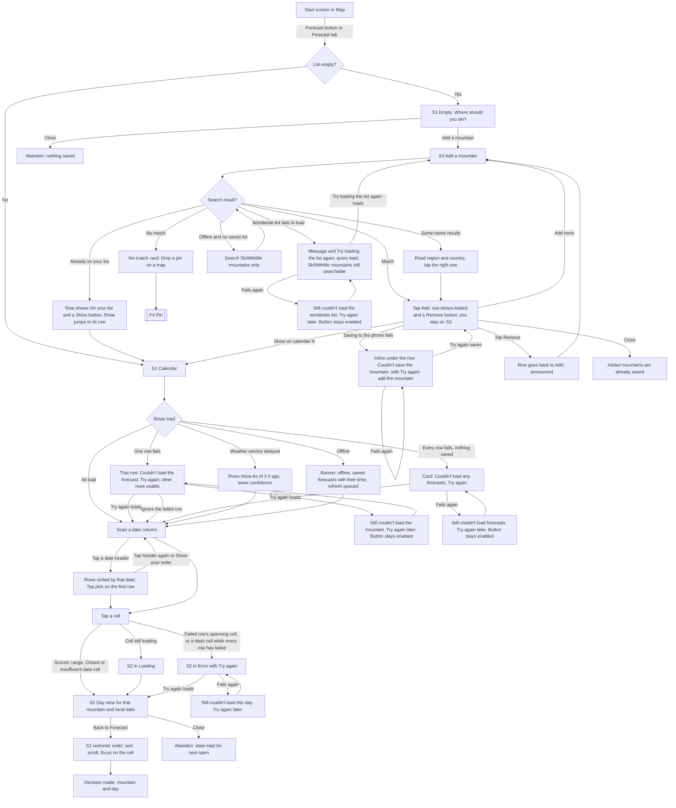
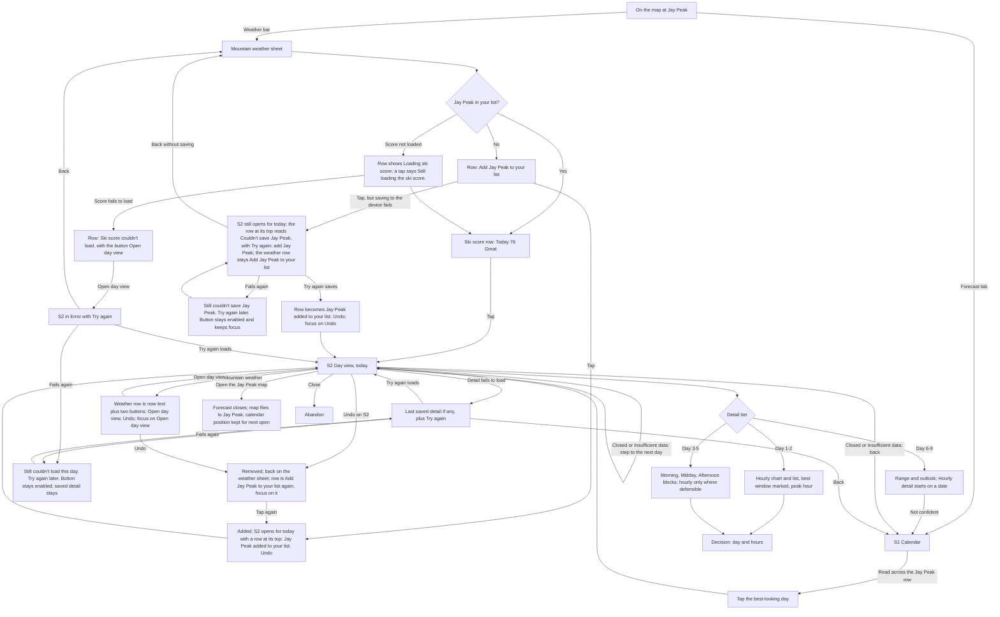
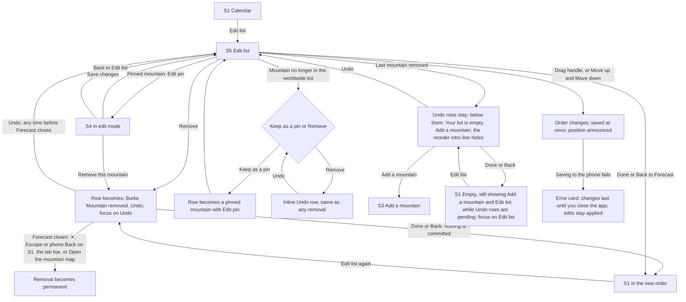
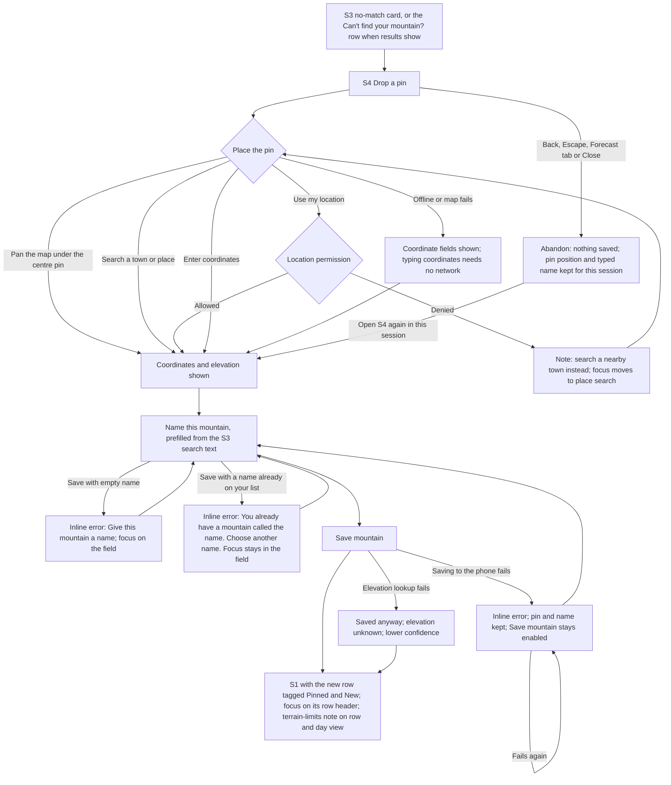
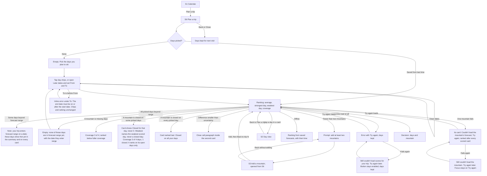

# SkiWithMe Forecast — UX PRD

| | |
|---|---|
| Status | Fix round 3 applied; reconciled with approved-design.md Part 0 |
| Date | 2026-11-21 |
| Requirements | `docs/FORECAST_SPEC.md` (Connor's spec), `docs/FORECAST_PLAN.md`, GitHub issue #1 and sub-issues #2–#12 |
| Design contract | `design/forecast/approved-design.md` (approved by Zach 2026-11-21, design round 0) |
| Prototype | `design/forecast/prototype/` (static HTML, fixture data) |

**How to read this with the design contract.** This PRD is the reconciled, buildable statement of the approved design. `approved-design.md` holds the exhaustive detail this PRD points to: every string (Part 1 §7), the per-screen accessibility tables (Part 2 §5), the announcement register (Part 2 §7) and the computed contrast tables (Part 2 §3). Where that file's Part 1 and Part 2 differ, its Part 0 decides, and this PRD already applies Part 0. If this PRD and Part 0 ever disagree, Part 0 wins and this PRD has a defect.

Fix round 1 added decisions D6–D29. In `approved-design.md` they are Part 0 §0.8 and §0.9, which also hold the per-screen changes to Part 2 (Tab orders, the focus-destination table, the added announcements and the added contrast table §3.5). Where a string or a focus destination in Part 1 §7 or Part 2 §5–§7 differs from §0.8 or §0.9, §0.8 and §0.9 win. This PRD states every D6–D29 rule in full, so it can be built from without opening the design file; the design file adds the exhaustive per-control tables.

**Precedence (R1).** Part 0 §0.8–§0.9 of `approved-design.md` governs accessible names, focus, Tab order and announcements; where this PRD repeats a Part 0 table (cell names, focus destinations, Tab order, the E3 row) the PRD's copy is verbatim, and the only exceptions are the wordings chosen by the fix-round-2 decisions E1–E24, the fix-round-3 decisions H1–H12 and the issue #14 follow-up decisions F1–F5 (§10), which every file uses, Part 0 included.

Screen IDs S1–S7, component IDs C1–C15, flow IDs F1–F5, entry IDs E1–E3 and decision IDs D1–D29 are the same in both files. Fix-round-2 decisions are cited as "decision E1" to "decision E24"; a bare E1, E2 or E3 is always an entry point.

---

## 1. Product intent and personas

**Intent.** Help a skier answer "Where should I ski Saturday?" and "Which day should I ski here?" at a glance. Every mountain on your list shows, for every day the forecast can speak to, a ski score out of 100 with a word label, the best window to ski, and a confidence level. Success: the skier picks a mountain and a day in under 30 seconds and trusts why.

**Scope.** A new Forecast section inside SkiWithMe. Map, Group, Stats, History, More and tracking are preserved, not redesigned. Forecast is free, needs no account and no SkiWithMe Pass, and saves your list on the device.

| Persona | Context | Job |
|---|---|---|
| Weekend skier | Phone; checks a few times in the week before a ski day; compares 3–6 nearby mountains | Pick the best mountain for a given day |
| Local regular | Skis one mountain often | Pick the best day and the best hours there |
| Trip planner (phase 6) | Plans a multi-day trip | Pick which days of the trip to ski, and where |

All three are casual-to-expert skiers, not weather experts. Mostly phone, sometimes desktop.

**Terms used everywhere (D15).** One word per concept. A second word for the same concept in any UI string, spoken name or announcement is a defect.

| Concept | The only term in UI text | Never in UI text |
|---|---|---|
| The saved mountains | "your list" ("Add {name} to your list", "On your list", "Edit list", "Your list is empty") | "watchlist", "your forecast", "Watching", "the calendar" as a name for the list |
| The section and its tab | "Forecast" | — |
| One mountain's weather data | "forecast", lower case ("Couldn't load the forecast for {name}.") | — |
| The S1 grid, as a destination | "the calendar" ("Show on calendar", "Show {name} on the calendar") | — |
| A mountain the user placed | tag "Pinned"; actions "Edit pin", "Keep as a pin"; noun "pin" | "Provisional" (allowed only as an internal term in code and in this document's history) |
| Every retry | "Try again", plus the object where two retries can show at once ("Try loading the list again", "Try again: add {name}") | "Retry" |
| The data provider | "weather service" (the S7 section is "Times and weather services") | "weather source", "source" or "sources" for the provider |
| The catalog of mountains that S3 searches | "the worldwide list" ("Couldn't load the worldwide list.", "Still couldn't load the worldwide list. Try again later.", "No longer in the worldwide list") | "the mountain list", "the worldwide mountain list", "the catalog" |
| A day that cannot be scored | "Insufficient data", on every screen including S6 | "No score" |
| The single best ski hour | "Peak hour", on every screen including S7; the chart marker reads "▲ Peak hour" | "the single best hour", "Peak" alone |
| The S1 button that scrolls to the first column | "Back to today" | "Today" as a button label (the first date header still reads "Today") |
| Removing a mountain in S5 | visible text "Remove" | a bare ✕ |
| A storage failure | "This device may be in private browsing or out of space." | "site storage", "browser storage" |
| Where something is saved | "this device" ("This day isn't saved on this device.") | "your phone", "on your phone" |
| A failure message | starts "Couldn't …", and on a repeat failure "Still couldn't …" (decision H8) | "We couldn't …", "Unable to …" |
| The five score bands (Epic to Poor) | "Score labels" (the S7 section heading and its table caption, decision H8) | "Word labels" as UI text |
| The per-hour breakdown of a day | "hourly detail" ("Tap a score for hourly detail", "Hourly detail starts {date}.", "Hourly detail needs a connection.") (decision H8) | "hour-by-hour detail" |
| Other fixed terms | Ski score, Best window, Confidence (High / Medium / Low), Base, Summit, mountain | "resort" |

The legend line reads "Score out of 100", the confidence bars alone followed by "Bars show confidence" (no sample word such as "Med" beside the bars), "Tap a score for hourly detail", then the `How scores work` link.

---

## 2. User flows

Five flows. Each shows the success path, the abandon path and the failure branches. Three rules hold in every flow:

- **Remove is always undone with an inline Undo row**, never a timed toast and never a confirmation (Part 0 §0.5 row 1, D8). Undo rows last until Forecast closes (D9).
- **A second failure never dead-ends (D23).** When `Try again` fails again, the message stays, the control stays enabled, and the wording changes to that state's own "Still couldn't load … Try again later." sentence (each is a whole string, listed in §3.3). The user can try again any number of times.
- **Undo is where the user lands (D7).** An action that changes your list and also navigates shows its Undo on the screen the user arrives at.

### F1 + F2 — Weekend skier: first run, then compare

### F2b — Local regular: best day and hours at one mountain

### F3 — Manage the list

**When a removal becomes permanent (D9).** Undo rows last until Forecast closes. Forecast closes in exactly five ways: the sheet's ✕, Escape on S1, the phone's Back gesture on S1, leaving through the tab bar (another tab, or the Forecast tab while on S1), and `Open the {mountain} map`. `Done`, the back control, going to another Forecast screen and the Forecast tab used from S2–S7 do not commit; reopening S5 shows the same Undo rows in the same positions. A removed mountain is hidden from S1, S3's "On your list" status and S6 at once; only its Undo row keeps it recoverable.

**The Undo rows stay reachable when the list is emptied (decision E13).** While any Undo row is pending, S1 in its Empty state still shows `Add a mountain` and `Edit list`, and Back or `Done` from S5 always lands on `Edit list`. The user can therefore reopen S5 and undo until Forecast closes.

### F4 — Pin a missing mountain (phase 5)

### F5 — Plan a trip (phase 6)

**Edge paths every flow honours**

- Same-name mountains are told apart by region and country on every S3 result, in its visible text and in the accessible name of its button. When two mountains on your list share a name, every control and cell name that carries the name adds `, {region}` (D6, decision E1): S1 cells and row headers, the S5 `Move up`, `Move down`, `Remove`, `Edit pin` and `Undo` names, S6 day buttons including "Not yet", and the failed-row and failed-card "Try again: {name}". If the region is also the same, `, {country}` follows it (Part 0 §0.9.1 tie-break). For this rule a pin's region is "Dropped pin" and its country is its coordinates, "{lat}, {lon}" to 4 decimals, so a pin "Jay Peak" next to catalog "Jay Peak, Vermont" reads "Jay Peak, Dropped pin" and "Jay Peak, Vermont" (decision F4). Saving a pin whose name matches a mountain already on your list (case-insensitive), a mountain waiting on an Undo row included, is refused with an inline error (decisions H5, F4; AC-106); a pin and a catalog mountain can still share a name when the catalog mountain is added later in S3, and the rule above then tells them apart: the duplicate check covers only S4 saves, so the "{lat}, {lon}" tie-break is reachable when S3 adds a catalog mountain whose name matches a pin already on your list.
- Every time is the mountain's local time, labelled; when the zone differs from the phone's, the row and the day view name the zone.
- Adding a mountain already on your list is impossible; its result reads "On your list" and its `Show` button jumps to its row on the calendar.
- Device storage cleared: your list is gone and S1 shows its Empty state, with no false "your list was lost" message.
- The phone's Back gesture always does what the top-left back control does, on every screen (D19).
- No message that matters is shown only in a toast (D18).

---

## 3. Screen inventory and state matrix

Seven screens. All live in the host bottom sheet at near-full height (`#sheet.tall`, D1). The sheet title is the screen heading; ✕ closes Forecast; S2–S7 have a top-left back control that names its destination.

| ID | Title | Purpose | Entered from | Exits to | Back control label |
|---|---|---|---|---|---|
| S1 | Forecast | Compare mountains (rows) across dates (columns) | E1 tab, E2 start button; back from S2–S7 | S2, S3, S5, S6, S7, close | none (S1 is the top level) |
| S2 | {mountain name} (day view) | One mountain, one local date: how good, when, how sure, why | Any S1 cell; a day in S6; E3 weather row; day stepper | Origin (S1, S6 or Mountain weather), S7, host map for built mountains, close | "‹ Forecast", "‹ Plan a trip" or "‹ Mountain weather", by origin |
| S3 | Add a mountain | Worldwide search by name, other name, local spelling or nearby town | S1 button group, S1 Empty, S5 Empty, S6 prompt | Origin (S1, S5 or S6), S1 through `Show on calendar ({N})` or a row's `Show`, S6 through `Back to trip ({N})`, S4, close | "‹ Forecast", "‹ Edit list" or "‹ Plan a trip", by origin |
| S4 | Drop a pin / Edit pin | Add or fix a pinned mountain | S3 no-match card and row; S5 `Edit pin` | S1 (new pin saved), S5 (edit saved or removed), S3 or S5 (back), close | "‹ Add a mountain" or "‹ Edit list", by origin |
| S5 | Edit list | Reorder, remove with Undo, fix pins | S1 button group | S1, S4, S3, close | "‹ Forecast" |
| S6 | Plan a trip (phase 6) | Rank mountains for the days the user will ski | S1 button group | S2, S3, S1, close | "‹ Forecast" |
| S7 | How scores work | Plain-language explainer | S1 legend line; S2 footer | Origin, close | "‹ Forecast" from S1; "‹ {mountain}" from S2 (the mountain name, never "Day view") |

**Depth is 4 at most (D15).** Counting S1 as level 1, these are the only routes that reach level 4:

| Route | When it happens |
|---|---|
| S1 → S6 → S2 → S7 | Plan a trip, open a day, open `How scores work` |
| S1 → S5 → S3 → S4 | Edit list is empty, add a mountain, no match, drop a pin |
| S1 → S6 → S3 → S4 | Plan a trip with fewer than two mountains, add a mountain, no match, drop a pin |

Every other route is 3 levels or fewer: S1 → S2 → S7; S1 → S3 → S4; S1 → S5 → S4; S1 → S6 → S2; S1 → S7. Each back control, Escape and the phone's Back gesture go up exactly one level, to the screen that opened the current one (D19). The Forecast tab goes straight to S1 from any level.

**History (D19).** Every Forecast screen pushes one `history.pushState` entry when it opens, S3, S4, S5 and S7 included. The phone's Back gesture and the browser Back button run the same code as the top-left back control, including its focus destination (§6 Focus). On S1, Back closes Forecast.

### 3.1 Score display rules (shared by every screen)

**Score labels (D5).** A score always shows as number + label, for example `82 Great`.

| Band | Range | Label |
|---|---|---|
| 5 | 85–100 | Epic |
| 4 | 70–84 | Great |
| 3 | 55–69 | Good |
| 2 | 40–54 | Fair |
| 1 | 0–39 | Poor |

A range shows its label only when both ends are in one band (`72–81 Great`); otherwise the range alone (`58–74`).

**Confidence.** Three ascending bars (filled count = level) plus the word. Never colour. `Medium` is written in full in the day view; `Med` is allowed inside a calendar cell. Spoken form "Confidence medium." (the full word, even where the cell shows `Med`; D17).

**Spoken forms (D27).** Wherever a range, a time span or an age is shown, the visual string is `aria-hidden` and a visually hidden spoken form sits beside it: `58–74` is "Score between 58 and 74"; `9 AM–12 PM` is "9 AM to 12 PM"; `As of 3 h ago` is "Forecast as of 3 hours ago". This applies on every screen (S1 cells and row headers, the S2 hero, key facts and ski hours, S6 cards, S7), not only in calendar cells.

**Detail by distance.** Day 1 is the mountain's local today.

| Days ahead | Calendar cell | Day view |
|---|---|---|
| 1–2 | score + label, exact best window (`9 AM–12 PM`), confidence | hourly chart + list, peak hour, base and summit by hour |
| 3–5 | score + label, broad window (`Morning` / `Midday` / `Afternoon`), confidence | time-block scores; hourly chart only where the engine marks it defensible, otherwise the reason |
| 6–9 | range (+ label if one band), `Outlook`, confidence | range, outlook sentence, confidence + reason, no hours, "Hourly detail starts {date}." |
| 10–15 (phase 7) | trend arrow + word: `Better` / `Similar` / `Worse` | trend sentence, "Scores from {date}" |

**Calendar columns (D2).** Days 1–9 until phase 7; days 1–15 once trends exist. A column never shows for a date the engine cannot speak to.

**Special statuses — always distinct from a low score.**

| Status | Calendar cell | Day view |
|---|---|---|
| Closed (confirmed) | glyph + `Closed`, no tint, dashed border | "Closed on this day" + the source of the closure; score sections hidden |
| Insufficient data | `–` + `Insufficient data` (wraps, never truncated), no tint, dotted border | "Insufficient data" + the reason as its own sentence (§8 engine codes) + the day stepper, so the next day is one tap away (D21) |
| Day over (local ski hours ended) | score + label kept; window line reads `Day over` | banner: the day has ended; forecast shown as it stood |
| Stale (weather service delayed) | values kept; row head shows clock + `As of 3 h ago`; confidence already lowered by the engine | same message as a banner |
| Loading | skeleton bars; the cell is still a focusable grid cell | S2 opens in its Loading state with a skeleton hero, because the cell has no score to show yet (D21, decision E16) |
| Failed (one mountain) | the row's date cells become one spanning cell: "Couldn't load the forecast for {name}." + `Try again`. The spanning cell is a focusable grid cell. `Try again` is a button inside that cell and is its own roving grid stop to the right of it (decision E11) | Tap or Enter on the spanning cell, outside the button, opens S2 in its Error state with `Try again` (D21). Right Arrow from the spanning cell reaches the row's `Try again`, which retries the row without opening S2 |
| Failed (every mountain; S1 Error) | each date cell shows `–` | Tap or Enter on a `–` cell opens S2 in its Error state: no hero, the card "Couldn't load this day. Check your connection and try again." + `Try again` (decision E16). It never shows a saved forecast, because none exists |
| Offline, never saved | `–` + `Offline` | Title, date line and day stepper, then "This day isn't saved on this device. It will load when you're back online." No score is shown, because none was ever saved |
| Offline, score saved but detail never opened | saved score, label, window, confidence | Hero from the saved cell + "Hourly detail needs a connection." (decisions H1, H8) |
| Out of season (the mountain's season has ended or not begun, for example a Southern Hemisphere mountain in December) | every date cell shows the Closed form (glyph + `Closed`); the row header adds the line "Season closed. Opens {month}." | Hero "Closed", the reason "Closed for the season." in place of "Closed on this day", then "Opens {month}." as a following sentence of its own; score sections hidden; the day stepper stays (decisions H6, F5) |

A tap, a mouse click, Enter and Space all do the same thing on every cell in every status (D21): they open S2 for that mountain and local date. No cell is ever inert. The `Try again` button on a failed row sits inside the spanning cell, is its own roving grid stop to the right of it, and retries the row without opening S2.

**Band tint (D3).** A cell is tinted with `--band-1..5`; the tint only reinforces the label. All text inside a tinted cell is `--ink`.

**Times and units (D14).** `Intl.DateTimeFormat` with the mountain's time zone, `formatRange` for windows; no English-only "noon". Units follow the app's existing `units` setting. The units switch (`°F · in` / `°C · cm`, a radiogroup named "Units" moved with the arrow keys) appears in two places that write the same saved setting: the S2 Base and summit card, where units are read, and the S1 footer. Changing either updates every value on the current screen at once and is announced "Showing {units}." (polite).

### 3.2 Per-screen layout summary

Full layouts: `approved-design.md` Part 1 §4, as amended by Part 0 §0.8–§0.9. What each screen contains, top to bottom, with every rule fix round 1 added:

**S1 Forecast.** Top to bottom, below the sheet title and ✕ (D13; banner first, decision H7):

1. Banner slot: the offline banner and the S1 Error card with its `Try again`. It sits above the button group, so in S1 Error the card's `Try again` is the first Tab stop after ✕. The stale line is not a banner: it is the footer line (`p#fc-foot-note`, item 6).
2. A plain labelled group (`role="group"`, name "Forecast actions"; not a toolbar) of four separate buttons, each its own Tab stop, in this order: `Add a mountain`, `Edit list`, `Back to today`, `Plan a trip` (from phase 6).
3. Legend line: "Score out of 100", the confidence bars alone with "Bars show confidence" (no "Med" sample word; decision E22), "Tap a score for hourly detail", then the link `How scores work`.
4. Sort line. Idle: the text "Your order · tap a date to sort by it" (no control). Sorted: "Sorted by Sat, Dec 6" + the button `Show your order`.
5. Calendar grid (sticky date header, sticky mountain column). One Tab stop with a roving cell.
6. Footer: update time, "All times are each mountain's local time.", then `Refresh`, the persistent footer line `p#fc-foot-note` (empty unless one of: stale, a Refresh outcome below, an offline Refresh), the units switch, and the weather service credit links.
7. `#tabs`.

Full Tab order, copied from Part 0 §0.9.2:

> ✕ → banner "Try again" (only in S1 Error) → Add a mountain → Edit list → Back to today → Plan a trip → How scores work → Show your order (only when sorted) → grid (one stop; roving cell) → Refresh → Units radiogroup (one stop) → each weather service credit link → `#tabs` (six stops) → ✕.

- `Refresh` (decisions E14, H4). Online: the label reads "Updating…" while it runs. It then ends in exactly one of four outcomes:
  - **Every row loads:** the footer time changes and the toast "Forecasts updated" shows (6 s) and is announced.
  - **Some rows still fail (S1 Partial):** the footer time changes and the footer line shows one whole string, "Updated. 1 mountain couldn't load." or "Updated. {n} mountains couldn't load." (one string per plural form), announced polite (N-S1-15). No "Forecasts updated" toast shows, and the failed rows keep their own messages. After any row's own `Try again` succeeds, the failing rows are recounted: with n ≥ 1 still failing the line shows the matching template for the new n; at 0 the line goes away and the ordinary "Updated {time}" footer remains. Nothing extra is announced; the row's "{name} forecast loaded." (N-S1-08) is enough (decision F3).
  - **The refresh fails and saved forecasts show (S1 Default, Partial or stale):** the footer line "Couldn't refresh. Showing forecasts as of {time}." shows and is announced polite (N-S1-05). No toast.
  - **In S1 Error:** a failed Refresh, like a failed card `Try again`, **replaces** the card's text with "Still couldn't load forecasts. Try again later." Nothing goes in the footer, and the sentence never shows twice. "Forecasts updated" is never shown in this state.
  
  Offline: the button's visible label is "Refresh when online" and it stays enabled; using it shows the persistent footer line "You're offline. Forecasts will refresh when you're back online." and announces the same sentence. No toast is used offline. "Forecasts updated" is the only toast in Forecast. The button's accessible name is always its visible label; the earlier name "Refresh forecasts" is withdrawn.
- Stale footer, two sentences: "Some forecasts are older than usual. The weather service is delayed." (decision E22)

- Sorting (D24). Every date header shows a sort glyph, so it reads as a control: an up-and-down glyph when that date is not the sort, a down glyph when it is. Tap a date header to sort highest first (score, then confidence, then your order); tap it again, or use `Show your order`, to go back. Closed, Insufficient data, Failed and Day over rows go last. The first row is tagged `Top pick`; when the engine says the top two are within uncertainty, both of the first two rows are tagged `Close call` instead (Part 0 §0.9.2 cell names). Sorting never changes your saved order.
- `Show your order` removes itself when used; focus moves to the date header that was sorted (D13).
- `Back to today` scrolls the grid to the first column and moves focus to the first-column cell of the row that holds the roving cell (the first row if none). On a failed row, whose cells are one spanning cell, it focuses that spanning cell. When the grid is already at the first column, the focus move is the visible feedback.
- Row header: contents and reading order are §6 Cell names, "Row header reading order" (copied from Part 0 §0.9.2; decision F5).
- `New` is only for rows added in this visit. A row reached with S3 `Show` gets the 4 s outline and never the `New` tag (decision E17).

**S2 Day view.** Title: the mountain name plus the visually hidden text ", {weekday date}", updated on each day step · back control · the E3 inline row, only when S2 was opened by the E3 implicit add (D7): "{name} added to your list." + `Undo` (name "Undo adding {name}"), or after a failed save "Couldn't save {name}. This device may be in private browsing or out of space." + `Try again: add {name}` (decision E15) · date line with the time-zone note · day stepper (`‹ {previous weekday}` and `{next weekday} ›`, in a `role="group"` named "Change day") · banner slot · score hero (number, label, "Ski score out of 100", confidence + reason sentence) · one-sentence explanation · key facts (Best window, Peak hour, Ski hours or "Assumed 9 AM–4 PM"), then window-timing confidence as its own sentence · hourly chart, then the hourly list · What moved the score (four parts with weights 45 / 25 / 20 / 10) · Base and summit card, holding the Morning / Midday / Afternoon switch (a radiogroup named "Time of day") and the units switch (D14) · footer (`Refresh`, `How scores work`, and `Open the {mountain} map` for built mountains).

Full Tab order, copied from Part 0 §0.9.3:

> ✕ → Back → the E3 inline row's one button, when the row is present ("Undo adding {name}", visible "Undo"; or "Try again: add {name}" after a failed save; E15) → previous-day stepper → next-day stepper → banner "Try again" (when present) → Time of day radiogroup (one stop) → Units radiogroup (one stop) → Refresh → How scores work → Open the {mountain} map → credit links → `#tabs` → ✕. The chart and the hour list items are not focusable.

- The E3 inline row sits before the day steppers, in the layout and in the Tab order. It is the first thing after the back control.
- Stepper names start with the visible weekday: "Fri, previous day, Friday, December 5" and "Sun, next day, Sunday, December 7".
- The hourly chart marks the peak hour with the label "▲ Peak hour" (decision E20).
- Days 6–9 show "Hourly detail starts {date}." (decision E22).
- The Closed and Insufficient data day views offer the next-day stepper as their one action. There is no "See {date}" button (decision E17).
- Day stepper (D21). A step swaps the day in place; it is not a screen change and pushes no history entry. Focus stays on the stepper that was used. At the first or last day the impossible stepper is not rendered; if the stepper just used disappears, focus goes to the remaining stepper, or to the sheet title if neither is rendered. Each step is announced "{date}. Ski score {n}, {label}." (polite), with the status word in place of the score for Closed, Insufficient data and ranges ("{date}. Score between {lo} and {hi}.").
- `Open the {mountain} map` (D21) closes Forecast and flies the host map to that mountain. Focus goes to the host header's resort name. The saved S1 order, sort, scroll and focused cell are kept for the next time Forecast opens.

**S3 Add a mountain (D6).** Back control · labelled search field "Search mountains" (focused on entry) · results list · the row "Can't find your mountain? Drop a pin on a map" · a sticky bar once at least one mountain has been added this visit.

- Idle (nothing typed): the "SkiWithMe mountains" list, plus "Near you" only when location is already allowed. Typing filters as you type, with no submit. At most 30 results show, followed by "Showing the top 30. Type more to narrow it down."
- Each result row shows the name, then region and country, then the match reason. The row is not focusable and not clickable. Each row has exactly one button, at its end:

| Row state | Visible in the row | The one button | Button's accessible name |
|---|---|---|---|
| Not on your list | — | `Add` | "Add {name}, {region}, {country}" |
| Added in this visit | status text "Added" (not a control) | `Remove` | "Remove {name}, {region}, {country}" |
| On your list before this visit | status text "On your list" (not a control) | `Show` | "Show {name}, {region}, {country} on the calendar" |

- You stay on S3 after `Add`. Focus moves to that row's new `Remove` button; after `Remove`, to that row's `Add` button. Announced (polite): "{name} added to your list." and "{name} removed from your list." The result count is announced 500 ms after typing stops.
- `Show` goes to S1, scrolls to that mountain's row, outlines it for 4 s without a `New` tag, focuses its row header and announces "{name} is already on your list." (polite; decisions E17, E22).
- In an S3 opened from S6, an "On your list" row shows the status text "On your list" and no `Show` button, so the user is never taken out of Plan a trip (decision H11). That row then has no button.
- Sticky bar, opened from S1 or S5: the button `Show on calendar ({N})`, where N is the number of mountains added in this visit. It goes to S1, focuses the row header of the first mountain added, and announces "{N} mountains added to your list." The sentence has one translation per plural form in every language ("1 mountain added to your list."); the noun is never swapped in code.
- Sticky bar, opened from S6: the button reads `Back to trip ({N})`, returns to S6 and focuses the S6 title.
- The sticky bar is the last Tab stop in the sheet, after the results.
- Escape in the search field clears the field when it holds text; Escape in an empty field goes back one level.
- No match: the no-match card with `Drop a pin on a map` shows, and the "Can't find your mountain?" row is hidden, so one control leads to S4, not two.
- Two failures can show at once and are named apart: the list-level retry is `Try loading the list again`; a row's save retry is `Try again: add {name}`.
- Save failure: persistent text under that row, "Couldn't save {name}. This device may be in private browsing or out of space.", plus a button whose visible label is `Try again: add {name}` (decision E22), announced assertive. No toast carries this message. If the retry fails again, the text and the button both stay, the button stays enabled and focused, and the failure is announced again.

**S4 Drop a pin / Edit pin (D20).** Back control · place search ("Find the area"; it filters as you type, like S3, and Enter also runs the search; there is no Find button) · pin map with arrow and zoom buttons and a coordinates + elevation readout · `Use my location` · `Enter coordinates` · "Name this mountain" (prefilled from the S3 search text) · "What we can forecast here" card · `Save mountain`.

- The map's accessible name is "Map. Move the map to put the pin on the ski area. Arrow keys move the map; plus and minus zoom." `Zoom in` and `Zoom out` visibly change the map scale and the readout.
- Place results use buttons named "Go here: {name}" (the visible label first).
- Focus after "Go here: {place}" or a successful `Use my location` (decision F5a): while the map shows, focus moves to the map and "Map moved to {place}. The pin is at its centre." / "Map moved to your location." is announced. While the map is not shown (tiles failed, or offline), focus stays on the control used, the coordinates and readout update, and one sentence is announced polite (N-S4-17): "Pin moved to {place}. The map isn't showing; the coordinates are filled in." or "Pin moved to your location. The map isn't showing; the coordinates are filled in."
- `Enter coordinates` opens the latitude and longitude fields whether online or offline; typing coordinates needs no network.
- The name field validates on blur and on `Save mountain`. Enter in the name field does what the primary button does (`Save mountain`, or `Save changes` in edit mode).
- Duplicate name (decisions H5, F4): saving a pin whose name matches a mountain already on your list, a mountain waiting on an Undo row included, compared case-insensitively with surrounding spaces trimmed, is refused. The name field shows the inline error "You already have a mountain called {name}. Choose another name.", where {name} is the matched mountain's name as your list shows it, linked with `aria-describedby`; focus moves to the name field from the Save button, or stays there after Enter. The error is announced assertive (N-S4-16, used instead of "Check the highlighted field." when the name is the only invalid field) only when focus stayed in the field after Enter; when the Save button moves focus into the field, nothing is announced, because the field's description reads the error as focus lands (decision F5d). "Check the highlighted field." follows the same rule. Nothing typed is cleared. In edit mode the pin's own current name does not count as a match. Catalog mountains that share both name and region are told apart by `, {country}` (§2 edge paths).
- Save failure: "Couldn't save this mountain. Your pin and name are still here. This device may be in private browsing or out of space.", announced assertive. A repeat failure changes the text to "Still couldn't save {name}. Try again later. Your pin and name are still here." and announces it again (N-S4-10b, decision H8); the Save button stays enabled.
- Draft: the pin position and the typed name are kept for the session across every exit from S4 (Back, Escape, the Forecast tab, ✕) and restored on the next entry. A successful save clears the draft.
- Edit mode, entered from S5 `Edit pin`: title "Edit pin"; back control "‹ Edit list"; focus on the title; the primary button reads `Save changes`; a second button `Remove this mountain` is shown. Back returns to S5 with focus on that row's `Edit pin`. `Save changes` returns to S5, focuses that row's `Edit pin` and announces "{name} updated." (polite). `Remove this mountain` returns to S5 with that mountain shown as an inline Undo row, focus on its `Undo` button, and the same announcement as an S5 removal.

**S5 Edit list.** Intro line "Drag to reorder, or use the arrows. The calendar shows mountains in this order." (hidden when no live rows remain) · one row per mountain · `Done`.

- Row: drag handle (pointer only, `aria-hidden`, not focusable), name, region and country, the `Pinned` tag on pins, then `Move up`, `Move down`, `Remove` (visible text "Remove", never a bare ✕) and, on pins, `Edit pin`. `Move up` and `Move down` show those words as visible text. Accessible names start with the visible text (WCAG 2.5.3; spec conflict C16): "Move up: {name}", "Move down: {name}", "Remove {name}", "Edit pin: {name}". When two mountains on your list share a name, each of these names adds `, {region}` after the mountain name ("Remove Snow Valley, Ontario"), and so does the Undo row wherever it carries the name ("Snow Valley, Ontario removed.") (decision E1).
- At 320 px the buttons wrap below the name onto as many lines as needed, each at least 44 × 44 px; the name keeps the full first line (D27).
- `Add a mountain` shows in S5 only when the list is empty (decision E17).
- A mountain no longer in the worldwide list: its row shows the status line "No longer in the worldwide list" (plain wrapping text, not a tag) and two buttons, `Keep as a pin` (name "Keep as a pin: {name}") and `Remove`. `Keep as a pin` turns the row into a pinned mountain at its saved coordinates, focuses that row's `Edit pin` and announces "{name} kept as a pin." (polite). `Remove` goes through the inline Undo row like every other removal; Undo restores the row with both choices (D8).

**S6 Plan a trip (D10).** Back control · "Which days will you ski?" day chips (one per forecast day; the first chip reads "Today") · the line "Later dates show up to 14 days." · the `Later dates` disclosure · picked-days summary line · the beyond-range note or message (outside the disclosure, decision H11) · ranking cards · rule note.

- `Later dates` is a disclosure button (`aria-expanded`). Opening it reveals two labelled native date inputs, "From" and "To", and a `Clear dates` button. Focus stays on the disclosure button when it opens.
- Setting From and To picks every day from From to To inclusive. Days inside forecast range select their day chips (the chips show pressed). Days beyond forecast range cannot be chips; they appear in the picked-days summary and on every card as "Not yet", and they never help or hurt a ranking.
- **14-day cap (decision H11).** A range adds at most 14 days, counted from From. Days after the 14th are not picked and are not listed anywhere. The visible line "Later dates show up to 14 days." under the chips states the cap at all times, so nothing is cut off silently.
- The note "Your trip enters forecast range on {date}. Those days aren't ranked yet." and the message "None of these days are in forecast range yet. Your trip enters range on {date}." sit directly under the picked-days summary, outside the `Later dates` disclosure, so folding the disclosure never hides them (decision H11).
- To before From: an error under To, shown on change, "The end date must be on or after the start date.", linked with `aria-describedby` and announced assertive. Neither input is cleared; chips and ranking stay as they were until the range is valid.
- `Clear dates` empties From and To and unpicks the days they added; chips the user pressed by hand stay pressed. Focus stays on `Clear dates`.
- Card numbering (Part 0 §0.9.7): open (scored) cards are numbered first, heading "{rank}. {mountain}"; a failed card carries no rank number, heading "{mountain}"; cards closed on every picked day continue the numbering after the open ones.
- Card: rank, name (the card's heading), Average, Strongest, Weakest, Coverage, and an always-visible row of the picked days (no disclosure). Each day in that row is a button that opens S2, at least 44 × 44 px, named "{weekday date}: ski score {n}, {label}. {mountain}.", or "{weekday date}: ski score between {lo} and {hi}. {mountain}.", "{weekday date}: Closed. {mountain}.", "{weekday date}: Insufficient data. {mountain}.", "{weekday date}: Not yet. {mountain}." (decision E6; Part 0 §0.9.7 adopts the same names). **On a card day button, `{weekday date}` is the button's visible short date: "Sat 6", or "Dec 16" for a day beyond the calendar** (decision H1; Part 0 §0.9.7), so the name starts with the visible label. Example: "Sat 6: ski score 86, Epic. Jay Peak." The mountain name ends every name so that the same day on two cards never produces two buttons with the same name; the visible text of the button is the day and its score or status only. A "Not yet" day has no day view to open, so its button stays enabled and says why when used (the no-disabled-controls rule, §6): it shows under the row, and announces (polite), "{weekday date} enters forecast range on {date}."
- `Close call` is a paragraph inside the second card's list item, directly after that card's heading: "Close call: {name A} and {name B} are closer than the forecast can tell apart." It is not a divider between cards.
- Ranking rule (owner decision H3, 2026-11-21; replaces decision E21 and the old assumption A5): coverage first, then average, then weakest day, then your order. Ranges count at their midpoint for the average and their low end for strongest and weakest (a range never helps; on a tie the scored day wins over a range day, then the earlier date). **Closed days, Insufficient data days and Not yet days are all excluded from both coverage and the average**: a mountain ranks on its open, scored days only. A card with fewer covered days never ranks above one with more. The weakest-day tie-break uses covered days only. **A mountain closed on every picked day ranks last**, after every scored card and after any failed card; two or more such cards keep your list order. Its card shows "Closed on all your days." in place of Average, Strongest and Weakest, the coverage line "Coverage 0 of {m} days · {m} closed", and its day buttons in the Closed form (Part 0 §0.9.7).
- Display rule for Closed (D10, unchanged by H3): a closed day is never displayed as the number 0; it shows as "Closed" in the day row.
- Weakest (decision F1): the Weakest line names the weakest covered day only, one whole template per form: a scored day "Weakest: {n} {label}, {weekday}" (for example "Weakest: 62 Good, Mon"); a range day, counted at its low end, visible "Weakest: {lo}–{hi}, {weekday}" with the spoken twin "Weakest: score between {lo} and {hi}, {weekday}." Closed, Insufficient data and Not yet days never appear in it, matching the rule note. "Weakest: Closed {weekday}" is withdrawn. Strongest mirrors it: "Strongest: {n} {label}, {weekday}"; a range day visible "Strongest: {lo}–{hi}, {weekday}" with the spoken twin "Strongest: score between {lo} and {hi}, {weekday}." Both compare covered days by their low end; on a tie the scored day wins over a range day, then the earlier date. The visible boxes are a `dl`: `dt` "Strongest" / "Weakest", `dd` the value line ("62 Good, Mon", or "58–74, Thu" for a range); the card's spoken summary uses the whole templates ("Weakest: 62 Good, Mon."). A mountain closed on every picked day shows no Weakest box; its card shows "Closed on all your days." and "Coverage 0 of {m} days · {m} closed".
- Coverage (decision H3): the Coverage line shows the counts: "Coverage 3 of 4 days · 1 closed", where 3 counts the covered (open, scored) days and 1 the closed days. The Average shown is the average of the covered days, so the order on screen always matches the numbers. The earlier sentence "The average counts 1 closed day as 0." is withdrawn.
- Rule note under the ranking (decision H3), one whole string: "Closed days and days without a score don't count. A mountain closed on all your days is listed last."
- Failed card: "Couldn't load {name}'s forecast." + `Try again`. On success focus moves to that card's heading. On failure focus stays on the button and "Still couldn't load {name}. Try again later." is announced and replaces the card's message.

**S7 How scores work (D25).** Sections: What the score means · What goes into it · How a day is scored (0.60 × average of all ski hours + 0.40 × best three consecutive hours; worked example 70 and 85 → 76; the text says "Peak hour", not "the single best hour"; then the edge rules of §8 "Day-score edge rules" in plain words: a day needs at least 3 ski hours with data, and no more than half of its ski hours missing, or it reads "Insufficient data"; with no 3 hours in a row the best stretch available is used and the day view says "Best window: under 3 hours of data"; scores are rounded to the nearest whole number, halves up. These rules are provisional until issue #2 confirms them, decision H2) · Score labels (heading "Score labels", decision H8), as a table with the caption "Score labels" and the column headers "Label" and "Score" (five rows, Epic to Poor) · Confidence · Detail by distance · Closed and Insufficient data · **Tags and statuses** · Base and summit · Times and weather services (decision E19: this title, never "Times and sources").

S7 has no `Done` button; the back control is its one exit besides ✕ and the tab bar (decision E17).

"Tags and statuses" explains each word a skier meets on the calendar, one sentence each:

| Term | Sentence |
|---|---|
| Pinned | "A mountain you added by dropping a pin. We know one point, so you see one estimate for the whole mountain." |
| Outlook | "Days 6 to 9 show a likely score range, not hourly detail." |
| Top pick | "The highest ski score for the date you sorted by." |
| Close call | "Two mountains are closer than the forecast can tell apart." |
| Day over | "Ski hours have ended at that mountain. The score is the forecast as it stood." |

### 3.3 State matrix (49 cells)

"N/A" for No permission always has the same reason: Forecast is free, needs no account or Pass, and the screen requests no device permission.

| Screen | Default | Loading | Empty | Error | Partial / degraded | Offline | No permission |
|---|---|---|---|---|---|---|---|
| **S1** | Button group, legend, sort line, grid (one row per mountain, 9 columns), footer; sort, scroll and focus restored. A `Refresh` that fails shows the footer line "Couldn't refresh. Showing forecasts as of {time}.", announced polite (N-S1-05), no toast (decision H4) | Row heads at once from your saved list; cells are skeletons, or saved values with "Updating…" in the footer; rows resolve one by one; never a full-sheet spinner. `aria-busy` is on the skeleton wrapper only; the loading text sits outside it. **A tap or Enter on a loading cell opens S2 in its Loading state, with a skeleton hero** (D21, decision E16) | "Where should you ski?" + explanation + `Add a mountain`; button group, legend, footer hidden. **Exception (decision E13): while any Undo row is pending, the button group still renders with `Add a mountain` and `Edit list` only, so S5 and its Undo rows stay reachable; Back or `Done` from S5 lands on `Edit list`** | All rows failed, nothing saved: the card, above the button group (decision H7), "Couldn't load any forecasts. Your mountains are saved. Check your connection and try again." + `Try again`, spoken once through the alert region when it renders; cells `–`; the button group still works. **A tap or Enter on a `–` cell opens S2 in its Error state with `Try again`** (decision E16). If `Try again` or `Refresh` fails: the card stays, the button stays enabled, and the card's text is **replaced** by "Still couldn't load forecasts. Try again later."; nothing goes in the footer and the sentence never shows twice; "Forecasts updated" is never shown in this state (decisions E14, H4) | One failed row becomes one spanning cell: "Couldn't load the forecast for {name}." + `Try again`; if that fails again, "Still couldn't load {name}. Try again later." with the button still enabled. **A tap or Enter on the spanning cell, outside its button, opens S2 in its Error state** (D21). A `Refresh` that leaves some rows failed shows the footer line "Updated. 1 mountain couldn't load." or "Updated. {n} mountains couldn't load.", announced polite, and no "Forecasts updated" toast (decision H4); a row's own `Try again` that succeeds recounts that line, which goes away at 0, with nothing extra announced (decision F3). Stale rows show `As of 3 h ago` + the footer note "Some forecasts are older than usual. The weather service is delayed."; Closed / Insufficient data cells | Banner "You're offline. Showing forecasts as of 6:40 AM. We'll refresh when you're back online."; saved cells show; never-saved cells `–` `Offline`; refresh queued and runs on reconnect: "Back online. Updating forecasts.", then the toast "Forecasts updated" (every row loaded), the footer line "Updated. … couldn't load." (some rows failed) or "Couldn't refresh. Showing forecasts as of {time}." (refresh failed), each announced (decision F5). The footer button reads "Refresh when online" and stays enabled; using it shows the persistent footer line "You're offline. Forecasts will refresh when you're back online." and announces it, with no toast (decision E14) | N/A |
| **S2** | Full layout per detail tier; designed variants for Closed, Insufficient data, Day over, unresolved base/summit (one column "Mountain (one estimate)") and pinned mountains; the "{name} added to your list." + `Undo` row at the top when opened by the E3 implicit add | Title, back control, day stepper and date line at once. Opened from a scored cell: the hero shows from the cell. **Opened from a loading cell: the hero is a skeleton too** (D21). Skeletons for reason, chart, list, parts, base/summit; `aria-busy` on the skeleton wrappers only | The no-score variants: Closed and Insufficient data (each explains why in its own sentence, and both keep the day stepper so the next day is one tap away); a day with no hourly detail is a Default tier, not an empty screen | Saved detail + banner "Couldn't refresh this day. Showing the forecast as of 6:40 AM." + `Try again`; or hero kept + card "Couldn't load the hourly detail. Check your connection and try again." + `Try again`. **Opened from a failed row, from a `–` cell while S1 is in Error, or from the weather row's "Ski score couldn't load." state: no hero; the card "Couldn't load this day. Check your connection and try again." + `Try again`** (D21, decisions E15, E16). **Opened by an E3 implicit add that failed to save: the inline row "Couldn't save {name}. This device may be in private browsing or out of space." + `Try again: add {name}`, announced assertive; a second failure changes the text to "Still couldn't save {name}. Try again later."** (decision E15). Each blocking card is spoken once through the alert region when it renders. If `Try again` fails: the card stays, the button stays enabled and keeps focus, the text becomes "Still couldn't load this day. Try again later." On success focus moves to the sheet title | Stale banner; missing hours shown as gaps and "No data" rows with a note; one estimate for base and summit; a missing value shows `–` "Not in forecast" | Saved detail + offline banner; a day whose score is saved but whose detail was never opened shows the hero and "Hourly detail needs a connection." (decisions H1, H8); a day never saved at all shows no score and "This day isn't saved on this device. It will load when you're back online." `Refresh` reads "Refresh when online", as on S1 (decision E14) | N/A |
| **S3** | Idle: SkiWithMe mountains (and "Near you" only if location is already allowed); typing filters as you type; up to 30 results | First open: field usable at once, searching SkiWithMe mountains while the worldwide list downloads with a percent; skeleton rows during a query | "No mountain called “{query}” found." + advice + `Drop a pin on a map`; query kept; the "Can't find your mountain?" row is hidden while this card shows | Two separate failures, named apart. They never stack on first view: the list failure shows when the screen renders, and a save failure can only appear after the user taps `Add` on a row. List download failed: "Couldn't load the worldwide list. You can still search SkiWithMe mountains." + `Try loading the list again`, spoken once through the alert region; if it fails again, "Still couldn't load the worldwide list. Try again later." with the button enabled. Save failed: persistent text under that row "Couldn't save {name}. This device may be in private browsing or out of space." + `Try again: add {name}`, announced assertive, no toast. The query is never cleared | List partly loaded: "Some mountains may be missing while the list finishes loading."; a result with limited terrain data says so and is still addable | Exactly one of two messages, never both. Worldwide list saved on the phone: full search and add, with the banner "You're offline. You can add mountains now; their forecasts load when you're back online." Not saved: SkiWithMe mountains only, with "You're offline. Only SkiWithMe mountains can be searched until you reconnect." The pin route stays available in both | N/A ("Near you" simply does not appear) |
| **S4** | Map centred on the best guess, or on the session's draft pin; readout updates after each move; name required and prefilled from the S3 search text or the draft. Edit mode: title "Edit pin", `Save changes`, `Remove this mountain` (§3.2) | Tile placeholders with pin and readout usable; "Finding elevation…"; `Saving…` | Place search finds nothing: "No place called “{query}” found. Try a nearby town, or move the map yourself." (the map itself is always present) | Map fails: card "The map couldn't load. Enter the coordinates instead, or try again." + `Try again` in the map's place and Tab slot (the map and its pan and zoom buttons are not rendered) + coordinate fields expanded; if it fails again, "Still couldn't load the map. Try again later." with the button enabled and the coordinate fields still usable. While the map is not shown, "Go here: {place}" and `Use my location` keep focus on the control used and announce N-S4-17 (decision F5a). Elevation fails: "Elevation unknown", save allowed. Save fails: inline "Couldn't save this mountain. Your pin and name are still here. This device may be in private browsing or out of space.", announced assertive, focus stays on the save button, nothing cleared; if it fails again, "Still couldn't save {name}. Try again later. Your pin and name are still here.", announced assertive (decision H8). Name already on your list (a mountain waiting on an Undo row included): inline error "You already have a mountain called {name}. Choose another name." on the name field, focus moves to (or stays in) the name field, announced assertive only when focus stayed in the field (decisions H5, F4, F5d) | Some tiles missing: placeholders, pin still works; elevation unavailable without blocking | Card "You're offline. The map needs a connection, but you can enter coordinates now."; `Enter coordinates` opens its fields and they work offline (D20); `Use my location` keeps focus on itself and announces N-S4-17 (decision F5a); save works; the new row loads its forecast when back online | **Location denied** after `Use my location`: inline note "Location is off for SkiWithMe, so we can't centre the map on you. Search for a nearby town instead. To allow location, change it in your browser's settings for this site."; focus moves to place search; announced polite (D20); every other control still works |
| **S5** | Intro, rows, reorder and remove with inline Undo | Cannot occur: the list is read from the device at once | No live rows remain: the Undo rows stay in place; below them "Your list is empty" + "Add a mountain to start comparing ski days." + `Add a mountain`; the reorder intro line is hidden (D9) | Saving fails: card "Couldn't save your changes. They'll last until you close the app. This device may be in private browsing or out of space.", spoken once per session through the alert region; edits stay applied | A saved mountain no longer in the worldwide list: its row shows "No longer in the worldwide list" with `Keep as a pin` and `Remove`. **Guard (D8): `Remove` here goes through the same inline Undo row as every other removal, with focus on `Undo`; Undo restores the row with both choices. It is never an immediate delete and never a confirmation dialog** | Works fully; no banner | N/A |
| **S6** | Chips, `Later dates`, summary, ranking cards, the Close call paragraph inside the second card. **"Not yet" (D10): a picked day beyond forecast range shows as "Not yet" in the picked-days summary and in the day row of every card, with the note "Your trip enters forecast range on {date}. Those days aren't ranked yet." directly under the summary, outside the `Later dates` disclosure (decision H11); it never changes a rank, an average, a weakest day or a coverage count**. The rule note "Closed days and days without a score don't count. A mountain closed on all your days is listed last." sits under the ranking (decision H3) | Skeleton cards in your order with names, settling into rank order; `aria-busy` on the skeleton wrapper only | Three cases: no days picked ("Pick the days you plan to ski"); fewer than two mountains ("Add at least two mountains to compare them for your trip." + `Add a mountain`, which opens S3 with the return button `Back to trip ({N})`); all picked days beyond range ("None of these days are in forecast range yet. Your trip enters range on {date}.", under the summary and outside the disclosure, with every picked day listed as "Not yet") | "Couldn't load scores for your trip. Your dates are saved. Check your connection and try again." + `Try again`, spoken once through the alert region; if it fails again, "Still couldn't load scores for your trip. Try again later." with the button enabled and the days kept. `Later dates` validation error: "The end date must be on or after the start date." under To | A failed mountain's card has "Couldn't load {name}'s forecast." + `Try again`, ranks after every scored card (only a card closed on all your days follows it, decision H3) and is left out of close-call checks; success moves focus to that card's heading; a second failure keeps focus on the button and says "Still couldn't load {name}. Try again later." Stale cards show their age; a day that cannot be scored shows `–` "Insufficient data"; a closed day shows "Closed", never 0, and is left out of coverage and the average: "Coverage 3 of 4 days · 1 closed"; Weakest names the weakest scored day, never a closed day (decision F1); a mountain closed on every picked day ranks last, says "Closed on all your days." and has no Weakest box (decisions H3, F1) | Ranking from saved forecasts with the banner "You're offline. Ranking uses forecasts as of {time}."; chips and `Later dates` still work | N/A |
| **S7** | All sections; first open, others folded | Cannot occur: text ships with the app | Cannot occur: content is fixed | Cannot occur: no network or storage use | Designed variant: before phase 7 the days 10–15 text is left out | Works fully | N/A |

Exact wording for every cell: `approved-design.md` Part 1 §7, as amended by Part 0 §0.8–§0.9. Exact focus, keyboard and announcement behaviour for every cell: Part 2 §5, as amended by Part 0 §0.8–§0.9.

**Rules that apply to every cell above**

- **Blocking errors are spoken once (D27).** When a screen renders in a state where its main job is blocked (S1 Error, S2 Error with no saved detail, S3 list failure, S5 storage failure, S6 Error), its message is sent once to the alert region as it renders.
- **Repeated failure (D23).** Every `Try again` that fails again keeps the message and the enabled control and changes the wording to that state's own "Still couldn't load … Try again later." sentence, listed below. Focus stays on the button.
- **Loading (D27, decision E2).** `aria-busy="true"` goes only on the skeleton wrapper inside each loading cell or card. It is never set on `<tbody>`, the table, a list or a stack. Mountain names, and any text that says content is loading, sit outside that wrapper so screen readers read them.
- **Whole strings (decision E23).** No sentence in any cell is built from fragments. Each variant is one template with placeholders, listed here as a whole string: "Still couldn't load forecasts. Try again later."; "Still couldn't load {name}. Try again later."; "Still couldn't load this day. Try again later."; "Still couldn't load the worldwide list. Try again later."; "Still couldn't load the map. Try again later."; "Still couldn't load scores for your trip. Try again later."; "Still couldn't save {name}. Try again later."; "Still couldn't save {name}. Try again later. Your pin and name are still here." (S4, decision H8); "Updated. 1 mountain couldn't load." / "Updated. {n} mountains couldn't load." (S1 Refresh, decision H4); "Couldn't refresh. Showing forecasts as of {time}." The S6 picked-days summary, the S6 Coverage line, the S6 spoken card summary and every cell name (§6) are whole templates in the same way, one per variant and per plural form.
- **In-progress work survives.** No state clears a typed query, a pin draft, a name, picked days or an edit.

---

## 4. Component spec

No design system is named in the repo; the host's CSS classes in `src/styles.css` ("2026-11 look") are the system. Order of preference applied: reuse, then extend, then net-new.

### 4.1 Reused as-is (22)

`#sheet` + `.sheet-head` + `#sheet-body`, `#sheet.over-start`, `.card` (+ `h3`, `h4`, `.sub`, `.note`, `.foot`), `.btn` (+ `.alt`, `.outline`, `.sm`), `.seg` / `.seg.solid`, `.search`, `.field`, `label.lbl`, `.srow`, `.row-link`, `.wx-hero`, `.boxes.b3` / `.b4`, `.box.cap`, `.wx-note.good/.warn/.bad`, `.wx-foot`, `.empty`, `.learn` / `.learn-text`, `.tag` (short words only: `Pinned`, `New`, `Top pick`, `Close call`; it wraps, with no `white-space: nowrap`; a sentence-length status such as "No longer in the worldwide list" is a plain status line, not a tag), the `#resort-card .back` control, `#toast` (for "Forecasts updated" only).

**Toast rule (D18).** Every toast stays at least 6 s and never carries the only copy of anything: "Forecasts updated" is also the footer's update time and an announcement. Errors, advice and Undo are never toasts.

### 4.2 Extensions (6)

| ID | Component | Extends | Change |
|---|---|---|---|
| C1 | Six-tab bar | `#tabs` | Six equal columns; new Forecast button (calendar glyph, inline SVG); 12 px label, two lines at most; `aria-current="page"` on the active tab; `aria-label="Sections"` on the nav |
| C2 | Tall sheet | `#sheet` | `.tall` variant: full app height minus the top inset and the tab bar; 44 × 44 close button; `role="dialog"` with a name and **no `aria-modal`** while it holds Forecast (D12, §6 Structure) |
| C12 | Reorder row | `.mrow` / `.list-item` | Drag handle (pointer only, `aria-hidden`, not focusable), `Move up`, `Move down`, `Remove` as visible text, and `Edit pin` on pins; a move that is impossible is not rendered (a 44 × 44 spacer holds the layout); at 320 px the buttons wrap below the name onto as many lines as needed, each at least 44 × 44 px (D27) |
| C13 | Inline Undo row | `.card` row | Replaces the removed row in place: "{name} removed." + `Undo`; stays until Forecast closes (D9). Also used for the E3 implicit add: "{name} added to your list." + `Undo` (name "Undo adding {name}") at the top of S2, and text + `Open day view` (name "Open day view: {name}") + `Undo` (name "Undo adding {name}") as three separate elements on the weather sheet (D7, decision E10). After a failed save the same row holds the error text + `Try again: add {name}` (decision E15). Controls are never nested. (Replaces the timed Undo toast in Part 1.) |
| C14 | Day chip toggle | `.start-filters button` | Multi-select, `aria-pressed`, 44 px tall and wide, auto-fill grid so seven never have to fit one row |
| — | Start-panel button pair | `#start-panel .join-btn` | `Forecast` and `Join Group` side by side; they stack when either label would wrap. The start panel is dark in both themes, so both buttons are theme-independent: `--start-btn-bg` fill, `--start-edge` border and white `--start-ink` text in light and dark (16:1), and the panel's `.sub` line uses `--start-muted` (8.3–10.5:1 on the dark panel) (D26) |

### 4.3 Net-new (11), each because the host has nothing equivalent

| ID | Component | Why reuse and extension failed |
|---|---|---|
| C3 | Calendar grid | The host has no table and no sticky column. Mountains × dates with names fixed while dates scroll is a two-axis layout. A native `<table role="grid">` with a caption, column and row headers |
| C4 | Mountain row head | Name + region + one status line in the sticky column; `.mrow` is 400 px wide with a thumbnail. Width `clamp(96px, 30vw, 140px)`; names wrap to three lines. A `<th scope="row">` that is part of the grid's roving set: `tabindex="0"` when it is the current roving cell, otherwise `tabindex="-1"`. It opens nothing, and it is the focus target after add, save and `Show` (D27; Part 0 §0.9.2). A new row carries a visible `New` text tag and an outline for 4 s (D18) |
| C5 | Date header button | A column header that sorts and exposes `aria-sort`; nothing similar exists. Always shows a sort glyph (inline SVG, `aria-hidden`): up-and-down when idle, down when sorted (D24) |
| C6 | Score cell | Stacks score, label, window and confidence, carries band tint and every special status, and is one focusable grid cell. Its accessible name is its own text content, visible plus visually hidden, with no `aria-label` (D17, §6). Includes a skeleton variant and the failed-row spanning cell, which holds its `Try again` button and is the one cell named with `aria-labelledby` (decision E11, §6). Every variant opens S2 on tap, click, Enter and Space (D21). Minimum 76 × 72 px |
| C6a | Confidence glyph | Three bars, filled count = level, always paired with the word |
| C7 | Hourly score chart | No chart exists. Inline SVG, `role="img"` with a text summary; not interactive; best window bracketed and labelled, peak hour marked with the label "▲ Peak hour" (decision E20) |
| C8 | Hourly list | The accessible list the spec requires: an `<ol role="list">`, one item per ski hour with hour, score, label, main factor (from an engine code, §8), and "Best window" / "Peak hour" in text. Reflows at 320 px |
| C9 | Base / summit comparison | Two sites × five conditions with a one-column fallback; two columns from 360 px, stacked below. Holds two radiogroups with the same key pattern (arrow keys move and select, one Tab stop each): "Time of day" (Morning / Midday / Afternoon) and "Units" (D14, D21) |
| C10 | Search result row | `.srow` (not focusable, not clickable) with the name, region and country, a match-reason line, an optional status text ("Added" or "On your list") and exactly one trailing button (`Add`, `Remove` or `Show`) whose accessible name includes region and country (D6) |
| C11 | Pin map | The host maps cannot place a point at slope scale anywhere on Earth. A 2D world map with a fixed centre pin, arrow-button and keyboard panning, zoom buttons that visibly change the scale, coordinate entry that works offline (D20) |
| C15 | Trip ranking card | An `<li>` in an `<ol role="list">`: rank, name as the card heading, four stats, an always-visible row of day buttons, and the Close call paragraph after the heading of the second card of a close pair (D10) |

Lists whose count or position carries meaning carry `role="list"` explicitly, because the host removes list markers and Safari then drops list semantics: the S3 results, the S2 hourly list, the S5 edit list and the S6 ranking (D27).

### 4.4 Tokens

Host colour tokens are used by name. New tokens are all `provenance: inferred` (no brand pack) and are listed in §10. Values: `approved-design.md` Part 1 §6.2, with these Part 2 values taking precedence:

| Token | Dark | Light | Use |
|---|---|---|---|
| `--band-5 … --band-1` | teal at .34 / .24 / .14 / .06 / transparent | same strengths of `#16b393` | Score cell tint |
| `--teal-text` | `#3ee6c4` | `#00715c` | Teal text, links, selected borders, best-window bracket |
| `--focus` | `#3ee6c4` | `#00715c` | Focus ring |
| `--warn-text` | `#ffc266` | `#9a5200` | Warning borders and warning icons. Text inside a warning banner (`.wx-note.warn`) is `--ink` (14.78:1 on light `--warn-bg`); its border stays `--warn-text` (D26) |
| `--control-edge` | `#6f879e` | `#6b7d90` | Borders of inputs, chips, segmented controls. Light value: 3.59:1 on `--chip`, 3.76:1 on `--seg-bg` (D26). The earlier light value `#7d8ea0` measured 2.85–2.99:1 on those two fills and is withdrawn |
| `--start-ink` | white | same as dark | Text of the two start-panel buttons, in both themes; 16:1 on `--start-btn-bg` over the dark panel (D26) |
| `--start-btn-bg` / `--start-edge` | dark translucent fill / `#3ee6c4` | same as dark | Fill of the two start-panel buttons / their border and focus ring; theme-independent because the panel is dark in both themes (D26). `--start-edge` is also the focus ring on the other always-dark surfaces, the pin map and the info bar; the pin-map centre pin is `#ffc266` in both themes (decision E4) |
| `--start-muted` | `#b9c8d6` | same as dark | The start panel's `.sub` line; 8.3–10.5:1 on the dark panel (D26) |
| `--toast-bg` / `--toast-ink` / `--toast-edge` / `--shadow-toast` / `--toast-max` / `--z-toast` | prototype `tokens.css` | prototype `tokens.css` | The "Forecasts updated" toast: fill, text, border, shadow, maximum width, stacking order |
| `--zoom-base` / `--zoom-step` | prototype `tokens.css` | same | Pin-map scale and the change per `Zoom in` / `Zoom out` press, so zoom is visible (D20) |
| `--chart-bar` / `--chart-bar-best` | `--muted` / `--teal-text` | `--muted` / `--teal-text` | Hourly chart. The `--score-*` tokens of Part 2 are dropped (D26) |
| `--space-1…7`, `--radius-*`, `--fs-*`, `--tap-min`, `--dur-*`, `--ease-out`, `--shadow-sheet` | host literals, named | same | Spacing, radius, type, motion |

---

## 5. Interaction and motion

Rules: micro-interactions ≤ 200 ms, transitions ≤ 400 ms, no animation blocks input, nothing is conveyed by motion alone. Every transition is wrapped in `@media (prefers-reduced-motion: no-preference)`; the reduced alternative is the default style.

| Element | Trigger | Feedback | Motion | Reduced motion |
|---|---|---|---|---|
| Forecast tab, start button | tap, Enter, Space | Sheet opens; focus on the sheet title | Host sheet slide, 300 ms | 150 ms cross-fade; focus moves at once |
| Weather row, mountain on your list | tap, Enter, Space | S2 opens for today; focus on the S2 title | Host sheet slide, 300 ms | 150 ms cross-fade |
| Weather row, mountain not on your list (`Add {name} to your list`) | tap, Enter, Space | The mountain is added; S2 opens for today with the row "{name} added to your list." + `Undo` at its top; announced "{name} added to your list." (polite, Forecast pair) | Host sheet slide, 300 ms | 150 ms cross-fade |
| Weather row, the implicit add fails to save | tap, Enter, Space on `Add {name} to your list` | S2 still opens for today, focus on its title. Its inline row reads "Couldn't save {name}. This device may be in private browsing or out of space." + `Try again: add {name}`, announced assertive (N-E3-06). The weather row stays `Add {name} to your list` | Host sheet slide, 300 ms | 150 ms cross-fade |
| `Try again: add {name}` in the S2 inline row | tap, Enter, Space | Success: the row becomes "{name} added to your list." + `Undo` (name "Undo adding {name}"); focus on `Undo`; announced "{name} added to your list." (polite, N-E3-01). Failure: the text becomes "Still couldn't save {name}. Try again later."; focus stays on the button; announced assertive (N-E3-07) | Content swap | none needed |
| Weather row, score couldn't load | tap, Enter, Space on its `Open day view` button | The row reads "Ski score couldn't load." with the button `Open day view` (name "Open day view: {name}"). The button opens S2 in its Error state with `Try again`; focus on the S2 title | Host sheet slide, 300 ms | 150 ms cross-fade |
| Weather row, score still loading | tap, Enter, Space | Stays put; the row text reads "Still loading the ski score." and the same sentence is announced (polite, weather-sheet region). Never a silent no-op | none | — |
| `Undo` on S2 or on the weather sheet (E3) | tap, Enter, Space | The mountain is removed. From S2: S2 closes back to the weather sheet. The weather row is the single button `Add {name} to your list` again and has focus; announced "{name} removed from your list." (polite) | Content swap | none needed |
| Score cell, any status | tap, click, Enter, Space | Press state 150 ms; S2 opens: with the cell's values already shown (scored), in Loading with a skeleton hero (loading cell), or in Error (failed row's spanning cell, or a `–` cell while S1 is in Error). Mouse click and Enter always behave the same | Content swap, no slide | none needed |
| Date header | tap, Enter | Rows reorder; the header's glyph changes from up-and-down to down and `aria-sort="descending"` is set; sort line reads "Sorted by {date}" + `Show your order`; announced "Sorted by {date}, best first. {name} is first." | Rows move, 200 ms | Instant reorder |
| `Show your order` | tap, Enter, Space | Rows return to your order; the button is removed; the sort line reads "Your order · tap a date to sort by it"; focus moves to the date header that was sorted; announced "Back to your order." | Rows move, 200 ms | Instant reorder |
| `Back to today` | tap, Enter, Space | Grid scrolls to the first column; focus moves to the first-column cell of the current row (a failed row: its spanning cell). Already at the first column: the focus move is the feedback | Smooth scroll ≤ 400 ms | Instant scroll |
| Loading cells and rows | loading | Skeleton bars; "Loading forecasts." spoken only if it lasts over 1 s | Opacity pulse | Static bars |
| New or jumped-to row | arrive from S3 or S4 | Row scrolled into view; a visible `New` text tag and an outline for 4 s (new rows only; a jumped-to row gets the outline without the tag); focus on its row header | Smooth scroll ≤ 400 ms | Instant scroll; static tag and outline |
| Back to S1 from S2 | back control, Forecast tab, Escape, phone Back | Scroll restored first, then focus on the opened cell | none | — |
| Back from S3–S7 | back control, Escape, `Done`, phone Back | The opening screen returns; focus on the control that opened the screen (§6 Focus) | Content swap | none needed |
| Day stepper | tap, Enter, Space | Adjacent day swaps in; focus stays on the stepper used (fallback: the remaining stepper, then the title); announced "{date}. Ski score {n}, {label}." At the first or last day the impossible step is not rendered | none | — |
| Time of day and Units radiogroups | tap, arrow keys | Selection moves; every value in the card updates at once; Units announces "Showing {units}." | none | — |
| `Open the {mountain} map` | tap, Enter, Space | Forecast closes; the host map flies to the mountain; focus on the host header's resort name | Host fly-to | Instant jump |
| S3 `Add` | tap, Enter, Space | Row status reads "Added" and its button becomes `Remove`, which takes focus; sticky bar appears or its count goes up; announced "{name} added to your list." | 150 ms cross-fade; bar slides up | Instant |
| S3 `Remove` | tap, Enter, Space | Status text goes; the button becomes `Add`, which takes focus; sticky count goes down (the bar hides at 0); announced "{name} removed from your list." | 150 ms cross-fade | Instant |
| S3 `Show` | tap, Enter, Space | S1 opens scrolled to that row, outlined 4 s; focus on its row header; announced "{name} is already on your list." | Smooth scroll ≤ 400 ms | Instant scroll |
| S3 sticky button | tap, Enter, Space | `Show on calendar ({N})`: S1, focus on the row header of the first mountain added, announced "{N} mountains added to your list." `Back to trip ({N})`: S6, focus on the S6 title, same announcement | Content swap | none needed |
| S3 search field | typing; Escape | Results filter as typed; count announced 500 ms after typing stops. Escape clears the field if it holds text, otherwise goes back | none | — |
| S5 reorder | drag, or `Move up` / `Move down` | Row moves; focus stays on the moved row's button; announced "{name} moved to position {n} of {total}." | 200 ms | Instant |
| S5 `Remove` / `Undo` | tap, Enter, Space | Row becomes the inline Undo row with focus on `Undo`; announced "{name} removed. Undo is available." Undo restores the row at its position with its saved forecast, focus on that row's `Remove`; announced "{name} is back on your list." | 200 ms | Instant swap |
| S5 `Keep as a pin` | tap, Enter, Space | Row becomes a pinned mountain; focus on its `Edit pin`; announced "{name} kept as a pin." | Instant swap | — |
| S4 place search | typing; Enter | Place results filter as typed; Enter runs the search at once; there is no Find button. Choosing "Go here: {name}" recentres the map under the pin and moves focus to the map; while the map is not shown (tiles failed or offline) focus stays on that button and the coordinates fill in (decision F5a) | none | — |
| S4 map | drag, arrow buttons, arrow keys, plus and minus keys, zoom buttons | Map moves or changes scale under the fixed pin; readout updates | Eased pan | Jump |
| S4 name field | Enter | Same as the primary button (`Save mountain` or `Save changes`). A name that matches a mountain already on your list (case-insensitive): inline error "You already have a mountain called {name}. Choose another name.", focus stays in the field, announced assertive (decision H5) | none | — |
| S4 `Save mountain` / `Save changes` / `Remove this mountain` | tap, Enter, Space | New pin: S1, focus on the new row's header, row tagged `Pinned` and `New`, announced "{name} added to your list as a pin." Edit: S5, focus on that row's `Edit pin`, announced "{name} updated." Remove: S5 with the Undo row, focus on `Undo` | Content swap | none needed |
| S6 chip | tap, Space | `aria-pressed`; ranking recomputes; announced "Ranking updated. {name} is first." 600 ms after the last change (N-S6-01); when every mountain is closed on all picked days, "Ranking updated. Every mountain is closed on all your days." (H3) | Cards reorder, 200 ms | Instant |
| S6 `Later dates` | tap, Enter, Space | From, To and `Clear dates` appear; `aria-expanded="true"`; focus stays on the button | none | — |
| S6 From / To | change | Valid: chips press, summary and cards update, ranking announced. To before From: error under To, announced assertive | none | — |
| S6 card `Try again` | tap, Enter, Space | Success: card fills, focus on its heading. Failure: focus stays, "Still couldn't load {name}. Try again later." shown and announced | none | — |
| `Refresh`, online | tap, Enter, Space | The button label reads "Updating…" and stays enabled; focus stays on it. Exactly one outcome follows (decision H4). All rows load: the footer's update time changes and a toast "Forecasts updated" shows for 6 s and is announced (D22). Some rows still fail: the update time changes and the footer line reads "Updated. 1 mountain couldn't load." or "Updated. {n} mountains couldn't load.", announced polite, with no toast. The refresh fails while saved forecasts show: the footer line "Couldn't refresh. Showing forecasts as of {time}.", announced polite (N-S1-05), no toast. In S1 Error, a failed refresh replaces the error card's text with "Still couldn't load forecasts. Try again later."; nothing goes in the footer and no toast shows (decision E14) | Toast slide (all-rows outcome only) | Instant |
| `Refresh`, offline | tap, Enter, Space | While offline the button's visible label is "Refresh when online" and it stays enabled. Using it shows the persistent footer line "You're offline. Forecasts will refresh when you're back online." and announces it. No toast (decision E14) | none | — |
| S6 `Clear dates` | tap, Enter, Space | From and To empty; the days the range added are unpicked, their chips included; chips the user pressed by hand stay pressed; focus stays on `Clear dates` (decision E17) | none | — |
| Back online | `online` event | Queued refresh runs; the offline banner goes; the update time changes; toast "Forecasts updated" for 6 s, also announced | Toast slide | Instant |
| Hourly chart | render | Bars drawn | none (a draw-in would be decorative) | — |

**Every action that announces something also changes something visible (D22).** No control answers only through the screen-reader regions, and no enabled control is a silent no-op.

No hover-only and no long-press interaction exists anywhere in Forecast. Activation fires on `click`; a calendar cell does not open if the pointer moved more than 10 px (a swipe is not a tap).

---

## 6. Accessibility requirements (WCAG 2.1 AA)

The accessibility specification in `approved-design.md` Part 2 is a requirement, not advice. Its global decisions, mapped onto the tall sheet by Part 0 §0.3 and amended by Part 0 §0.8–§0.9 (D6–D29), are:

**Structure and dialog semantics (D12)**
- The sheet is `role="dialog" aria-labelledby="sheet-title"` for all seven screens. **It does not carry `aria-modal`**: `aria-modal` hides everything outside the dialog from some screen readers, VoiceOver on iPhone among them, and the tab bar sits outside the dialog and must stay reachable. Containment comes from `inert` instead.
- While Forecast is open, everything outside the sheet is `inert` **except `#tabs`**. `#tabs` is `<nav aria-label="Sections">` and the active tab has `aria-current="page"`. Over the start screen (E2) there is no tab bar, so everything outside the sheet is `inert`.
- **Tab wrap (D12), copied from Part 0 §0.9.1:**

  > First sheet control = ✕ "Close". Order on every screen: ✕ → back control (S2–S7) → screen content in the order its block lists → `#tabs` buttons (Map, Group, Stats, History, Forecast, More; six separate Tab stops) → ✕. Shift+Tab reverses. Over the start screen: last content control → ✕.

  So the wrap is: last tab → ✕ → back control. The DOM order matches this order; CSS keeps ✕ in its visual place at the top right (decision E3). This cycle is a build obligation; nothing else on the page ever takes focus while Forecast is open.
- `h2#sheet-title` is the one screen heading; sections are `h3`, sub-sections `h4`; no level is skipped.
- The host's `aria-live` on `#sheet` is removed while it holds Forecast. One pair of regions inside the sheet does all announcing: `#fc-status` (polite) and `#fc-alert` (assertive), both with `aria-atomic="true"` (D27). Text is cleared then set, never appended; each is a whole translatable sentence. The full list is Part 2 §7 as extended by Part 0 §0.8–§0.9; anything not in it is not announced. An offline message for a screen opened offline (N-S2-05, N-S3-06, N-S3-10, N-S4-08, N-S6-04) is spoken once per open, after focus lands, and not again when the screen re-renders; S2 also speaks it once per day step (Part 2 §7 rule 12).
- Announcements made while the Mountain weather sheet is showing (the E3 Undo, the "Still loading the ski score." reply) go through a polite region inside the weather sheet, because the Forecast pair is not on screen there. Announcements made inside Forecast, the E3 add included, go through the Forecast pair (D7). Part 0 §0.8–§0.9 name both regions.

**Focus (D11)**

One rule, in two halves:

1. **Forward navigation lands on the new screen's title** (`h2#sheet-title`, `tabindex="-1"`, no ring). The one exception is S3, where focus lands in the search field. "Forward" means opening Forecast and opening any screen from another screen.
2. **Back, Escape, `Done` and the phone's Back gesture return focus to the control that opened the screen being left.** They never land on the title.

Focus destinations on S1, copied from the Part 0 §0.9.2 focus table. Back, Escape and the phone's Back gesture share each "Back" row:

| Event | Focus destination |
|---|---|
| Forecast opened (tab, start button) | `h2#sheet-title` |
| Forecast reopened later | `h2#sheet-title`; grid scroll and roving cell restored |
| Back from S2 | the cell that opened S2 (scroll restored first, G5) |
| Back from S3 | "Add a mountain" in the group; in S1 Empty, the empty-state "Add a mountain" button; if that button no longer exists because mountains were added, the group's "Add a mountain" |
| "Show on calendar ({N})" in S3 | row header of the first mountain added this visit |
| "Show" on an "On your list" row in S3 | that mountain's row header, scrolled into view; it gets the 2 px outline for 4 s and no "New" tag (E17) |
| Back / Done from S5 | "Edit list", always: in S1 Empty the group still renders "Add a mountain" and "Edit list" while any Undo row is pending (E13) |
| Back from S6 | "Plan a trip" |
| Back from S7 | "How scores work" in the legend line |
| "Save mountain" in S4 | the new mountain's row header |
| Date header activated (sort) | stays on that date header |
| "Show your order" activated | the date header that was sorted (the button is removed; the roving cell becomes that header) |
| "Back to today" activated | today's cell in the row of the current roving cell (first row if none); on a failed row, that row's spanning cell; grid scrolled to the first date column |
| Units changed | stays on the selected radio |
| Refresh activated, completes or fails | stays on Refresh |
| Row "Try again" activated | stays on "Try again"; on success → that row's first date cell (the button is gone); on repeat failure stays on "Try again" |
| Spanning cell opened → S2 Error → Back | that spanning cell |
| S1 Error "Try again" | stays on the button; on success → `h2#sheet-title` (the button is gone); on repeat failure stays |
| Background update while focus is in the grid | stays on the same (row, date) cell; text nodes updated in place |
| The roving cell's mountain was removed in S5 | same column in the row now at that index; if none, the last row; if no rows, `h2#sheet-title` |
| List becomes empty while S1 is showing | `h2#sheet-title` |

"Back / Done from S5" has one destination in every case: `Edit list`. When the list has been emptied, `Edit list` is still rendered because Undo rows are pending (decision E13, §3.3 S1 Empty).

Returns that do not land on S1 (Part 0 §0.9.3–§0.9.9):

| Leaving | By | Focus lands on |
|---|---|---|
| S2, opened from an S6 day button | Back, Escape, phone Back | That day button on S6 |
| S2, opened from the weather row (E3) | Back, Escape, phone Back | The control the weather row now shows: the watched row button; after an implicit add, `Open day view`; after a failed save, `Add {name} to your list`; in the couldn't-load state, its `Open day view` button |
| S3, opened from S5 Empty or the S6 prompt | Back, Escape (field empty), phone Back | That screen's `Add a mountain` button if still rendered, otherwise its title |
| S4, opened from S3 | Back, Escape, phone Back | The S3 control that opened it (`Drop a pin on a map` on the card or the row); if it no longer shows, the S3 search field `#s3-q` |
| S4 edit mode, opened from S5 | Back, Escape, phone Back, `Save changes` | That row's `Edit pin` |
| S7, opened from S2 | Back, Escape, phone Back | `How scores work` in the S2 footer |

The tab bar while Forecast is open, copied from Part 0 §0.9.1:

| Action | Result and focus |
|---|---|
| Forecast tab on S1 | Closes Forecast. Focus stays on the Forecast tab button; `aria-current` moves to the tab the host shows. |
| Forecast tab on S2–S7 | Returns to S1. Focus → the S1 control that opened the first screen of the chain (a "Forecast actions" button, the legend's "How scores work", or the grid cell); if that control no longer exists, `h2#sheet-title`. The stored grid scroll and roving cell are restored. Pending Undo rows are kept (not a close). The S4 draft is kept. The history stack is rewound to the `'calendar'` entry. When the chain started outside S1 (E3 row → S2), the Forecast tab still returns to S1 (E17): a `'calendar'` entry replaces the `'day'` entry, focus → `h2#sheet-title`, and ✕ or Back on that S1 returns to the weather-sheet control §0.9.9 names. |
| Any other tab | Closes Forecast (commits removals); host behaviour follows; focus stays on the activated tab button. |

Actions that complete a task move focus to the result, not to the opener:

| Action | Focus lands on |
|---|---|
| S3 `Add` / `Remove` | That row's new `Remove` / `Add` button; the user stays on S3 |
| S3 `Show on calendar ({N})` | S1 row header of the first mountain added |
| S3 `Show` | S1 row header of that mountain |
| S3 `Back to trip ({N})` | S6 title |
| S4 `Save mountain` (new pin) | S1 row header of the new row |
| S4 `Remove this mountain` | `Undo` on that mountain's inline Undo row in S5 |
| S5 `Remove` | `Undo` on the new inline Undo row |
| S5 `Undo` | `Remove` on the restored row |
| S5 `Keep as a pin` | `Edit pin` on that row |
| E3 `Undo` (on S2 or on the weather sheet) | The restored `Add {name} to your list` button on the weather sheet |
| E3 `Try again: add {name}` in the S2 inline row, success | `Undo` in that row (the retry button is gone) |
| E3 `Try again: add {name}`, failure | Stays on the button |
| S6 failed card `Try again`, success | That card's heading |
| Any `Try again`, failure | Stays on the button |
| S1 `Show your order` | The date header that was sorted |
| S2 day stepper | Stays on the stepper used; else the remaining stepper; else the title |

- The Forecast tab, used from S2–S7, returns straight to S1, including from an S2 that was opened from the weather row (decision E17); the table above gives the focus destination in each case.
- ✕ closes Forecast and returns focus to the control that opened it (tab, start button or weather row). Escape: on S1 it closes Forecast; on S2–S7 it goes back one level; in the S3 search field it clears the field first when the field holds text (D6).
- `Open the {mountain} map` closes Forecast and puts focus on the host header's resort name (D21). The two live regions sit inside the sheet, so nothing can be announced after Forecast closes: this exit, and every other close, is conveyed by the focus move alone. The host header's resort name is therefore the confirmation that the map changed, and it must be focusable (`tabindex="-1"`) and hold the new mountain's name when focus arrives.
- Leaving S1 stores order, sort, scroll and the roving cell; they are restored on every return and kept across a close for the next open.
- Focus ring: 2 px `--focus`, 2 px offset; inside scroll containers a 3 px inset ring. Sticky headers never cover a focused cell (`scroll-padding`).

**Calendar grid**
- Native `<table role="grid">` with `<caption>` (two whole strings, decision H9: "Ski scores by mountain and day. In your order." / "Ski scores by mountain and day. Sorted by {long date}."), `<th scope="col">` date buttons carrying `aria-sort`, `<th scope="row">` mountain heads that are part of the roving set (`tabindex="0"` when current, otherwise `-1`; they open nothing, and they are the focus targets after add, save and `Show`; D27), focusable `gridcell`s.
- One Tab stop. Arrow keys move between cells; Home / End go to the row ends; Ctrl+Home / Ctrl+End to the grid corners; PageUp / PageDown move 7 columns, clamped; Enter or Space opens S2. The `Back to today` button returns to the first column.
- A failed row has two roving stops (Part 0 §0.9.2, decision E11): the spanning failed cell, then the `Try again` button, which is a child of that cell and sits at its right. Right Arrow from the spanning cell moves to `Try again`; Left Arrow moves back; End lands on `Try again`; Up and Down Arrow from either move to the nearest cell in the row above or below. Enter or Space on the spanning cell opens S2 in its Error state; Enter or Space on `Try again` retries the row and keeps focus there. Neither is a separate Tab stop: the grid stays one Tab stop.
- The four S1 buttons above the grid are a plain labelled group of separate Tab stops, not `role="toolbar"` (D13). The full S1 Tab order is in §3.2.

**Cell names (D17)**

This table is copied from Part 0 §0.9.2. Two rows carry the wording that decisions E11 and E12 chose (the failed row and the offline cell), and the tag order below is decision E12's.

The gridcell's text content is the whole name; no `aria-label`, no `aria-describedby`. Visually hidden words are `.sr-only` spans; visual strings that have a spoken twin are `aria-hidden`. The one exception is the failed row's spanning cell, described under the table.

| Cell | Text content, in order (spoken) | Visible part |
|---|---|---|
| Scored, days 1–2 | "{mountain}, {weekday date}: ski score {n}, {label}. Best window {from} to {to}. Confidence {word}." | `82` `Great` `9 AM–12 PM` bars + `Med` |
| Scored, days 3–5 | "{mountain}, {weekday date}: ski score {n}, {label}. Best window {morning \| midday \| afternoon}. Confidence {word}." | `74` `Great` `Morning` bars + word |
| Range, days 6–9 | "{mountain}, {weekday date}: ski score between {lo} and {hi}. Outlook. Confidence {word}." With one band: "… between {lo} and {hi}, {label}. Outlook. …" | `58–74` `Outlook` bars + word |
| Trend (phase 7) | "{mountain}, {weekday date}: trend {better \| similar \| worse}." | arrow + word |
| Closed | "{mountain}, {weekday date}: closed." | ⦸ `Closed`, dashed border |
| Insufficient data | "{mountain}, {weekday date}: insufficient data." | `–` `Insufficient data`, dotted border |
| Day over | "{mountain}, {weekday date}: ski score {n}, {label}. Day over. Confidence {word}." | `76` `Great` `Day over` bars + word |
| Offline, never saved | "{mountain}, {weekday date}: Offline. No forecast saved." | `–` `Offline` |
| Loading | "{mountain}, {weekday date}: loading." | skeleton bars (`aria-hidden`) |
| Failed, single cell (S1 Error) | "{mountain}, {weekday date}: couldn't load." | `–` |
| Failed row, spanning cell (named by `aria-labelledby` on its message span, E11) | "Couldn't load the forecast for {mountain}." Repeat failure: "Still couldn't load {mountain}. Try again later." The button text is not part of the cell's name. | message + button "Try again" |
| Failed row, "Try again" button (inside the spanning cell; its own roving stop) | "Try again: {mountain}" | `Try again` |
| Stale row | any pattern above with the sentence "Forecast as of {n} hours ago." appended | row head shows 🕒 `As of 3 h ago` |
| Sorted column, first row | "{mountain}, Top pick, {weekday date}: …" | row head tag `Top pick` |
| Sorted column, first two rows when within uncertainty | "{mountain}, Close call, {weekday date}: …" | row head tag `Close call` |
| Two watched mountains share a name | "{mountain}, {region}, {weekday date}: …" | row head shows the region line |

- `{weekday date}` is the long form from `Intl` ("Saturday, December 6"). `{word}` is high, medium or low.
- Header cells keep `scope` so table navigation works. A screen reader in table mode may read the header before the cell name; that repetition is accepted (D17).
- Row header reading order (E12): name; then the tags that apply, in this order: Pinned, New, Top pick or Close call; then "region, country"; then the stale sentence, the zone line ("Times in {zone} local time") and "One estimate for the whole mountain"; last, for a mountain outside its season, the line "Season closed. Opens {month}." (H6; `{month}` is the full month name from `Intl`, e.g. "June"). The tags are text inside the `th`, so they are read with the row, after the name.

The cell-name bullets above are copied from Part 0 §0.9.2. On an S6 card day button, by contrast, `{weekday date}` is the button's visible short date ("Sat 6"; "Dec 16" beyond the calendar), per Part 0 §0.9.7 and AC-89.
- Date header button text: visible "Sat 6", exposed to assistive technology; then the hidden words ", Saturday, December 6, sort by this day" or ", Saturday, December 6, sorted, highest score first". Only the glyph is hidden (decision E5).
- **Failed row (decision E11).** "Try again" is a button inside the spanning gridcell and a separate roving stop. The spanning cell's name is its own message text only. The button's text is not counted in the cell's name, because the cell is named with `aria-labelledby` pointing at its message span. This is the only gridcell that uses `aria-labelledby`. The button's name is "Try again: {mountain}".
- Each of these sentences is one translatable template per variant; none is built by joining fragments (decision E23).

**Accessible names start with the visible label (D27, WCAG 2.5.3)**

Every control except the "‹ Forecast" back control (decision F2, below) whose accessible name is longer than its visible text begins with that visible text, unchanged: "Add {name}, {region}, {country}", "Remove {name}, {region}, {country}", "Show {name}, {region}, {country} on the calendar", "Go here: {name}", "Keep as a pin: {name}", "Edit pin: {name}", "Remove {name}", "Move up: {name}", "Move down: {name}", "Try again: {name}", "Try again: add {name}", "Open day view: {name}", "Undo adding {name}" (decision E10). When two mountains on your list share a name, every one of these that carries the name adds `, {region}` after it (decision E1). S6 day buttons put the visible short date ("Sat 6") and score first and the mountain last: "{weekday date}: ski score {n}, {label}. {mountain}." (and the Closed, Insufficient data and Not yet forms in §3.2), so the same day on two cards never shares a name; example "Sat 6: ski score 86, Epic. Jay Peak." The host stand-in info bar's name includes its visible text. **One exception (decision F2):** the back control whose visible text is "‹ Forecast" is named "Back to Forecast" (glyph `aria-hidden`, hidden "Back to ", visible "Forecast"); the name contains the visible word, as WCAG 2.5.3 requires, but does not start with it. The Forecast tab keeps the name "Forecast", so the two never share a name. No two controls on one screen share an accessible name, and none is a prefix of another where both can show at once (`Try loading the list again` and `Try again: add {name}`).

**Never colour alone**
- Score = number + word. Confidence = bar shape + word. Status = glyph + word + border style. Best window in the chart = bracket + label + text in the list. Selected, pressed and sorted states add a 2 px `--teal-text` border, a glyph or word, and the ARIA state. A greyscale screenshot conveys every value.

**Targets, zoom, reflow**
- Every control is at least 44 × 44 px with 8 px between hit areas; cells are at least 76 × 72 px.
- Everything except the calendar grid reflows to one column at 320 px and at 200% zoom. The grid scrolls sideways inside its own container; the page never does. **The 200% zoom half of this is blocked on Q1 / C7** (the host viewport forbids pinch-zoom); see AC-46 and §10.
- Labels, statuses, tags and confidence words wrap and are never cut with an ellipsis; no sentence-length text is `nowrap`. Tab-bar labels may wrap to two lines. Layouts tolerate +40% string length.
- The S5 row at 320 px: name on the first line; the buttons (`Move up`, `Move down`, `Remove`, and `Edit pin` or `Keep as a pin`) wrap below the name onto as many lines as needed, each at least 44 × 44 px, with 8 px between them (D27; Part 2 G7 computes that they cannot fit on one line).

**Timed messages (D18, WCAG 2.2.1)**
- Every toast stays at least 6 s. No toast carries the only copy of any information, error, advice or action.
- Undo is never timed: Undo rows last until Forecast closes (S5) or until the weather sheet closes (E3).
- The new-row highlight lasts 4 s and is paired with a visible `New` text tag, so the highlight is never the only cue.
- Nothing else in Forecast disappears on a timer.

**Forms (S3, S4, S6)**
- Visible labels above fields (placeholders are hints only); validation on blur, and again on save; inline errors linked with `aria-describedby`; nothing typed is ever cleared.
- S6 From and To are native date inputs with visible labels; the To-before-From error shows on change, under To, is linked with `aria-describedby` and is announced assertive (D10).

**No disabled controls**
- An action that cannot run stays enabled and says why when used, visibly and through the status region. A move that is impossible is not rendered.

**Speech formatting (D27)**
- Ranges are spoken "Score between 58 and 74"; time spans "9 AM to 12 PM"; ages "Forecast as of 3 hours ago". The visual string is `aria-hidden` and the spoken form is visually hidden text beside it, on every screen (§3.1 Spoken forms). Mountain and place names carry `translate="no"`. Units are written as text.
- S7's score-label bands are a table with a caption and column headers, not a run-on line (D25).

**Contrast (D26)**
- All pairings are computed in Part 2 §3, with the fix-round additions in Part 2 §3.5. Rules that follow from them: text in a tinted cell is `--ink`; teal text and links use `--teal-text`; text in a warning banner is `--ink` with a `--warn-text` border; control borders use `--control-edge`, which must reach 3:1 against light `--chip` and light `--seg-bg`.
- The start panel is dark in both themes: its `Forecast` and `Join Group` buttons use a dark translucent fill with `--start-ink` text in both themes, and its `.sub` line reaches 4.5:1 on the dark panel.
- Part 2 §3.5 holds the computed table the build must match: `--ink`, `--focus` and `--teal-text` on each `--band-*` composite in both themes; the dashed (Closed) and dotted (Insufficient data) border colours at 3:1 or better; chart bars against `--chart-bar` and `--chart-bar-best`. The `--score-*` tokens are dropped. If `--ink` on a band tint ever falls under 4.5:1, lighten the tint, never the text.

**Entry E3 (Mountain weather row, D7)** — copied from the Part 0 §0.9.9 row table, with the names decision E10 confirms and the error states decision E15 words:

| Row state | Structure | Names |
|---|---|---|
| Watched | one `button.row-link`, ≥ 44 px tall | text content "Ski score today: {n}, {label}. Tap to see the best hours. {mountain}." The visible text comes first and in visible order ("Ski score today", "76 Great", "Tap to see the best hours"); only the trailing "{mountain}." is hidden (E10) |
| Unwatched | one `button.row-link` | "Add {name} to your list" + small line "Adds it and opens today's day view." (H8; the small line is part of the button's text, after the label) |
| Just added (after the implicit add, on return) | `p` "{name} added to your list." + `button` "Open day view" + `button` "Undo" (separate siblings, 8 px apart, each ≥ 44 px) | "Open day view: {name}" ; "Undo adding {name}" |
| Loading | one `button.row-link`; text "Loading ski score…"; `aria-busy` only on the skeleton wrapper inside it | "Loading ski score…" |
| Score couldn't load (E15a) | `p` "Ski score couldn't load." + one `button` "Open day view" (≥ 44 px), a sibling of the text | "Open day view: {name}"; it opens S2 in Error with "Try again" (N-S2-03) |

The watched row's name contains its visible text first, in visible order (decision E10). "Watched" means on your list; the word is the design file's and is never UI text.

Focus and announcements, from the same Part 0 table, with decision E15's retry rows:

| Event | Focus destination | Announcement |
|---|---|---|
| Watched row activated | S2 `h2#sheet-title`; back control "‹ Mountain weather" | none |
| Unwatched row activated | The mountain is added; S2 opens for today with the inline row "{name} added to your list." + "Undo" at its top; focus → S2 `h2#sheet-title` | N-E3-01 through `#fc-status`, set after focus lands |
| Back from S2 to the weather sheet, mountain still on the list | "Open day view" (after an implicit add) or the watched row button | none |
| "Undo" in S2's inline row | The mountain is removed; S2 and Forecast close (their history entries are removed); the weather sheet shows with the row as the single button "Add {name} to your list"; focus on that button | N-E3-02 through `#wx-status`, set after focus lands (Forecast's regions are gone by then) |
| "Undo" on the weather sheet | the row becomes the single button "Add {name} to your list"; focus on it | N-E3-03 through `#wx-status` |
| "Open day view" | S2 `h2#sheet-title` | none |
| Loading row activated | stays on the row; its small line shows "Still loading the ski score." | N-E3-05 through `#wx-status` |
| Score finishes loading or fails | unchanged; row text updates in place | none (background change, readable in place), unless N-E3-05 was spoken for this row: then N-E3-04 through `#wx-status` |
| Implicit add fails to save | S2 still opens; its inline row reads "Couldn't save {name}. This device may be in private browsing or out of space." + button "Try again: add {name}" (visible label and name); focus → S2 `h2#sheet-title`; on the weather sheet the row stays "Add {name} to your list" | N-E3-06 through `#fc-alert` |
| "Try again: add {name}" succeeds (E15b) | the inline row becomes "{name} added to your list." + "Undo" (name "Undo adding {name}"); focus → that "Undo" button, because the retry button is destroyed; the weather-sheet row becomes the "Just added" form | N-E3-01 through `#fc-status`, set after focus lands |
| "Try again: add {name}" fails again (E15b) | stays on the button, which stays enabled; the row text becomes "Still couldn't save {name}. Try again later." | N-E3-07 through `#fc-alert` (assertive) |
| Back from S2 while the save is still failed | the weather row's "Add {name} to your list" button (the mountain is not on your list) | none |
| "Open day view" on the "Score couldn't load" row (E15a) | S2 `h2#sheet-title`; S2 is in Error with "Try again"; back control "‹ Mountain weather" | N-S2-03 through `#fc-alert` once S2 renders |
| Forecast tab while that S2 is open (E17) | S1 `h2#sheet-title` | none |
| ✕ on a Forecast opened from E3 | the weather sheet control the row now shows: "Open day view", the watched row button, or "Add {name} to your list" | none |

Weather-sheet announcements go through `#wx-status`, a polite region inside the weather sheet; announcements inside Forecast go through `#fc-status` and `#fc-alert`. The S2 inline row stays for as long as that S2 stays open; its `Try again: add {name}` button is in the S2 Tab order, directly after Back (§3.2). The weather-sheet text + two-button row stays until the weather sheet closes. It is never timed. The sentences: N-E3-01 "{name} added to your list."; N-E3-02 and N-E3-03 "{name} removed from your list."; N-E3-05 "Still loading the ski score."

**Motion** — §5; 17 animations with reduced alternatives in Part 2 §4.

---

## 7. Brand conformance notes

No brand pack was supplied. The host app's existing look is the visual system: dark navy by default with a light theme, teal for primary actions and selected choices, outlined cards, low-poly peak sheet titles, `--font-head` and `--font-body`. Forecast adds no new visual language; the only new colour use is the teal band tint.

Voice: calm outdoor utility, numbers first, sentence case, second person. Every string is a whole translatable sentence or label with `{0}`-style placeholders, added to `src/i18n/en.js` and the nine other language files.

Conflicts between the host look and AA, and how each is settled (full table: Part 2 §8, C1–C14). In every case AA wins and the fix changes a foreground colour or adds a non-colour cue; no fill colour changes.

| Host behaviour | Resolution inside Forecast | App-wide? |
|---|---|---|
| Light theme: white text on teal buttons (2.66:1) | `--teal-ink` becomes `#04261f` | Recommended app-wide; needs Connor's review |
| Light theme: teal as text, active tab label, links (2.66–3.65:1) | `--teal-text #00715c`; links underlined | Recommended app-wide |
| `--edge2` as the border of inputs and chips (1.70–2.53:1) | `--control-edge` | Recommended app-wide |
| Viewport blocks pinch-zoom | Forecast needs it removed to meet 1.4.4 | **App-wide by nature; needs Connor's review** |
| No focus styles, no focus trap or return, no reduced-motion handling, sheet-wide `aria-live`, 38 px close button, silent storage errors, class-only active tab | Forecast defines each for its own screens | Recommended app-wide, separate issues |
| Light theme: warning banner text `--warn-ink` on `--warn-bg` (4.18:1) | Banner text is `--ink`; the border stays `--warn-text` (D26) | Recommended app-wide |
| Light theme: start-panel outline buttons become white on white (1.00:1) | Start-panel buttons are theme-independent: dark translucent fill, `--start-ink` text (D26) | Forecast's own button and `Join Group` beside it; needs Connor's review because it restyles a host button |

---

## 8. Implementation target and architecture notes

**Prototype target: `static-html`.** Chosen because the host is plain JavaScript with Vite and no component framework, so static HTML ports most directly. The prototype is a design artifact with fixture data; it is not production code and must not be copied into `src/`.

**Production target: the existing SkiWithMe app** (`cjmcg10-lab/WeSki`): vanilla JS ES modules, Vite 5, vitest, Cloudflare Workers, PWA. UI is HTML template strings in `src/main.js` rendered with `innerHTML` and one delegated click handler on `data-act`.

- **Screens are sheet values, not routes.** `S.sheet` = `forecast`, `fc-day`, `fc-add`, `fc-pin`, `fc-edit`, `fc-trip`, `fc-how`, with arguments in `S.sheetArg` (S3 and S2 carry their origin; S4 carries `mode: new | edit`). No URL routes in v1.
- **History (D19).** Every one of the seven screens pushes one `history.pushState` entry when it opens. `popstate` runs the same function as the top-left back control, so the phone's Back gesture has the same destination and the same focus target. A day step in S2 pushes nothing. Closing Forecast removes its entries.
- **Dialog containment (D12).** Set `inert` on every sibling of the sheet except `#tabs` while Forecast is open, remove it on close, and wrap Tab from the last sheet control to `#tabs`, and from the last tab to ✕, the first sheet control, which the back control follows. ✕ comes first in the sheet's DOM; CSS keeps it at the top right (decision E3). Do not set `aria-modal`.
- **Saved on the device.** `fcList` (your list in order, each entry with enough to draw its row offline), `fcCache:<id>` (last good engine output + its time), `fcView` (`sortDate`, `tripDates`, and the `Later dates` From and To), `S.fc.scroll` and the roving cell (memory + `sessionStorage`; kept when `Open the {mountain} map` closes Forecast), `S.fc.pinDraft` (pin position and typed name, memory only, for the session; D20), `S.fc.removed` (the mountains behind live Undo rows, with their positions; cleared, making the removals permanent, when Forecast closes; D9), `fcIndex` (worldwide search index in IndexedDB), and the existing `units`. Forecast writes then reads back, because the host's `prefs.set` hides storage errors.
- **Engine output the UI depends on** (issue #2 owns the shape): per mountain-day a status (`scored`, `range`, `trend`, `closed`, `insufficient`, `failed`, `ended`), score or range, best window (exact, broad or none), peak hour, day confidence + a reason code, window-timing confidence + a reason code, an explanation code, the forecast's age; per hour a score with base and summit parts and a main-factor code; per score part a caption code; per site (base, summit) and time of day a precipitation code and a snow-surface code; a closure-source code on a closed day; time blocks for days 3–5; and an `uncertainty` value, without which no Close call is ever shown.

**Day-score edge rules (decision H2).** Owner: **issue #2** (scoring engine). These rules are provisional until issue #2 confirms them; changing them changes no UI, because each outcome below already has a screen form. The prototype's `scoreOf` follows them.

| Case | Rule | What the UI shows |
|---|---|---|
| Fewer than 3 ski hours have data | The day is **Insufficient data** | The Insufficient data cell and day view, with the reason code `insuff.too_few_hours` ("Not enough hourly data to score this day.") |
| More than half of the day's ski hours are missing | The day is **Insufficient data**, same code | As above |
| No 3 consecutive ski hours have data | The best-window term (0.40 × best three consecutive hours) uses the best available consecutive run: 2 hours, else 1 | The score shows as usual; in the day view the Best window value reads "Best window: under 3 hours of data" instead of a window time |
| Rounding | The score rounds half up to an integer (84.5 → 85) | — |

The formula itself is unchanged: 0.60 × the average of all ski hours with data + 0.40 × the best three consecutive hours.

**Engine text: codes plus parameters, never sentences (D16)**

The scoring engine never returns prose. Every piece of explanatory text is returned as `{ code, params }`. `src/i18n/en.js` holds one whole-sentence template per code, and each of the nine other language files holds its translation; `params` is an ordered list that fills the template's `{0}`-style placeholders (`{0}` is the first parameter). The UI never joins two templates, never lower-cases a template to use it as a clause, and never puts a template after a dash or a colon inside another sentence. An unknown code shows the fallback sentence for its slot and is logged, so a new engine code can never produce a blank or a raw code on screen.

Nine slots carry codes (decision E24 added `precip`, `surface` and `closureSource`):

| Slot | Where it shows | Shape |
|---|---|---|
| `explain` | S2, the one-sentence explanation under the hero | one code |
| `confReason` | S2, under day confidence | one code |
| `windowReason` | S2, its own sentence after "Window timing confidence: {level}." | one code |
| `insufficientReason` | S2, its own sentence after the "Insufficient data" heading | one code |
| `factor` | S2 hourly list, the main factor of each hour; S2 "What moved the score" captions, one per score part | one code per hour and per part |
| `outlook` | S2 days 6–9 (and the trend sentence for days 10–15 in phase 7) | one code |
| `precip` | S2 Base and summit card, the Precipitation value at the base and at the summit | one code per site and time of day |
| `surface` | S2 Base and summit card, the Snow surface value at the base and at the summit | one code per site and time of day |
| `closureSource` | S2 Closed day view, the sentence under "Closed on this day" | one code |

Two sentences that used to be spliced are now separate sentences (D16): "Window timing confidence: Low." followed by the `windowReason` sentence ("Snow arrival time is uncertain."), and the heading "Insufficient data" followed by the `insufficientReason` sentence ("The summit forecast is missing for part of the day.").

Initial code set. English templates are the starting wording; issue #2 confirms or changes the set before phase 2 is built.

| Slot | Code | Parameters | English template |
|---|---|---|---|
| `explain` | `EX_FRESH_SNOW_FIRM_BASE` | — | "Fresh snow overnight on a firm base." |
| `explain` | `EX_FRESH_SNOW_WIND_EASES` | `{0}` hour | "Fresh snow overnight, and the wind drops after {0}." |
| `explain` | `EX_GROOMED_FIRM_FAST` | — | "Firm, fast groomed snow and good visibility." |
| `explain` | `EX_SOFTENING_SUN` | `{0}` hour | "Firm early, softening in the sun from {0}." |
| `explain` | `EX_THAW_REFREEZE` | — | "A thaw and refreeze leaves the surface firm and icy." |
| `explain` | `EX_FLAT_LIGHT_GUSTS_PM` | — | "Flat light and stronger gusts build in the afternoon." |
| `explain` | `EX_RAIN_AT_BASE` | — | "Rain is likely at the base, with snow higher up." |
| `explain` | `EX_SUMMIT_WIND` | — | "Strong summit wind holds the score down." |
| `explain` | `EX_COLD` | — | "Very cold, with wind chill well below the air temperature." |
| `explain` | `EX_MIXED` | — | "Packed snow and a steady breeze make a fair all-round day." |
| `confReason` | `CR_NEAR_TERM_AGREE` | — | "The day is close and the weather models agree." |
| `confReason` | `CR_MODELS_DISAGREE_PRECIP_TYPE` | — | "Models disagree on whether rain or snow falls at the base." |
| `confReason` | `CR_MODELS_DISAGREE_TIMING` | — | "Models disagree on when the weather changes." |
| `confReason` | `CR_FAR_AHEAD` | `{0}` number of days | "This day is {0} days away, so details can still change." |
| `confReason` | `CR_STALE` | `{0}` number of hours | "The forecast is {0} hours old because the weather service is delayed." |
| `confReason` | `CR_ONE_ESTIMATE` | — | "The weather service can't tell the base and summit apart here." |
| `confReason` | `CR_PIN_ONE_POINT` | — | "This is a pin, so the forecast is for one point only." |
| `confReason` | `CR_ELEVATION_UNKNOWN` | — | "The height of this pin is unknown." |
| `windowReason` | `WR_STABLE` | — | "Conditions are steady through the day." |
| `windowReason` | `WR_SNOW_ARRIVAL_UNCERTAIN` | — | "Snow arrival time is uncertain." |
| `windowReason` | `WR_WIND_SHIFT_UNCERTAIN` | — | "The time the wind eases is uncertain." |
| `windowReason` | `WR_CLEARING_UNCERTAIN` | — | "The time the cloud clears is uncertain." |
| `windowReason` | `WR_TOO_FAR_AHEAD` | — | "Timing isn't predictable this far ahead." |
| `windowReason` | `WR_HOURS_ASSUMED` | — | "Ski hours here are assumed, not published." |
| `insufficientReason` | `IR_SUMMIT_MISSING` | — | "The summit forecast is missing for part of the day." |
| `insufficientReason` | `IR_TOO_FEW_HOURS` | `{0}` number of hours | "Only {0} ski hours have a forecast." |
| `insufficientReason` | `IR_SERVICE_UNAVAILABLE` | — | "The weather service has no forecast for this place yet." |
| `insufficientReason` | `IR_NO_SNOW_HISTORY` | — | "There isn't enough recent weather to judge the snow surface." |
| `factor` | `F_FRESH_SNOW` | — | "Fresh snow" |
| `factor` | `F_FIRM_SURFACE` | — | "Firm surface" |
| `factor` | `F_ICY_REFROZEN` | — | "Refrozen, icy surface" |
| `factor` | `F_SOFT_SNOW` | — | "Soft snow" |
| `factor` | `F_WET_SNOW` | — | "Wet, heavy snow" |
| `factor` | `F_GOOD_VISIBILITY` | — | "Good visibility" |
| `factor` | `F_FLAT_LIGHT` | — | "Flat light" |
| `factor` | `F_SUMMIT_FOG` | — | "Fog on the summit" |
| `factor` | `F_HEAVY_SNOWFALL` | — | "Heavy snowfall" |
| `factor` | `F_LIGHT_WIND` | — | "Light wind" |
| `factor` | `F_STRONG_GUSTS` | — | "Strong gusts" |
| `factor` | `F_COLD` | — | "Very cold" |
| `factor` | `F_RAIN` | — | "Rain" |
| `factor` | `F_COMFORTABLE` | — | "Comfortable temperature" |
| `outlook` | `OL_COLDER_SNOW_POSSIBLE` | — | "Colder air and some new snow are possible, but the timing is not settled." |
| `outlook` | `OL_MILD_UNSETTLED` | — | "Mild, unsettled weather is likely." |
| `outlook` | `OL_SETTLED_COLD` | — | "Settled, cold weather is likely." |
| `outlook` | `OL_NO_CLEAR_SIGNAL` | — | "There is no clear signal yet for this day." |

**Codes adopted from the prototype fixtures (decision E24).** Every code and template in `prototype/mock/data.js` that the table above lacked is added here, code and wording unchanged. The prototype fixtures may use only codes and templates listed in this section. Codes are opaque strings, so the two naming styles (upper case above, dotted below) can live side by side; issue #2 may rename any of them (A10). Where a code below says the same thing as one above (`timing.snow_arrival` and `WR_SNOW_ARRIVAL_UNCERTAIN`, `conf.stale` and `CR_STALE`, `f.flat` and `F_FLAT_LIGHT`), both are valid until issue #2 picks one.

| Slot | Code | Parameters | English template |
|---|---|---|---|
| `confReason` | `conf.agree` | — | "Weather models agree and the forecast is fresh." |
| `confReason` | `conf.snow_amount` | `{0}` hour | "Models disagree on how much snow falls before {0}." |
| `confReason` | `conf.far` | — | "This far ahead, models disagree on timing and amounts." |
| `confReason` | `conf.rain_snow` | — | "Models disagree on whether precipitation falls as rain or snow at the base." |
| `confReason` | `conf.one_point` | — | "The weather service can't separate the base and summit here." |
| `confReason` | `conf.stale` | `{0}` number of hours | "The forecast is {0} hours old because the weather service is delayed." |
| `windowReason` | `timing.snow_arrival` | — | "Snow arrival time is uncertain." |
| `windowReason` | `timing.wind_ease` | — | "The wind could ease an hour earlier or later." |
| `explain` | `explain.fresh_wind_drop` | `{0}` hour | "Fresh snow overnight on a firm base, and the wind drops after {0}." |
| `explain` | `explain.firm_flat` | — | "Firm, fast groomers early; flat light and gusts build in the afternoon." |
| `explain` | `explain.leftover` | — | "Leftover fresh snow and light wind; best before the light goes flat." |
| `explain` | `explain.packed` | — | "Packed snow and a steady breeze; a fair all-round day." |
| `explain` | `explain.thaw` | — | "A thaw and refreeze leaves the surface firm, with gusts up high." |
| `outlook` | `outlook.broad` | — | "A broad outlook only: colder air and some new snow are possible, but the timing is not settled." |
| `insufficientReason` | `insuff.summit_missing` | `{0}` hour | "The summit forecast is missing after {0}." |
| `insufficientReason` | `insuff.not_loaded` | — | "The forecast has not loaded." |
| `insufficientReason` | `insuff.too_few_hours` | — | "Not enough hourly data to score this day." (decision H2; the twin of `IR_TOO_FEW_HOURS`) |
| `closureSource` | `closed.ops_report` | `{0}` mountain name | "Source: {0} operations report." |
| `factor` (hourly main factor) | `f.fresh_firm` | — | "Fresh snow on firm base" |
| `factor` (hourly main factor) | `f.fresh_wind_easing` | — | "Fresh snow, wind easing" |
| `factor` (hourly main factor) | `f.soft_clear` | — | "Soft snow, good visibility" |
| `factor` (hourly main factor) | `f.tracked` | — | "Snow getting tracked" |
| `factor` (hourly main factor) | `f.flat_building` | — | "Flat light building" |
| `factor` (hourly main factor) | `f.wind_up` | — | "Wind picking up" |
| `factor` (hourly main factor) | `f.light_fading` | — | "Light fading" |
| `factor` (hourly main factor) | `f.firm` | — | "Firm groomers" |
| `factor` (hourly main factor) | `f.firm_light_wind` | — | "Firm groomers, light wind" |
| `factor` (hourly main factor) | `f.softening` | — | "Softening in the sun" |
| `factor` (hourly main factor) | `f.flat` | — | "Flat light" |
| `factor` (hourly main factor) | `f.gusts_summit` | — | "Gusts on the summit" |
| `factor` (hourly main factor) | `f.refreezing` | — | "Refreezing" |
| `factor` (score-part caption, Snow) | `p.snow.good` | — | "Fresh snow on firm base" |
| `factor` (score-part caption, Snow) | `p.snow.fair` | — | "Packed powder, firm in places" |
| `factor` (score-part caption, Snow) | `p.snow.poor` | — | "Refrozen and scratchy" |
| `factor` (score-part caption, Visibility) | `p.vis.good` | — | "Clear below the summit" |
| `factor` (score-part caption, Visibility) | `p.vis.fair` | — | "Flat light at times" |
| `factor` (score-part caption, Visibility) | `p.vis.poor` | — | "Fog on the upper mountain" |
| `factor` (score-part caption, Wind) | `p.wind.good` | `{0}` hour | "Wind drops after {0}" |
| `factor` (score-part caption, Wind) | `p.wind.fair` | — | "Breezy on the ridges" |
| `factor` (score-part caption, Wind) | `p.wind.poor` | — | "Strong gusts up high" |
| `factor` (score-part caption, Comfort) | `p.comfort.good` | — | "Cold but dry" |
| `factor` (score-part caption, Comfort) | `p.comfort.fair` | — | "Cold with light snow" |
| `factor` (score-part caption, Comfort) | `p.comfort.poor` | — | "Wet and raw" |
| `precip` | `precip.light_snow` | — | "Light snow" |
| `precip` | `precip.none` | — | "No precipitation" |
| `surface` | `surf.fresh_firm` | — | "Fresh snow on firm base" |
| `surface` | `surf.firm_groomed` | — | "Firm groomed" |
| `surface` | `surf.fresh_packed` | — | "Fresh snow, wind packed" |
| `surface` | `surf.scoured` | — | "Wind scoured" |

The `precip` and `surface` sets are the fixture words only. Issue #2 extends them (rain, heavy snow, mixed, icy and so on) before phase 2; a new code ships with its ten translations (Q14).

Rules for the set: an hour parameter is a raw hour in the mountain's zone, and a count parameter is a number; the UI formats both with `Intl` and plural rules, and the engine never sends a formatted string. A `factor`, `precip` or `surface` label is a whole label used alone in a list item, caption or value, never inside a sentence. No template contains "noon" or any other English-only time word. Fallback sentences, one per slot: "No explanation is available for this day." (`explain`, `confReason`, `windowReason`, `insufficientReason`, `outlook`), "Not in forecast" (`factor`, `precip`, `surface`) and no sentence at all for `closureSource` (the line is left out).

- **Closure text.** "Closed on this day" is fixed UI text. The source of a closure is a `closureSource` code with the same code-plus-template rule. `closed.ops_report` is the one code so far; the rest of the set depends on Q5. In that template "Source" names where the closure report came from, not the weather service (§1).
- **Tab bar and start screen** are in `index.html`; the Forecast tab and button are the only changes outside Forecast's own code, apart from the Ski score row in the weather sheet.
- **Translations.** Every string in `src/i18n/en.js` and all nine other language files (`tests/i18n.test.js` enforces this), the engine-code templates above included. The Forecast tab label stays within 10 characters in every language and may wrap to two lines.
- **Plurals.** Any sentence with a count has one whole-sentence string per plural form in each language, chosen with `Intl.PluralRules` ("1 mountain added to your list." / "{n} mountains added to your list."; "1 day picked: {range}" / "{n} days picked: {range}"; "Coverage {n} of {m} days · 1 closed" / "Coverage {n} of {m} days · {k} closed", each a whole template with plural forms, where {n} counts covered days and excludes the closed days (decision H3); "Updated. 1 mountain couldn't load." / "Updated. {n} mountains couldn't load." (decision H4); the S6 summary "{n} days picked: {range}" and its form with "{m} not yet in forecast range" are each one whole string per plural form, and the summary has a spoken twin with long dates joined by " to "). A noun is never swapped or given an "s" in code, and a label is never lower-cased in code to fit inside another string.
- **Phasing** follows `docs/FORECAST_PLAN.md`: S6 ships in phase 6; S4 in phase 5; days 10–15 in phase 7. Until phase 3 the search covers SkiWithMe mountains only and all "worldwide list" wording is hidden.
- **Repo rules.** Each phase starts from its GitHub issue, on its own `claude/...` branch, through a pull request reviewed by the other owner. `npm test` before every push.

---

## 9. Acceptance criteria

**Entry and container**
- AC-1 The tab bar shows six tabs in this order: Map, Group, Stats, History, Forecast, More. Each is at least 44 px wide at a 320 px viewport, and existing tabs behave as before.
- AC-2 The start screen shows `Forecast` beside `Join Group`; it opens S1 over the start screen with no tab bar.
- AC-3 Mountain weather shows a Ski score row. For a mountain on your list it reads today's score and label and opens S2 for today. For a mountain not on your list it is one button reading "Add {name} to your list"; activating it adds the mountain and opens S2 for today, and S2 shows "{name} added to your list." with an `Undo` button (name "Undo adding {name}") at its top, before the day steppers. The watched row's accessible name is "Ski score today: {n}, {label}. Tap to see the best hours. {mountain}." (Part 0 §0.9.9). The unwatched row's small line reads "Adds it and opens today's day view." (Reworded: D7, D15, decisions E10, H1, H8.)
- AC-4 All seven screens render in the tall sheet; the sheet does not change size between them.
- AC-5 Tapping the Forecast tab from S2–S7 returns to S1, including from an S2 opened from the weather row (focus then on the S1 title); tapping it on S1 closes Forecast. (Reworded: decision E17.)
- AC-56 After the implicit add, Back from S2 shows the weather row as the text "{name} added to your list." plus two separate buttons, `Open day view` (name "Open day view: {name}") and `Undo` (name "Undo adding {name}"), with focus on `Open day view`; no button contains another control. (D7; reworded: decision E10.)
- AC-101 When the weather row's score fails to load, the row reads "Ski score couldn't load." with a button named "Open day view: {name}"; the button opens S2 in its Error state with `Try again`. (Decision E15.)
- AC-102 When the implicit add fails to save, S2 still opens and shows, before the day steppers, "Couldn't save {name}. This device may be in private browsing or out of space." and the button `Try again: add {name}`, which is in the S2 Tab order directly after Back; the message is announced assertive and the weather row stays "Add {name} to your list". A retry that saves turns the row into "{name} added to your list." + `Undo`, puts focus on `Undo` and announces "{name} added to your list." A retry that fails changes the text to "Still couldn't save {name}. Try again later.", keeps focus on the button and is announced assertive. (Decision E15.)
- AC-57 `Undo`, on S2 or on the weather sheet, removes the mountain from your list, ends on the weather sheet with the single button "Add {name} to your list" focused, and announces "{name} removed from your list." (D7)
- AC-58 Activating the weather row while its score is loading shows and announces "Still loading the ski score."; it is never a silent no-op. (D27)
- AC-59 On every screen the phone's Back gesture and the browser Back button go to the same screen, with the same focus target, as the top-left back control; on S1 they close Forecast. S3, S4, S5 and S7 each push a history entry. (D19)
- AC-60 No screen is more than 4 levels deep, and level 4 is reached only by S1→S6→S2→S7, S1→S5→S3→S4 and S1→S6→S3→S4. The S7 back control opened from S2 reads "‹ {mountain}". (D15)

**Calendar (S1)**
- AC-6 With an empty list and no pending Undo row, S1 shows "Where should you ski?" and one `Add a mountain` button, and no button group, legend or footer. While any Undo row is pending, S1 Empty still shows `Add a mountain` and `Edit list`, so S5 and its Undo rows can be reopened; Back and `Done` from S5 always put focus on `Edit list`. (Reworded: decision E13.)
- AC-7 With mountains on your list, S1 shows one row per mountain and exactly 9 date columns before phase 7; the mountain column and the date header stay visible while the grid scrolls.
- AC-8 A scored cell shows number, word label, best window and confidence bars + word. Bands: Epic 85–100, Great 70–84, Good 55–69, Fair 40–54, Poor 0–39.
- AC-9 A days-6–9 cell shows a range, with a label only when both ends are in the same band.
- AC-10 Closed, Insufficient data, Day over, stale, failed and offline-never-saved each render as specified in §3.1 and none can be mistaken for a low score in a greyscale screenshot.
- AC-11 Tapping a date header sorts rows highest first for that date and sets `aria-sort="descending"`; tapping it again, or `Show your order`, restores the saved order. The saved order is unchanged by sorting.
- AC-12 When sorted, Closed, Insufficient data, failed and Day over rows are last; the first row is tagged `Top pick`.
- AC-13 No `Close call` tag or paragraph appears unless the engine supplied an uncertainty value.
- AC-14 If one mountain fails to load, its row shows "Couldn't load the forecast for {name}." and `Try again`, and every other row remains usable. `Try again` is a button inside the spanning failed cell and its own roving grid stop to the right of it: Right Arrow from the spanning cell reaches it, and the grid is still one Tab stop. The spanning cell's accessible name is its message alone ("Couldn't load the forecast for {name}."), set with `aria-labelledby` on the message span, so the button's text is not part of it; the button's name is "Try again: {name}". (Reworded: D15, Part 0 §0.9.2, decision E11.)
- AC-15 Row heads appear immediately from your saved list while cells load; there is never a full-sheet spinner.
- AC-16 Offline, S1 shows the offline banner with the time of the saved forecasts. On reconnect "Back online. Updating forecasts." is announced polite (N-S1-12) and a refresh runs automatically. It then ends in exactly one of three ways: every row loads → the footer's update time changes and the "Forecasts updated" toast shows for at least 6 s and is announced (N-S1-03); some rows still fail → the footer time changes and the footer line reads exactly "Updated. 1 mountain couldn't load." or "Updated. {n} mountains couldn't load.", announced polite (N-S1-15), with no toast; the refresh fails → the footer line reads "Couldn't refresh. Showing forecasts as of {time}.", announced polite (N-S1-05), with no toast. (Reworded: D18, D22, decision F5.)
- AC-17 `Refresh` is never disabled. Online, its label reads "Updating…" while it runs; when every row loads, the update time changes and the "Forecasts updated" toast shows for at least 6 s and is announced. Offline, the button's visible label is "Refresh when online"; using it shows the persistent footer line "You're offline. Forecasts will refresh when you're back online." and announces it, and no toast shows. "Forecasts updated" is the only toast in Forecast. The button's accessible name is its visible label. The partial, failed and S1 Error outcomes are AC-107. (Reworded: D22, decisions E14, H4.)
- AC-107 Refresh outcomes other than full success (decision H4). (a) When Refresh ends with one or more rows still failing, the update time changes, the footer shows exactly "Updated. 1 mountain couldn't load." (one row) or "Updated. {n} mountains couldn't load." ({n} ≥ 2), it is announced through the polite region (N-S1-15), and no "Forecasts updated" toast shows or is announced. After any failed row's own `Try again` succeeds, the line is recounted: with 3 rows failing and one retried successfully it reads exactly "Updated. 2 mountains couldn't load."; with 1 row still failing, "Updated. 1 mountain couldn't load."; when the last failing row loads, the line is gone and the footer shows only "Updated {time}". After each such retry the only announcement is "{name} forecast loaded." (N-S1-08); N-S1-15 is not spoken again (decision F3). (b) When Refresh fails while saved forecasts show, the footer shows "Couldn't refresh. Showing forecasts as of {time}.", announced polite, with no toast. (c) In S1 Error, a failed Refresh or a failed card `Try again` replaces the error card's text with "Still couldn't load forecasts. Try again later."; the footer stays without that sentence, and the sentence appears exactly once on screen after any number of failed attempts by either control. In every case focus stays on the control used.
- AC-61 In S1 the banner slot (offline banner, S1 Error card) is above the button group; the stale line is in the footer. The four S1 buttons appear in the order `Add a mountain`, `Edit list`, `Back to today`, `Plan a trip`; each is its own Tab stop; their container has no `role="toolbar"`. The S1 Tab order is: ✕, the banner `Try again` (only in S1 Error), those four, `How scores work`, `Show your order` (only when sorted), the grid (one stop), `Refresh`, the units switch, each weather service credit link, then `#tabs`, then ✕ again. (D13; reworded: decisions E3, H7.)
- AC-62 Every date header shows a sort glyph, and the unsorted sort line reads "Your order · tap a date to sort by it". (D24)
- AC-63 `Show your order` restores your order and moves focus to the date header that was sorted. (D13)
- AC-64 `Back to today` scrolls to the first column and focuses the first-column cell of the current row; on a failed row it focuses that row's spanning cell. (D13)
- AC-65 A tap, a click, Enter and Space on a loading cell all open S2 in its Loading state with a skeleton hero, never a score the cell did not show; on a `–` cell while S1 is in Error they open S2 in its Error state with `Try again`, never a saved forecast; on a failed row's spanning cell they all open S2 in its Error state with `Try again`, while activating the row's own `Try again` stop retries the row and does not open S2. No cell ignores activation. (D21)
- AC-66 Every `Try again` that fails a second time leaves its message and its enabled button in place, keeps focus on the button, and changes the text to that state's whole sentence from §3.3 ("Still couldn't load forecasts. Try again later.", "Still couldn't load {name}. Try again later." and so on); none is built by inserting a noun phrase into a shared sentence. This holds for the S1 row, the S1 all-failed card, the S2 error card, the S3 list error, the S4 map error, the S6 error, an S6 failed card and the E3 save retry in S2. (D23, decision E23)
- AC-67 When two mountains on your list share a name, every control and cell name that carries the name adds `, {region}`: both row headers and all their cell names, the S5 `Move up`, `Move down`, `Remove`, `Edit pin` and Undo-row names, the S6 day buttons including "Not yet", and "Try again: {name}" on a failed row or card. No two controls on a screen share an accessible name. (D6; reworded: decision E1.)
- AC-68 A row that has just been added shows a visible `New` text tag and an outline for 4 s, and its row header has focus. A row reached with S3 `Show` gets the outline and never the `New` tag. (D18, D27; reworded: decision E17.)
- AC-69 The legend reads "Score out of 100", the confidence bars alone with "Bars show confidence" and no "Med" sample word, "Tap a score for hourly detail", then the `How scores work` link. (D15; reworded: decision E22.)
- AC-103 The stale footer is two sentences: "Some forecasts are older than usual. The weather service is delayed." (Decision E22.)

**Day view (S2)**
- AC-18 Opening any cell shows that exact mountain and local date, with the score, label and confidence visible before detail finishes loading.
- AC-19 S2 shows best window, peak hour, ski hours (or "Assumed 9 AM–4 PM" labelled as assumed), day confidence with its reason, and window-timing confidence separately.
- AC-20 For days 1–2 the hourly chart and the hourly list show the same hours and scores; the best window and peak hour are identified in text in the list.
- AC-21 For days 3–5 without defensible hourly data, S2 shows Morning / Midday / Afternoon blocks and the sentence explaining why hours are absent. For days 6–9 it shows the range and "Hourly detail starts {date}." (Reworded: decision E22.)
- AC-22 When base and summit cannot be told apart, S2 shows one column "Mountain (one estimate)" with the explanation, and no summit wind or visibility value anywhere.
- AC-23 Back from S2 restores S1's order, sort, horizontal and vertical scroll, and puts focus on the cell that was opened. The phone's Back gesture and Escape do the same.
- AC-24 All times in S2 are the mountain's local time and the zone is named.
- AC-70 The S2 Tab order begins ✕, Back, the E3 inline row's button when that row is present (`Undo` or `Try again: add {name}`), then the previous-day and next-day steppers. After a step, focus is on the stepper that was used; when that stepper is no longer rendered (first or last day), focus is on the remaining stepper, or on the title if neither is rendered. Each step announces "{date}. Ski score {n}, {label}." (D21)
- AC-71 Morning / Midday / Afternoon is a radiogroup named "Time of day" and the units switch is a radiogroup named "Units"; in both, the arrow keys move and select and the group is one Tab stop. (D14, D21)
- AC-72 The units switch appears in the S2 Base and summit card and in the S1 footer; changing either changes the other, updates every value on the current screen, and survives a reload. (D14)
- AC-73 `Open the {mountain} map` closes Forecast, flies the map to that mountain and puts focus on the host header's resort name; reopening Forecast shows S1 with the same order, sort, scroll and focused cell. (D21)
- AC-74 The Insufficient data and Closed day views both show the day stepper and no "See {date}" button. The Insufficient data reason and the window-timing reason are each a sentence of their own, not a clause after a dash or a colon. (D16, D21)
- AC-75 No engine-written English appears in the UI: the explanation, confidence reason, window-timing reason, insufficient-data reason, hourly main factor, score-part captions and outlook each come from a code in §8 with a template in all ten language files; an unknown code shows the slot's fallback sentence. (D16)

**Add, pin, edit**
- AC-25 Typing "Jay" in S3 returns Jay Peak without a submit action; each result shows region and country. With nothing typed, S3 lists SkiWithMe mountains; at most 30 results ever show.
- AC-26 A mountain already on your list shows the status text "On your list" and a `Show` button, cannot be added twice, and `Show` jumps to its row in S1 with focus on its row header. (Reworded: D6, D15.)
- AC-27 A search with no match shows the no-match card with the query quoted and a route to S4; the query stays in the field; the "Can't find your mountain?" row is hidden while the card shows. (Reworded: D6.)
- AC-76 A result row is not focusable; it holds exactly one button. Its accessible name is "Add {name}, {region}, {country}", "Remove {name}, {region}, {country}" or "Show {name}, {region}, {country} on the calendar". Two results with the same mountain name never produce two buttons with the same accessible name. (D6)
- AC-77 After `Add` the user is still on S3, the row shows "Added", focus is on that row's `Remove`, and "{name} added to your list." is announced; after `Remove`, focus is on that row's `Add` and "{name} removed from your list." is announced. (D6)
- AC-78 Opened from S1 or S5, the sticky button reads `Show on calendar ({N})`, goes to S1, focuses the row header of the first mountain added and announces "{N} mountains added to your list." with the correct plural form for N = 1. Opened from S6, it reads `Back to trip ({N})`, returns to S6 and focuses the S6 title. (D6)
- AC-79 Escape in the S3 search field clears the field when it holds text; a second Escape goes back. (D6)
- AC-80 When saving an added mountain fails, the text "Couldn't save {name}. This device may be in private browsing or out of space." and the button `Try again: add {name}` stay under that row until it succeeds, and the message is announced assertive; no toast carries it. The list-level retry reads `Try loading the list again`. (D6, D15, D18)
- AC-28 S3 never asks for location; "Near you" appears only when location is already allowed.
- AC-29 In S4 the pin can be placed by dragging the map, by arrow buttons, by keyboard arrows, by place search and by typed coordinates.
- AC-30 Saving in S4 with an empty name shows "Give this mountain a name" under the field and moves focus to it; nothing typed is cleared.
- AC-31 A saved pin appears in S1 as a row tagged `Pinned`, with focus on its row header; its day view shows the pinned-mountain note. The word "Provisional" appears nowhere in the UI. (Reworded: D15, D27.)
- AC-32 Denying location after `Use my location` shows the inline note, moves focus to place search and announces the note politely; every other control still works. (Reworded: D20.)
- AC-33 In S5 every row can be reordered with `Move up` / `Move down` alone; the new position is announced and focus stays on the moved row. The drag handle is `aria-hidden` and not focusable.
- AC-34 `Remove` (visible text "Remove") replaces the row with "{name} removed." and `Undo`, with focus on `Undo`. Undo restores the row at its old position. A pending removal becomes permanent, and its Undo row is gone at the next open, on exactly these eight events (Part 0 §0.9.1 "Commit triggers"): (1) ✕ on any screen; (2) Escape on S1; (3) system Back on S1; (4) the Forecast tab while S1 shows; (5) any other tab, from any screen; (6) "Open the {mountain} map" in S2; (7) "Undo adding {name}" in S2's E3 inline row (it closes Forecast); (8) the page being closed, reloaded or discarded (`pagehide`). These do **not** commit, and the Undo row is still there afterwards: "Done", the back control, Escape or system Back on S2–S7, the Forecast tab on S2–S7, "Show on calendar", "Show", "Save mountain", "Save changes". Nothing is announced at commit. (Reworded: D9, D15, decision H1.)
- AC-35 If saving to the device fails, S5 shows the error card "Couldn't save your changes. They'll last until you close the app. This device may be in private browsing or out of space." and keeps the edits for the session. (Reworded: D15.)
- AC-81 On a "No longer in the worldwide list" row, `Remove` produces the same inline Undo row as any other removal, and Undo restores the row with both `Keep as a pin` and `Remove`. `Keep as a pin` makes it a pinned row, focuses its `Edit pin` and announces "{name} kept as a pin." (D8)
- AC-82 When the last live row is removed, the Undo rows stay, "Your list is empty" and `Add a mountain` show below them, and the reorder intro line is hidden. (D9)
- AC-83 At a 320 px viewport an S5 row shows the full name on its first line, and the buttons wrap below the name onto as many lines as needed, each at least 44 × 44 px. (D27; reworded in fix round 2.)
- AC-84 S4 opened from S5 `Edit pin` has the title "Edit pin" and the back control "‹ Edit list", with focus on the title. Back returns focus to that row's `Edit pin`. `Save changes` returns to S5, focuses that row's `Edit pin` and announces "{name} updated." `Remove this mountain` returns to S5 with that mountain as an inline Undo row and focus on `Undo`. (D20)
- AC-85 Leaving S4 by Back, Escape, the Forecast tab or ✕ and opening it again in the same session restores the pin position and the typed name. On first entry the name field holds the S3 search text. (D20)
- AC-106 Saving a pin (S4 `Save mountain`, `Save changes`, or Enter in the name field) whose name equals the name of a mountain already on your list, compared case-insensitively with surrounding spaces trimmed ("jay peak " matches "Jay Peak"), saves nothing and shows under the name field "You already have a mountain called {name}. Choose another name.", where {name} is the matched mountain's name as it appears on your list, not what was typed (typing "jay peak " shows "You already have a mountain called Jay Peak. Choose another name."). A mountain waiting on an S5 Undo row counts as on your list for this check: with "Jay Peak" removed and its Undo row still showing, saving a pin named "Jay Peak" is refused the same way (decision F4). The error is linked to the field with `aria-describedby`, focus is in the name field, and nothing typed is cleared. Announcement (decision F5d): after Enter in the name field, focus stays there and the sentence is announced once through the assertive region (N-S4-16; when the name is the only invalid field it is spoken instead of N-S4-05, not as well); after the Save button, focus moves into the name field and nothing is announced through either region, so the error is read once, by the field's description. N-S4-05 ("Check the highlighted field." / "Check the {n} highlighted fields.") follows the same rule: spoken only when the refused save leaves focus where it was. In edit mode the pin's own saved name is not a match. Enter in the name field saves exactly as the primary button does. Two catalog mountains on your list that share name and region are named "{name}, {region}, {country}" wherever the same-name rule applies (AC-67). For the same-name rule a pin's region is "Dropped pin" and its country is "{lat}, {lon}" to 4 decimals: a pin "Jay Peak" at 44.9381, -72.5045 and catalog "Jay Peak, Vermont, USA" on the same list have row headers and names reading "Jay Peak, Dropped pin" and "Jay Peak, Vermont" (decision F4). (Decisions H5, F4, F5d.)
- AC-113 In S4, while the map is not shown (tiles failed, or the device is offline), "Go here: {place}" and a successful `Use my location` leave focus on the control used, update the coordinate fields and the readout, and announce polite exactly one sentence: "Pin moved to {place}. The map isn't showing; the coordinates are filled in." (for "Go here: Lyndonville": "Pin moved to Lyndonville. The map isn't showing; the coordinates are filled in.") or "Pin moved to your location. The map isn't showing; the coordinates are filled in." (N-S4-17). Neither "Map moved to …" sentence nor "Pin at …" is announced then. While the map shows, both move focus to the map and announce "Map moved to {place}. The pin is at its centre." / "Map moved to your location." as before. (Decision F5a.)
- AC-108 A second failed save in S4 changes the inline text to "Still couldn't save {name}. Try again later. Your pin and name are still here.", announced assertive (N-S4-10b); the pin, the name and the enabled Save button stay. (Decision H8.)
- AC-86 The S4 map's accessible name ends "Arrow keys move the map; plus and minus zoom."; `Zoom in` and `Zoom out` visibly change the map; `Enter coordinates` opens working latitude and longitude fields while offline. (D20)

**Trip planner (S6, phase 6)**
- AC-36 With no days picked S6 shows the pick-days prompt; with fewer than two mountains it shows the add-mountains prompt, whose `Add a mountain` opens S3 with the return button `Back to trip ({N})`.
- AC-37 Ranking order is coverage, then average, then weakest day, then your order, where coverage, the average and the weakest day count only covered days: Closed, Insufficient data and Not yet days are excluded from all three. A card with fewer covered days never ranks above one with more. A mountain closed on every picked day ranks last, after every scored card and after any failed card, and its card shows "Closed on all your days." in place of Average, Strongest and Weakest, with "Coverage 0 of {m} days · {m} closed". A partly closed mountain's Coverage line shows both counts: with 4 days picked and 1 closed, "Coverage 3 of 4 days · 1 closed", its Average is the average of the 3 covered days, and its Weakest names the lowest of those 3 days, never the closed day (AC-90). The rule note under the ranking reads exactly "Closed days and days without a score don't count. A mountain closed on all your days is listed last." Example: with 3 days picked, mountain A closed all 3 days and mountain B scored 90 and 88 with 1 Insufficient data day, B ranks above A. The ranking announcement (N-S6-01) never names an all-closed mountain as first while any other card has a covered day; when every mountain is closed on all picked days it reads "Ranking updated. Every mountain is closed on all your days."; when every mountain that loaded is closed on all picked days and some failed, it reads exactly "Ranking updated. Every mountain that loaded is closed on all your days. 1 mountain couldn't load." or "Ranking updated. Every mountain that loaded is closed on all your days. {n} mountains couldn't load." Card numbering: open cards are numbered first ("1. {mountain}", "2. {mountain}", …); a failed card's heading is "{mountain}" with no number; all-closed cards continue the numbering after the open ones. Example: open A and B, failed C, all-closed D read "1. A", "2. B", "C", "3. D", in that order. (Reworded: owner decision H3, replacing decision E21; decision F1 and its reviewer follow-ups.)
- AC-109 Under the S6 day chips the line "Later dates show up to 14 days." is always visible. A `Later dates` range adds at most 14 days counted from From; later days are not picked. The note "Your trip enters forecast range on {date}. Those days aren't ranked yet." and the message "None of these days are in forecast range yet. Your trip enters range on {date}." appear directly under the picked-days summary and stay visible when `Later dates` is folded. (Decision H11.)
- AC-110 In an S3 opened from S6, a mountain already on your list shows the status text "On your list" and no `Show` button, so no result row on that S3 leads to S1. (Decision H11.)
- AC-38 A picked day beyond forecast range shows as "Not yet" in the picked-days summary and in the day row of every card, with the date the trip enters range; adding or removing such a day changes no rank, average, weakest day or coverage count. (Reworded: D10.)
- AC-87 `Later dates` is a disclosure button; opening it reveals date inputs labelled "From" and "To" and a `Clear dates` button, and focus stays on the disclosure button. Days in range press their chips. `Clear dates` empties both inputs and unpicks the days the range added, their chips included; chips the user pressed by hand stay pressed. (D10, decision E17)
- AC-88 Setting To before From shows "The end date must be on or after the start date." under To on change, linked with `aria-describedby` and announced assertive; no input is cleared and the ranking does not change. (D10)
- AC-89 Each card shows its picked days in an always-visible row; each is a button named "{weekday date}: ski score {n}, {label}. {mountain}.", or "{weekday date}: ski score between {lo} and {hi}. {mountain}.", "{weekday date}: Closed. {mountain}.", "{weekday date}: Insufficient data. {mountain}.", "{weekday date}: Not yet. {mountain}." Here `{weekday date}` is the button's visible short date, "Sat 6" ("Dec 16" for a day beyond the calendar), so each name starts with the button's visible text; for example "Sat 6: ski score 86, Epic. Jay Peak." and "Dec 16: Not yet. Jay Peak." (Part 0 §0.9.7, decision H1). No two day buttons on the screen share an accessible name, and no day-chip name is a prefix of a card day-button name. Scored, range, Closed and Insufficient data days open S2; a Not yet day stays put and shows and announces "{weekday date} enters forecast range on {date}." (D10)
- AC-90 A closed day never displays as 0: it reads "Closed" in the card's day row, and the card reads "Coverage {n} of {m} days · {k} closed", where {n} counts only covered days and excludes the {k} closed days (decision H3). The Weakest line names the weakest covered day only: with Sat 86 Epic, Sun 62 Good and Mon closed, it reads exactly "Weakest: 62 Good, Sun"; a range day reads "Weakest: {lo}–{hi}, {weekday}" with the spoken form "Weakest: score between {lo} and {hi}, {weekday}." No card ever reads "Weakest: Closed …", and Insufficient data and Not yet days never appear in it. Strongest uses the mirror templates ("Strongest: 86 Epic, Sat"; range "Strongest: {lo}–{hi}, {weekday}", spoken "Strongest: score between {lo} and {hi}, {weekday}."). Both compare days by their low end: with Sat 70 Great and Thu 58–74, Strongest is "Strongest: 70 Great, Sat" and Weakest "Weakest: 58–74, Thu"; on a tie the scored day wins over a range day, then the earlier date. Visibly each is a `dt` ("Strongest", "Weakest") and a `dd` ("70 Great, Sat"); the card's spoken summary reads the whole template ("Weakest: score between 58 and 74, Thu."). A mountain closed on every picked day shows no Weakest line, only "Closed on all your days." and "Coverage 0 of {m} days · {m} closed". A day that cannot be scored reads "Insufficient data" in S6, never "No score". (D10, D15; reworded: decision F1.)
- AC-91 A failed card's `Try again` moves focus to that card's heading on success; on failure focus stays on the button and "Still couldn't load {name}. Try again later." is shown and announced. (D10)
- AC-92 "Close call" text is a paragraph inside the second card's list item, after that card's heading; there is no element between list items. (D10)

**Explainer (S7)**
- AC-39 S7 states the four parts and weights (45 / 25 / 20 / 10), the day formula in words, and the worked example 70 and 85 → 76, and uses the words "Peak hour". Its "How a day is scored" section also states the day-score edge rules of §8 (decision H2).
- AC-111 Day-score edge rules (decision H2; provisional until issue #2 confirms, §8). Given hourly fixture data: a day with fewer than 3 ski hours with data is Insufficient data with the reason "Not enough hourly data to score this day."; a day with more than half of its ski hours missing is Insufficient data with the same reason; a day with data but no 3 consecutive hours with data gets a score whose best-window term uses the best consecutive run available (2 hours, else 1), and its day view shows "Best window: under 3 hours of data" in place of a window time; a computed score of 84.5 displays as 85.
- AC-93 S7 has a "Tags and statuses" section explaining Pinned, Outlook, Close call, Top pick and Day over, and its band section is headed "Score labels" and holds a table with the caption "Score labels" and column headers (decision H8). Its last section is titled "Times and weather services". S7 has no `Done` button. (D25; reworded: decisions E17, E19.)

**Accessibility**
- AC-40 The calendar is one Tab stop; arrow keys, Home, End, Ctrl+Home, Ctrl+End, PageUp and PageDown move as specified in §6; Enter and Space open S2.
- AC-41 A scored cell's accessible name, computed from its text content alone with no `aria-label` or `aria-describedby` on the gridcell, is exactly "{mountain}, {weekday date}: ski score {n}, {label}. Best window {from} to {to}. Confidence {word}." The closed, insufficient data, Day over, offline ("Offline. No forecast saved."), stale, range, loading, failed, Top pick, Close call and same-name variants read as listed in §6 Cell names, which is a copy of Part 0 §0.9.2. The failed row's spanning cell is the one gridcell named with `aria-labelledby` (AC-14). Row headers read the name, then the tags in the order Pinned, New, Top pick or Close call. (Reworded: D17, decisions E11, E12.)
- AC-42 Forward navigation puts focus on the new screen's title (S3: the search field). Back, Escape, `Done` and the phone's Back gesture put focus on the control that opened the screen being left, as listed in §6 Focus: for example `Edit list` after S5, `Plan a trip` after S6, `How scores work` in the legend line after S7, the opened cell after S2. Closing Forecast with ✕ returns focus to the control that opened Forecast. (Reworded: D11.)
- AC-43 While Forecast is open the sheet has `role="dialog"` and an accessible name and **no `aria-modal` attribute**; everything outside the sheet except `#tabs` is `inert`; Tab from the last sheet control goes to `#tabs`, and Tab from the last tab goes to ✕, then to the back control on S2–S7 (Shift+Tab reverses this); the DOM order matches. The tab bar is reachable by Tab and by screen-reader swipe. (Reworded: D12.)
- AC-44 Every interactive control is at least 44 × 44 px; every focusable element shows a visible focus ring with at least 3:1 contrast.
- AC-45 All text meets 4.5:1 in both themes, including `--ink` on every band tint, the text of every warning banner (`--ink` on `--warn-bg`), the start-panel `Forecast` and `Join Group` buttons and the start-panel `.sub` line in the light theme. `--control-edge` and the Closed and Insufficient data cell borders reach 3:1 against every fill they sit on, light `--chip` and `--seg-bg` included. (Reworded: D26.)
- AC-46 **Blocked on Q1 / C7.** (a) At a 320 px viewport nothing is lost and the page does not scroll sideways; only the calendar grid scrolls sideways, inside its own container. This half is testable now. (b) At 200% zoom the same holds. This half cannot pass while the host viewport carries `maximum-scale=1, user-scalable=no`, so it is testable only after Q1 is resolved by removing that restriction. Shipping Forecast without (b) is a WCAG 1.4.4 (AA) failure; it is allowed only with the owner's explicit, recorded sign-off, and is never the default outcome. (Reworded: D28.)
- AC-47 With reduced motion set, no element slides, pulses or eases; every state change is still shown in text.
- AC-48 Forecast contains no disabled control, no hover-only interaction and no long-press interaction. Every enabled control gives visible feedback when used; none answers only through a screen-reader region. (Reworded: D22.)
- AC-49 Sort, add, move, remove, undo, keep as a pin, pin update, day step, units change, refresh and ranking changes are each announced once through the status region, using the sentences in Part 2 §7 as extended by Part 0 §0.8–§0.9. Blocking errors (S1 Error, S2 Error with nothing saved, S3 list failure, S5 storage failure, S6 Error) are announced once through the alert region when they render. (Reworded: D27.)
- AC-94 `#fc-status` and `#fc-alert` both carry `aria-atomic="true"`. `aria-busy` is set only on skeleton wrappers, never on an element that contains loading text. (D27)
- AC-95 No toast is on screen for less than 6 s, and removing every toast from the build loses no information, error text or action. (D18)
- AC-96 Ranges, time spans and ages have spoken forms everywhere they appear: "Score between 58 and 74", "9 AM to 12 PM", "Forecast as of 3 hours ago". (D27)
- AC-97 Every accessible name that is longer than its visible label starts with that visible label, with one exception, AC-114; no two controls that can show together share a name. (D27; reworded: decision F2.)
- AC-114 On S2, S3, S5, S6 and S7, the back control whose visible text is "‹ Forecast" has the accessible name exactly "Back to Forecast" (the glyph is `aria-hidden`; the name contains the visible word "Forecast", WCAG 2.5.3), and the Forecast tab's name is exactly "Forecast"; no other control on those screens is named "Forecast" or "Back to Forecast". The other back controls ("‹ Plan a trip", "‹ Mountain weather", "‹ Add a mountain", "‹ Edit list", "‹ {mountain}") keep their visible text as their name. (Decision F2; closes G12.)
- AC-98 The S3 results, the S2 hourly list, the S5 edit list and the S6 ranking each carry `role="list"`. (D27)
- AC-99 No tag or status is `white-space: nowrap`; "No longer in the worldwide list" wraps at 320 px; a tab-bar label of 10 characters wraps to two lines without clipping at 320 px. (D27)

**Content**
- AC-50 Every Forecast string exists in `src/i18n/en.js` and the nine other language files, and `npm test` passes.
- AC-51 Mountain and place names carry `translate="no"`; no string is built by joining fragments; every sentence with a count has one string per plural form ("1 mountain added to your list." never reads "1 mountains").
- AC-100 The words "watchlist", "Watching", "your forecast" (meaning the list), "Provisional", "Retry", "weather source", "Times and sources", "the mountain list", "the worldwide mountain list", "No score", "site storage", "We couldn't", "hour-by-hour", "Word labels" and "on your phone" appear in no Forecast string in `src/i18n/en.js`, and so in no visible text, accessible name or announcement. (D15)
- AC-104 The chart's peak marker reads "▲ Peak hour"; "Peak" never appears alone. The search catalog is called "the worldwide list" in every string. The storage message reads "This device may be in private browsing or out of space." (Decisions E20, E22.)
- AC-105 Every engine code in use is listed in §8 with its template, the `precip` and `surface` codes for the Base and summit card included; no precipitation or snow-surface word is written by the engine. (Decision E24.)
- AC-52 Windows and times are formatted with `Intl` in the mountain's time zone; no "noon" special case.

**Spec acceptance tests carried over (`docs/FORECAST_SPEC.md` §7)**
- AC-53 From an empty list: add Jay Peak, Burke Mountain and Cannon Mountain through the search, compare a date, open one hourly view, and return to the same calendar position.
- AC-54 Replace all three with a small hill, a mountain outside North America and a Southern Hemisphere mountain; add, reorder, reload, compare and open their forecasts with no code or configuration change.
- AC-112 A mountain that is out of season on the dates shown (for example a Southern Hemisphere mountain on 4 December) shows every date cell in the Closed form (glyph + `Closed`, cell name "{mountain}, {weekday date}: closed."), its row header adds the line "Season closed. Opens {month}.", and its day view shows the hero "Closed", then the reason "Closed for the season.", then "Opens {month}." as a separate sentence (for example "Opens June."), with no score sections and with the day stepper. Its times are in its own local time zone and its ski hours are its own. (Decisions H6, F5.)
- AC-55 The list, its order, the sort date and the trip days survive a page reload.

---

## 10. Open questions and declared assumptions

### Decisions made at approval (closed)

D1 tall-sheet container · D2 nine date columns, fifteen after phase 7 · D3 tinted score cells · D4 sixth tab, start button and weather row · D5 word labels with the bands above.

### Decisions made in fix round 1 (closed)

Each is stated in full in the section named; `approved-design.md` Part 0 §0.8–§0.9 holds the same decisions.

| # | Decision | Where in this PRD |
|---|---|---|
| D6 | S3 keeps the user on the screen: one button per row (`Add` / `Remove` / `Show`), names with region and country, sticky `Show on calendar ({N})` or `Back to trip ({N})` | §2 F1, §3.2 S3, §6, AC-25–27, AC-76–80 |
| D7 | E3 implicit add opens S2 with Undo at its top; text + `Open day view` + `Undo` on return | §2 F2b, §5, §6 Entry E3, AC-3, AC-56–58 |
| D8 | The S5 "no longer in the worldwide list" `Remove` uses the inline Undo row | §2 F3, §3.3 S5 Partial, AC-81 |
| D9 | A removal is permanent only when Forecast closes | §2 F3, §3.3 S5 Empty, AC-34, AC-82 |
| D10 | S6 `Later dates`, "Not yet", always-visible day buttons, Closed never shown as 0, failed-card focus, Close call placement | §2 F5, §3.2 S6, §3.3 S6, AC-36–38, AC-87–92 |
| D11 | Focus: forward to the title, back to the opener | §6 Focus, AC-42 |
| D12 | No `aria-modal`; `inert` except `#tabs`; Tab wraps sheet → `#tabs` → sheet | §6 Structure, §8, AC-43 |
| D13 | S1 button group, order and Tab order | §3.2 S1, AC-61, AC-63, AC-64 |
| D14 | Units switch in S2 and in the S1 footer | §3.1, AC-71, AC-72 |
| D15 | One word per concept; depth 4 with routes | §1, §3, AC-60, AC-69, AC-100 |
| D16 | Engine returns codes plus parameters | §8, AC-74, AC-75, Q14 |
| D17 | Cell names from text content | §6 Cell names, AC-41 |
| D18 | Toasts at least 6 s, never the only copy; 4 s highlight with a `New` tag | §4.1, §6 Timed messages, AC-68, AC-95 |
| D19 | Every screen pushes a history entry; phone Back equals the back control | §3, §8, AC-59 |
| D20 | S4 edit mode, session draft, map label, offline coordinates | §3.2 S4, §3.3 S4, AC-32, AC-84–86 |
| D21 | S2 stepper, Time of day radiogroup, map exit, loading and failed cell taps | §3.1, §3.2 S2, §3.3 S1 and S2, AC-65, AC-70, AC-73, AC-74 |
| D22 | Every announced action also changes something visible | §5, AC-17, AC-48 |
| D23 | Repeated failure keeps the message and the control | §2, §3.3, AC-66 |
| D24 | Sort glyph and the idle sort line | §3.2 S1, AC-62 |
| D25 | S7 "Tags and statuses" and the bands table | §3.2 S7, AC-93 |
| D26 | Contrast fixes and Part 2 §3.5 | §4.2, §4.4, §6 Contrast, §7, AC-45 |
| D27 | Remaining accessibility items | §3.3 rules, §4.3, §6, AC-49, AC-94, AC-96–99 |
| D28 | AC-46 blocked on Q1 / C7 | AC-46, Q1 |
| D29 | Prototype and PRD agree after this round | "Known gaps" below |

### Decisions made in fix round 2 (closed)

Rule R1 (precedence) is in the reading note at the top. Decisions E1–E24 are in `.analysis/generate-ux/review/fix-round-2.md`; these are the ones this PRD states, and where.

| # | Decision | Where in this PRD |
|---|---|---|
| E1 | Same-name mountains: every name that carries the mountain adds the region | §2 edge paths, §3.2 S5, §6 names, AC-67 |
| E2 | `aria-busy` only on the skeleton wrapper | §3.3 rules |
| E3 | Tab order ✕, back control, content; wrap last tab → ✕ | §3.2 S1 and S2, §6 Structure, §8, AC-43, AC-61, AC-70 |
| E5, E6 | Date header names; S6 day-button names end with the mountain | §6 Cell names, §3.2 S6, AC-89 |
| E10 | E3 names "Open day view: {name}", "Undo adding {name}" | §6 Entry E3, AC-3, AC-56 |
| E11 | Failed-row `Try again` is inside the spanning cell; the cell is named by `aria-labelledby` | §3.1, §6 Cell names, AC-14 |
| E12 | Top pick and Close call cell names; offline cell name; tag order | §6 Cell names, AC-41 |
| E13 | S1 Empty keeps `Add a mountain` and `Edit list` while Undo rows are pending | §2 F3, §3.3 S1 Empty, §6 Focus, AC-6 |
| E14 | Offline `Refresh when online` and footer line; no false "Forecasts updated" | §3.2 S1, §3.3 S1, §5, AC-17 |
| E15 | E3 couldn't-load state; implicit-add save failure and its retry | §2 F2b, §3.3 S2 Error, §5, §6 Entry E3, AC-101, AC-102 |
| E16 | S2 from a loading cell and from an S1 Error cell; offline hero without detail | §3.1, §3.3 S1 and S2, AC-65 |
| E17 | Clear dates; Forecast tab from a weather-row S2; S5 `Add a mountain`; no S7 Done; no "See {date}"; `New` only for added rows | §3.2, §5, §6 Focus, AC-5, AC-68, AC-74, AC-87, AC-93 |
| E19, E20, E22 | S7 caption and section title; "▲ Peak hour"; "the worldwide list"; the strings listed in the decision | §1, §3.2, AC-21, AC-69, AC-93, AC-103, AC-104 |
| E21 | Coverage counts closed days as covered and says so. **Replaced in fix round 3 by owner decision H3** | — |
| E23 | No sentence built from fragments | §3.3 rules, §8 Plurals, AC-66 |
| E24 | §8 holds every engine code the fixtures use, with `precip` and `surface` slots | §8, AC-105 |

E4, E7, E8, E9 and E18 are accessibility and prototype details owned by Part 0 and the prototype; this PRD repeats only the parts shown above (E4 in §4.4, E7 in §3.2 S2).

### Decisions made in fix round 3 (closed)

Decisions H1–H12 and the owner's decision H3 (2026-11-21) are in `.analysis/generate-ux/review/fix-round-3.md`.

| # | Decision | Where in this PRD |
|---|---|---|
| H1 | PRD reconciled with Part 0: E3 watched-row name, the eight commit triggers, the S6 short date, the copied blocks; the S4→S3 fallback added to Part 0 §0.9.5 | §3.2 S1 and S6, §6, AC-3, AC-34, AC-89 |
| H2 | Day-score edge rules, provisional, owned by issue #2 | §3.2 S7, §8, AC-39, AC-111 |
| H3 | **Owner decision.** Closed days are excluded from coverage and the average; a mountain closed on every picked day ranks last with "Closed on all your days."; Coverage shows "3 of 4 days · 1 closed"; new rule note. Replaces E21 and A5 | §2 F5, §3.2 S6, §3.3 S6, §8 Plurals, AC-37, AC-90 |
| H4 | Refresh outcomes: partial ("Updated. {n} mountains couldn't load."), failed (N-S1-05), S1 Error replaces the card text | §3.2 S1, §3.3 S1, §5, AC-17, AC-107 |
| H5 | Duplicate pin names refused; `, {country}` tie-break | §2, §3.2 S4, §3.3 S4, §5, AC-106 |
| H6 | Out-of-season calendar and day-view forms | §3.1, §3.2 S1, AC-112 |
| H7 | S1 banner slot above the button group, and first in Tab order after ✕ | §3.2 S1, §3.3 S1, AC-61 |
| H8 | Strings: one failure voice "Couldn't … / Still couldn't …"; "hourly detail"; "Score labels"; "on this device"; S4 repeat save failure; E3 add row subtitle | §1, §3, §6 Entry E3, AC-3, AC-93, AC-100, AC-108 |
| H11 | S6: beyond-range note outside the disclosure; no `Show` in an S3 opened from S6; the 14-day Later dates cap | §3.2 S3 and S6, §3.3 S6, AC-109, AC-110 |

H9 and H10 are prototype accessibility and i18n fixes; H12 assigns the remaining audit items to each file's owner.

### Follow-up decisions for issue #14 (closed)

Decisions F1–F5 (2026-11-21, adopted by the owner after PR #20) are in `.analysis/generate-ux/review/followups-14-16.md`; Part 0 §0.8.3 states them, with the new register id N-S4-17 and the replaced strings in §0.9.10.

| # | Decision | Where in this PRD |
|---|---|---|
| F1 | S6 Weakest names the weakest scored day; closed days never appear in it; no Weakest box on a card closed on every picked day; "Weakest: Closed {weekday}" withdrawn. Reviewer follow-ups: Strongest mirror templates; low-end comparison and tie rule; `dt`/`dd` boxes with whole-template spoken summary; failed cards unnumbered; two N-S6-01 variants | §2 F5, §3.2 S6, §3.3 S6, AC-37, AC-90 |
| F2 | The "‹ Forecast" back control is named "Back to Forecast"; the Forecast tab keeps "Forecast". Closes G12 | §6 names, AC-97, AC-114 |
| F3 | The partial-Refresh footer line is recounted after a row's own `Try again` succeeds and goes away at 0; nothing extra announced | §3.2 S1, §3.3 S1, AC-107 (a) |
| F4 | A mountain on an Undo row counts for the duplicate-pin check; the error names the listed mountain; for the same-name rule a pin's region is "Dropped pin" and its country "{lat}, {lon}" | §2 edge paths, §3.2 S4, §3.3 S4, AC-106 |
| F5 | S4 focus and N-S4-17 when the map is not shown; S1 reconnect outcomes; register rule 10; the §3.2 S1 row-header bullet is a pointer to §6; Part 2's old S2 offline string superseded; N-S4-16 and N-S4-05 spoken only when focus stays; S2 out-of-season "Opens {month}." | §3.1, §3.2 S1 and S4, §3.3 S1 and S4, §5, AC-16, AC-106, AC-112, AC-113 |

### Inferred tokens (no brand pack; all `provenance: inferred`)

New in fix round 1, values in the prototype's `tokens.css`: `--start-btn-bg`, `--start-edge`, `--start-muted`, `--toast-bg`, `--toast-ink`, `--toast-edge`, `--shadow-toast`, `--toast-max`, `--z-toast`, `--zoom-base`, `--zoom-step`. From the first round: `--band-1` to `--band-5`, `--teal-text`, `--focus`, `--warn-text`, `--control-edge`, `--chart-bar`, `--chart-bar-best`, `--space-1` to `--space-7`, `--radius-cell`, `--radius-box`, `--radius-card`, `--radius-btn`, `--radius-btn-sm`, `--radius-pill`, `--fs-cap`, `--fs-small`, `--fs-sub`, `--fs-body`, `--fs-btn`, `--fs-h4`, `--fs-cell`, `--fs-title`, `--fs-hero`, `--cell-w`, `--head-w`, `--tap-min`, `--shadow-sheet`, `--dur-micro`, `--dur-move`, `--dur-sheet`, `--ease-out`. Spacing, radius, type and motion tokens name the host's existing literal values, so nothing changes visually. The prototype adds names for more host literals (for example `--btn-fill`, `--field-bg`, `--tabs-bg`, `--surface-solid`, `--skeleton`, `--peak-1` to `--peak-6`); these are also inferred.

### Assumptions to confirm

| # | Assumption | Who confirms |
|---|---|---|
| A1 | Word-label bands as above | Scoring owner |
| A2 | Day 1 is each mountain's local today; a cell whose ski hours have ended reads "Day over" | Scoring owner |
| A3 | Broad windows are named Morning / Midday / Afternoon; trends Better / Similar / Worse | Scoring owner |
| A4 | Pinned mountains assume 9 AM–4 PM ski hours | Scoring owner |
| A5 | Closed by owner decision H3 (2026-11-21): Closed, Insufficient data and Not yet days are all excluded from coverage and the average; a mountain closed on every picked day ranks last. The earlier assumption "Closed = 0, counted as covered" is withdrawn | — |
| A6 | The units switch writes the existing app-wide `units` setting; default follows the phone's locale when never set (verify in `main.js`) | Zach |
| A7 | The worldwide search index is downloaded once and kept on the device for offline search | Build |
| A8 | Until phase 3, S3 searches SkiWithMe mountains only and hides worldwide wording | Zach |
| A9 | Desktop and tablet show Forecast in the host's 430 px phone column. Because of desktop use, the storage message says "This device", not "Your phone" (decision E22) | Zach / Connor |
| A10 | The initial engine code set in §8 (codes, parameters and English templates) is this PRD's proposal; the scoring owner may rename, add or remove codes before phase 2 without changing the rule that the engine returns codes, never sentences | Scoring owner (issue #2) |
| A11 | A "Not yet" day button in an S6 card does not open S2; it shows and announces "{weekday date} enters forecast range on {date}." D10 lists "Not yet" among the day-button names but S2 has no state for a date outside forecast range. The prototype does the same | Zach |
| A12 | Closed by owner decision H3: the sentence "The average counts 1 closed day as 0." is withdrawn, because closed days no longer enter the average | — |
| A13 | The S4 place search filters as you type, with Enter also running it, and has no Find button, matching S3. In the product it calls a network service, so the build must wait until typing pauses before each request | Zach / Build |
| A17 | Closed in fix round 2: decision E6 adopts S6 day-button names that end with the mountain name, in Part 0 as well | — |
| A18 | The `closed.ops_report` template takes the mountain name as `{0}`. The fixture stores the code without a parameter, so the parameter is inferred from the sentence | Scoring owner (Q5) |
| A19 | The E3 implicit-add failure text is "Couldn't save {name}. This device may be in private browsing or out of space.", the same sentence as the S3 save failure. Decision E15 quotes only its first sentence | Zach |
| A20 | The weather row's couldn't-load state is text plus a separate `Open day view` button. Decision E15 says "with a button"; Part 0 §0.9.9 drew one row-wide button before that decision | Spec editor |
| A14 | The Forecast tab, used from S3–S7, puts focus on the S1 control that opened the first screen of the chain | Accessibility review; Part 0 §0.9 decides if it differs |
| A15 | Undo from the S2 "added to your list" row closes S2 and returns to the weather sheet, because D7 puts focus on the weather row's `Add {name} to your list` button after Undo from either place | Zach |
| A16 | New wording written in this round where no decision or register entry gave one: "{name} kept as a pin.", "{name} added to your list as a pin.", "This day isn't saved on this device. It will load when you're back online." (decision H8 changed "on your phone"; the second sentence is kept because H8 names only the first), the "Still couldn't load … Try again later." sentences listed whole in §3.3, the five "Tags and statuses" sentences in §3.2, and the S4 save error. Part 0 §0.8–§0.9 wins where it words any of these differently | Spec editor / Zach |
| A22 | In S4 edit mode the pin's own saved name does not count as a duplicate, so `Save changes` with an unchanged name succeeds (H5 does not address edit mode) | Zach |
| A23 | The 14-day Later dates cap counts from the From date, and days after the 14th are dropped without a separate message; the always-visible line "Later dates show up to 14 days." is the explanation (H11) | Zach |
| A24 | An out-of-season mountain's month in "Season closed. Opens {month}." comes from the catalog's season data, formatted with `Intl` (H6 gives the string, not the source) | Scoring / data owner (issue #2) |
| A25 | An S1 cell for a day with under 3 hours of data shows "Under 3 h of data", and its accessible name uses "Best window: under 3 hours of data" (the prototype's wording; H2 sets only the day-view string). Declared here and not in any AC until confirmed (G11) | Design owner, with issue #2 |

### Open questions

| # | Question | Recommendation |
|---|---|---|
| Q1 | Remove `maximum-scale=1, user-scalable=no` from the app's viewport? Forecast cannot meet WCAG 1.4.4 without it; it may change how map pinch feels. **AC-46 (b) is blocked on this question (D28).** If the answer is no, Forecast ships with a known WCAG 1.4.4 AA failure, and that needs the owner's explicit sign-off recorded on the issue; it is not the default. | Remove it, as its own issue reviewed by Connor, before Forecast phase 1 ships |
| Q2 | Apply the light-theme contrast fixes (`--teal-ink`, `--teal-text`, links, `--control-edge`) app-wide or only in Forecast? | App-wide, as its own issue |
| Q3 | Pin-map tile source: which free, commercially usable tiles within their usage policy? | Decide before phase 5; a self-hosted vector tile file is one option |
| Q4 | The engine must return an `uncertainty` value for Close call. | Add it to the scoring output (issue #2); show no Close call until then |
| Q5 | Where does a confirmed closure come from, and what is its source text in S2? | Scoring / data owner names sources per region |
| Q6 | Cap the list size? | No cap in v1; revisit past 20 |
| Q7 | Is the implicit add from the weather row acceptable, given Undo at the top of the day view the user lands on and on the weather row afterwards (D7)? The row's small line now says what happens: "Adds it and opens today's day view." (decision H8) | Yes |
| Q8 | Deep links (`#forecast/<id>/<date>`)? | Not in v1 |
| Q9 | Wider Forecast on desktop? | Not in v1 |
| Q10 | An "Add to forecast" action on the start screen's mountain card? | Not in v1 |
| Q11 | Rename host `Join Group` to sentence case "Join group"? | Separate host change |
| Q12 | `lang` attributes on mountain names for pronunciation? | Deferred; the catalog has no language field |
| Q13 | S6 day chips are individual Tab stops; switch to arrow-key group if testing shows fatigue? | Keep; revisit after testing |
| Q14 | **For issue #2 (scoring engine).** Will the engine return reason, factor, explanation and outlook **codes plus parameters** as §8 requires, and is the initial code set in §8 the right one? The UI cannot meet AC-50, AC-51 or AC-75 if the engine returns English sentences. Also needed from issue #2: the raw parameter types (an hour in the mountain's zone, and counts of hours and days as numbers), which of the twin codes in §8 survive, and the full `precip` and `surface` sets and a rule for adding codes later (a new code ships with its ten translations in the same pull request). | Yes: adopt codes plus parameters in the engine's output contract and review the code list in issue #2 before phase 2 starts |
| Q15 | How is a pinned mountain's time zone found? Every time in Forecast is the mountain's local time, and a pin has only coordinates. | Look the zone up from the coordinates on save (a small bundled zone map or the weather service's reply) and store it with the pin; until that is decided a pin uses the zone the weather service returns for its point |
| Q16 | Closed in fix round 2 (decision E22): the days 6–9 line reads "Hourly detail starts {date}." in all three files | — |
| Q17 | Closed in fix round 3 (owner decision H3): how does a coverage-first trip ranking treat a mountain closed on the picked days? Closed days are excluded from coverage and the average, and a mountain closed on every picked day is listed last | — |
| Q18 | **For issue #2.** Confirm the provisional day-score edge rules in §8 (3-hour minimum, half-missing threshold, short-window fallback, round half up), and whether `insuff.too_few_hours` or `IR_TOO_FEW_HOURS` survives | Confirm before phase 2; no UI change either way |

### Known gaps between the prototype and this PRD

The prototype is a design artifact; where it differs, this PRD is the requirement.

Source for the table: the prototype's `README.md`, "What is faked" and "Known differences from the PRD", as read after the round-3 prototype pass (184 lines). The README no longer lists "Show" from Plan a trip, so the earlier G8 is removed (H11 applied). G9 and G11 come from its "Known differences" list; G10 and G12 were reported by the orchestrator (G10 is now fixed in the prototype by issue #16, G12 closed by decision F2); its dialog-semantics item matches this PRD (AC-43) and its zoom, translation and right-to-left item is G6.

| # | Prototype | Requirement | Reason |
|---|---|---|---|
| G1 | System fonts | Host `--font-head` and `--font-body` | A prototype may load no remote files, and the host fonts are not bundled |
| G2 | Every `Try again` fails once on purpose, then succeeds on the second press. From fix round 2 this includes the save retries in S3 and S4 (decision E18) | A retry succeeds or fails on the real result | Shows the repeated-failure wording (D23) and the focus move after a successful retry, which could not otherwise be reviewed |
| G3 | `Close call` uses a made-up `uncertainty` value in the fixtures | AC-13: none shown until the engine supplies the value | Lets the tag and paragraph be reviewed; the engine field does not exist yet (Q4) |
| G4 | Engine codes are turned into words by a table in `mock/data.js`, which holds a subset of the §8 codes with the same templates (decision E24) | §8: templates in `src/i18n/en.js` and nine other language files | A prototype must not write into the app's `src/` |
| G5 | A "Leave the phone" link after `#tabs`, hidden until it has keyboard focus, sits in the Tab cycle | §6: the cycle is sheet → `#tabs` → sheet, with nothing else | Scaffolding so keyboard users can reach the reviewer's states panel; not part of the product (D12) |
| G6 | 200% zoom, translations and right-to-left are not demonstrated; text is English only | AC-46 (b), AC-50, logical properties for RTL | Zoom is blocked on Q1 / C7; translations are written at build time |
| G7 | Reorder by `Move up` / `Move down` only; drag is not built | Drag and buttons both work | Drag is pointer-only and adds nothing a reviewer cannot judge from the buttons |
| G9 | The live regions sit inside the sheet, so nothing is announced after the sheet has closed; the reviewer's states panel note covers those moments | Weather-sheet announcements go through `#wx-status` (§6 E3); Forecast announcements go through `#fc-status` and `#fc-alert` while the sheet holds Forecast | The prototype has no host live region outside the sheet; a message after close has no on-screen place to be judged |
| G10 | **Fixed in the prototype by issue #16 (fix P5).** Was: in S3, S4 and S6 a repeat failure added the "Still couldn't …" sentence under the error card; only S1 and S2 replaced the card's text | The "Still couldn't …" sentence replaces the first failure's text, so it appears once (D23, H8; AC-107 (c) for S1) | The #16 prototype pass replaces the card text in S3, S4 and S6; the next audit confirms it |
| G11 | The S1 cell for a day with under 3 hours of data reads "Under 3 h of data"; its name says "Best window: under 3 hours of data" | No PRD string for the S1 cell; the day-view wording is "Best window: under 3 hours of data" (H2) | Listed in the README's "Known differences"; the cell string is assumption A25 |
| G12 | **Closed by decision F2.** Was: the S2–S7 back control "‹ Forecast" and the Forecast tab both had the name "Forecast" | The back control is named "Back to Forecast"; the Forecast tab keeps "Forecast" (AC-114; Part 0 §0.9.1 "Back control name") | Decided in issue #14 (F2) and applied in the prototype by issue #16 (fix P5); the next audit confirms it |

Everything else the prototype fakes (data, the map behind the sheet, the pin map, location, loading and offline switched by hand, nothing saved) is fixture scaffolding, not a difference in behaviour.

### Verification status

- Prototype checks, as reported in its `README.md` for the revised prototype: page validation, a script syntax check, and a headless-browser pass that opened all 49 screen-and-state pairs and pressed every control once, looking for script errors. Those were not re-run for this PRD.
- This PRD revision changed the document only. Nothing in it was run or measured; the contrast figures quoted in §4.4 are the reviser's reported values.
- Fix round 3: every block in this PRD labelled as copied from Part 0 (the S1 and S2 Tab orders, the Tab wrap, the S1 focus table, the tab bar table, the cell-name table and its bullets, the E3 row table, the E3 focus and announcements table, AC-34's triggers and "do not commit" list, AC-3's watched-row name and AC-89's day-button forms; 19 blocks) was compared by script with the final 3113-line `approved-design.md`. The first run found 8 differing blocks; each was replaced with Part 0's text and the re-run found 0 differences. The §8 fixture codes were copied from `prototype/mock/data.js` as it stood in fix round 2 and were not re-compared.
- Issue #14 follow-ups (F1–F5): after the edits, a script (`cmp_part0.py`, run with Python 3) compared every block in this PRD labelled as copied from Part 0 with the edited `approved-design.md` Part 0: the S1 and S2 Tab orders, the Tab wrap, the S1 focus table (23 rows), the tab bar table, the cell-name table (18 rows) and its three bullets, the E3 row table, the E3 focus and announcements table, AC-34's eight triggers and "do not commit" list, AC-3's watched-row name and AC-89's five day-button forms (19 blocks), plus the check that the §3.2 S1 row-header bullet is a pointer to §6 "Row header reading order" (decision F5). Each table row, quoted order and quoted string was required to appear word for word, whitespace normalised, in Part 0. Result: 20 checks, 0 differences on the first run, so nothing needed replacing. The new strings (N-S4-17's two templates, the Weakest templates, "Back to Forecast", "Opens {month}.", "Dropped pin") were also searched in both files and read the same; "Weakest: Closed" survives only in withdrawal notes. The prototype was not checked against these decisions; it is being changed in parallel under issue #16.
- F1 reviewer follow-ups (Strongest templates, low-end comparison and tie rule, `dt`/`dd` boxes, failed cards unnumbered, two N-S6-01 variants, same-name country form for announcements, pin tie-break reachability): the same script was re-run on the edited files. Result: 20 checks, 0 differences. None of these edits touched a copied block.
- Not checked: a real phone, a real screen reader, measured contrast on the built prototype, the 320 px width, touch gestures. No real-device behaviour is claimed.
